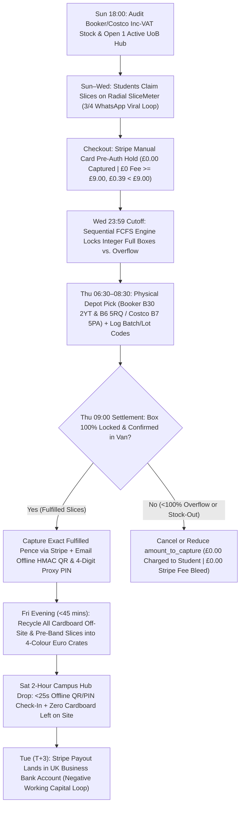
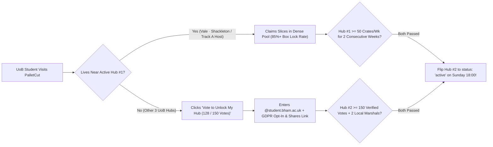

# PalletCut (SplitBox) — The Master Founder's Business & Operating Playbook

**Edition:** University of Birmingham (UoB) Launch Manual (`@student.bham.ac.uk`)  
**Product Identity Note:** User-facing storefront brand is **PalletCut** *(formerly **SplitBox**; internal repository paths, `--sb-*` CSS design tokens, and `SPLITBOX_CATALOG` / `PALLETCUT_CATALOG` symbols are preserved for zero-regression stability)*.  
**Purpose:** Read this manual cover-to-cover in one sitting (`~45 minutes`) to master every financial, UK legal, wholesale supply-chain, campus growth, investor-pitch, and post-Antigravity engineering system in PalletCut—and execute step-by-step to turn this codebase into a legally compliant, cash-generating UK company for **under `£200`**.

> [!IMPORTANT]
> **Your Single-Sitting Master Manual + 5 Deep-Dive Execution Volumes:** This root playbook gives you every governing rule, worked GBP (`£`) model, script, and launch gate in one cohesive narrative. Whenever you need full statutory templates—such as the England & Wales `/terms` page, the 1-page UK HSE Risk Assessment & Method Statement (RAMS), or Challenger Brand sponsorship emails—jump directly into the linked companion volume:

| Volume | Companion Deep-Dive File | High-Leverage Templates & Reference Tables Inside |
| :--- | :--- | :--- |
| **Vol. 01** | [playbook/01-unit-economics-and-financial-model.md](playbook/01-unit-economics-and-financial-model.md) | Integer-pence margin physics across all 14 UoB SKUs, Stage 1 vs. Stage 2 HMRC VAT formulas, Stripe UK domestic vs. international card P&Ls, and 30-week Drop #1 to 5-campus EBITDA scenarios. |
| **Vol. 02** | [playbook/02-uk-legal-regulatory-and-compliance.md](playbook/02-uk-legal-regulatory-and-compliance.md) | Home Office Student Visa (`ST 26.5`) rules, `£50` Companies House `Ltd` setup, free Birmingham City Council FBO filing text, 60-second UK FIR 2014 & GB CLP label checklist, FCA pre-auth boundary, CRA 2015 restocking rules, and full UK `/terms` skeleton. |
| **Vol. 03** | [playbook/03-wholesale-supply-chain-and-drop-ops.md](playbook/03-wholesale-supply-chain-and-drop-ops.md) | Birmingham Cash & Carry postcodes (`Booker Stirchley B30 2YT`, `Booker Aston B6 5RQ`, `Costco Nechells B7 5PA`, `Bestway`, `Dhamecha`, `Wing Yip`), Challenger Brand `£250` crate-sponsorship outreach email, van payload math, `<45m` Euro-crate pre-sort, and `<25s` Saturday Hub SOP. |
| **Vol. 04** | [playbook/04-uob-campus-gtm-estates-and-pitching.md](playbook/04-uob-campus-gtm-estates-and-pitching.md) | Single-hub liquidity proof, 7-day permissionless Selly Oak launch (`Track A`), official `Vale · Shackleton` Sustainability & Residence Life email + 1-page UK HSE RAMS (`Track B`), WhatsApp viral scripts, A5 ASA-compliant flyer, `B-Enterprising` grants, and UK SEIS `50%` angel tax math. |
| **Vol. 05** | [playbook/05-post-antigravity-24h-to-drop1-roadmap.md](playbook/05-post-antigravity-24h-to-drop1-roadmap.md) | Final-hours Antigravity verification & backup runbook, `£0.00/mo` `@student.bham.ac.uk` stack (`Copilot Pro + Cloudflare + Supabase + Stripe + Resend`), 48h Concierge MVP vs. Live Postgres RPC path, Stripe 7–14 day first-payout survival protocol, Day-1-to-Day-30 calendar, and KPI gates. |

---

## Part 0 — The 5-Minute Executive Mental Model

### 0.1 Why PalletCut Wins Where Getir, Gorillas & Gopuff Burned Billions

Over 38,000 students at the University of Birmingham—especially car-free undergraduates in **The Vale Village** (`Shackleton`, `Chamberlain`, `Maple Bank`, `Tennis Courts`, `Mason`), **Pritchatts Park** (`Ashcroft`, `Oakley Court`), and shared HMOs across **Selly Oak** (`Bristol Road`, `Dawlish Road`, `Tiverton Road`, `Bournbrook`)—get squeezed every week by the **"Single-Unit Convenience Tax"**:
- Walking down Bristol Road (`B29`) to convenience stores means paying **`35%–45%` markups** (`£2.20` for 1L of Oatly Barista = **`£6.60` for 3 cartons**; `£9.50` for laundry capsules) and hauling `10kg` carrier bags 20 minutes uphill in November rain.
- Buying wholesale alone is impossible: **85% of halls students have no car** to drive to Costco Nechells (`B7 5PA`) or Booker Stirchley (`B30 2YT`), **no trade card**, **zero under-bed storage** for a 48-roll toilet tissue carton, and **zero appetite** to chase five flatmates for bank transfers.

Rapid-delivery grocery startups (*Getir*, *Gorillas*, *Gopuff*, *Weezy*) raised billions promising 15-minute couriers to student doors and collapsed across the UK because every `£12.00` student order carried **three permanent cost anchors** that `22%` grocery spreads can never cover:

| Structural Cost Driver | Rapid Courier App (*Getir / Deliveroo Hop*) | Selly Oak Convenience Store (*Bristol Rd Express / Local*) | PalletCut Weekly Campus Drop (*UoB Model*) |
| :--- | :--- | :--- | :--- |
| **Inventory & Property Risk** | Leased dark store + 2,000 speculative SKUs (`3%–6%` weekly spoilage) | Prime Bristol Rd retail rent, rates & single-unit shrinkage | **Pre-committed demand only:** `100%` locked wholesale cases, **`£0.00` unsold stock**, `0%` spoilage |
| **Cold Chain & Food Prep** | Walk-in chillers, freezers & insulated bags | 24/7 store refrigeration banks | **Zero cold chain:** `100%` factory-sealed, UK FIR-labelled ambient retail sub-units |
| **Last-Mile Topology** | `1` rider (`£13–£15/hr`) -> `1` door (`£4.20–£5.50` labour/bag!) | Student walks 20m uphill carrying heavy bags | **`1` van -> `1` Saturday 2h Hub -> `40–60` orders handed out in `<25s` each** |
| **Fulfilment Cost / Order** | **`£4.20 – £5.50`** | Baked into `35%–45%` shelf markup | **`£0.80 – £1.25`/order** at `40–60` orders (`<£1.60` at `30` orders!) |
| **Student Fee (`>= £9.00` Crate)** | `£3.50–£6.00` delivery + small-order + service fees | `£0.00` fee, punitive single-unit prices | **`£0.00` delivery & crate fee** (`£0.39` card-cover only on micro-crates `< £9.00`) |

**Why Both Sides Win on Day 1:** PalletCut buys a `12 × 1L` Oatly Barista case at wholesale for **`£13.20` (`£3.30` per `3 × 1L` Slice)** and sells each Slice for **`£4.20`** (vs. `£6.60` Selly Oak benchmark). The student saves **`£2.40` (`36%`)** with `£0.00` crate fees (`>= £9.00`), while PalletCut earns **`£0.90`/slice (`21.4%` gross margin)**. At `~£2.25` net order contribution after Stripe fees, **a single UoB hub breaks even at just `22` weekly student orders**!

---

### 0.2 Operating Vocabulary & The 3 Non-Negotiable Laws of PalletCut

Speak with crisp, consistent domain terms across your storefront, pitches, and legal terms:
- **Box:** One complete manufacturer wholesale outer case (e.g., `12 × 1L` Oatly tray or `4 × 2kg` Tilda Basmati trade outer).
- **Slice:** One pre-defined, factory-sealed retail share of a Box (e.g., `3 × 1L` Oatly cartons for `£4.20`, or `1 × 2kg` sealed rice bag for `£4.50`).
- **Box Pool & `<SliceMeter />`:** The live hub-specific radial SVG dial showing `X/Y` slices claimed in the currently open Box (`#10D48E` mint stranger wedges, popped `#FF6B1A` tangerine user wedges).
- **Card Pre-Authorisation Hold:** Stripe `capture_method: 'manual'` temporary ring-fence (`£0.00` captured until box lock—**never** called `"escrow"` in Live UI!).
- **Flatmate Proxy PIN:** The 4-digit check-in PIN alongside `<QRCodeSVG />` allowing any trusted flatmate to collect a student's Saturday crate in `15 seconds`.

**Obey these 3 Non-Negotiable Laws every single week—breaking any one of them breaks the business:**

1. **Law 1 — 100% Locked Wholesale Boxes Before Buying (`£0.00` Inventory Risk):**
   - Slices allocate strictly **First-Come, First-Served (`FCFS`)** across sequential case boundaries (`Box #1`, `Box #2`, …). Claiming `2` slices on a `3/4` Oatly pool assigns **Slice 1 -> `Box #1` (`4/4` Locked & Guaranteed)** and **Slice 2 -> `Box #2` (`1/4` Pooling)**.
   - At Wednesday `23:59` cutoff, only `100%` full boxes (`Math.floor(totalSlices / slicesPerBox)`) are purchased on Thursday morning. Unfilled `<100%` overflow slices are released uncaptured (`£0.00` charged to the student, **`£0.00` Stripe fee bleed**).
2. **Law 2 — 100% Factory-Sealed, Ambient, UK FIR-Labelled Sub-Units:**
   - **Zero refrigeration** and **zero decanting/scooping** (never scoop a `20kg` rice sack into pouches or count loose laundry pods into bags).
   - Every Slice handed to a student must carry standalone English **UK Food Information Regulations 2014 (FIR)** print (**14 allergens emphasised inline in bold**, ingredients, net weight, `Best Before`, Lot code, UK FBO address) or intact **`GB CLP`** child-impeding tubs/pouches transported in segregated **`NON-FOOD`** Euro crates.
3. **Law 3 — Hyper-Dense Single-Hub Launches (`85%+` Box Lock Rate):**
   - Each campus hub maintains an isolated physical `HubDropLedger`. Splitting 20 early orders across 4 UoB hubs produces `~1` slice per pool (**`80%` failed-box cancellations**).
   - Launch with **1 active pickup hub (`Vale · Shackleton`, `status: 'active'`)**—or flip **`Selly Oak · Bristol Rd`** active first for a 7-day permissionless private-host launch while Vale Estates clears—and keep the other **3 UoB hubs on `status: 'coming_soon'` (`"Vote to Unlock Next"`)** until Hub #1 clears **`50+` weekly crates at `>=85%` Box Lock Rate for 2 consecutive weeks**.

---

### 0.3 The Complete Sunday-to-Saturday Operating Flowchart



---

## Part 1 — Money, Pricing, VAT & Stripe Cashflow Physics

*Deep-Dive Reference:* [playbook/01-unit-economics-and-financial-model.md](playbook/01-unit-economics-and-financial-model.md)

### 1.1 Master Unit Economics Table Across All 14 UoB Catalog SKUs (`src/data/catalog.ts`)

Every monetary calculation in `src/data/catalog.ts` and `src/store/dropEngine.ts` uses **integer GBP pence** (`toPence` / `fromPence`, e.g. `£4.20 = 420p`). Below are all **14 UoB catalog SKUs** priced off **landed `inc-VAT` Cash & Carry cost** (the exact cash price an unregistered `<£90,000` UK startup pays at the Booker or Costco checkout today):

| UoB Catalog SKU (`src/data/catalog.ts`) | UK VAT | Case (`ex-VAT`) | Case (`inc-VAT`) | Slices / Box | Cost / Slice (`inc-VAT`) | PalletCut Price | Selly Oak Benchmark | Student Saving | Gross Margin (`£` / `%`) |
| :--- | :---: | :---: | :---: | :---: | :---: | :---: | :---: | :---: | :---: |
| **Oatly Barista Ambient** (`12×1L` -> `3×1L`/slice) | `0%` | `£13.20` | `£13.20` | `4` | `£3.30` (`330p`) | **`£4.20`** (`420p`) | `£6.60` | `£2.40` (**`36%`**) | **`£0.90` (`21.4%`)** |
| **Mutti Polpa Tomatoes** (`24×400g` -> `4-pack`/slice) | `0%` | `£15.60` | `£15.60` | `6`* | `£2.60` (`260p`) | **`£3.30`** (`330p`) | `£5.40` | `£2.10` (**`39%`**) | **`£0.70` (`21.2%`)** |
| **Bamboo 3-Ply Loo Roll** (`48-roll` -> `6-roll`/slice) | `20%` | `£25.00` | `£30.00` | `8`* | `£3.75` (`375p`) | **`£4.80`** (`480p`) | `£7.50` | `£2.70` (**`36%`**) | **`£1.05` (`21.9%`)** |
| **Tilda Pure Basmati Rice** (`4×2kg` -> `1×2kg`/slice) | `0%` | `£14.20` | `£14.20` | `4` | `£3.55` (`355p`) | **`£4.50`** (`450p`) | `£7.25` | `£2.75` (**`38%`**) | **`£0.95` (`21.1%`)** |
| **TREK Cocoa Oat Flapjacks** (`24×50g` -> `4-bar`/slice) | `20%`† | `£11.00` | `£13.20` | `6`* | `£2.20` (`220p`) | **`£2.80`** (`280p`) | `£4.50` | `£1.70` (**`38%`**) | **`£0.60` (`21.4%`)** |
| **Fairy Non-Bio Laundry Pods** (`4×28w` -> `1 tub`/slice) | `20%` | `£15.17` | `£18.20` | `4` | `£4.55` (`455p`) | **`£5.90`** (`590p`) | `£9.50` | `£3.60` (**`38%`**) | **`£1.35` (`22.9%`)** |
| **Nongshim Shin Ramyun** (`20×120g` -> `5-pack`/slice) | `0%` | `£11.80` | `£11.80` | `4` | `£2.95` (`295p`) | **`£3.75`** (`375p`) | `£6.25` | `£2.50` (**`40%`**) | **`£0.80` (`21.3%`)** |
| **Easy-Peeler Clementines** (`6×1kg` -> `1kg net`/slice) | `0%` | `£8.88` | `£8.88` | `6`* | `£1.48` (`148p`) | **`£1.85`** (`185p`) | `£3.00` | `£1.15` (**`38%`**) | **`£0.37` (`20.0%`)** |
| **Jimmy's Iced Coffee Cans** (`24×250ml` -> `4-pk`/slice) | `0%`‡ | `£18.30` | `£18.30` | `6`* | `£3.05` (`305p`) | **`£3.90`** (`390p`) | `£6.40` | `£2.50` (**`39%`**) | **`£0.85` (`21.8%`)** |
| **Garofalo Bronze-Die Penne** (`16×500g` -> `2×500g`/slice) | `0%` | `£16.64` | `£16.64` | `8`* | `£2.08` (`208p`) | **`£2.60`** (`260p`) | `£4.40` | `£1.80` (**`41%`**) | **`£0.52` (`20.0%`)** |
| **Pip & Nut Smooth PB 1kg** (`4×1kg` -> `1×1kg`/slice) | `0%` | `£15.20` | `£15.20` | `4` | `£3.80` (`380p`) | **`£4.95`** (`495p`) | `£7.80` | `£2.85` (**`37%`**) | **`£1.15` (`23.2%`)** |
| **Finish Ultimate Dish Tabs** (`6×34t` -> `1 pouch`/slice) | `20%` | `£20.00` | `£24.00` | `6`* | `£4.00` (`400p`) | **`£5.20`** (`520p`) | `£8.75` | `£3.55` (**`41%`**) | **`£1.20` (`23.1%`)** |
| **Minor Figures Masala Chai** (`12×1L` -> `2×1L`/slice) | `0%`‡ | `£21.60` | `£21.60` | `6`* | `£3.60` (`360p`) | **`£4.60`** (`460p`) | `£7.40` | `£2.80` (**`38%`**) | **`£1.00` (`21.7%`)** |
| **PROPER Sea Salt Lentil Chips** (`24×85g` -> `3×85g`/slice) | `20%`† | `£16.80` | `£20.16` | `8`* | `£2.52` (`252p`) | **`£3.15`** (`315p`) | `£5.25` | `£2.10` (**`40%`**) | **`£0.63` (`20.0%`)** |
| **14-SKU Equal-Weight Catalog Average** | — | `£15.96` | `£17.21` | `5.7` | `£3.10` (`310p`) | **`£3.96`** (`396p`) | `£6.43` | `£2.47` (**`38.5%`**) | **`£0.86` (`21.8%`)** |

*(`*`Drop #1–#3 Slice-Count Rule: Hold back `6`- and `8`-slice splits until a hub passes `80+` orders/wk—or simply double-bundle them into `3` or `4` slices per box, e.g. `4` slices of `12` Bamboo rolls for `£9.60`, to lock `85%+` of boxes on Day 1! `†`/`‡` Always verify `Z (0%)` vs `S (20%)` VAT codes on your Booker/Costco receipt: traditional oat flapjacks and `>=75%` milk drinks/tea qualify for `0%` under HMRC Notice `701/14`, whereas chocolate-coated protein bars, crisps, bottled water, and sweetened soft/energy drinks carry `20%` VAT.)*

---

### 1.2 The UK VAT Trap (`0%` Zero-Rated vs. `20%` Standard-Rated) & Exact Pricing Formulas

> [!WARNING]
> **The Cash & Carry Ex-VAT Shelf-Tag Trap:** Consumer UK prices must be VAT-inclusive, whereas Booker, Costco, and Bestway print **`ex-VAT` prices in huge bold text** on yellow shelf barkers! Before you cross the **`£90,000` rolling 12-month VAT registration threshold**, you charge `£0` Output VAT to students **and cannot reclaim the `20%` Input VAT paid at the Cash & Carry till**. Pricing a `£25.00 ex-VAT` (`£30.00 inc-VAT`) 48-roll tissue case off the `£25` tag (`£4.00`/slice instead of `£4.80`) slashes your gross profit from `£1.05` to `£0.25`—turning every pack of loo roll into a **`-£0.01` net cash loss** after Stripe!

- **Stage 1 (`< £90,000` Rolling 12-Month Turnover, Unregistered):** Price strictly off **`inc-VAT` landed till cost**. *(Watch the threshold monthly: `0%` zero-rated food sales legally count as taxable turnover toward `£90,000`!)*
- **Stage 2 (`>= £90,000` OR Voluntary "Repayment Trader" VAT Registration):** Because **`75%–85%` of PalletCut's volume is `0%` zero-rated ambient food staples** (`Oatly`, `Mutti`, `Tilda`, `Shin Ramyun`, `Garofalo`, `Pip & Nut`), registering voluntarily for VAT means your Output VAT on `0%` food stays **`£0.00`** while **HMRC refunds you `20%` Input VAT in cash every quarter** on Enterprise van hire, Euro crates, laptops, and packaging! (On `20%` household items post-registration, `1/6th` of the gross student price is Output VAT while supplier `20%` VAT is reclaimed—nudging `£4.80` tissue to `£5.00` preserves your full `£1.05` cash profit while still saving students `33%`.)

```text
STAGE 1 — NOT VAT-REGISTERED (< £90,000/yr):
  landedCaseCostPence    = caseCostExVatPence + ROUND(caseCostExVatPence * supplierVatRate)
  costPerSlicePence      = ROUND(landedCaseCostPence / slicesPerBox)
  minSlicePricePence     = CEIL(costPerSlicePence / (1 - targetMargin))

STAGE 2 — VAT-REGISTERED (Mandatory >= £90,000/yr OR Voluntary Repayment Trader):
  costPerSliceExVatPence = ROUND(caseCostExVatPence / slicesPerBox)
  outputVatPence         = IF(skuVatRate == 0.20, ROUND(slicePricePence / 6), 0)
  minSlicePricePence     = CEIL((costPerSliceExVatPence / (1 - targetMargin)) * (1 + skuVatRate))
```

---

### 1.3 Stripe UK Fee Physics, `£9.00` Micro-Crate Economics & Surviving the 7–14 Day Payout Lag

Stripe UK (`£0.00/mo` fixed fee, native **Apple Pay & Google Pay**) charges **`1.5% + £0.20`** on domestic UK cards and **`2.5% + £0.20`** on EEA/international student cards (`~25%–30%` of UoB buyers -> **`1.80% + £0.20` blended**). To stop the fixed `£0.20` charge from devouring small orders (or multiple 1-slice checkouts in the same week), Live Production Mode (`src/data/catalog.ts`) pairs **1 editable weekly `PaymentIntent` per student** with **`FREE_CRATE_THRESHOLD_PENCE = 900` (`£9.00+` = `£0.00` Free Crate)** and **`MICRO_CRATE_FEE_PENCE = 39` (`+£0.39` card-cover `< £9.00`)**:

| Worked Basket P&L (`21.4%` Product Margin) | `£3.50` 1-Slice (Naive `£0` Fee) | `£3.50` 1-Slice (**Live `+£0.39` Cover**) | `£12.50` 3-Slice (**Live `£0.00` Free Crate**) |
| :--- | :---: | :---: | :---: |
| **Product Gross Profit (`21.4%` after COGS)** | `£0.75` (`75p`) | `£0.75` (`75p`) | **`£2.68` (`268p`)** |
| **Crate Card-Cover Fee (`< £9.00` only)** | `£0.00` | `+£0.39` (`+39p`) | **`£0.00`** *(Free Crate Unlocked!)* |
| **Stripe Fee — UK (`1.5%+20p`) / Intl (`2.5%+20p`)** | `-£0.25` / `-£0.29` | `-£0.26` / `-£0.30` | `-£0.39` / `-£0.51` |
| **Net Contribution Profit (UK / Intl Card)** | `£0.50` / `£0.46` | **`£0.88` / `£0.84`** | **`£2.29` / `£2.17`** (**`18.3%` / `17.4%`**) |

*(Fairness Guardrail: Never retroactively charge `£0.39` at Thursday cutoff if a student qualified for a `>= £9.00` Free Crate at checkout and an unfilled overflow box reduced their settled total below `£9.00`.)*

> [!CAUTION]
> **Two Stripe UK Rules That Save Your Cashflow in Week 1:**
> 1. **Stripe NEVER Refunds Processing Fees on Captured Refunds — Use `capture_method: 'manual'`:** Capturing 40 slices upfront (`capture_method: 'automatic'`) and refunding unfilled pools on Wednesday night permanently loses `£0.26–£0.31` per refund (`£10.40–£12.40` burned on `£0` sales!). Instead, place a 7-day (`168h`) uncaptured **Card Pre-Authorisation Hold** (`Sun 18:00 -> Thu 09:00 = 87 hours`), pick physical cases at `06:30–08:30` Thursday, and run `capture({ amount_to_capture })` or `cancel()` at **`09:00` Thursday** for **`£0.00` Stripe fee bleed** on unfilled slices and depot stock-outs!
> 2. **Stripe Holds Your VERY FIRST Live Payout for `7–14` Calendar Days (`T+3` Business Days Thereafter):** Thursday `09:00` captures will **NOT** hit your bank before Friday's Costco run! **Step A:** Charge yourself **`£1.00` live via Apple Pay on Day 2** (`£0.22` fee) `10–12 days` before Drop #1 so the initial freeze expires early. **Step B:** Keep a **`£200–£300` revolving 96-hour transit float** (`0%` overdraft/credit card or `B-Enterprising` grant) to bridge Thursday wholesale checkout until Tuesday's Faster Payments payout returns `100%` of your float + `~£65` profit.

---

### 1.4 Negative Working Capital Timeline & Honest 30-Week Academic Year P&L Trajectory

Because sequential FCFS locks integer full boxes *before* you step inside Booker or Costco, you never hold dead stock—and once seasoned on `T+3` Stripe payouts, student cash hits your bank ~3 weeks before a 30-day business credit card statement falls due:

| Weekly Milestone | Operational Action | Inventory Risk | Cash & Stripe Position |
| :--- | :--- | :---: | :--- |
| **Sun `18:00` – Wed `23:59`** | Students claim slices at `1` active hub; Stripe places `capture_method: 'manual'` holds | **`£0.00`** | `£0.00` Stripe fees accrued; `100%` of slices backed by live issuing-bank holds. |
| **Wed `23:59` Cutoff** | Storefront closes; `dropEngine` resolves `lockedBoxes = FLOOR(claims / slicesPerBox)` | **`£0.00`** | Master PO outputs exact integer wholesale cases (`0` partial cases). |
| **Thu `06:30 – 08:30`** | Pick locked cases at `Booker B30 2YT / B6 5RQ` & `Costco B7 5PA`; log Batch/Lot codes | `100%` pre-sold | Paid via `£200–£300` transit float / `0%` business card; stock verified *before* capture. |
| **Thu `09:00` Settlement** | Batch `paymentIntents.capture({ amount_to_capture })` & `cancel()` unfilled/stock-out slices | `100%` matched | Zero Stripe refund-fee bleed; Stripe queues `T+3` UK Faster Payments payout. |
| **Sat `2-Hour` Hub Drop** | Offline QR + 4-digit PIN handoffs (`<25s`/student); folding Euro crates pack down flat | **`£0.00` left** | Zero campus storage, zero spoilage, zero cardboard waste left behind. |
| **Tue (`T+3` Payout)** | Stripe deposits Thursday's net GBP revenue into your `Mettle` / `Starling` Business account | **`£0.00`** | Transit float replenished `100%` + net gross profit ready for next Thursday! |

UK universities run **`30` high-density residential weeks/year** (plus `22` holiday weeks where PalletCut's zero-lease, zero-van, zero-perishable burn drops near `£0`):

| Financial Metric (`1.8% + 20p` Blended Stripe) | **Drop #1 Launch** (`Vale` Only, Solo) | **Drop #4 UoB Scale** (`4` UoB Hubs, Marshals) | **Mature UoB** (`4` Hubs + Brand Sampling) | **Year 2 Multi-Campus** (`5` Unis, `20` Hubs, VAT-Reg) |
| :--- | :---: | :---: | :---: | :---: |
| **Fulfilled Weekly Student Crates** | **`30` / wk** *(B/E: `22`)* | **`150` / wk** *(B/E: `75`)* | **`180` / wk** *(B/E: `57`)* | **`1,200` / wk** (`240`/uni) |
| **Average Order Value (AOV) & Weekly GMV** | `£12.00` · **`£360`** | `£13.00` · **`£1,950`** | `£13.50` · **`£2,430`** | `£14.00` · **`£16,800`** |
| **Order Contribution Profit (After COGS + Stripe)** | **`£67.58`** (`£2.25`/ord) | **`£372.33`** (`£2.48`/ord) | **`£489.50`** (`£2.72`/ord) | **`£3,800.12`** (`£3.17`/ord) |
| **FMCG Challenger Brand Crate Sampling** | `£0.00` | `£0.00` | `+£75.00 / wk` | `+£500.00 / wk` |
| **Weekly Fixed Hub Ops (Van + `£13/hr` Marshals + Ins.)** | `-£48.00` *(Founder solo)* | `-£185.00` | `-£230.00` | `-£1,650.00` |
| **Weekly Net Operating Profit (EBITDA)** | **`+£19.58 / wk`** (`5.4%`) | **`+£187.33 / wk`** (`9.6%`) | **`+£334.50 / wk`** (`13.8%`) | **`+£2,650.12 / wk`** (`15.8%`) |
| **30-Week Term-Time GMV / Net Cash Profit** | `£10,800` / **`+£587`** | `£58,500` / **`+£5,620`** | `£72,900` / **`+£10,035`** | `£504,000` / **`+£79,504`** |

---

## Part 2 — UK Legal, Food Safety, Labelling & Insurance Shield

*Deep-Dive Reference:* [playbook/02-uk-legal-regulatory-and-compliance.md](playbook/02-uk-legal-regulatory-and-compliance.md)

### 2.0 Master 7-Gate UK Pre-Launch Compliance Chronology

Clear these seven statutory English-law gates in strict chronological order before accepting live student funds:

| Timing Gate | Mandatory UK Compliance Action | Regulator / Authority | Statutory Cost | Consequence If Skipped |
| :--- | :--- | :--- | :---: | :--- |
| **Gate 0 (`Day 1`)** | **Verify Founder UK Visa Self-Employment Eligibility** | Home Office (UKVI `ST 26.5`) | `£0.00` | Visa curtailment & university expulsion if trading on a UK Student Visa |
| **Gate 1 (`T−28d`)** | **Register as a Food Business Operator (FBO)** | Birmingham City Council (`gov.uk`) | **`£0.00` (Free)** | Criminal offence under assimilated Reg `852/2004` & Hygiene Regs 2013 |
| **Gate 2 (`T−21d`)** | **Incorporate UK `Ltd` + Virtual Office + Business Bank** | Companies House & HMRC | **`£50.00`** *(+`~£40/yr`)* | Unlimited personal liability; Selly Oak home address scraped onto Google |
| **Gate 3 (`T−14d`)** | **60-Second Physical Sub-Unit Label & CLP Audit** | Trading Standards (`FIR 2014` / `CLP`) | `£0.00` | Unlimited fines for unlabelled inner multipacks or loose detergent pods |
| **Gate 4 (`T−7d`)** | **Dated Selly Oak Shelf Photos + CRA 2015 Live Terms** | ASA (`CAP 3.33`), CMA (`DMCCA 2024`) | `£0.00` | ASA takedown; unenforceable unfair `100%` 30-minute forfeiture clauses |
| **Gate 5 (`T−5d`)** | **Pay ICO Tier 1 Data Protection Fee** | ICO (`ico.org.uk`) | **`£35.00/yr`** *(DD)* | Civil penalty up to `£4,000` for storing `@student.bham.ac.uk` records |
| **Gate 6 (`T−3d`)** | **`£5m` Public/Product Liability + Commercial Motor Cover** | UoB Estates / Road Traffic Act s.143 | `~£10–£12/mo` | Campus ban; `IN10` (`6–8` points + licence loss!) on SD&P car insurance |

### 2.1 Gate 0: Founder UK Visa Check & `£50` Companies House Incorporation

Check your UK immigration right to be self-employed **before** touching Companies House or taking `£1`:

| Founder Immigration Status | Can Incorporate a UK `Ltd` / Trade Now? | Mandatory Action Path |
| :--- | :---: | :--- |
| **British / Irish Citizen, EUSS (Settled / Pre-Settled) or ILR** | **Yes — 100% Unrestricted** | Incorporate UK `Ltd` online (`£50`) and trade immediately. |
| **UK Graduate Visa (2-Year Post-Study) / Endorsed Innovator Founder** | **Yes — Permitted** | Incorporate and trade once Graduate Visa or UoB Elevate endorsement is granted. |
| **UK Student Visa (formerly Tier 4 — `Appendix Student ST 26.5`)** | **NO — Strictly Prohibited** | **STOP.** Self-employment, `Ltd` directorship, `>10%` active shares, or using a British flatmate as a "front" breaches visa law (even at `£0` pay). Build non-commercial code, enter ideation prizes (check **UoB IST** + **B-Enterprising**), and switch to a Graduate / Innovator Founder Visa on completion. |

**Incorporating Cleanly for `£50.00` (`gov.uk/limited-company-formation`):**
1. **Company Name & Virtual Address Privacy:** Register e.g. `PALLETCUT TECHNOLOGIES LTD` or `SPLITBOX UK LTD` (never use `"University of Birmingham"` or `"UoB"` in the corporate title). Under **ECCTA 2023**, PO Boxes are illegal, and Selly Oak student AST leases forbid company registration—buy a **`~£35–£60/yr` Virtual Registered Office + Director Service Address** (or ask **UoB Elevate at The Exchange**) so your student house is hidden from public Google scrapes.
2. **SIC Codes, SEIS Share Capital & Vesting:** Enter SIC **`47910`** (*Retail sale via Internet*) and **`47110`** (*Retail sale with food/beverages predominating*). Issue **`1,000,000` Ordinary Shares at `£0.0001` nominal (`£100` capital)**—single class, full-risk ordinary shares for **SEIS**—put every founder on **4-year reverse vesting with a 1-year cliff**, sign a **Deed of IP Assignment** (keeping code strictly separate from assessed UoB coursework), diarise **Accounts (`21m`)**, **`CT600` (`19%` Small Profits Corp Tax)**, and **`CS01` (`£34/yr`)**, and open a **`£0/mo` UK Business Bank Account** (**Mettle** includes free **FreeAgent** accounting; **Starling** or **Monzo Business Lite**).

---

### 2.2 Free Birmingham City Council FBO Registration (`T−28d`) & The 60-Second UK FIR Label Test

Storing and handing out `100%` pre-packed ambient groceries at a weekly pop-up legally requires **free (`£0.00`) Food Business Operator (FBO) registration** at **`gov.uk/food-business-registration`** under **Birmingham City Council** at least **28 calendar days before Drop #1** (`Retailer -> Online / distance selling + Mobile collection point`; registration cannot be refused). Paste this exact scope summary into the GOV.UK form:

```text
Online pre-ordered student grocery pooling platform supplying strictly 100% factory-sealed, shelf-stable ambient pre-packed groceries and sealed household essentials via a scheduled 2-hour weekly collection point in reusable food-grade crates. Zero open food handling, zero weighing/re-packing/decanting, zero hot food preparation, and zero chilled or frozen cold-chain storage.
```

Maintain **Food Safety Act 1990 s.21 due diligence** and **"One Step Back, One Step Forward" traceability (`Reg 178/2002`)** by buying solely on named Booker/Costco trade invoices, photographing every case's **Best Before + Batch/Lot (`L...`) code** on Thursday morning, and keeping `@student.bham.ac.uk` digital slice logs for `<60s` FSA recall alerts.

> [!IMPORTANT]
> **The Cash & Carry 60-Second Sub-Unit Label Audit (`UK FIR 2014`, `Natasha's Law` & `GB CLP`):** Splitting `12 × 1L Oatly` into four `3 × 1L` Slices is **100% legal**; scooping a `20kg` rice sack into pouches (**Natasha's Law PPDS trap**), handing out unlabelled inner foil bars, or splitting loose laundry pods is a **criminal offence carrying unlimited fines**. Pull **1 Slice sub-unit** out of the wholesale carton in the depot aisle and confirm all **7 checks** on the Slice unit itself:
> - [ ] **1. Factory Seal Unbroken?** Zero decanting/scooping; tamper strip intact.
> - [ ] **2. English Language?** Printed directly on the inner `5-pack` / `4-box` / bottle (not only on the outer brown shipping case!).
> - [ ] **3. All 14 UK Allergens Bolded Inline?** Emphasised **inside** the ingredients list (*Water, **Oats** (10%)*)—reject North American `"Contains:"`-only export labels!
> - [ ] **4. Legible Best Before (`>=30d`; `>=5d` citrus) + Lot Code (`L...`)?** Present on the Slice unit.
> - [ ] **5. Metric Net Weight/Volume & `kJ/kcal` per `100g/100ml` Nutrition Table?** Present on all food slices.
> - [ ] **6. UK (GB/NI) FBO Name & Postal Address?** Mandatory in Great Britain since Jan 2024.
> - [ ] **7. Chemical `GB CLP` & Citrus SMS Intact?** Child-impeding click-lock tubs (`Fairy 28w`) & pouches (`Finish 34t`) carry red-diamond GHS warnings and travel in a **dedicated stencilled `NON-FOOD` crate** away from porous food/fruit; `1kg` Clementine nets keep their Country-of-Origin + Class wine-glass tag.

---

### 2.3 FCA Pre-Auth Shield, CRA 2015 Uncollected Crates, ASA Proofs, GDPR & Car Insurance

1. **FCA Shield (`PSRs 2017`) — Delete `"Escrow"` From Live Copy:** Never hold pooled student funds in your bank account or offer a top-up cash wallet. Contract as **Principal Retailer (Merchant of Record)** using **Stripe Payments UK Ltd (`FCA FRN 900461`)** `capture_method: 'manual'` **"Card Pre-Authorisation Hold"**. Paste this exact disclosure above your Live checkout button:
   ```text
   CARD PRE-AUTHORISATION HOLD (£0.00 CAPTURED TODAY)
   • Placing your order authorises a temporary hold via Stripe Payments UK Ltd (£0.00 crate fee at £9.00+, or £0.39 micro-crate card cover under £9.00). Zero funds are captured today.
   • Edit or cancel freely until Wednesday 23:59 cutoff. On Thursday by 10:00, we capture ONLY slices inside 100% locked wholesale boxes confirmed in stock, and release unfilled overflow slices automatically (£0.00 charged).
   • Collect Saturday using your QR Pass or 4-digit Flatmate Proxy PIN. Uncollected sealed ambient crates receive a 24h rollover/refund option (minus a £2.00 handling & restocking fee; fresh fruit excluded—see Terms of Sale).
   ```
2. **CRA 2015 s.62 Uncollected Crate Fix:** Retaining `100%` of a student's payment after 30 minutes on long-life ambient groceries is an unenforceable unfair penalty under **Consumer Rights Act 2015 Schedule 2** (and collides with 14-day **CCR 2013** unopened ambient return rights). Use `T−30m` **Flatmate Proxy PIN** reminders (`80%` rescue) + **24h choice** of free rollover OR card refund **minus a cost-reflective `£2.00` restocking fee** (carving out fresh clementines under `CCR 2013 Reg 28(1)(c)` + optional unticked Community Pantry donation toggle).
3. **ASA CAP Rule 3.33, UK GDPR / ICO (`£35/yr` DD) & The `IN10` Motor Insurance Trap:**
   - **ASA Proofs:** Archive fortnightly timestamped shelf-tag photos from **Sainsbury's Local (`584 Bristol Rd, B29 6BE`)** and **Tesco Express (`526 Bristol Rd, B29 6BD`)** in `compliance-audit/` and print the verification date on cards/flyers.
   - **ICO & Anonymised Tickers:** Pay the **`£35/yr` Direct Debit (`£40` card) ICO Tier 1 fee** at `ico.org.uk` (ignore `£100` scam mailers!), host Supabase in **`eu-west-2` London**, and **strip flat/room numbers from Live activity feeds** (`"A student at Vale · Shackleton..."`—never `"Flat 12"`!).
   - **Campus & Vehicle Insurance:** Hold **`£5,000,000` Public & Product Liability** (`~£10–£12/mo`), add **Employers' Liability** (`~£5/mo`) *before* using any student marshal (`£2,500/day` fine if skipped), and **NEVER carry commercial stock on a standard Social, Domestic & Pleasure (SD&P) student car policy**—an ANPR stop voids cover and triggers **`IN10` (`6–8` penalty points + automatic licence revocation if driving `<2` years!)**. Hire an **Enterprise Car Club / Hertz 24/7 commercial van** (insurance included) or secure written **Class 1 Business ("Carriage of Own Goods")** cover.

#### Final 8-Point Pre-Drop #1 Legal Sign-Off
- [ ] Founder right-to-work / non-Student-Visa status verified (`ST 26.5`).
- [ ] Free Birmingham City Council FBO registration submitted `>=28 days` prior (or running non-food household bridge in Weeks 2–3).
- [ ] UK `Ltd` incorporated (`£50`, Virtual Office, SIC `47910`/`47110`) + dedicated `£0/mo` UK business bank account live.
- [ ] All active SKUs physically audited in-depot against the 7-point UK FIR / `GB CLP` label checklist + `NON-FOOD` crate stencilled.
- [ ] Live UI uses `"Card Pre-Authorisation Hold"`, transparent `£9.00`/`£0.39` rule (`DMCCA 2024`), and `£2.00` CRA 2015 restocking policy.
- [ ] Dated Selly Oak (`B29`) convenience shelf photos saved in `compliance-audit/`.
- [ ] ICO Tier 1 fee paid (`ico.org.uk`) + live activity ticker anonymised to hub level.
- [ ] `£5m` PLI (+ Employers' Liability before marshals) + commercial van hire or written Class 1 "Carriage of Own Goods" car cover saved.

---

## Part 3 — Birmingham Wholesale Supply Chain & Saturday Hub Execution

*Deep-Dive Reference:* [playbook/03-wholesale-supply-chain-and-drop-ops.md](playbook/03-wholesale-supply-chain-and-drop-ops.md)

### 3.1 Birmingham Wholesalers (`5–25 Mins` Away) & Challenger Brand Sponsorships

Bring one document wallet (**Photo ID + Companies House Certificate / BCC FBO Email + Business Bank Statement PDF**) in Week 1 to unlock all four depots:
- **Booker Wholesale Stirchley (`Pershore Rd, B30 2YT` — `1.5 mi / 6 mins`, `£0` Free Card):** Closest depot to Selly Oak & The Vale; check live branch stock at `booker.co.uk` and use Thursday **Click & Collect** (`Oatly`, `Mutti`, `Garofalo`, `Fairy`, `TREK`, `Clementines`).
- **Booker Wholesale Aston #402 (`85–87 Rocky Lane, Aston Cross, B6 5RQ` — `5.5 mi / 18 mins`, `£0` Same Card):** Deep flagship multipack stock (`Jimmy's Iced Coffee`, `Minor Figures Chai`, `Finish Tabs`) right on the A38 return route from Costco.
- **Costco Wholesale Birmingham (`100 Watson Rd, Nechells, B7 5PA` — `6.5 mi / 22 mins`, `£26.40/yr` inc-VAT Trade Card):** Best unit prices on `48-roll` Bamboo/Cushelle/Kirkland sub-packs, detergent tubs, `Pip & Nut`, and `PROPER`, plus quiet `10:00–12:00` weekday Trade Hours and valid business VAT invoices.
- **Bestway (`Saltley, B8 1JT`), Dhamecha (`Smethwick, B66 2AU`) & Wing Yip (`Nechells, B7 5NT` — `2 mins` from Costco, `£0` Free Trade Cards):** Unbeatable world staples for UoB's international societies (`Nongshim Shin Ramyun 20-pack = 4×5-packs`, `Tilda/Laila 4×2kg Basmati`—always check inner packs for UK English bolded allergens!).
- **Stage 2 (`100+` Weekly Crates):** Switch core staples to free delivered pallets via **CLF Distribution / Suma Wholefoods / Booker Delivered** (`+6%–12%` margin, `£0` van cost) and pitch UK Challenger Brand Field Marketing Managers (*Oatly*, *Minor Figures*, *Jimmy's*, *Huel*, *TREK*, *Smol*) **`£200–£500` Saturday Crate Drop Sponsorships** (`1` sample + QR flyer placed directly inside `150` verified UoB shared kitchens!).

---

### 3.2 Box-Divisibility Math & Worked `27-Case / 204.6kg` Thursday Master PO

Why `2–4` slices/box win early while `12`-slice boxes kill trust (`lockedBoxes = Math.floor(claims / slicesPerBox)`):

| `totalSlicesPerBox` | Example Case Split | Result at `5` Claims | Result at `9` Claims | Founder Verdict |
| :--- | :--- | :--- | :--- | :--- |
| **`2`–`3` Slices / Box** | `6×1L` Oatly (`2×3L`) or `24×400g` Mutti (`3×8 tins`) | `1–2` Boxes Lock (`60%–80%` fill) | `3–4` Boxes Lock (**`89%–100%` fill**) | **Bulletproof for Drops #1–#3**; lifts AOV past `£9.00`. |
| **`4` Slices / Box** | `12×1L` Oatly (`4×3L`), `4×2kg` Tilda, `20pk` Ramyun (`4×5pk`) | `1` Box Locks (**`80%` fill**) | `2` Boxes Lock (**`89%` fill**) | **The PalletCut Sweet Spot** (`3/4` WhatsApp 1-tap lock!). |
| **`6`–`8` Slices / Box** | `48-Roll` Bamboo (`8×6`), `16×500g` Garofalo (`8×2`) | **`0` Boxes Lock (`0%` fill!)** | `1` Box Locks (`67%–89%` fill) | **Stage 2 Only (`80+` hub orders)**; double-bundle on Week 1! |
| **`12` Slices / Box** | `12×1L` Oatly split into `12` single `1L` cartons (`£1.40`) | **`0` Boxes Lock (`0%` fill!)** | **`0` Boxes Lock (`0%` fill!)** | **NEVER DO THIS:** `0%` lock rate + crushed by `20p` Stripe fee. |

**Worked Thursday Morning Master Procurement Sheet (`42` Shackleton Orders -> `27` Integer Locked Cases):**

| Depot Stop & Postcode | SKU (`src/data/catalog.ts`) | Claimed | `Slices/Box` | **Buy (`lockedBoxes`)** | Released Overflow | Case (`inc-VAT`) | Spend (`£`) | Payload (`kg`) |
| :--- | :--- | :---: | :---: | :---: | :---: | :---: | :---: | :---: |
| **1. Booker Stirchley (`B30 2YT`)** | Oatly Barista (`12×1L`) | `22` | `4` | **`5` Cases** | `2` (`2/4`) | `£13.20` | `£66.00` | `63.0 kg` |
| **1. Booker Stirchley (`B30 2YT`)** | Mutti Polpa (`24×400g`) | `19` | `6` | **`3` Cases** | `1` (`1/6`) | `£15.60` | `£46.80` | `33.6 kg` |
| **1. Booker Stirchley (`B30 2YT`)** | Garofalo Penne (`16×500g`) | `17` | `8` | **`2` Cases** | `1` (`1/8`) | `£16.64` | `£33.28` | `16.8 kg` |
| **1. Booker Stirchley (`B30 2YT`)** | Jimmy's Iced Coffee (`24×250ml`) | `12` | `6` | **`2` Cases** | `0` (`0/6`) | `£18.30` | `£36.60` | `13.2 kg` |
| **1. Booker Stirchley (`B30 2YT`)** | Orchard Clementines (`6×1kg`) | `13` | `6` | **`2` Cases** | `1` (`1/6`) | `£8.88` | `£17.76` | `12.8 kg` |
| **2. Costco Nechells (`B7 5PA`)** | Bulk 3-Ply Loo Roll (`48-Roll`) | `25` | `8` | **`3` Cases** | `1` (`1/8`) | `£30.00` | `£90.00` | `22.2 kg` |
| **2. Costco Nechells (`B7 5PA`)** | Fairy Non-Bio (`4×28` Tubs) | `9` | `4` | **`2` Cases** | `1` (`1/4`) | `£18.20` | `£36.40` | `6.4 kg` |
| **2. Costco Nechells (`B7 5PA`)** | Pip & Nut Smooth PB (`4×1kg`) | `8` | `4` | **`2` Cases** | `0` (`0/4`) | `£15.20` | `£30.40` | `8.8 kg` |
| **3. Wing Yip (`B7 5NT`) / Dhamecha** | Nongshim Shin Ramyun (`20×120g`) | `18` | `4` | **`4` Cases** | `2` (`2/4`) | `£11.80` | `£47.20` | `11.2 kg` |
| **3. Wing Yip (`B7 5NT`) / Dhamecha** | Tilda Pure Basmati (`4×2kg`) | `9` | `4` | **`2` Cases** | `1` (`1/4`) | `£14.20` | `£28.40` | `16.6 kg` |
| **MASTER PO TOTAL (`10` SKUs)** | **`152` Fulfilled Slices** | `162` | — | **`27` Cases** | **`10` (`£0` fee)** | — | **`£432.84`** | **`204.6 kg`** |

*(Captured Student Revenue on those `27` locked cases = **`£552.00`** · Gross Wholesale Spread = **`£119.16` (`21.6%`)** · Dead Unsold Inventory = **`£0.00`**!)*

---

### 3.3 Van Physics, `<45-Min` Zero-Cardboard Pre-Sort & `<25s` Saturday Hub Choreography

1. **Carless Van Run (`~£38–£48` for 3h via Enterprise Car Club / Hertz 24/7 at Costco):** Standard UK Category B car licences cover `<3.5t` vans (check `19+/21+` car-club age tiers or recruit a 21+ postgrad Friday driver at `£14/hr`). Respect liquid weight (`1L = 1.05kg`): wheel `3–4` case stacks on a **`£38` folding sack truck**, strap heavy liquids/tins flat against the front bulkhead over the axles, and keep solo lifts `<=15kg`.
2. **Friday Evening `<45-Minute` Euro-Crate Pre-Sort:** Strip and recycle **100% of supplier cardboard off-site** at home, strap multi-carton slices (`3×1L Oatly`, `2×500g Pasta`) with kraft belly-bands into **1-grab units**, stick **4-colour category dots** (**Mint** Drinks, **Cobalt** Pantry, **Tangerine** Snacks/Fruit, **Yellow** segregated Household), and pack into `8` folding `600×400mm` food-grade Euro crates (`£65–£85` once; fold to `65mm` under a bed!) + `1` **Buffer Crate** (`2` spare Oatlys, wipes, emergency bags).
3. **The British-Rainproof `<25s` Saturday Pop-Up Bay (`144` Students/Hour):**

```text
   [ SINGLE-FILE QUEUE ALONG PERIMETER WALL — >=3m CLEAR OF DOORS & FIRE EXITS ]
          |
          v  "Morning! QR or 4-Digit PIN & Tote Bag Open Ready?"
   +------------------------------+------------------------------------+
   | CHECK-IN ZONE (Left 2ft)     | HANDOVER ZONE (Right 4ft)          |
   | • HubMarshallScannerCard PWA | • Picker places colour-coded       |
   | • 20,000mAh USB-C Power Bank |   pre-banded Slices for 2s count   |
   | • Waterproof A4 PIN Sheet    | • Student slides straight into bag |
   +------------------------------+------------------------------------+
        [ Marshal 1: Scanner ]             [ Marshal 2: Picker ]
   +------------------------------+ +----------------------------------+
   | FOOD CRATES (On 32cm Risers) | | HOUSEHOLD CRATES (Segregated!)   |
   | Mint Drinks & Cobalt Pantry  | | Yellow Loo Roll / Fairy / Buffer |
   +------------------------------+ +----------------------------------+
```

- **Outdoor Gazebo Safety & `<25s` Check-In Cadence:** Weight outdoor canopy legs with **`4 × 15kg = 60kg` ballast** (never pegs on tarmac!) and raise active food crates off wet paving on folded empty Euro-crate risers (`EC 852/2004`). Smooth the `12:00` sleep-in rush via `A–L` (`11:00–12:00`) / `M–Z` (`12:00–13:00`) waves + `15` free early-bird sample cans before `11:25`. Hit `<25 seconds` every time:
  - **`00s–04s`:** Eye contact with next student in line: *"Morning! QR or 4-digit PIN & bag open ready?"*
  - **`04s–09s`:** Scan `<QRCodeSVG />` (`UOB-BOX-XXXX`) or punch the **4-digit PIN** into `HubMarshallScannerCard` (or tick waterproof A4 backup sheet).
  - **`09s–19s`:** Call colour-coded pick list (*"1 Mint Oatly 3-pack, 1 Cobalt Tilda 2kg, 1 Cobalt Ramyun!"*) onto handover zone for 2-second visual check.
  - **`19s–25s`:** Tap **`Mark Collected`** (`collectedAt` replay-protection stamp) as student slides sealed packs into their tote bag.
- **Pre-Scripted Saturday Exception SOPs:**
  - *Dented Tin / Weeping Carton at Table:* Swap immediately from **Buffer Crate** (or issue exact pence partial refund + `£1.00` next-drop voucher and claim Booker/Costco credit note with batch photo).
  - *Depot Stock-Out on Thursday Morning:* Never substitute allergens silently and **never capture before picking**—deduct the out-of-stock SKU from `amount_to_capture` prior to Thursday `09:00` Stripe settlement (**`£0.00` Stripe fee bleed**) + add a `£1.00` apology credit.
- **15-Second Walk-Up Conversion Script (Never Sell Spot Stock Off the Table!):**
  > *"Everything in these crates was pre-locked by flatmates here before Wednesday midnight—that's how we get it 38% cheaper than Selly Oak with £0 delivery fees! I can't sell off the table today, **but scan this QR sign right now (takes 10 seconds)** to unlock tomorrow's 6pm Drop—and grab a free cold [Sample Bar/Can] on us!"*
- **Scaling With UoB Student Hub Marshals:** Pay **`£13.00/hr` (`2.5h` = `£32.50`) + a free `£15` retail-value crate (`~£9.50` wholesale cost) = `£42.00` true shift cost** (`£19/hr` perceived student value—covered by just **`14` orders**!). Recruit organised UoB Rowing/Athletics/MedSoc early-risers, require **`T−10m` setup** and **`T+35m` spotless zero-litter exit photos**, and service all 4 staggered UoB hub windows (`10:30` -> `11:00` -> `12:00` -> `13:00`) from **1 single hired van**.

---

## Part 4 — Winning University of Birmingham (Zero-Ad-Spend GTM, Estates & Funding)

*Deep-Dive Reference:* [playbook/04-uob-campus-gtm-estates-and-pitching.md](playbook/04-uob-campus-gtm-estates-and-pitching.md)

### 4.1 Marketplace Density Proof & Parallel Two-Track Venue Launch

With `20` early UoB orders (`60` claimed slices), opening all `4` hubs × `14` SKUs (`56` pools) averages `1.07` slices/pool (**`80%` cancellations = instant churn**), whereas concentrating `100%` of orders into **`1` active hub across `10` tight SKUs** averages `6.00` slices/pool (**`85.7%` Box Lock Rate, `90%` slice fill**). Keep the other `3` hubs on `status: 'coming_soon'` (`"Vote to Unlock"`):



**Run Both Venue Tracks in Parallel Starting Week 1:**
1. **Track A — Permissionless Selly Oak Launch in 7 Days (`B29`, Zero University Committees):** Partner with an independent coffee/bubble-tea shop or barber on Bristol Rd / Raddlebarn Rd (`£20–£25/Sat` + 50 guaranteed student coffee buyers) or a **paved off-street HMO driveway behind a boundary wall** on Dawlish/Tiverton Rd (`~£12.50` wholesale cost in free house groceries—strictly off the public pavement!).
   - *30-Second Selly Oak Café Walk-In Pitch:* *"Hi! Quick 30-second pitch—I'm [Name], a UoB student running a grocery click-and-collect club helping Selly Oak houses save 38% on sealed bulk staples like Oatly, Basmati rice, and loo roll. Everyone pre-orders online by Wednesday; we just need a tidy 2m × 2m corner on Saturdays `13:00–15:30` where 40 students scan a QR code in 20 seconds from sanitised crates. We carry £5m Public Liability insurance, leave zero cardboard, and pay **£25 every Saturday** plus give every student a coffee voucher for your till. Could we test a 1-Saturday trial next week?"*
2. **Track B — Official `Vale · Shackleton` & `Guild · Mermaid Sq` RAMS Approval:** Register with **UoB `B-Enterprising`** -> warm-intro the **UoB Sustainability Manager** (*50 consolidated crates cut ~20 Scope-3 courier van trips & 100% of secondary cardboard on Edgbaston Park Rd*) -> submit your merged PDF (**1-page UK HSE `5×5` RAMS + `£5m` PLI + BCC FBO receipt**) to **HAS Residence Life** for a **4-week Saturday `11:00–13:30` exterior Shackleton Forecourt pilot** (`>=3m` clear of doors, zero reception involvement), backed by spotless photos from your Selly Oak Track A drops!

---

### 4.2 Zero-CAC `3/4` WhatsApp Viral Scripts & The 52-Week Calendar Engine

When `<SliceMeter />` hits **`3/4 Slices Claimed — 1 Left to Lock!`**, the buyer shares to guarantee their own Saturday delivery (`<£1.80` blended CAC across UoB's 4 highest-velocity organic channels):

| Hyper-Local UoB Channel | Target Halls, Streets & Societies | Hero Catalog Hooks (`src/data/catalog.ts`) | Exact `£0`-Ad-Spend Conversion Play |
| :--- | :--- | :--- | :--- |
| **1. Vale Village Hall Chats** *(`~3,500` first-years)* | `Shackleton`, `Maple Bank`, `Tennis Courts`, `Chamberlain`, `Mason` | `Oatly (£4.20 vs £6.60)`, `Jimmy's (£3.90)`, `Mutti (£3.30)`, `Clementines (£1.85)` | Recruit **1 resident Hall Marshal per hall** (rewarded `1` free `£4.20` Oatly slice [`£3.30` cost] per `10` fulfilled hall crates = **`£0.33` CAC**). |
| **2. Selly Oak HMO Houses** *(`5–8` bed shared houses)* | `Dawlish Rd`, `Tiverton Rd`, `Heeley Rd`, `Hubert Rd`, `Bournbrook` | `Fairy 28w (£5.90 vs £9.50)`, `Finish (£5.20)`, `Bamboo (£4.80)`, `Garofalo (£2.60)` | **"1 House = 1 Instant Locked Box":** `4–6` housemates ordering together lock a full `4`-slice box of Oatly or Fairy in one checkout (`100%` guaranteed). |
| **3. Cultural & Intl Societies** *(`200–1,500` members)* | `CSSA`, `Malaysian Soc`, `Korean Soc`, `Indian Soc`, `ISOC`, `ACS / Nigerian Soc` | `Shin Ramyun 5-pk (£3.75 vs £6.25)`, `Tilda 2kg (£4.50)`, `Minor Figures Chai (£4.60)` | Give the Society Treasurer a `?soc=` link paying **`£0.50` per fulfilled crate** straight into the society's Guild events account. |
| **4. UBSport & Munrow Gym** + **Tue `19:30` Demos** | `UBBC Rowing`, `Rugby`, `Athletics`, `Barbell Club` + invited hall kitchens | `Pip & Nut 1kg (£4.95 vs £7.80)`, `TREK (£2.80)`, `Oatly (£4.20)`, `Basmati (£4.50)` | Appoint 1 Club Nutrition Captain for post-training Saturday pickup + run invited **`£4.40` Tuesday `19:30` Oatly Iced-Latte kitchen demos** (`15–20` live locks). |

- **Peer-to-Peer Flat/Hall WhatsApp Forward:**
  > *"Anyone in [Maple Bank / Dawlish Rd] want to split a case of Oatly or Shin Ramyun for Saturday? I just claimed a slice on PalletCut — 3x 1L Oatly Barista is £4.20 (vs £6.60 on Bristol Rd) and 5-pack Shin Ramyun is £3.75 (vs £6.25). Open box is at 3/4 right now and needs 1 last slice before Weds 23:59 to lock (£0 fee over £9, card pre-auth hold only so £0 taken if it doesn't fill): [link]"*
- **Wednesday `20:30` "Orphan Slice Rescue" Broadcast (`90%+` Lock Rate Booster):**
  > *"FINAL 3.5 HOURS: Drop closes 23:59 tonight! 14 boxes are 100% LOCKED — just 3 open boxes need 1 final slice for Saturday: Oatly 3x1L (£4.20, 3/4), Tilda Basmati 2kg (£4.50, 3/4), TREK 4-Box (£2.80, 5/6). Already ordered? Tap 'Edit My Weekly Crate' to add a rescue slice with £0 extra fee: [link]"*

**Turning the 22 Student Holiday Weeks Into High-Margin Cash + Cloning Cities (`<£400`):**

| Calendar Window | UoB Campus Reality | Revenue & Retention Play | Margin / Cash Impact |
| :--- | :--- | :--- | :--- |
| **Term-Time (`30–32` wks)** | Weekly staple depletion | Sat `14:30` cumulative `£` saved receipt + **1-Tap Re-Slice** into Sunday's Drop | **`45%–60%` repeat buyer rate** at `£0` ad spend |
| **June Move-Out (`Wks 10–11`)** | Selly Oak HMO `£500` deposit cleans | **"Deposit-Saver Shared-House Cleaning Box"** (sealed `GB CLP` sprays, sacks, Finish tabs) | **`28%–32%` gross margin** during exam taper |
| **Summer Term (`Jul–Sep`, `14` wks)** | `12,000+` MSc & intl postgrads stay | Consolidate to **1 Summer Hub** (`Selly Oak` / `Guild`) heavy on `Rice`, `Ramyun`, `Oatly` | **`40–75` profitable crates/wk** all summer |
| **Mid-Aug -> Sept Arrivals** | `8,000+` incoming Vale/Pritchatts freshers | Pre-sell **`£34.00` "UoB Week-1 Survival Crate"** (`capture_method: 'automatic'` fixed bundle!) | **`200` crates = `£6,800` Aug cash (`~£1,900` net)** |

*(Multi-City Expansion: Once UoB matures, clone Track A + Track B + local `<15m` Booker/Costco depots into **Nottingham [`Lenton NG7`]**, **Manchester [`Fallowfield M14`]**, **Leeds [`Hyde Park LS6`]**, and **Sheffield [`Endcliffe Village`]** for `<£400` per city using `150` pre-warmed `.ac.uk` votes, a `£140` couriered Euro-crate kit, and a merchant-locked Thursday PO card.)*

---

### 4.3 Non-Dilutive Grants, UK SEIS `50%` Tax Math, 3-Min Demo & Investor Q&A Shield

1. **Stack `0%`-Dilution Grants First:** Apply immediately to **UoB `B-Enterprising` Startup Grants (`£500–£5,000` + free UoB Elevate desk)**, **Santander X UK Awards (`£5,000–£25,000`)**, **Innovate UK Young Innovators (`£5,000–£15,000`)**, and **UnLtd (`£500–£8,000`)**.
2. **UK SEIS (`£250,000` Cap) — Why a `£10,000` UK Angel Cheque Risks Just `£2,750`:**
   Put this exact HMRC tax-relief breakdown in front of UK alumni angels, FMCG executives, and PBSA operators (subscribe in cash for **new full-risk ordinary shares** with zero liquidation preference, and file **SEIS Advance Assurance** free on `gov.uk` once you hold `1` named prospective angel intent letter):

   | UK SEIS Tax Lever *(45% Additional-Rate UK Taxpayer Investing `£10,000`)* | Exact HMRC Relief | Angel's Net Cash Position |
   | :--- | :--- | :--- |
   | **Initial Subscription into UK `Ltd`** (`<3 yrs` trading, `<£350k` assets) | `£10,000.00` ordinary shares | `£10,000` gross cheque |
   | **1. `50%` Upfront Income Tax Relief (`SEIS3` Certificate)** | `-£5,000.00` off UK Income Tax bill | **Day-1 Net Cash at Risk = `£5,000`** |
   | **2. Optional `50%` CGT Reinvestment Relief** *(rolling over a `24%` gain)* | `-£1,200.00` CGT permanently wiped | Effective net cost drops to **`£3,800`** |
   | **3. `10x` Exit Upside** *(held `>= 3 years`, stake grows to `£100,000`)* | **`0%` Capital Gains Tax** (`£21.6k` saved!) | **`£100,000` tax-free (`20x` on `£5k` net)** |
   | **4. Total Wipeout Downside** *(company fails at `£0.00`)* | `-£2,250.00` (`45%` Loss Relief on `£5k`) | **Max Worst-Case Net Loss = `£2,750` (`27.5p`/`£1`)** |
3. **Your 4-Beat, 3-Minute Offline Demo Script + 8 Investor & Estates Objection Killers:**
   - **Live Laptop Flow (`Wi-Fi OFF`):** *(0:00–0:45)* Show **`Vale · Shackleton`** active & **`Oatly Barista` (`£4.20` vs `£6.60` Selly Oak — Save `36%`, `£0` fee `>=£9`)** at `3/4`. *(0:45–1:30)* Add **`2` slices** -> prove sequential FCFS (`Box #1` locks `4/4`; `Box #2` opens `1/4`). *(1:30–2:15)* Click **Trigger Cutoff** -> show perforated GBP Settlement Receipt (`Box #1` captured; `Box #2` released uncaptured at `£0` fee). *(2:15–3:00)* Show offline `<QRCodeSVG />` + **4-Digit Proxy PIN**, **Hub Ops** integer-case manifest, **Investor X-Ray**, and **`375px` mobile view**.
   - **Crisp Answers to the 8 Hardest Questions:**
     1. *Getir/Gorillas died?* They burned `£4.20–£5.50`/bag in solo courier wages + dark-store cold chains; our 2-hour batch hub costs `£0.80–£1.25`/order with `£0` inventory risk, breaking even at `22` weekly orders.
     2. *Won't Tesco Express match prices?* `3,000 sq ft` high-street convenience formats depend structurally on `35%–45%` single-unit markups, and `85%` of halls students lack a car or trade card to haul `12.6kg` wholesale trays.
     3. *Students graduate every June?* Every September UoB delivers `8,000` fresh car-free first-years into the exact same Vale buildings at `<£1.80` organic CAC (`~£28.35` Yr-1 net contribution -> **`>15x` Yr-1 LTV:CAC**).
     4. *Unfilled boxes burn Stripe refund fees & trust?* `capture_method: 'manual'` holds settled Thursday `09:00` post-pick mean unfilled/out-of-stock slices cost **`£0.00` in Stripe fees**, while single-hub `2–4` slice curation + Wed `20:30` rescue alerts lock **`85%–92%`** of boxes.
     5. *Weekend copycat app?* Software isn't the moat—local hub pool liquidity is (`60` orders = `90%` fill vs. copycat's `8` orders = `85%` failed-box cancellations), reinforced by signed UoB Estates RAMS permits and brand rebates.
     6. *Unlicensed FCA escrow or Natasha's Law risk?* Principal B2C seller via FCA-authorised Stripe (`FRN 900461`) manual holds (zero pooled escrow funds); BCC FBO registered `28d` prior + `100%` sealed ambient UK FIR / `GB CLP` retail sub-packs.
     7. *Saturday student no-shows?* Pre-authorised `~£13.50` stakes + **4-Digit Flatmate Proxy PIN** drive `95%+` pickup; stragglers get a CRA 2015-compliant 24h rollover or refund minus a fair `£2.00` restocking fee (`0` spoilage, `0` chargebacks).
     8. *Venture scale or campus side-hustle?* `2.9m` UK students spend `£3.8bn+/yr` across `35` carbon-copy campus corridors (`15%` of top 25 cities = `£55m+` negative-working-capital GMV) + `80%`-margin FMCG Challenger Brand kitchen sampling sponsorships.

---

## Part 5 — Your Next 24 Hours (Post-Antigravity) & 30-Day Launch Master Checklist

*Deep-Dive Reference:* [playbook/05-post-antigravity-24h-to-drop1-roadmap.md](playbook/05-post-antigravity-24h-to-drop1-roadmap.md)

### 5.1 Tonight's Pre-Expiry Lockdown & Your `£0.00/Month` `@student.bham.ac.uk` Stack

Execute these exact terminal commands in `/home/hacksday/Documents/project` before your 24-hour Antigravity window closes:

```bash
# 1. Run TypeScript build, unit tests, zero-CDN asset check & 100% GBP (£) currency QA gate
npm install && npm run typecheck && npm run verify && npm run build

# 2. Commit everything — NEVER git-ignore .agents/, .github/copilot-instructions.md, AGENTS.md, CLAUDE.md, docs/, or playbook/!
git status && git add -A
git commit -m "chore(release): lock post-antigravity PalletCut (SplitBox) UoB MVP, specs, and founder playbooks"

# 3. Push to your PRIVATE founder GitHub repo + archive an offline USB/OneDrive tarball
git branch -M main
git remote add origin https://github.com/<YOUR-USERNAME>/palletcut-uob.git
git push -u origin main
tar --exclude='node_modules' --exclude='dist' -czf ../palletcut-uob-complete-backup.tar.gz .
```

**Activate Your `£0.00/Month` Production Stack Tonight Using `@student.bham.ac.uk`:**

| Stack Layer | Provider & Tier | UoB Student Cost | Exact Role After Antigravity Expires |
| :--- | :--- | :---: | :--- |
| **AI Coding in VS Code** | **GitHub Copilot Pro** (`education.github.com/pack`) + **Cursor / Claude Free** | **`£0.00 / mo`** | Auto-loads `.github/copilot-instructions.md` & `AGENTS.md`. Always run **`npm run verify`** before committing! |
| **Domain & Static Hosting** | **Student Pack Free Domain** + **Cloudflare Pages** (`dist/`) | **`£0.00 / mo`** | Unlimited static hosting for live storefront (`palletcut.me`) + offline-capable pitch simulator (`VITE_DEMO_MODE=true`). |
| **Auth, DB & Realtime** | **Supabase Free Tier** (`eu-west-2` London) | **`£0.00 / mo`** | UK GDPR London Postgres (`SELECT ... FOR UPDATE` pool lock), `50k` MAU `@student.bham.ac.uk` OTPs, Edge Functions. |
| **UK Cards & Mobile Wallets** | **Stripe UK** (`capture_method: 'manual'`) | **`£0.00 / mo` fixed** | Verify domain in 2m for **Apple Pay & Google Pay** (`85%+` of student mobile checkouts!); `£0` fee on cancelled holds. |
| **Auth & Pass Emails** | **Resend Free Tier** (`3,000` emails/mo) | **`£0.00 / mo`** | Plug into Supabase SMTP (lifts Supabase's `2-emails/hr` dev limit!) + send Thursday GBP receipts & QR passes. |

---

### 5.2 Honest `localStorage` Gap Audit & Two Paths to Drop #1 Revenue

Know exactly what works tonight vs. what requires a shared backend across separate student phones:

| Capability | Current Prototype (`localStorage`) | Gap Across `30` Separate Student Smartphones |
| :--- | :--- | :--- |
| **Storefront, Math & `375px` UI** | **100% Complete** (`14` GBP SKUs, `<SliceMeter />`, Hub Ops, Investor X-Ray). | None visually—deploy static catalog to Cloudflare Pages tonight. |
| **Shared Pool Counts (`3/4 -> 4/4`)** | Persists inside **one browser's** `localStorage` (`splitbox_uob_drop_v1`). | **Phone A cannot see Phone B** without a shared ledger (Google Sheet in Path 1; Supabase Postgres in Path 2). |
| **Real Card Holds & Thursday Capture** | Simulates integer-pence holds & cutoff in browser memory. | Needs real **Stripe Apple Pay / Google Pay** (`Payment Links` in Path 1; `PaymentIntents` Edge Function in Path 2). |
| **Saturday QR + PIN Verification** | Renders offline `<QRCodeSVG />` + 4-digit PIN locally. | Marshal table needs a shared master manifest (iPad/printed sheet at `25` orders; WebCrypto HMAC sync at `50+`). |

> [!TIP]
> **Ship Revenue First — Path 1 (48h Concierge Drop #1) -> Path 2 (Automated Live Stack):**
> - **Path 1 (`<= 30` Orders This Week, `0` Backend Risk):** Host the static Vite catalog on Cloudflare Pages, pick **1 hub & 8 `2–4` slice SKUs**, collect real Apple Pay orders via a free **Tally.so + Stripe Checkout (`£9.00+` Free Crate / `£0.39` `<£9.00`, manual capture)** form, post nightly `19:00` `3/4` pool updates from a Google Sheet into WhatsApp, buy integer locked cases Thursday, and tick off `UOB-01..30` PINs Saturday in `<20s`.
> - **Path 2 (`30+` Orders/Wk, ~3 Evenings in VS Code w/ Copilot Pro):** Wire `stripe_supabase_live` (`docs/architecture/fullstack-blueprint.md`): Supabase `@student.bham.ac.uk` OTP + Resend SMTP, Postgres `claim_sequential_slices` (`SELECT ... FOR UPDATE`), Stripe `capture_method: 'manual'` Apple/Google Pay, and Thursday `09:00` post-pick `capture({ amount_to_capture })` / `cancel()` + offline **HMAC-SHA256 QR Passes**.

---

### 5.3 `< £200` Startup Budget, Day-1-to-Day-30 Master Checklist & North Star KPIs

- **Ultra-Lean Validation (`£45.00` ops — `£92.00` w/ ICO `£35` + Month-1 `£5m` PLI `£12`):** Free BCC FBO (`£0`), free Booker Stirchley card (`£0`), totes + 4-colour stickers (`£10`), 2h Booker car-club share (`£20`), A5 QR flyers + table sign (`£15`), plus **`£150–£200` revolving 7-day Stripe transit float**.
- **Full Incorporated UK `Ltd` Launch (`£168.40 – £203.40` total):** Companies House `Ltd` (`£50`), ICO Tier 1 DD (`£35`), Booker (`£0`) + Costco Trade (`£26.40`), `5×` folding `600×400mm` Euro crates + stickers (`£30`), 3h Transit van (`£35`), signage (`£15`), Month-1 `£5m` PLI (`£12`), Virtual Office (`~£35/yr`), plus **`£250–£300` revolving transit float** (returned `100%` + profit every Tuesday!).

#### Master Day-1-to-Day-30 Launch Checklist (With the 100% Legal 28-Day FBO Bridge!)
- [ ] **Day 1 (Tonight):** Run `npm run verify && npm run build`, push private GitHub + `.tar.gz` backup, rehearse 3-min Airplane-Mode pitch, claim GitHub Student Pack (`Copilot Pro`), and deploy static catalog to Cloudflare Pages (`£0`).
- [ ] **Day 2 (Legal Clock Starts):** Verify UK visa right-to-work (`ST 26.5`), submit **free Birmingham City Council FBO registration** (`gov.uk/food-business-registration` — starts your **28-day statutory clock**!), incorporate UK `Ltd` (`£50`, Virtual Office, SIC `47910`/`47110`), and open `Mettle` / `Starling` Business banking.
- [ ] **Day 3 (Stripe Warmup + ICO):** Activate **Stripe UK** (Apple/Google Pay), **run a `£1.00` live Apple Pay charge to yourself today** so the `7–14` day first-payout hold expires before Drop #1, and pay the **ICO** `£35` DD fee.
- [ ] **Day 4 (Birmingham Wholesaler Recon):** Open **Booker Stirchley (`B30 2YT`) / Aston (`B6 5RQ`)**, **Costco Nechells (`B7 5PA`)**, and **Bestway / Dhamecha / Wing Yip** trade cards; run the 60-second UK FIR / `GB CLP` inner-pack label test and verify `inc-VAT` (`0%` vs `20%`) till prices.
- [ ] **Day 5 (ASA Price Vault):** Photograph dated shelf tags at **Sainsbury's Local (`584 Bristol Rd, B29 6BE`)** & **Tesco Express (`526 Bristol Rd, B29 6BD`)** into `compliance-audit/`.
- [ ] **Day 6 (Track A + Track B Venues):** Lock your permissionless **Selly Oak Track A host** (`£20–£25` café corner or off-street HMO driveway) + `£5m` PLI (`£12/mo`); email **UoB `B-Enterprising`**, **Sustainability**, and **Vale Residence Life** with your 1-page Shackleton Forecourt RAMS (`Track B`).
- [ ] **Days 7–14 (Week 2 — Legal "Dorm Household Drop #1" Bridge!):** While Day 2's 28-day FBO food notice ticks down, either obtain written BCC EHO clearance to start sealed ambient early **OR run Weeks 2–3 as a 100% NON-FOOD "Dorm & House Essentials Drop"** (`Bamboo 48-Roll Tissue`, `Fairy 28-Wash Tubs`, `Finish 34-Tab Pouches`, `Kitchen Roll`, `Refuse Sacks` — **non-food household items require zero FBO registration!**). Validate `25–30` paid Apple Pay crates (`2–4` slices/box, 1 hub), Thursday `09:00` post-pick capture, and `<25s` Saturday QR/PIN check-ins!
- [ ] **Days 15–21 (Week 3 — Reconcile P&L & Cut Over to Path 2):** Audit exact penny margin after `1.5%/2.5% + 20p` Stripe fees, confirm `T+3` bank payouts unlocked, wire Supabase `eu-west-2` `SELECT ... FOR UPDATE` + Stripe manual capture in VS Code with Copilot Pro, and double Hub #1 to **`45–60` orders**.
- [ ] **Days 22–30 (Week 4 — Marshal #1, Grants/Estates & Full FBO Grocery Launch):** Add Employers' Liability (`~£5/mo`), hire UoB Hub Marshal #1 (`£13/hr + £15 crate`), pitch **`B-Enterprising` (`£500–£5,000` grant)** & **Vale Estates** with spotless Week 2–3 photos + `150` Shackleton waitlist votes, and—once **Day 28 clears**—unlock the full **`0%`-VAT Food + Drinks Catalog (`Oatly`, `Mutti`, `Tilda`, `Shin Ramyun`, `Pip & Nut`, `Jimmy's`)** + send your first **`£250` Challenger Brand Sponsorship** emails!

#### Weekly Sunday `11:00` North Star KPI Scorecard & Automated Pivot Triggers

| Weekly North Star KPI | Exact Calculation | Green (Scale Gate) | Red (Freeze New Hubs/SKUs & Execute Immediate Fix) |
| :--- | :--- | :---: | :--- |
| **1. Box Lock Rate** | `Locked Full-Box Slices ÷ Total Pre-Auth Slices` | **`>= 80%`** *(85%+ target)* | **`< 70%`:** Cut active menu to `8–10` staples, cap all boxes at `2–4` slices, send Wed `20:30` Orphan Slice Rescue alerts, freeze Hub #2. |
| **2. Net Contribution Margin** | `(Captured £ − Inc-VAT COGS − Stripe − Van/Marshal) ÷ Captured £` | **`>= 12.0%`** | **`< 9.0%`:** Fix `20%`-VAT items priced off ex-VAT tags, verify `<£9.00` `£0.39` cover fee, or use closer Booker Stirchley car-share under `30` crates. |
| **3. Saturday Collection Rate** | `Collected (2h Window + 30m Grace) ÷ Fulfilled Crates` | **`>= 95.0%`** | **`< 90.0%`:** Fire `T−90m` & `T−30m` SMS/WhatsApp reminders spotlighting the **4-Digit Flatmate Proxy PIN** + `£2.00` restocking rule. |
| **4. Repeat Buyer Rate** | `% of Drop N Buyers Ordering Again by Drop N+2` | **`>= 45.0%`** | **`< 30.0%`:** Weight `60%` of hero top-row cards toward 7-day consumables (`Oatly`, `Iced Coffee`, `Ramen`, `Clementines`) + Sat `14:30` 1-tap Re-Slice link. |
| **5. Hub Check-In Speed** | `Median Seconds From Queue Arrival to Handover` | **`< 25 sec`** | **`> 45 sec`:** Pre-band multi-carton slices with 4-colour dots on Friday night and keep offline 4-digit PIN + waterproof A4 sheet ready. |

---

*You now hold the entire company in one document: verified offline-first code, a `£0/mo` `@student.bham.ac.uk` cloud stack, positive unit economics from Crate #22, a complete English-law regulatory shield, Birmingham Cash & Carry postcodes 5 minutes down Pershore Road, and a permissionless 7-day path to paying UoB students. Lock your repo tonight, file your free Birmingham City Council FBO registration tomorrow morning, and go build PalletCut.*
