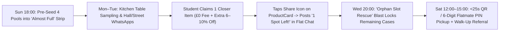

# Divly — Single-Location Initial User Marketing Campaign (0 → 100 Students)

This campaign is engineered specifically around **Divly's live product mechanics** in your codebase ([seed.ts](file:///home/hacksday/Documents/project/server/seed.ts), [db.ts](file:///home/hacksday/Documents/project/server/db.ts), [StorefrontView.tsx](file:///home/hacksday/Documents/project/src/components/StorefrontView.tsx), and [ProductCard.tsx](file:///home/hacksday/Documents/project/src/components/ProductCard.tsx)) for running at **one physical collection hub** (`The Vale · Shackleton Hub`, `Sat 12:00–15:00` — or a single Selly Oak private venue if launching permissionlessly first).

> [!IMPORTANT]
> **Why Running at 1 Location Is Your Biggest Advantage (Not a Limitation):**
> Divly pools orders into physical wholesale cases (`2` to `6` shares per case). Concentrating **100% of your first 30–50 buyers into 1 hub** across a tight SKU list guarantees boxes hit `100%` lock rate instead of fragmenting across campus. Your goal for Drop #1 is **not** awareness across 38,000 UoB students—it is **30 fulfilled orders inside a 400-metre radius** so every early user gets their groceries on Saturday and tells their kitchen.

---

## 1. Core Positioning & Your "Trojan Horse" Offer

Most student apps fail at cold-start because asking a sceptical student to spend `£15+` on an unknown website is high-friction. **Your codebase already has a built-in cold-start weapon** in [db.ts](file:///home/hacksday/Documents/project/server/db.ts#L315-L341) and [poolAllocator.ts](file:///home/hacksday/Documents/project/server/services/poolAllocator.ts#L96-L99):

1. **The Headline Hook — *"Cheaper Than Aldi, Zero Bus Trip":***
   Every UoB student treats Aldi as the cheapest possible grocery benchmark—yet getting to Aldi Selly Oak from The Vale means a 35-minute round walk/bus hauling heavy bags uphill. Beating **Aldi shelf prices by 24%–31%** (and Bristol Rd convenience stores by ~40%) turns heads immediately.
2. **The Zero-Risk Guarantee:**
   `@student.bham.ac.uk` verified pools; if an open risky box doesn't fill by cutoff, unfilled overflow slots are **automatically refunded to the penny**.
3. **The "Closer Bonus" Trojan Horse (`£3.56` First-Order Hook):**
   Normally, orders under `£8.00` pay a `£0.50` small-order fee. **However**, whenever a box is `>=50%` full or `1–2` spots from locking (`isAlmostFull`), Divly automatically gives the student **an extra 6%–10% Closer Bonus AND waives the `£0.50` pickup fee across their entire basket!**
   - *What this means for marketing:* A cautious student can test Divly with **one single item**—e.g. **3L of Oatly Barista for `£3.92`** (vs `£5.85` at Aldi) or **5-pack Shin Ramyun for `£3.56`** (vs `£5.75` at Aldi)—with **£0.00 pickup fee**. Once they experience a 20-second Saturday pickup, they convert into `£14+` weekly multi-item buyers.

### Hero SKU Cheat-Sheet for Ads, Flyers & WhatsApp

Use your **2-, 3-, and 4-share cases** as front-of-house acquisition magnets (temporarily hide or de-emphasise 5–6 share slow-fillers in Week 1 if needed):

| Hero Magnet SKU ([seed.ts](file:///home/hacksday/Documents/project/server/seed.ts)) | Target Student Tribe | Shares / Case | Aldi Price | Divly Base | **1-Spot-Left Closer Price (`-10%` + `£0` Fee)** |
| :--- | :--- | :---: | :---: | :---: | :---: |
| **🥛 Oatly Barista (`3 × 1L`)** | Coffee drinkers / Flat kitchens | **`2`** *(Instant lock!)* | `£5.85` | `£4.35` (`-26%`) | **`£3.92` (`Save 33% vs Aldi`)** |
| **🍜 Nongshim Shin Ramyun (`5-pk`)** | International & late-night study | **`4`** | `£5.75` | `£3.95` (`-31%`) | **`£3.56` (`Save 38% vs Aldi`)** |
| **⚡ Monster Ultra White (`6 × 500ml`)** | Exam-crammers, gamers, gym | **`4`** | `£7.49` | `£5.49` (`-27%`) | **`£4.94` (`Save 34% vs Aldi`)** |
| **🥢 Indomie Mi Goreng (`10-pk`)** | Hall kitchens / Cultural socs | **`4`** | `£4.90` | `£3.45` (`-30%`) | **`£3.11` (`Save 37% vs Aldi`)** |
| **🧺 Fairy Non-Bio Pods (`27 washes`)** | Circuit Laundry / HMO houses | **`4`** | `£6.49` | `£4.85` (`-25%`) | **`£4.37` (`Save 33% vs Aldi`)** |
| **🍚 Pure Basmati Rice (`5kg bag`)** | Self-catered flats & postgrads | **`4`** | `£8.49` | `£6.45` (`-24%`) | **`£5.81` (`Save 32% vs Aldi`)** |

---

## 2. Pre-Launch Engineering Trick: "Never Show an Empty Restaurant"

Before sharing the link with a single stranger on Sunday at `18:00`:

1. **Pre-Seed 4 Real Friend Orders (`~£25` total):** Have 3–4 friends/flatmates place real 1-share orders on Sunday at `17:45` so that **Oatly (`1/2`)**, **Shin Ramyun (`3/4`)**, **Monster Ultra (`2/4`)**, and **Fairy Pods (`3/4`)** sit live inside the **`🔥 Almost Full — Closer Bonus + Free Pickup`** spotlight strip at the top of [StorefrontView.tsx](file:///home/hacksday/Documents/project/src/components/StorefrontView.tsx#L66-L80).
2. **Use Bayesian Buy-Ahead on Core Shelf-Stable Boxes in Drop #1:** Your Admin panel already includes the Gamma-Poisson `SAFE_BUY_AHEAD` predictor. For Drop #1, commit to underwriting any half-full box on your top 4 ambient staples (`52-week` shelf life). Result: **100% of Week-1 shelf-stable buyers get fulfilled** (zero disappointed early adopters), and leftover shares show the green **`✓ Instant Stock Held at Hub`** badge in Drop #2!

---

## 3. The 5 Hyper-Local Acquisition Channels (Single-Location Focus)



### Channel 1: The "1 Flat = 1 Locked Box" Kitchen-Table Blitz (Highest Conversion)
Instead of flyering random lecture theatres across Edgbaston where 80% of passers-by don't live near your hub, target **only the kitchens within a 4-minute walk** of your single hub (`Shackleton, Maple Bank, Chamberlain, Tennis Courts, Mason` for The Vale — or `Dawlish, Tiverton, Heeley, Hubert Rd` for Selly Oak):
- **Tuesday `19:30–21:00` Micro-Tasting (`£6` cost → `15+` first orders):** Get invited into 3–4 flat kitchens by friends or flat reps. Bring 1 chilled carton of Oatly Barista + instant iced espresso shots (`£1.80`) and 2 packs of cut TREK Protein Flapjacks (`£3.00`).
- Pull up Divly on your phone showing **Oatly (`1/2 — 1 spot left!`)** or **Monster (`3/4 — 1 spot left!`)**. When two flatmates chip in together, the live SSE progress bar snaps to **`✓ Case Locked`** on both their phones in real time.

### Channel 2: Weaponising the Native WhatsApp Share Button in Hall & Block Group Chats
Every [ProductCard.tsx](file:///home/hacksday/Documents/project/src/components/ProductCard.tsx#L47-L71) already has a 1-tap `Share2` button that generates:
> *"Only 1 spot left to lock Oatly Barista Edition Oat Drink (3 × 1L ambient cartons) at £3.92 vs Aldi £5.85 on Divly!"*
- **Why this goes viral organically:** Forwarding a referral code feels spammy. Asking your 8-person kitchen chat or 120-person block WhatsApp *"Who wants the other half of this Oatly case for £3.92 so mine locks for Saturday?"* is pure self-interest and social proof.
- **Recruit 4 "Block Captains" at Your Hub Location:** Find 1 loud, well-connected student in each neighbouring hall block (or street). Give them **1 free share (`~£3.50` wholesale cost) every week their block hits 8+ fulfilled shares**. That's a **`~£0.44` Customer Acquisition Cost (CAC)**.

### Channel 3: Micro-Tribe Society & Sports Partnerships (Pickup Stacked on Existing Routines)
Match specific wholesale SKUs to societies whose members already walk past or live at your hub:
- **Asian & International Societies (`Korean Soc`, `Malaysian Soc`, `CSSA`, `Indian Soc`, `ACS`):** Pitch `Shin Ramyun 5-pk (£3.95 vs £5.75)`, `Indomie 10-pk (£3.45 vs £4.90)`, `5kg Basmati (£6.45 vs £8.49)`, and `Kikkoman 500ml (£2.85)`. Offer the Society Treasurer **`£0.50` society sponsorship per fulfilled order** (or 1 free 40-pack Indomie carton for their next movie night once 25 members order).
- **Gym, Rowing (`UBBC`) & Run Clubs:** Pitch `Monster Ultra 6-pk (£5.49)`, `TREK Flapjacks (£2.95)`, `Warburtons Protein Bagels (£2.95)`, and `5kg Basmati (£6.45)` as the *"Post-Saturday-Session Bulk Refuel"* right at `12:00`.

### Channel 4: Physical "Aldi Receipt Showdown" A5 Table Cards & Laundry-Room QR Drops
- **Where to place (Zero wall-paint damage):** Kitchen dining tables (via invited residents), society common spaces, partner Selly Oak café counter, and **right beside the Circuit Laundry / launderette waiting benches** (*"Paying £3.80 for one wash AND £6.49 for Fairy Pods? Split a wholesale Fairy 27-wash tub for £4.85 right outside on Saturday"*).
- **Visual Proof:** Tape a real dated **Aldi Selly Oak till receipt** next to Divly's prices on an A-board at your Saturday hub and in a 12-second vertical video (*"I bought the exact same UoB student weekly shop at Aldi vs Divly — £31.15 vs £22.59"*).

### Channel 5: Turning Saturday Pickup (`12:00–15:00`) Into a Live Spectacle + "Flatmate PIN" Viral Loop
Your Saturday collection table is your highest-trust billboard:
1. **Stack the Clean Crates Visibly:** Seeing 30+ real students scan QR passes and walk away with `6-packs of Monster`, `5kg Basmati bags`, and `3-packs of Oatly` eliminates 100% of "is this legit?" scepticism from curious passers-by.
2. **Walk-Up Cold Can Hook (Never sell spot stock off the table):** Keep 24 chilled cans of Monster Ultra (`£19.20` wholesale = **`£0.80/can`**) in a cooler box. Whenever a passer-by asks *"Can I buy one?"*, say:
   > *"Everything on the table was pre-pooled before cutoff so it's 30% cheaper than Aldi—I can't sell off the table, **but verify your `@student.bham.ac.uk` email via this QR right now (15 seconds) to join Drop #2 and take an ice-cold Monster free on us!**"*
   - Paying **`£0.80` per verified `.bham.ac.uk` account** standing physically at your pickup hub beats `£12` Instagram ads by 15×.
3. **Push the 6-Digit Flatmate Pickup PIN:** Remind buyers on Friday evening: *"Busy Saturday 12–3pm? Send your 6-digit PIN (`pickupPin`) to any flatmate walking down—if they bring a friend who scans up for Drop #2 at the table, you both get a free TREK bar."*

---

## 4. The Weekly Rhythm: 7-Day Operating & Marketing Calendar

Run this exact cadence every single week so students build a Pavlovan weekly habit:

| Day & Time | Marketing & Pool-Liquidity Action | Psychological Trigger |
| :--- | :--- | :--- |
| **Sun `18:00`** | Open new Drop Cycle in Admin (`/api/admin/new-drop`). Post **"Drop #X Live + Carryover Instant-Lock Stock"** in your hub WhatsApp announcement group (`max 2 messages/week` so nobody mutes!). | Scarcity on `✓ Instant Stock Held at Hub` carryover slots (`box_number = 0` locks immediately!). |
| **Mon `12:00–14:00`** | Post 15-sec `@uob.divly` Reel/TikTok: *"Aldi Selly Oak vs Divly Vale Hub Receipt Check"* + drop society graphics via 2 Society Treasurers. | Rational price shock (`Save 25–35% vs Aldi`). |
| **Tue `19:30–21:00`** | Run **3 invited flat-kitchen Oatly/TREK tastings** near the hub. Block Captains drop personal *"Splitting a Monster/Oatly case, 1 spot left"* links in corridor chats. | Mid-week empty fridge + wet cold walk dread + live SSE bar filling. |
| **Wed / Cutoff `-4h`** | Send **"⚡ Final 4 Hours: Orphan Slot Rescue"** WhatsApp/email listing the exact 3–4 products sitting at `3/4` or `1/2` with **`-10% Closer Bonus + £0.00 Free Pickup`**. | Loss aversion + extra 10% discount clears `90%+` of open boxes before cutoff! |
| **Cutoff Night** | Trigger Admin Cutoff (`/api/admin/cutoff`). Screenshot the `"X Full Cases Locked for Saturday!"` scoreboard for Instagram Stories. | Momentum & FOMO for non-buyers. |
| **Sat `11:30`** | Send SMS/email reminder with **QR code + 6-digit Flatmate PIN** (`Sat 12:00–15:00` at Shackleton Forecourt). | Ensures `95%+` on-time collection. |
| **Sat `12:00–15:00`** | Run `<25s` pickup bay + `£0.80` cold Monster walk-up signups. At `15:30`, message today's collectors their **cumulative £ saved vs Aldi** + Sunday re-order teaser. | Locks `50%+` Week-1-to-Week-2 retention. |

---

## 5. Copy-Paste Campaign Assets (Ready to Send Tonight)

### A. Block Captain / Early Adopter Peer WhatsApp Text (Non-Salesy)
```text
Anyone in [Shackleton / Maple Bank / Dawlish Rd] want to split a case of Oatly Barista or Monster Ultra for Saturday? 👀
Using Divly (UoB student bulk-buy site) — 3x 1L Oatly is £4.35 vs £5.85 in Aldi, and 6x Monster Ultra is £5.49 vs £7.49.
My box has 1 spot left so whoever grabs the last slot gets an extra 10% Closer Bonus + £0 free Saturday pickup right outside Shackleton (auto-refunds if a box doesn't fill):
[YOUR_DIVLY_URL]
```

### B. Wednesday Evening "4-Hour Closer Bonus Rescue" Broadcast
```text
⚡ 4 HOURS LEFT — Divly Drop #1 closes tonight for Saturday 12:00–15:00 pickup at The Vale (Shackleton Hub)!

9 bulk cases are already 100% LOCKED ✅
Grab the final spot on any of these open boxes before midnight to trigger an automatic -10% CLOSER BONUS + £0.00 FREE PICKUP (even on a 1-item order!):

🥛 Oatly Barista (3×1L) — 1/2 claimed → Last spot £3.92 (Aldi £5.85)
🍜 Shin Ramyun (5-pack) — 3/4 claimed → Last spot £3.56 (Aldi £5.75)
⚡ Monster Ultra (6×500ml) — 3/4 claimed → Last spot £4.94 (Aldi £7.49)
🧺 Fairy Non-Bio (27 pods) — 3/4 claimed → Last spot £4.37 (Aldi £6.49)

Takes 20 seconds with your @student.bham.ac.uk email: [YOUR_DIVLY_URL]
```

### C. A5 Kitchen Flyer / Launderette Poster Copy
```text
====================================================================
  DIVLY · UoB STUDENT BULK CLUB        [ @student.bham.ac.uk ONLY ]
  CHEAPER THAN ALDI. NO BUS. NO 20KG BAGS UPHILL.
====================================================================
  Chip in anonymously with other students at [The Vale · Shackleton]
  to split factory-sealed wholesale cases.

  YOUR SHARE                     ALDI PRICE   DIVLY   CLOSER BONUS*
  ------------------------------------------------------------------
  Oatly Barista (3 x 1L)            £5.85     £4.35      £3.92
  Shin Ramyun Spicy (5-Pack)        £5.75     £3.95      £3.56
  Indomie Mi Goreng (10-Pack)       £4.90     £3.45      £3.11
  Monster Ultra White (6 x 500ml)   £7.49     £5.49      £4.94
  Fairy Non-Bio Tub (27 Washes)     £6.49     £4.85      £4.37
  Pure Basmati Rice (5kg Bag)       £8.49     £6.45      £5.81

  HOW IT WORKS:
  1. Claim shares before cutoff (£0 pickup on £8+ OR any Closer item!).
  2. 100% full cases lock; any unfilled risky overflow auto-refunds.
  3. Collect SAT 12:00–15:00 @ Shackleton Hub via QR or 6-Digit PIN
     (any flatmate can grab yours in 20 seconds!).

  [ QR CODE -> SCAN LIVE OPEN BOXES ]
  *Extra 6%–10% Closer Bonus + £0 fee applies automatically on boxes >=50% full.
====================================================================
```

---

## 6. 4-Week Budget (`< £85` Total) & Growth Targets at 1 Hub

Do **not** spend a penny on Meta/TikTok paid ads while operating at 1 location—ad platforms cannot geofence *"only Shackleton & Maple Bank students."* Put 100% of your `<£85` budget into physical product in students' hands:

| Line Item | Cost (`£`) | Expected Conversion Yield |
| :--- | :---: | :--- |
| **250 × A5 Heavy-Card Kitchen & Laundry Flyers** (local print) | `£16.00` | Placed on 45 flat kitchen tables + laundry benches (`~12–15` orders) |
| **1 × Wholesale Tray Monster Ultra (`24 × 500ml`)** for Saturday walk-up signups | `£19.20` | `24` verified `.bham.ac.uk` walk-up accounts (`£0.80` CAC) |
| **2 × Tuesday Kitchen Tasting Kits** (Oatly + espresso + TREK squares + cups) | `£12.00` | `6–8` kitchens sampled live (`~15–20` orders) |
| **Block Captain Free Shares** (`4` captains × `1` share/wk × `3` wks at wholesale) | `~£36.00` | Performance-only (`£0` upfront; paid only when block hits `8+` shares) |
| **TOTAL 4-WEEK LAUNCH MARKETING SPEND** | **`£83.20`** | **Target: `85–110` weekly orders by Drop #4 (`< £0.85` blended CAC)** |

### 4-Week Single-Hub KPI Milestones

- **Drop #1 (Proof of Trust):** **25–30 orders** (`~75` shares) · `95%+` shelf-stable fulfilment (using `SAFE_BUY_AHEAD` on 3–4 core cases if needed) · Capture 5 phone videos of Saturday QR handovers.
- **Drop #2 (Closer-Loop Kick-In):** **45–55 orders** · `50%+` of Drop #1 buyers re-order · `carryoverStockSlots` sell out within 6 hours of Sunday `18:00` launch.
- **Drop #3 (Society + Flatmate PIN Multiplier):** **65–80 orders** · `>= 88%` organic natural Case Lock Rate without needing founder buy-ahead underwriting.
- **Drop #4 (Single-Hub Saturation Gate):** **90–110 orders** (`£1,100–£1,350/wk` GMV at 1 location) · Start collecting waitlist emails for **Location #2** (*Selly Oak* or *Pritchatts Park*) so Location #2 launches with 100+ pre-warmed buyers on Day 1.
