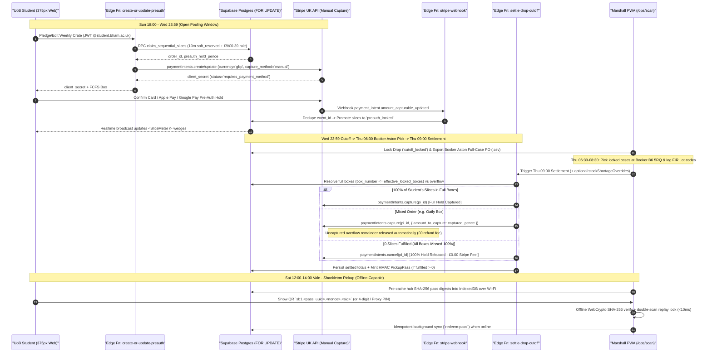

# SplitBox UoB — Full-Stack Architecture & Technical Blueprint

This document is the authoritative technical reference for SplitBox's codebase structure, **Dual-Mode (`VITE_DEMO_MODE` vs Live Cloud) Repository Adapter**, **PostgreSQL ACID cross-box slice allocator (`SELECT ... FOR UPDATE`)**, **Stripe `capture_method: 'manual'` pre-authorisation & Thursday `09:00` settlement pipeline**, and **HMAC-SHA256 offline-first `/ops/scan` Hub Marshall PWA**.

For product & compliance rules see [docs/product/mvp-spec.md](../product/mvp-spec.md); for visual tokens & radial `<SliceMeter />` geometry see [docs/design/brand-and-ui.md](../design/brand-and-ui.md); for the 24-hour execution plan see [docs/ACTION_PLAN_24H.md](../ACTION_PLAN_24H.md).

---

## 1. Quickstart, Scripts & Dual-Mode Runtime Model

### Local Commands (`package.json`)

```bash
npm install          # Install local dependencies (React 19, Tailwind v4, @fontsource/*, qrcode.react)
npm run dev          # Start Vite dev server (auto-enables Demo Mode if .env.local is absent)
npm run typecheck    # Strict TypeScript project-reference check (tsc -b)
npm test             # Run deterministic unit, security, & hub test suites
npm run build        # Production typecheck + Vite bundle into dist/
npm run verify       # Full gate: npm test + zero-CDN / GBP check + production build
```

### Dual-Mode Execution & Network Boundaries

SplitBox runs the **exact same React 19 UI components** across two runtime modes controlled by `src/lib/env.ts`:

| Capability / Boundary | Offline Demo Mode (`isDemoMode() === true`) | Live UoB Production Mode (`isDemoMode() === false`) |
| :--- | :--- | :--- |
| **Activation Condition** | `VITE_DEMO_MODE === 'true'` **OR** `VITE_SUPABASE_URL` is unset (default on fresh `git clone`). | `VITE_DEMO_MODE === 'false'` **AND** `VITE_SUPABASE_URL`, `VITE_SUPABASE_ANON_KEY`, `VITE_STRIPE_PUBLISHABLE_KEY` are set. |
| **Authentication** | Zero login wall; boots straight into mocked UoB student session for instant 60s pitches. | Public read-only pool browsing; claiming slices requires **`@student.bham.ac.uk` / `@bham.ac.uk`** passwordless Magic Link OTP. |
| **State & Persistence** | `LocalDemoRepository` wrapping `src/store/dropEngine.ts` + `localStorage` (`splitbox_uob_drop_v1`). | `SupabaseRepository` backed by Supabase Postgres (`eu-west-2` London), ACID RPCs, and Realtime WebSockets. |
| **Payment Hold & Cutoff** | Instant simulated pre-auth hold + interactive `DemoControlsBar` (`Simulate Strangers`, `Trigger Cutoff`, `Pitch Beats 1–4`, `Reset`). | Real **Stripe `PaymentIntent` (`capture_method: 'manual'`)** hold (`£0.00` fee `≥ £9.00`, `£0.39` `< £9.00`) settled Thursday `09:00` after Booker Aston pick. |
| **QR Pickup Pass** | Deterministic `SplitBox-UoB` signed payload + `UOB-BOX-XXXX` + 4-digit PIN verified locally in `HubOpsView`. | Server-minted **`sb1.<pass_uuid>.<nonce>.<sig>`** (`HMAC-SHA256`) verified online or offline via `IndexedDB` in `/ops/scan`. |
| **Permitted Network Calls** | **Zero (`0`) external `http(s)://` calls.** 100% air-gapped capable. | **Strictly allowlisted:** `*.supabase.co`, `js.stripe.com` / `api.stripe.com`, and server-side `api.resend.com`. |
| **Forbidden CDNs (Both Modes)** | **Never allowed in either mode:** `fonts.googleapis.com`, `fonts.gstatic.com`, Unsplash/remote product images, or external QR image APIs. Always use local `@fontsource/*` and `qrcode.react` (`<QRCodeSVG />`). | **Never allowed in either mode:** `fonts.googleapis.com`, `fonts.gstatic.com`, Unsplash/remote product images, or external QR image APIs. |

---

## 2. Complete Codebase Directory Map

Items marked **`[LIVE]`** are active in the workspace today; items marked **`[24H SPRINT]`** are the full-stack adapter, Supabase SQL/Edge Function, and PWA scanner modules added during Sprint Blocks 1–5 in [docs/ACTION_PLAN_24H.md](../ACTION_PLAN_24H.md).

```text
project/
├── AGENTS.md                                      # [LIVE] Master AI agent router, guardrails, & skill table
├── CLAUDE.md                                      # [LIVE] Claude Code automatic entrypoint -> AGENTS.md
├── README.md                                      # [LIVE] Repository quickstart, doc map, & 60s walkthrough
├── index.html                                     # [LIVE] Offline HTML shell & local SVG favicon
├── package.json                                   # [LIVE] Build, test, verify, & multi-agent hub scripts
├── vite.config.ts                                 # [LIVE] Vite 6 + React 19 + Tailwind CSS v4 plugin config
├── .github/
│   ├── copilot-instructions.md                    # [LIVE] GitHub Copilot Pro automatic workspace instructions
│   └── workflows/
│       └── ci.yml                                 # [24H SPRINT] Free GitHub Actions gate running `npm run verify`
├── docs/
│   ├── ACTION_PLAN_24H.md                         # [LIVE] 24h Antigravity sprint roadmap + copy-paste /swarm prompts
│   ├── product/
│   │   └── mvp-spec.md                            # [LIVE] Dual-mode product spec, Drop #1 rules, & acceptance gates
│   ├── architecture/
│   │   └── fullstack-blueprint.md                 # [LIVE] This file: repo map, adapter, Postgres DDL, RPC, Stripe, HMAC QR
│   ├── design/
│   │   └── brand-and-ui.md                        # [LIVE] Brand voice, --sb-* tokens, @fontsource, crate UI, SliceMeter SVG
│   └── business/
│       └── uob-launch-and-pitch.md                # [LIVE] UK data feeds, FIR/VAT/FBO/ASA compliance, & 3-min UoB pitch
├── public/
│   ├── assets/                                    # [LIVE] Local SplitBox brand SVGs (splitbox-logo.svg, splitbox-icon.svg)
│   ├── manifest.webmanifest                       # [24H SPRINT] Installable PWA manifest for `/ops/scan` Marshall terminal
│   └── _redirects                                 # [24H SPRINT] Cloudflare Pages SPA routing fallback (`/* /index.html 200`)
├── src/
│   ├── main.tsx                                   # [LIVE] React root + local @fontsource/{space-grotesk,plus-jakarta-sans,jetbrains-mono}
│   ├── index.css                                  # [LIVE] Tailwind v4 + SplitBox `--sb-*` CSS custom properties & crate shadows
│   ├── types.ts                                   # [LIVE] Domain contracts (CampusHub, CatalogItem, ClaimedSlice, OrderRecord, PickupPass)
│   ├── App.tsx                                    # [LIVE] Top-level shell routing `storefront` | `orders` | `ops` | `investor`
│   ├── lib/
│   │   ├── env.ts                                 # [24H SPRINT] Typed env parser & `isDemoMode()` zero-config detector
│   │   ├── supabaseClient.ts                      # [24H SPRINT] Lazy singleton Supabase browser client (null in Demo Mode)
│   │   └── offlineManifestStore.ts                # [24H SPRINT] IndexedDB pass manifest store + WebCrypto SHA-256 verifier + sync outbox
│   ├── repositories/
│   │   ├── DropRepository.ts                      # [24H SPRINT] Dual-mode data/checkout/scanner interface contract
│   │   ├── LocalDemoRepository.ts                 # [24H SPRINT] Offline adapter delegating to pure `dropEngine.ts` + `localStorage`
│   │   └── SupabaseRepository.ts                  # [24H SPRINT] Live adapter calling Postgres RPCs, Realtime pools, & Edge Functions
│   ├── data/
│   │   └── catalog.ts                             # [LIVE] UoB hubs, FIR-labelled GBP SKUs, & integer-pence helpers (`toPence`/`fromPence`)
│   ├── store/
│   │   ├── dropEngine.ts                          # [LIVE] Deterministic FCFS cross-box allocator, cutoff resolver, PO builder, & QR verifier
│   │   └── DropContext.tsx                        # [LIVE] React Context + reducer exposing `useDrop()` selectors & actions
│   └── components/
│       ├── common/
│       │   ├── index.ts                           # [LIVE] Common barrel exports
│       │   └── ErrorBoundary.tsx                  # [LIVE] Resilient view-level & root-level crash recovery boundary
│       ├── auth/
│       │   └── UobMagicLinkModal.tsx              # [24H SPRINT] Passwordless `@student.bham.ac.uk` / `@bham.ac.uk` OTP modal
│       ├── storefront/
│       │   ├── index.ts                           # [LIVE] Storefront barrel exports
│       │   ├── Navbar.tsx                         # [LIVE] Sticky header, hub selector ("Vote Next Hub"), view tabs, countdown, crate pill
│       │   ├── StorefrontView.tsx                 # [LIVE] Campus hero, Margin X-Ray toggle, category/status/search bar, & SKU grid
│       │   ├── SplitCard.tsx                      # [LIVE] Tactile crate card with radial SliceMeter, GBP receipt, & FIR allergen details
│       │   ├── SliceMeter.tsx                     # [LIVE] Segmented radial SVG progress dial (mint stranger, popped tangerine user wedges)
│       │   ├── ProductArtwork.tsx                 # [LIVE] Deterministic offline SVG packaging illustrations per `artworkKey`
│       │   ├── HallActivityTicker.tsx             # [LIVE] Anonymised hub-level pool lock activity feed
│       │   ├── SharePoolModal.tsx                 # [LIVE] WhatsApp / flat group-chat "1–2 slices left to lock!" share modal
│       │   └── securityUtils.ts                   # [LIVE] Input sanitizers, bounds clamps, & checkout field validators
│       ├── basket/
│       │   ├── index.ts                           # [LIVE] Basket barrel exports
│       │   ├── BasketDrawer.tsx                   # [LIVE] Slide-over crate drawer, FCFS cross-box pills, £9 free-crate / £0.39 fee summary
│       │   ├── MobileBasketBar.tsx                # [LIVE] Sticky bottom basket bar engineered for 375px mobile viewports
│       │   └── StripePreAuthSheet.tsx             # [24H SPRINT] Lazy-loaded Stripe PaymentElement (`capture_method: 'manual'`) sheet
│       ├── orders/
│       │   ├── index.ts                           # [LIVE] Orders & demo toolbar barrel exports
│       │   ├── OrdersPickupView.tsx               # [LIVE] Pre-cutoff editable order ledger & post-cutoff fulfilled vs released breakdown
│       │   ├── PickupPassCard.tsx                 # [LIVE] Offline `<QRCodeSVG />` pass, 4-digit PIN, flatmate proxy PIN, & restocking terms
│       │   ├── PickupPassTicketSection.tsx        # [LIVE] Perforated ticket sub-layout & clipboard helpers
│       │   ├── pickupPassHelpers.ts               # [LIVE] Defensive view-model sanitizer for pickup passes
│       │   ├── SettlementReceipt.tsx              # [LIVE] Perforated GBP receipt comparing pre-auth hold, released overflow, & captured net
│       │   └── DemoControlsBar.tsx                # [LIVE] Collapsible Demo Mode toolbar (Simulate Strangers, Trigger Cutoff, Pitch Beats, Reset)
│       ├── ops/
│       │   ├── index.ts                           # [LIVE] Hub Operations barrel exports
│       │   ├── HubOpsView.tsx                     # [LIVE] Campus Operations Dashboard shell
│       │   ├── EstatesComplianceStrip.tsx         # [LIVE] 100% Ambient, Zero Hall Reception Storage, & Zero Waste guarantees
│       │   ├── HubMarshallScannerCard.tsx         # [LIVE] QR / `UOB-BOX-*` / 4-digit PIN check-in terminal & 25-entry audit log
│       │   ├── WholesaleManifestSection.tsx       # [LIVE] Booker Aston (`B6 5RQ`) full-case PO table (+ `.csv` export in Block 4)
│       │   └── LiveScannerPwaView.tsx             # [24H SPRINT] Offline-capable camera QR & PIN scanner backed by `offlineManifestStore.ts`
│       └── investor/
│           ├── index.ts                           # [LIVE] Investor & UoB Elevate pitch view barrel exports
│           ├── InvestorPitchView.tsx              # [LIVE] Interactive unit-economics & multi-hub rollout simulator
│           ├── PitchStoryboardSection.tsx         # [LIVE] 4-beat guided live demo director
│           ├── UnitEconomicsSection.tsx           # [LIVE] Per-box wholesale -> slice margin waterfall
│           ├── ScaleSimulatorSection.tsx          # [LIVE] Interactive student count, basket size, & hub count simulator
│           ├── CampusRolloutSection.tsx           # [LIVE] Phased UoB -> Midlands Russell Group expansion roadmap
│           └── investorData.ts                    # [LIVE] Pure unit-economics & preset simulation math
├── supabase/                                      # [24H SPRINT] Zero-fixed-cost London (`eu-west-2`) backend
│   ├── config.toml                                # [24H SPRINT] Local Supabase CLI & Edge Function configuration
│   ├── seed.sql                                   # [24H SPRINT] Seeds `vale-shackleton` active + 3 `coming_soon` hubs + UoB SKUs + Drop #1
│   ├── migrations/
│   │   ├── 0001_splitbox_core.sql                 # [24H SPRINT] Core tables, integer-pence CHECKs, & partial unique indexes
│   │   ├── 0002_rls_and_auth.sql                  # [24H SPRINT] Row-Level Security & `@(student.)?bham.ac.uk` domain enforcement
│   │   ├── 0003_claim_slices_rpc.sql              # [24H SPRINT] PL/pgSQL `SELECT ... FOR UPDATE` cross-box sequential allocator
│   │   └── 0004_settlement_rpc.sql                # [24H SPRINT] Atomic Thursday `09:00` cutoff settlement helper RPC
│   └── functions/
│       ├── _shared/
│       │   ├── cors.ts                            # [24H SPRINT] Strict origin CORS headers
│       │   ├── stripe.ts                          # [24H SPRINT] Stripe SDK singleton (`apiVersion` pinned)
│       │   └── hmacPass.ts                        # [24H SPRINT] `sb1.<pass_uuid>.<nonce>.<sig>` HMAC-SHA256 signer & verifier
│       ├── create-or-update-preauth/index.ts      # [24H SPRINT] Reserves slices + creates/updates manual-capture PaymentIntent
│       ├── stripe-webhook/index.ts                # [24H SPRINT] Idempotent webhook promoting `soft_reserved` -> `preauth_locked`
│       ├── settle-drop-cutoff/index.ts            # [24H SPRINT] Post-Booker Thursday `09:00` capture / partial-capture / cancel worker
│       ├── marshall-manifest/index.ts             # [24H SPRINT] Exports SHA-256 pass digests to Marshall PWA `IndexedDB`
│       ├── redeem-pass/index.ts                   # [24H SPRINT] Online & reconnected-offline idempotent check-in endpoint
│       └── rotate-proxy-pass/index.ts             # [24H SPRINT] Rotates `qr_nonce` & issues flatmate delegation PIN
├── harness/                                       # [LIVE] Multi-agent coordination bus (`agent_hub.py`, `hub_hooks.py`, `sdk_agent_harness.py`)
├── .agents/                                       # [LIVE] Specialized SplitBox skills (`.agents/skills/*`), custom agents, & hub snapshot
├── scripts/
│   └── run-tests.mjs                              # [LIVE] Zero-dependency test runner
└── tests/                                         # [LIVE + 24H SPRINT] Hub, concurrency, settlement pence-math, & HMAC offline sync tests
```

---

## 3. Dual-Mode `DropRepository` Adapter Design

To ensure the existing offline prototype (`npm run dev` with zero `.env` keys) never breaks while adding real multi-user persistence, `DropContext.tsx` delegates all storage and checkout mutations through a narrow `DropRepository` interface.

### Environment Mode Resolution (`src/lib/env.ts`)

```ts
export interface SplitBoxRuntimeEnv {
  readonly mode: 'demo' | 'live';
  readonly supabaseUrl: string | null;
  readonly supabaseAnonKey: string | null;
  readonly stripePublishableKey: string | null;
}

export function resolveRuntimeEnv(): SplitBoxRuntimeEnv {
  const explicitDemo = import.meta.env.VITE_DEMO_MODE;
  const supabaseUrl = import.meta.env.VITE_SUPABASE_URL?.trim() || null;
  const supabaseAnonKey = import.meta.env.VITE_SUPABASE_ANON_KEY?.trim() || null;
  const stripePublishableKey = import.meta.env.VITE_STRIPE_PUBLISHABLE_KEY?.trim() || null;

  // Auto-fallback to offline Demo Mode whenever cloud keys are missing or VITE_DEMO_MODE=true
  if (
    explicitDemo === 'true' ||
    !supabaseUrl ||
    !supabaseAnonKey ||
    !stripePublishableKey
  ) {
    return {
      mode: 'demo',
      supabaseUrl: null,
      supabaseAnonKey: null,
      stripePublishableKey: null,
    };
  }

  return {
    mode: 'live',
    supabaseUrl,
    supabaseAnonKey,
    stripePublishableKey,
  };
}

export const isDemoMode = (): boolean => resolveRuntimeEnv().mode === 'demo';
```

### `DropRepository` Contract (`src/repositories/DropRepository.ts`)

```ts
import type {
  CampusHub,
  CatalogItem,
  CheckInPassResult,
  DropStatus,
  HubId,
  OrderRecord,
  PickupPass,
  SimulateStrangersResult,
  StudentCheckoutDetails,
  ViralHallmateClaimResult,
} from '../types';

export interface PoolAggregateCount {
  productId: string;
  hubId: HubId;
  committedSliceCount: number;
  userLockedSliceIndices: number[]; // Only indices owned by current student; strangers stay anonymous
}

export interface DropSnapshotPayload {
  dropId: string;
  dropStatus: DropStatus;
  opensAtIso: string;
  cutoffAtIso: string;
  hubs: ReadonlyArray<CampusHub & { status: 'active' | 'coming_soon'; voteCount?: number }>;
  catalog: readonly CatalogItem[];
  poolsByHub: Record<HubId, Record<string, PoolAggregateCount>>;
  activeWeeklyOrder: OrderRecord | null; // 1 editable weekly order per student
  pickupPass: PickupPass | null;
}

export interface PreAuthCheckoutSession {
  mode: 'demo_instant' | 'stripe_manual_capture';
  order: OrderRecord;
  stripeClientSecret?: string; // Present in Live Mode for <PaymentElement />
  reservedUntilIso?: string;   // 10-minute soft hold expiry timestamp
}

export interface DemoSimulationControls {
  simulateStrangers(hubId: HubId): Promise<SimulateStrangersResult>;
  simulateViralHallmateClaim(hubId: HubId, productId: string): Promise<ViralHallmateClaimResult>;
  simulateCampusRush(): Promise<{ totalBoxesLockedDelta: number; totalSlicesAdded: number }>;
  triggerCutoffNow(): Promise<PickupPass | null>;
  simulateUncollectedRestock(hubId: HubId): Promise<PickupPass | null>;
  resetDemoState(): Promise<void>;
}

export interface DropRepository {
  readonly mode: 'demo' | 'live';

  /** Loads initial hubs, catalog, aggregate pool counts, and current student's weekly order/pass */
  fetchDropSnapshot(hubId: HubId): Promise<DropSnapshotPayload>;

  /** Subscribes to live pool fill changes (no-op in Demo Mode; Supabase Realtime channel in Live Mode) */
  subscribeToHubPools(
    hubId: HubId,
    onUpdate: (updatedPool: PoolAggregateCount) => void
  ): () => void;

  /** Records student demand vote for a `coming_soon` UoB hub */
  voteForNextHub(hubId: HubId, uobEmail: string): Promise<{ ok: boolean; newVoteCount: number }>;

  /**
   * Creates or updates the student's 1 editable weekly order for the active Drop.
   * - Demo Mode: Synchronously allocates slices in `localStorage` and returns `mode: 'demo_instant'`.
   * - Live Mode: Invokes `create-or-update-preauth` Edge Function (`SELECT ... FOR UPDATE` 10m soft hold
   *   + Stripe `PaymentIntent` with `capture_method: 'manual'`) and returns `stripeClientSecret`.
   */
  upsertWeeklyPreAuthOrder(params: {
    hubId: HubId;
    basket: Record<string, number>;
    studentDetails?: StudentCheckoutDetails;
  }): Promise<PreAuthCheckoutSession>;

  /** Cancels the student's editable weekly order prior to Wednesday 23:59 cutoff */
  cancelWeeklyPreAuthOrder(orderId: string): Promise<{ ok: boolean }>;

  /** Rotates QR nonce & generates/updates flatmate proxy collection PIN */
  delegatePassToFlatmate(passId: string, proxyName: string): Promise<PickupPass>;

  /** Verifies & redeems a student QR token (`sb1.*` or demo payload) or 4-digit PIN */
  redeemPickupPass(input: string, hubId: HubId): Promise<CheckInPassResult>;

  /** Populated ONLY by `LocalDemoRepository` (undefined in `SupabaseRepository` so Demo bar hides in prod) */
  readonly demo?: DemoSimulationControls;
}
```

---

## 4. Production PostgreSQL DDL (`supabase/migrations/0001_splitbox_core.sql`)

All monetary columns are stored strictly in **integer GBP pence (`INTEGER`)** (`£4.20` = `420`, `£9.00` = `900`, `£0.39` = `39`). Floating-point `REAL`/`FLOAT` types are forbidden.

```sql
-- Enable cryptographic UUID & digest helpers
CREATE EXTENSION IF NOT EXISTS "pgcrypto";

-- 1. UoB Campus Pickup Hubs (Drop #1: 'vale-shackleton' active; others 'coming_soon')
CREATE TABLE public.hubs (
  id              TEXT PRIMARY KEY,
  name            TEXT NOT NULL,
  short_label     TEXT NOT NULL,
  area            TEXT NOT NULL,
  address_note    TEXT NOT NULL,
  pickup_window   TEXT NOT NULL,
  walking_note    TEXT NOT NULL,
  status          TEXT NOT NULL CHECK (status IN ('active', 'coming_soon')),
  sort_order      SMALLINT NOT NULL DEFAULT 0,
  created_at      TIMESTAMPTZ NOT NULL DEFAULT now()
);

-- Demand votes for 'coming_soon' UoB hubs (1 vote per hashed UoB email per hub)
CREATE TABLE public.hub_votes (
  id              UUID PRIMARY KEY DEFAULT gen_random_uuid(),
  hub_id          TEXT NOT NULL REFERENCES public.hubs(id) ON DELETE CASCADE,
  uob_email_hash  TEXT NOT NULL,
  created_at      TIMESTAMPTZ NOT NULL DEFAULT now(),
  UNIQUE (hub_id, uob_email_hash)
);

-- 2. Weekly Campus Drop Cycles (72-96h window: Sun 18:00 -> Wed 23:59 -> Thu 09:00 settle -> Sat pickup)
CREATE TABLE public.drops (
  id                           UUID PRIMARY KEY DEFAULT gen_random_uuid(),
  slug                         TEXT NOT NULL UNIQUE, -- e.g. 'uob-2026-w47'
  opens_at                     TIMESTAMPTZ NOT NULL,
  cutoff_at                    TIMESTAMPTZ NOT NULL,
  booker_pick_at               TIMESTAMPTZ NOT NULL,
  settled_at                   TIMESTAMPTZ,
  pickup_date                  DATE NOT NULL,
  status                       TEXT NOT NULL DEFAULT 'scheduled'
                               CHECK (status IN ('scheduled', 'open', 'cutoff_locked', 'settling', 'settled', 'completed')),
  free_crate_threshold_pence   INTEGER NOT NULL DEFAULT 900 CHECK (free_crate_threshold_pence >= 0),
  micro_crate_fee_pence        INTEGER NOT NULL DEFAULT 39  CHECK (micro_crate_fee_pence >= 0),
  uncollected_restock_fee_pence INTEGER NOT NULL DEFAULT 200 CHECK (uncollected_restock_fee_pence >= 0),
  created_at                   TIMESTAMPTZ NOT NULL DEFAULT now(),
  CHECK (cutoff_at > opens_at AND booker_pick_at > cutoff_at)
);

-- 3. Wholesale Catalog SKUs (FIR-compliant sealed sub-units + explicit 0% vs 20% UK VAT)
CREATE TABLE public.products (
  id                                TEXT PRIMARY KEY,
  name                              TEXT NOT NULL,
  brand                             TEXT NOT NULL,
  category                          TEXT NOT NULL,
  booker_code                       TEXT,            -- Booker Aston B6 5RQ 6-digit M-code
  gtin_ean                          TEXT,            -- Inner sub-unit retail EAN-13 barcode
  case_description                  TEXT NOT NULL,
  slice_unit_description            TEXT NOT NULL,
  slices_per_box                    INTEGER NOT NULL CHECK (slices_per_box IN (4, 6, 8, 10, 12)),
  slice_price_pence                 INTEGER NOT NULL CHECK (slice_price_pence > 0),
  wholesale_slice_cost_ex_vat_pence INTEGER NOT NULL CHECK (wholesale_slice_cost_ex_vat_pence >= 0),
  vat_rate                          NUMERIC(4, 2) NOT NULL DEFAULT 0.00 CHECK (vat_rate IN (0.00, 0.20)),
  retail_benchmark_pence            INTEGER NOT NULL CHECK (retail_benchmark_pence > slice_price_pence),
  retail_benchmark_source           TEXT NOT NULL,   -- e.g. 'Sainsbury''s Local 584 Bristol Rd B29 6BE'
  retail_benchmark_checked_on       DATE NOT NULL,
  is_food_item                      BOOLEAN NOT NULL DEFAULT true,
  is_fir_inner_labelled             BOOLEAN NOT NULL DEFAULT true,
  ingredients_text                  TEXT NOT NULL,
  allergens_bold                    TEXT[] NOT NULL DEFAULT '{}',
  uk_fbo_address                    TEXT NOT NULL,
  case_weight_grams                 INTEGER NOT NULL CHECK (case_weight_grams > 0),
  artwork_key                       TEXT NOT NULL,
  pack_badge                        TEXT NOT NULL,
  is_active                         BOOLEAN NOT NULL DEFAULT true,
  created_at                        TIMESTAMPTZ NOT NULL DEFAULT now(),
  -- Guard against selling split packs that lack individual UK FIR allergen labelling
  CHECK ((NOT is_food_item) OR is_fir_inner_labelled = true)
);

-- 4. Hub Product Pools (Row-Level Lock Target for `SELECT ... FOR UPDATE`)
CREATE TABLE public.hub_product_pools (
  id                        UUID PRIMARY KEY DEFAULT gen_random_uuid(),
  drop_id                   UUID NOT NULL REFERENCES public.drops(id) ON DELETE CASCADE,
  hub_id                    TEXT NOT NULL REFERENCES public.hubs(id) ON DELETE RESTRICT,
  product_id                TEXT NOT NULL REFERENCES public.products(id) ON DELETE RESTRICT,
  slices_per_box            INTEGER NOT NULL CHECK (slices_per_box IN (4, 6, 8, 10, 12)),
  committed_slice_count     INTEGER NOT NULL DEFAULT 0 CHECK (committed_slice_count >= 0),
  locked_box_count          INTEGER GENERATED ALWAYS AS (committed_slice_count / slices_per_box) STORED,
  max_boxes_cap             INTEGER NOT NULL DEFAULT 20 CHECK (max_boxes_cap > 0),
  stock_override_boxes      INTEGER CHECK (stock_override_boxes IS NULL OR stock_override_boxes >= 0),
  updated_at                TIMESTAMPTZ NOT NULL DEFAULT now(),
  UNIQUE (drop_id, hub_id, product_id)
);

-- 5. Student Weekly Orders (1 Editable Order per Student per Hub per Drop)
CREATE TABLE public.orders (
  id                        UUID PRIMARY KEY DEFAULT gen_random_uuid(),
  drop_id                   UUID NOT NULL REFERENCES public.drops(id) ON DELETE RESTRICT,
  hub_id                    TEXT NOT NULL REFERENCES public.hubs(id) ON DELETE RESTRICT,
  user_id                   UUID NOT NULL REFERENCES auth.users(id) ON DELETE RESTRICT,
  uob_email                 TEXT NOT NULL CHECK (uob_email ~* '^[A-Z0-9._%+-]+@(student\.)?bham\.ac\.uk$'),
  student_name              TEXT NOT NULL,
  uk_mobile                 TEXT,
  proxy_collector_name      TEXT,
  status                    TEXT NOT NULL DEFAULT 'soft_reserved'
                            CHECK (status IN (
                              'soft_reserved',
                              'preauth_held',
                              'partially_captured',
                              'captured',
                              'cancelled_unfilled',
                              'cancelled_by_student'
                            )),
  subtotal_pence            INTEGER NOT NULL CHECK (subtotal_pence > 0),
  micro_crate_fee_pence     INTEGER NOT NULL CHECK (micro_crate_fee_pence >= 0),
  preauth_hold_pence        INTEGER NOT NULL CHECK (preauth_hold_pence = subtotal_pence + micro_crate_fee_pence),
  captured_total_pence      INTEGER CHECK (captured_total_pence IS NULL OR captured_total_pence >= 0),
  released_total_pence      INTEGER CHECK (released_total_pence IS NULL OR released_total_pence >= 0),
  stripe_payment_intent_id  TEXT UNIQUE,
  accepted_terms_at         TIMESTAMPTZ NOT NULL DEFAULT now(),
  created_at                TIMESTAMPTZ NOT NULL DEFAULT now(),
  updated_at                TIMESTAMPTZ NOT NULL DEFAULT now(),
  CHECK (
    captured_total_pence IS NULL
    OR released_total_pence IS NULL
    OR (captured_total_pence + released_total_pence = preauth_hold_pence)
  )
);

-- Enforce 1 active editable weekly order per student per hub/drop (protects against Stripe 20p fee stacking)
CREATE UNIQUE INDEX one_active_weekly_order_per_student
  ON public.orders (drop_id, hub_id, user_id)
  WHERE status NOT IN ('cancelled_by_student');

-- 6. Chronological Claimed Slices (Strict FCFS Sequential Slot Ledger)
CREATE TABLE public.claimed_slices (
  id                  UUID PRIMARY KEY DEFAULT gen_random_uuid(),
  pool_id             UUID NOT NULL REFERENCES public.hub_product_pools(id) ON DELETE CASCADE,
  drop_id             UUID NOT NULL REFERENCES public.drops(id) ON DELETE CASCADE,
  hub_id              TEXT NOT NULL REFERENCES public.hubs(id) ON DELETE RESTRICT,
  product_id          TEXT NOT NULL REFERENCES public.products(id) ON DELETE RESTRICT,
  order_id            UUID NOT NULL REFERENCES public.orders(id) ON DELETE CASCADE,
  user_id             UUID NOT NULL REFERENCES auth.users(id) ON DELETE RESTRICT,
  global_slot_index   INTEGER NOT NULL CHECK (global_slot_index >= 0),
  box_number          INTEGER NOT NULL CHECK (box_number >= 1),
  slot_index_in_box   INTEGER NOT NULL CHECK (slot_index_in_box >= 0),
  slice_price_pence   INTEGER NOT NULL CHECK (slice_price_pence > 0),
  vat_rate            NUMERIC(4, 2) NOT NULL CHECK (vat_rate IN (0.00, 0.20)),
  status              TEXT NOT NULL DEFAULT 'soft_reserved'
                      CHECK (status IN (
                        'soft_reserved',
                        'preauth_locked',
                        'fulfilled',
                        'released_unfilled',
                        'expired',
                        'cancelled'
                      )),
  reserved_until      TIMESTAMPTZ, -- 10-minute checkout TTL while status = 'soft_reserved'
  picked_lot_code     TEXT,        -- Recorded Thu 06:30 at Booker Aston for Reg (EC) 178/2002 recall traceability
  claimed_at          TIMESTAMPTZ NOT NULL DEFAULT now()
);

-- Hard database invariant: two active slices can NEVER occupy the same sequential slot in a pool
CREATE UNIQUE INDEX unique_active_pool_slot
  ON public.claimed_slices (pool_id, global_slot_index)
  WHERE status IN ('soft_reserved', 'preauth_locked', 'fulfilled');

CREATE INDEX idx_claimed_slices_order ON public.claimed_slices (order_id);
CREATE INDEX idx_claimed_slices_pool_active ON public.claimed_slices (pool_id, global_slot_index)
  WHERE status IN ('soft_reserved', 'preauth_locked', 'fulfilled');

-- 7. Cryptographic Campus Pickup Passes (Generated Thu 09:00 ONLY when fulfilled_slice_count > 0)
CREATE TABLE public.pickup_passes (
  id                       UUID PRIMARY KEY DEFAULT gen_random_uuid(),
  drop_id                  UUID NOT NULL REFERENCES public.drops(id) ON DELETE RESTRICT,
  hub_id                   TEXT NOT NULL REFERENCES public.hubs(id) ON DELETE RESTRICT,
  order_id                 UUID NOT NULL UNIQUE REFERENCES public.orders(id) ON DELETE RESTRICT,
  user_id                  UUID NOT NULL REFERENCES auth.users(id) ON DELETE RESTRICT,
  pickup_code              TEXT NOT NULL UNIQUE CHECK (pickup_code ~ '^UOB-BOX-[0-9]{4,6}$'),
  pin_display              CHAR(4) NOT NULL CHECK (pin_display ~ '^[0-9]{4}$'),
  proxy_pin_display        CHAR(4) NOT NULL CHECK (proxy_pin_display ~ '^[0-9]{4}$'),
  qr_nonce                 TEXT NOT NULL, -- 128-bit base64url CSPRNG nonce (rotatable on delegation)
  qr_token                 TEXT NOT NULL, -- Compact HMAC token: sb1.<pass_uuid>.<nonce>.<sig>
  fulfilled_slice_count    INTEGER NOT NULL CHECK (fulfilled_slice_count > 0),
  released_slice_count     INTEGER NOT NULL DEFAULT 0 CHECK (released_slice_count >= 0),
  final_charged_pence      INTEGER NOT NULL CHECK (final_charged_pence > 0),
  released_pence           INTEGER NOT NULL DEFAULT 0 CHECK (released_pence >= 0),
  collection_status        TEXT NOT NULL DEFAULT 'ready'
                           CHECK (collection_status IN (
                             'ready',
                             'collected',
                             'uncollected_restocked',
                             'donated_perishable'
                           )),
  collected_at             TIMESTAMPTZ,
  collected_by_marshall_id UUID REFERENCES auth.users(id),
  offline_scan_id          TEXT UNIQUE,   -- Client UUID for idempotent IndexedDB -> Supabase sync
  issued_at                TIMESTAMPTZ NOT NULL DEFAULT now()
);

-- 8. Idempotent Stripe Webhook Event Ledger
CREATE TABLE public.stripe_webhook_events (
  event_id           TEXT PRIMARY KEY,    -- Stripe evt_... identifier
  event_type         TEXT NOT NULL,
  payment_intent_id  TEXT,
  payload            JSONB NOT NULL,
  processed_at       TIMESTAMPTZ NOT NULL DEFAULT now()
);
```

### Row-Level Security (RLS) Summary (`0002_rls_and_auth.sql`)

- **`hubs`, `drops`, `products`, `hub_product_pools`:** `SELECT` granted to `anon` and `authenticated`. Because `hub_product_pools` exposes only integer aggregate counts (`committed_slice_count`, `locked_box_count`), Realtime WebSocket subscribers receive instant `<SliceMeter />` updates with **zero leakage of student emails, names, or hall room numbers** (UK GDPR compliant).
- **`orders`, `claimed_slices`, `pickup_passes`:** `SELECT` restricted strictly to `auth.uid() = user_id` (plus `role = 'marshall'` read policy for active hub manifests via Edge Functions). Direct client `INSERT`/`UPDATE`/`DELETE` is revoked; all mutations run via `SECURITY DEFINER` RPCs or Service-Role Edge Functions enforcing `(auth.jwt() ->> 'email') ~* '^[A-Z0-9._%+-]+@(student\.)?bham\.ac\.uk$'`.
- **`stripe_webhook_events`:** Service-Role access only (`ENABLE ROW LEVEL SECURITY` with zero public policies).

---

## 5. Exact PL/pgSQL `SELECT ... FOR UPDATE` Cross-Box Allocation Logic

When 25 students in Shackleton tap **Lock Slices** for the final `3/4` slot of *Oatly Barista* at Wednesday `23:55`, client-side index math would race and double-sell `Box #1` Slot `#4`. The `claim_sequential_slices` RPC serializes concurrent checkouts per pool in `<5ms` with zero deadlocks and gap-free 10-minute `soft_reserved` expiration:

```sql
-- p_items format: '[{"product_id": "oatly-barista-surplus", "quantity": 2}, ...]'::jsonb
CREATE OR REPLACE FUNCTION public.claim_sequential_slices(
  p_drop_id    UUID,
  p_hub_id     TEXT,
  p_user_id    UUID,
  p_uob_email  TEXT,
  p_student_name TEXT,
  p_items      JSONB
)
RETURNS JSONB
LANGUAGE plpgsql
SECURITY DEFINER
SET search_path = public
AS $$
DECLARE
  v_drop                public.drops%ROWTYPE;
  v_hub_status          TEXT;
  v_order_id            UUID;
  v_existing_pi_id      TEXT;
  v_pool                RECORD;
  v_req_qty             INTEGER;
  v_max_slots           INTEGER;
  v_start_slot          INTEGER;
  v_idx                 INTEGER;
  v_global_slot         INTEGER;
  v_subtotal_pence      INTEGER := 0;
  v_fee_pence           INTEGER := 0;
  v_hold_pence          INTEGER := 0;
  v_reserved_until      TIMESTAMPTZ := now() + interval '10 minutes';
BEGIN
  -- 1. Enforce UoB academic email domain
  IF p_uob_email IS NULL OR p_uob_email !~* '^[A-Z0-9._%+-]+@(student\.)?bham\.ac\.uk$' THEN
    RAISE EXCEPTION 'UOB_EMAIL_REQUIRED: Only @student.bham.ac.uk or @bham.ac.uk addresses may claim slices.';
  END IF;

  -- 2. Verify hub is active (blocks direct API writes to 'coming_soon' hubs)
  SELECT status INTO v_hub_status FROM public.hubs WHERE id = p_hub_id;
  IF v_hub_status IS DISTINCT FROM 'active' THEN
    RAISE EXCEPTION 'HUB_NOT_ACTIVE: Selected campus hub (%) is not active for this Drop.', p_hub_id;
  END IF;

  -- 3. Verify Drop window is currently open
  SELECT * INTO v_drop FROM public.drops WHERE id = p_drop_id;
  IF NOT FOUND OR v_drop.status <> 'open' OR now() < v_drop.opens_at OR now() >= v_drop.cutoff_at THEN
    RAISE EXCEPTION 'DROP_CLOSED: Weekly Drop cutoff has passed or Drop is not yet open.';
  END IF;

  IF jsonb_typeof(p_items) <> 'array' OR jsonb_array_length(p_items) = 0 THEN
    RAISE EXCEPTION 'EMPTY_CRATE: Crate must contain at least 1 slice.';
  END IF;

  -- 4. Acquire row-level exclusive locks in deterministic `product_id ASC` order (prevents AB/BA deadlocks!)
  --    Include both newly requested products AND any products in the student's existing editable order.
  PERFORM 1
  FROM public.hub_product_pools hpp
  WHERE hpp.drop_id = p_drop_id
    AND hpp.hub_id = p_hub_id
    AND (
      hpp.product_id IN (SELECT DISTINCT (elem ->> 'product_id') FROM jsonb_array_elements(p_items) elem)
      OR hpp.id IN (
        SELECT cs.pool_id
        FROM public.claimed_slices cs
        JOIN public.orders o ON o.id = cs.order_id
        WHERE o.drop_id = p_drop_id
          AND o.hub_id = p_hub_id
          AND o.user_id = p_user_id
          AND o.status IN ('soft_reserved', 'preauth_held')
      )
    )
  ORDER BY hpp.product_id ASC
  FOR UPDATE;

  -- 5. Look up existing editable weekly order for this student (if editing crate prior to Wed 23:59)
  SELECT id, stripe_payment_intent_id
    INTO v_order_id, v_existing_pi_id
  FROM public.orders
  WHERE drop_id = p_drop_id
    AND hub_id = p_hub_id
    AND user_id = p_user_id
    AND status IN ('soft_reserved', 'preauth_held')
  FOR UPDATE;

  -- If editing an existing order, mark old slices cancelled so we re-pack cleanly in locked pools
  IF v_order_id IS NOT NULL THEN
    UPDATE public.claimed_slices
       SET status = 'cancelled', reserved_until = NULL
     WHERE order_id = v_order_id
       AND status IN ('soft_reserved', 'preauth_locked');
  END IF;

  -- 6. Sweep expired 10-minute `soft_reserved` holds across all locked pools & compact contiguous FCFS slots
  FOR v_pool IN
    SELECT hpp.id AS pool_id, hpp.slices_per_box
    FROM public.hub_product_pools hpp
    WHERE hpp.drop_id = p_drop_id
      AND hpp.hub_id = p_hub_id
      AND (
        hpp.product_id IN (SELECT DISTINCT (elem ->> 'product_id') FROM jsonb_array_elements(p_items) elem)
        OR EXISTS (
          SELECT 1 FROM public.claimed_slices cs
          WHERE cs.pool_id = hpp.id AND cs.status IN ('soft_reserved', 'cancelled')
        )
      )
    ORDER BY hpp.product_id ASC
  LOOP
    -- Expire abandoned checkouts past their 10-minute PaymentElement TTL
    UPDATE public.claimed_slices
       SET status = 'expired', reserved_until = NULL
     WHERE pool_id = v_pool.pool_id
       AND status = 'soft_reserved'
       AND reserved_until < now();

    -- Re-index remaining active ('soft_reserved', 'preauth_locked') slices chronologically (0..N-1)
    -- so an abandoned checkout never leaves a permanent hole in Box #1!
    WITH ranked AS (
      SELECT id,
             (ROW_NUMBER() OVER (ORDER BY claimed_at ASC, global_slot_index ASC, id ASC) - 1)::INTEGER AS new_slot
      FROM public.claimed_slices
      WHERE pool_id = v_pool.pool_id
        AND status IN ('soft_reserved', 'preauth_locked')
    )
    UPDATE public.claimed_slices cs
       SET global_slot_index = ranked.new_slot,
           box_number        = (ranked.new_slot / v_pool.slices_per_box) + 1,
           slot_index_in_box = ranked.new_slot % v_pool.slices_per_box
      FROM ranked
     WHERE cs.id = ranked.id
       AND cs.global_slot_index <> ranked.new_slot;

    UPDATE public.hub_product_pools
       SET committed_slice_count = (
             SELECT COUNT(*)::INTEGER
             FROM public.claimed_slices
             WHERE pool_id = v_pool.pool_id
               AND status IN ('soft_reserved', 'preauth_locked')
           ),
           updated_at = now()
     WHERE id = v_pool.pool_id;
  END LOOP;

  -- 7. Compute integer-pence subtotal across requested SKUs & validate pool capacity caps
  SELECT COALESCE(SUM(p.slice_price_pence * GREATEST(0, LEAST(24, (req.elem ->> 'quantity')::INTEGER))), 0)::INTEGER
    INTO v_subtotal_pence
  FROM jsonb_array_elements(p_items) AS req(elem)
  JOIN public.products p ON p.id = (req.elem ->> 'product_id') AND p.is_active = true;

  IF v_subtotal_pence <= 0 THEN
    RAISE EXCEPTION 'INVALID_ITEMS: Requested products are inactive or have zero quantity.';
  END IF;

  -- Apply £9.00+ Free Crate Rule: £0.00 fee >= 900p, £0.39 (39p) micro-crate card-cover fee < 900p
  IF v_subtotal_pence >= v_drop.free_crate_threshold_pence THEN
    v_fee_pence := 0;
  ELSE
    v_fee_pence := v_drop.micro_crate_fee_pence;
  END IF;
  v_hold_pence := v_subtotal_pence + v_fee_pence;

  -- 8. Create or update the student's single weekly Order row
  IF v_order_id IS NULL THEN
    INSERT INTO public.orders (
      drop_id, hub_id, user_id, uob_email, student_name,
      status, subtotal_pence, micro_crate_fee_pence, preauth_hold_pence
    )
    VALUES (
      p_drop_id, p_hub_id, p_user_id, lower(trim(p_uob_email)), trim(p_student_name),
      'soft_reserved', v_subtotal_pence, v_fee_pence, v_hold_pence
    )
    RETURNING id INTO v_order_id;
  ELSE
    UPDATE public.orders
       SET status                = 'soft_reserved',
           subtotal_pence        = v_subtotal_pence,
           micro_crate_fee_pence = v_fee_pence,
           preauth_hold_pence    = v_hold_pence,
           updated_at            = now()
     WHERE id = v_order_id;
  END IF;

  -- 9. Allocate sequential FCFS slices across case boundaries (`3/4 + 2 -> Box #1 4/4 + Box #2 1/4`)
  FOR v_pool IN
    SELECT hpp.id AS pool_id,
           hpp.product_id,
           hpp.slices_per_box,
           hpp.committed_slice_count,
           hpp.max_boxes_cap,
           p.slice_price_pence,
           p.vat_rate,
           GREATEST(0, LEAST(24, (req.elem ->> 'quantity')::INTEGER)) AS qty
    FROM jsonb_array_elements(p_items) AS req(elem)
    JOIN public.hub_product_pools hpp
      ON hpp.drop_id = p_drop_id
     AND hpp.hub_id = p_hub_id
     AND hpp.product_id = (req.elem ->> 'product_id')
    JOIN public.products p ON p.id = hpp.product_id AND p.is_active = true
    ORDER BY hpp.product_id ASC
  LOOP
    v_req_qty   := v_pool.qty;
    IF v_req_qty <= 0 THEN
      CONTINUE;
    END IF;

    v_max_slots  := v_pool.max_boxes_cap * v_pool.slices_per_box;
    v_start_slot := v_pool.committed_slice_count;

    IF v_start_slot + v_req_qty > v_max_slots THEN
      RAISE EXCEPTION 'POOL_CAP_EXCEEDED: Product % only has % slice slots remaining in this Drop.',
        v_pool.product_id, (v_max_slots - v_start_slot);
    END IF;

    FOR v_idx IN 0 .. (v_req_qty - 1) LOOP
      v_global_slot := v_start_slot + v_idx;
      INSERT INTO public.claimed_slices (
        pool_id, drop_id, hub_id, product_id, order_id, user_id,
        global_slot_index,
        box_number,
        slot_index_in_box,
        slice_price_pence,
        vat_rate,
        status,
        reserved_until
      )
      VALUES (
        v_pool.pool_id, p_drop_id, p_hub_id, v_pool.product_id, v_order_id, p_user_id,
        v_global_slot,
        (v_global_slot / v_pool.slices_per_box) + 1,
        v_global_slot % v_pool.slices_per_box,
        v_pool.slice_price_pence,
        v_pool.vat_rate,
        'soft_reserved',
        v_reserved_until
      );
    END LOOP;

    UPDATE public.hub_product_pools
       SET committed_slice_count = v_start_slot + v_req_qty,
           updated_at            = now()
     WHERE id = v_pool.pool_id;
  END LOOP;

  RETURN jsonb_build_object(
    'order_id', v_order_id,
    'existing_payment_intent_id', v_existing_pi_id,
    'subtotal_pence', v_subtotal_pence,
    'micro_crate_fee_pence', v_fee_pence,
    'preauth_hold_pence', v_hold_pence,
    'reserved_until', v_reserved_until
  );
END;
$$;
```

---

## 6. Stripe Manual-Capture → Booker Aston Pick → Thursday `09:00` Settlement Flow

Because standard Visa/Mastercard card pre-authorisation holds (`capture_method: 'manual'`) remain valid for **7 days (`168 hours`)**, opening weekly Drops on **Sunday `18:00`**, locking pools **Wednesday `23:59`**, physically picking wholesale cases at **Booker Aston (`B6 5RQ`) Thursday `06:30–08:30`**, and executing Stripe `capture()` / `cancel()` at **Thursday `09:00`** completes settlement in at most **87 hours (~3.6 days)** — well inside card-network expiry limits and **after** depot stock availability is verified.



### Exact Thursday `09:00` Settlement & Fee Reconciliation Matrix

| Order Outcome at Thursday `09:00` | Captured Slice Subtotal | Micro-Crate Fee Rule Applied at Settlement | Stripe API Action | Stripe Fee Paid by SplitBox | Pickup Pass Issued? |
| :--- | :--- | :--- | :--- | :--- | :--- |
| **All slices in `100%` boxes (`≥ £9.00`)** | `£11.40` (`1140p`) | `£0.00` (`0p`) | `capture(pi_id)` (`1140p`) | `1.5% + 20p` (`~37p`) | **Yes** (`sb1.*` QR + PIN) |
| **All slices in `100%` boxes (`< £9.00`)** | `£5.70` (`570p`) | `£0.39` (`39p` held upfront) | `capture(pi_id)` (`609p`) | `1.5% + 20p` (`~29p`, covered by `39p` fee) | **Yes** (`sb1.*` QR + PIN) |
| **Mixed (`£11.40` held -> `£8.55` fulfilled, `£2.85` overflow released)** | `£8.55` (`855p`) | **Never up-charge above pre-auth hold:** Stripe manual capture cannot exceed `preauth_hold_pence`; if original crate qualified for `£0.00` fee (`≥ 900p` pledged), student keeps `£0.00` fee even if partial box release drops captured subtotal below `£9.00`! | `capture(pi_id, { amount_to_capture: 855 })` | `1.5% + 20p` (`~33p`) | **Yes** (for fulfilled slices only) |
| **0 slices fulfilled (only partial box slices)** | `£0.00` (`0p`) | **`£0.00`** (even if `39p` micro-fee was held upfront, `cancel()` releases 100%!) | `cancel(pi_id)` | **`£0.00`** | **No** (Pass suppressed; `"£0.00 Charged"` receipt shown) |

---

## 7. Cryptographic HMAC QR Token (`sb1.<pass_uuid>.<nonce>.<sig>`) & Offline `/ops/scan` PWA

In Live Production Mode, client-computable hashes are replaced with a compact, server-signed **HMAC-SHA256** token (`~106 characters`) that renders as a coarse, glare-resistant QR code for rainy Birmingham campus handovers and verifies **100% offline** without ever shipping `PICKUP_PASS_HMAC_SECRET` to a browser.

### Wire Format

```text
sb1.<pass_uuid>.<nonce>.<sig>
```

- **`sb1`**: Protocol version prefix (`SplitBox v1`).
- **`<pass_uuid>`**: Lowercase 36-char UUID v4 (`pickup_passes.id`, e.g. `9b1deb4d-3b7d-4bad-9bdd-2b0d7b3dcb6d`).
- **`<nonce>`**: 22-char unpadded `base64url` encoding of 16 CSPRNG bytes (`crypto.getRandomValues(new Uint8Array(16))`), stored in `pickup_passes.qr_nonce`. Rotating `qr_nonce` via `rotate-proxy-pass` immediately invalidates leaked screenshots.
- **`<sig>`**: 43-char unpadded `base64url` output of `HMAC-SHA256(PICKUP_PASS_HMAC_SECRET, canonical_message)`, where:
  ```text
  canonical_message = "sb1|" + pass_uuid + "|" + drop_id + "|" + hub_id + "|" + fulfilled_slice_count + "|" + final_charged_pence + "|" + qr_nonce
  ```

### Server Signing Helper (`supabase/functions/_shared/hmacPass.ts`)

```ts
const encoder = new TextEncoder();

function toBase64Url(bytes: Uint8Array): string {
  let binary = '';
  for (let i = 0; i < bytes.length; i += 1) {
    binary += String.fromCharCode(bytes[i]);
  }
  return btoa(binary).replace(/\+/g, '-').replace(/\//g, '_').replace(/=+$/, '');
}

export async function signPickupPassToken(params: {
  hmacSecretHex: string;
  passUuid: string;
  dropId: string;
  hubId: string;
  fulfilledSliceCount: number;
  finalChargedPence: number;
  nonce: string;
}): Promise<string> {
  const canonical = [
    'sb1',
    params.passUuid.toLowerCase(),
    params.dropId.toLowerCase(),
    params.hubId,
    String(params.fulfilledSliceCount),
    String(params.finalChargedPence),
    params.nonce,
  ].join('|');

  const key = await crypto.subtle.importKey(
    'raw',
    encoder.encode(params.hmacSecretHex),
    { name: 'HMAC', hash: 'SHA-256' },
    false,
    ['sign']
  );
  const sigBuffer = await crypto.subtle.sign('HMAC', key, encoder.encode(canonical));
  const sigB64Url = toBase64Url(new Uint8Array(sigBuffer));
  return `sb1.${params.passUuid.toLowerCase()}.${params.nonce}.${sigB64Url}`;
}
```

### Zero-Secret-Leakage Offline Verification in `/ops/scan` (`src/lib/offlineManifestStore.ts`)

1. **Pre-Pickup Wi-Fi Sync (Saturday `11:45` in Hall Room):**
   - Founder/Marshall opens `/ops/scan` while authenticated (`role = 'marshall'`) and taps **Download Shackleton Offline Manifest**.
   - `GET /functions/v1/marshall-manifest` returns an array of hub-scoped manifest records stored in `IndexedDB` (`splitbox_marshall_v1`):
     ```json
     {
       "passUuid": "9b1deb4d-3b7d-4bad-9bdd-2b0d7b3dcb6d",
       "pickupCode": "UOB-BOX-4821",
       "studentDisplayName": "A. Patel",
       "proxyCollectorName": "J. Smith",
       "packingItems": [{ "sku": "Oatly Barista (3x1L)", "qty": 1, "lotCode": "LOT-OAT-2611" }],
       "expectedQrSha256": "<hex-sha256-of-full-sb1-qr-token>",
       "pinSaltedSha256": "<hex-sha256(passUuid + ':' + pin)>",
       "proxyPinSaltedSha256": "<hex-sha256(passUuid + ':' + proxyPin)>",
       "collectionStatus": "ready"
     }
     ```
   - Notice: **`PICKUP_PASS_HMAC_SECRET` never leaves Supabase Secrets**, and even raw clonable `qr_token` / raw 4-digit PINs are hashed (`SHA-256`) inside `IndexedDB`!
2. **Instant Airplane-Mode Check-In at `Vale · Shackleton` (`<10ms`):**
   - Camera scans `rawToken = "sb1.<pass_uuid>.<nonce>.<sig>"`:
     1. Regex check: `/^sb1\.([0-9a-f-]{36})\.[A-Za-z0-9_-]{22}\.[A-Za-z0-9_-]{43}$/`.
     2. Lookup `record = indexedDb.manifests.get(passUuid)`.
     3. Compute `actualSha256 = hex(await crypto.subtle.digest('SHA-256', utf8(rawToken)))` and compare in constant time against `record.expectedQrSha256`.
     4. Check `record.collectionStatus !== 'collected'` (instant offline double-scan replay lock!).
     5. Atomically mark `record.collectionStatus = 'collected'` in `IndexedDB` and append `{ offlineScanId: crypto.randomUUID(), passUuid, scannedAtIso }` to the `pending_checkins` outbox store.
   - Manual fallback (cracked student camera/screen): Marshall enters `UOB-BOX-4821` + 4-digit `PIN` (or Flatmate `Proxy PIN`); WebCrypto hashes `passUuid + ':' + enteredPin` and verifies against `pinSaltedSha256` / `proxyPinSaltedSha256`.
3. **Reconnect Outbox Sync:**
   - On `window.addEventListener('online')`, `/ops/scan` flushes `pending_checkins` to `POST /functions/v1/redeem-pass` keyed by `offlineScanId` (`ON CONFLICT (offline_scan_id) DO NOTHING`), reconciling Saturday check-ins cleanly into Postgres.
