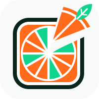

# SplitBox — Brand Identity & Web UI Design System

> **Purpose for AI Agents & Frontend Builders:** Single authoritative brand, token, typography, SVG geometry, and component specification for **SplitBox**. For drop-in code assets, pair with [`.agents/skills/splitbox-ui-system/resources/splitbox-tokens.css`](../../.agents/skills/splitbox-ui-system/resources/splitbox-tokens.css) and [`.agents/skills/splitbox-ui-system/resources/SliceMeter.tsx`](../../.agents/skills/splitbox-ui-system/resources/SliceMeter.tsx). Related specs: [Product MVP Spec](../product/mvp-spec.md) · [Full-Stack Blueprint](../architecture/fullstack-blueprint.md).

---

## 1. Brand Strategy, Voice & Domain Vocabulary

### 1.1 Positioning & Archetype
- **Business Name:** **SplitBox** — taking a wholesale bulk **Box** (case/crate) and **Splitting** it into sealed, student-sized **Slices** pooled anonymously across a university campus hub.
- **Primary Tagline:** *Wholesale groceries, split by the slice.*
- **Utility Tagline:** *Bulk prices. Hall-sized portions. Zero flat-chat hassle.*
- **Utility Sub-Badge:** `CAMPUS BULK GROCERY POOLING`
- **Brand Persona (*Smart & Thrifty Utility × Market-Crate Freshness*):** Transparent unit math (`£/L`, `£/kg`), collective pool fill momentum, and tactile crate framing on an unbleached chalk-white light canvas (`#F7FAF8`). Every card answers two questions immediately: *"How much do I save in `£` per slice?"* and *"How many slices remain to lock this box?"*

### 1.2 Canonical SplitBox UI Vocabulary

| Generic Concept | SplitBox Term | Approved UK Campus UI Microcopy (`£` GBP) |
| :--- | :--- | :--- |
| Bulk Wholesale Case / Lot | **Box** | *"12 × 1L Oatly Barista Ambient Box"* |
| Individual Sealed Student Share | **Slice** | *"Claim 1 Slice (£4.20)"* · *"1 Slice = 3 × 1L Sealed Cartons"* |
| Active Hub Group Pool | **Box Pool** | *"3 of 4 Slices Claimed"* · *"✓ 1 Box Locked"* |
| Card Pre-Authorisation Hold | **Slice Lock** | *"Card Pre-Authorisation Hold — £0.00 captured until the box locks"* *(never say unregulated "escrow" in live checkout UI)* |
| Scheduled Campus Pickup Window | **Box Drop** | *"Vale · Shackleton Drop — Sat 11:00–14:00"* |

---

## 2. Logo System: "The Citrus Crate"

### 2.1 Visual Metaphor
Oranges are naturally pre-portioned into radial wedges. The SplitBox mark fuses a rounded-square wholesale crate (**the Box**) with a segmented citrus cross-section (**the Split**):
1. **Outer Crate Frame:** Bold rounded square in **Deep Forest Ink (`#0B241C`)** enclosing a **Zesty Tangerine (`#FF6B1A`)** crate bed.
2. **Segmented Citrus Core:** Crisp white pith ring divided into radial wedges alternating **Zesty Tangerine (`#FF6B1A`)** and **Botanical Spearmint (`#10D48E`)**.
3. **Popped Top-Right Wedge ("Your Split"):** One `#FF6B1A` tangerine wedge breaks out of the top-right corner, crowned with a `#10D48E` spearmint leaf—symbolizing a student claiming 1 slice without buying the whole wholesale case.

### 2.2 Bundled Local Brand Assets (Zero External Image URLs)
- **Horizontal Lockup (SVG):** [`assets/splitbox-logo.svg`](../../assets/splitbox-logo.svg) & [`public/assets/splitbox-logo.svg`](../../public/assets/splitbox-logo.svg)
- **Standalone Crate Icon / Favicon (SVG):** [`assets/splitbox-icon.svg`](../../assets/splitbox-icon.svg) & [`public/assets/splitbox-icon.svg`](../../public/assets/splitbox-icon.svg)
- **Raster Brand Mark (PNG):** [`assets/splitbox-logo.png`](../../assets/splitbox-logo.png)

```text
                         🌿  <-- Botanical Spearmint Leaf (#10D48E)
                       ╱   ╲
       ╭──────────────╱     ╲    <-- Popped Top-Right Wedge (#FF6B1A)
       │  ╭───────── /   / ╲ ╲       ("Claiming 1 Slice from the Box")
       │  │   ╲  mint│ /    ╲╱
       │  │ tan ╲    │/     ╱
       │  │──────( CORE )──╱─╮
       │  │ mint╱    │╲   mint│  <-- Radial Citrus Slices inside
       │  │   ╱  tan │  ╲     │      Tangerine Crate Bed
       │  ╰──────────────────╯
       ╰──────────────────────╯  <-- Deep Forest Ink Crate Frame (#0B241C)

            S p l i t B o x      <-- Space Grotesk 700 ("Split" #0B241C / "Box" #1849D6)
       [• CAMPUS BULK GROCERY POOLING ] <-- JetBrains Mono Utility Sub-badge
```

### 2.3 Inline Production SVG (Horizontal Lockup)
```xml
<svg xmlns="http://www.w3.org/2000/svg" viewBox="0 0 580 200" width="100%" height="100%" role="img" aria-label="SplitBox Logo">
  <defs>
    <style>
      .wordmark {
        font-family: 'Space Grotesk', 'Plus Jakarta Sans', -apple-system, BlinkMacSystemFont, 'Segoe UI', sans-serif;
        font-weight: 700;
        font-size: 66px;
        letter-spacing: -0.035em;
        fill: #0B241C;
      }
      .wordmark-accent { fill: #1849D6; }
      .tagline {
        font-family: 'JetBrains Mono', ui-monospace, monospace;
        font-weight: 600;
        font-size: 12.5px;
        letter-spacing: 0.08em;
        fill: #0B241C;
      }
    </style>
    <clipPath id="citrus-circle-clip">
      <circle cx="96" cy="108" r="52" />
    </clipPath>
  </defs>

  <rect width="580" height="200" rx="16" fill="#F7FAF8" />

  <g transform="translate(8, 0)">
    <rect x="28" y="40" width="136" height="136" rx="28" fill="#FFFFFF" stroke="#0B241C" stroke-width="8" />
    <rect x="38" y="50" width="116" height="116" rx="18" fill="#FF6B1A" />
    <circle cx="96" cy="108" r="56" fill="#FFFFFF" />

    <g clip-path="url(#citrus-circle-clip)">
      <path d="M 96 108 L 66 52 L 96 52 Z" fill="#10D48E" />
      <path d="M 96 108 L 40 78 L 66 52 Z" fill="#FF6B1A" />
      <path d="M 96 108 L 40 108 L 40 78 Z" fill="#FF6B1A" />
      <path d="M 96 108 L 40 138 L 40 108 Z" fill="#10D48E" />
      <path d="M 96 108 L 66 164 L 40 138 Z" fill="#FF6B1A" />
      <path d="M 96 108 L 96 164 L 66 164 Z" fill="#FF6B1A" />
      <path d="M 96 108 L 126 164 L 96 164 Z" fill="#10D48E" />
      <path d="M 96 108 L 152 138 L 126 164 Z" fill="#FF6B1A" />
      <path d="M 96 108 L 152 108 L 152 138 Z" fill="#FF6B1A" />
      <path d="M 96 108 L 152 78 L 152 108 Z" fill="#10D48E" />
      <path d="M 96 108 L 96 52 L 152 78 Z" fill="#FFFFFF" />

      <line x1="96" y1="50" x2="96" y2="166" stroke="#FFFFFF" stroke-width="4.5" />
      <line x1="38" y1="108" x2="154" y2="108" stroke="#FFFFFF" stroke-width="4.5" />
      <line x1="46" y1="79" x2="146" y2="137" stroke="#FFFFFF" stroke-width="4.5" />
      <line x1="67" y1="58" x2="125" y2="158" stroke="#FFFFFF" stroke-width="4.5" />
      <line x1="146" y1="79" x2="46" y2="137" stroke="#FFFFFF" stroke-width="4.5" />
      <line x1="125" y1="58" x2="67" y2="158" stroke="#FFFFFF" stroke-width="4.5" />
    </g>

    <path d="M 96 108 L 116 30 L 182 68 Z" fill="#F7FAF8" />

    <g transform="translate(12, -14)">
      <path d="M 92 98 L 114 28 A 74 74 0 0 1 168 68 Z" fill="#FF6B1A" />
      <path d="M 111 36 A 65 65 0 0 1 160 72" fill="none" stroke="#FFFFFF" stroke-width="4.5" stroke-linecap="round" />
      <line x1="92" y1="98" x2="141" y2="49" stroke="#FFFFFF" stroke-width="4" stroke-linecap="round" />
    </g>

    <g transform="translate(152, 8)">
      <path d="M 0 32 C -2 12, 14 0, 32 0 C 32 18, 20 34, 0 32 Z" fill="#10D48E" />
      <line x1="2" y1="30" x2="22" y2="10" stroke="#FFFFFF" stroke-width="3" stroke-linecap="round" />
      <line x1="11" y1="21" x2="10" y2="11" stroke="#FFFFFF" stroke-width="2.5" stroke-linecap="round" />
      <line x1="11" y1="21" x2="21" y2="22" stroke="#FFFFFF" stroke-width="2.5" stroke-linecap="round" />
    </g>
  </g>

  <text x="214" y="108" class="wordmark">Split<tspan class="wordmark-accent">Box</tspan></text>
  <rect x="216" y="126" width="288" height="28" rx="6" fill="#EDF7F2" stroke="#0B241C" stroke-width="1.75" />
  <circle cx="232" cy="140" r="5" fill="#10D48E" />
  <text x="246" y="145" class="tagline">CAMPUS BULK GROCERY POOLING</text>
</svg>
```

### 2.4 Logo Clear-Space & Guardrails
- **Clear Space:** Minimum `0.25W` (25% of crate width) on all sides, measured from the tip of the popped top-right leaf.
- **Minimum Sizes:** `140px` wide for the full horizontal lockup; `28px × 28px` for navbar crate icon (`16px × 16px` favicons simplify inner wedges to 4 quadrants while preserving the popped top-right wedge).
- **Approved Variations:** Primary Full-Color (on `#F7FAF8`, `#FFFFFF`, or `#EDF7F2`), Inverted Campus Pickup Sign Badge (`#0B241C` ground with `2px` white outer crate border), or 1-color Monochrome Stamp (`#0B241C` or `#1849D6`).
- **Do Nots:** Never rotate the crate or move the popped wedge away from top-right; never add blurry drop shadows or 3D bevels; never place the full-color mark on saturated orange or green backgrounds.

---

## 3. Color System, `--sb-*` Tokens & Strict Contrast Guardrails

| Swatch Role | CSS Variable | Hex | RGB | HSL | Usage Rule |
| :--- | :--- | :--- | :--- | :--- | :--- |
| **Canvas Base** | `--sb-bg-canvas` | `#F7FAF8` | `247, 250, 248` | `140°, 23%, 97%` | Light-mode `<body>` background across all views (never dark mode) |
| **Card Surface** | `--sb-bg-surface` | `#FFFFFF` | `255, 255, 255` | `0°, 0%, 100%` | Product crate cards, sticky navbar, modals, slide-over drawers |
| **Mint Surface** | `--sb-bg-mint-tint` | `#EDF7F2` | `237, 247, 242` | `150°, 38%, 95%` | Perforated GBP receipt blocks, open slice wedges, savings strips |
| **Cobalt Surface** | `--sb-bg-cobalt-tint` | `#EEF2FF` | `238, 242, 255` | `226°, 100%, 97%` | Pre-auth hold callouts, campus hub zone pills |
| **Primary Ink** | `--sb-ink-primary` | `#0B241C` | `11, 36, 28` | `161°, 53%, 9%` | Primary copy, headings, `1.5px–2px` borders, hard offset shadows |
| **Secondary Ink** | `--sb-ink-secondary` | `#4A665C` | `74, 102, 92` | `159°, 16%, 35%` | Sub-unit breakdowns, FIR allergen metadata, timestamps |
| **Subtle Rule** | `--sb-border-subtle` | `#CBE0D6` | `203, 224, 214` | `151°, 26%, 84%` | Internal perforated receipt dashed dividers |
| **Botanical Mint** | `--sb-mint-500` | `#10D48E` | `16, 212, 142` | `159°, 86%, 45%` | Stranger-claimed wedges, `SAVE X%` badges, `100%` locked boxes |
| **Mint Deep Text** | `--sb-mint-700` | `#087F53` | `8, 127, 83` | `158°, 88%, 26%` | Accessible green text on light `#EDF7F2` mint surfaces |
| **Zesty Tangerine** | `--sb-tangerine-500` | `#FF6B1A` | `255, 107, 26` | `21°, 100%, 55%` | Primary `Claim 1 Slice` CTAs, user's popped active wedge |
| **Tangerine Hover** | `--sb-tangerine-600` | `#E05206` | `224, 82, 6` | `21°, 95%, 45%` | Active/pressed tangerine control accent |
| **Electric Cobalt** | `--sb-cobalt-600` | `#1849D6` | `24, 73, 214` | `225°, 80%, 47%` | Wordmark `"Box"` accent, pre-auth lock badges, Pickup Pass CTA |
| **Harvest Amber** | `--sb-warning-500` | `#F59E0B` | `245, 158, 11` | `38°, 92%, 50%` | `1–2 Slices Left` closing-soon callouts |
| **Radish Red** | `--sb-danger-600` | `#E11D48` | `225, 29, 72` | `347°, 77%, 50%` | Validation errors, expired QR replay warnings |

### Non-Negotiable Contrast Rules
1. **On Botanical Mint (`#10D48E`):** ALWAYS use **Deep Forest Ink (`#0B241C`)** bold text (`9.8:1` WCAG AAA). Never place white text on `#10D48E`.
2. **On Zesty Tangerine (`#FF6B1A`):** ALWAYS use **Deep Forest Ink (`#0B241C`)** bold text (`6.4:1` WCAG AA) for crisp price-gun legibility. Never place white text on `#FF6B1A`.
3. **On Electric Cobalt (`#1849D6`) & Deep Forest Ink (`#0B241C`):** ALWAYS use **Pure White (`#FFFFFF`)** text.

---

## 4. Bundled Offline Typography & Numeric Discipline (`@fontsource/*`)

External font stylesheet CDNs are **strictly forbidden** in both Demo Mode and Live Production Mode. Bundle self-hosted `@fontsource` packages directly in `src/main.tsx` (or `src/index.css`):

```ts
// src/main.tsx — 100% self-hosted font imports (npm i @fontsource/space-grotesk @fontsource/plus-jakarta-sans @fontsource/jetbrains-mono)
import '@fontsource/space-grotesk/600.css';
import '@fontsource/space-grotesk/700.css';
import '@fontsource/plus-jakarta-sans/500.css';
import '@fontsource/plus-jakarta-sans/600.css';
import '@fontsource/plus-jakarta-sans/700.css';
import '@fontsource/jetbrains-mono/500.css';
import '@fontsource/jetbrains-mono/600.css';
import '@fontsource/jetbrains-mono/700.css';
```

| Role | CSS Token | Family | Bundled Weights | Target Elements |
| :--- | :--- | :--- | :--- | :--- |
| **Display & Headings** | `--sb-font-display` | `Space Grotesk` | `600`, `700` | `h1`–`h3` titles, tactile button labels, `SplitBox` wordmark |
| **Body & Controls** | `--sb-font-sans` | `Plus Jakarta Sans` | `500`, `600`, `700` | Sub-unit descriptions, FIR allergen disclosures, hub notes, inputs |
| **Receipts & Counters** | `--sb-font-mono` | `JetBrains Mono` | `500`, `600`, `700` | **All GBP prices (`£4.20`), unit rates (`£1.40/L`), slice ratios (`3/4`), savings (`SAVE 36%`), timers, and pass codes (`UOB-BOX-409`)** |

> **Tabular Numeric Discipline:** Every element rendering GBP currency, percentages, countdowns, PINs, or `X/Y` counters MUST apply `font-family: var(--sb-font-mono)` and `font-variant-numeric: tabular-nums` (`.sb-mono`).

---

## 5. Tactile Crate Framing & Base CSS Tokens

- **Crisp Ink Borders:** `1.5px solid #0B241C` (`--sb-border-regular`) on pills/receipts; `2px solid #0B241C` (`--sb-border-strong`) on cards, drawers, inputs, and buttons.
- **Zero-Blur Hard Offset Shadows:** Use `3px 3px 0px #0B241C` (`--sb-shadow-crate`), lifting to `5px 5px 0px #0B241C` on hover and pressing to `1px 1px 0px #0B241C` on active click. Diffuse/blurry SaaS drop shadows (such as `0 10px 25px rgba(...)` or Tailwind `shadow-md` / `shadow-lg`) are **forbidden**.

```css
@import "tailwindcss";

:root {
  /* Surfaces */
  --sb-bg-canvas: #F7FAF8;
  --sb-bg-surface: #FFFFFF;
  --sb-bg-mint-tint: #EDF7F2;
  --sb-bg-cobalt-tint: #EEF2FF;

  /* Ink & Borders */
  --sb-ink-primary: #0B241C;
  --sb-ink-secondary: #4A665C;
  --sb-border-subtle: #CBE0D6;

  /* Brand Accents */
  --sb-mint-500: #10D48E;
  --sb-mint-700: #087F53;
  --sb-tangerine-500: #FF6B1A;
  --sb-tangerine-600: #E05206;
  --sb-cobalt-600: #1849D6;
  --sb-warning-500: #F59E0B;
  --sb-danger-600: #E11D48;

  /* Typography */
  --sb-font-display: 'Space Grotesk', -apple-system, BlinkMacSystemFont, sans-serif;
  --sb-font-sans: 'Plus Jakarta Sans', -apple-system, BlinkMacSystemFont, sans-serif;
  --sb-font-mono: 'JetBrains Mono', ui-monospace, SFMono-Regular, monospace;

  /* Radii & Tactile Crate Framing */
  --sb-radius-box: 16px;
  --sb-radius-control: 10px;
  --sb-radius-pill: 6px;
  --sb-border-strong: 2px solid var(--sb-ink-primary);
  --sb-border-regular: 1.5px solid var(--sb-ink-primary);
  --sb-shadow-crate: 3px 3px 0px var(--sb-ink-primary);
  --sb-shadow-crate-hover: 5px 5px 0px var(--sb-ink-primary);
  --sb-shadow-crate-active: 1px 1px 0px var(--sb-ink-primary);

  /* Layout */
  --sb-max-width: 1280px;
}

html, body {
  margin: 0;
  padding: 0;
  overflow-x: clip;
  background-color: var(--sb-bg-canvas);
  color: var(--sb-ink-primary);
  font-family: var(--sb-font-sans);
  font-size: 16px;
  line-height: 1.5;
  -webkit-font-smoothing: antialiased;
}

.sb-crate-grid-bg {
  background-color: var(--sb-bg-canvas);
  background-image:
    linear-gradient(to right, rgba(11, 36, 28, 0.05) 1px, transparent 1px),
    linear-gradient(to bottom, rgba(11, 36, 28, 0.05) 1px, transparent 1px);
  background-size: 32px 32px;
}

.sb-container {
  max-width: var(--sb-max-width);
  margin: 0 auto;
  padding: 0 24px;
}

.sb-catalog-grid {
  display: grid;
  grid-template-columns: repeat(auto-fill, minmax(min(100%, 310px), 1fr));
  gap: 20px;
}

@media (max-width: 640px) {
  .sb-container { padding: 0 14px; }
  .sb-catalog-grid { grid-template-columns: 1fr; gap: 14px; }
}

.sb-mono {
  font-family: var(--sb-font-mono);
  font-variant-numeric: tabular-nums;
}

.sb-badge {
  display: inline-flex;
  align-items: center;
  gap: 6px;
  font-family: var(--sb-font-mono);
  font-variant-numeric: tabular-nums;
  font-size: 0.72rem;
  font-weight: 700;
  letter-spacing: 0.05em;
  text-transform: uppercase;
  padding: 4px 8px;
  border-radius: var(--sb-radius-pill);
  border: var(--sb-border-regular);
  white-space: nowrap;
}

.sb-badge--mint { background: var(--sb-mint-500); color: var(--sb-ink-primary); }
.sb-badge--cobalt { background: var(--sb-bg-cobalt-tint); color: var(--sb-cobalt-600); }
.sb-badge--cobalt-solid { background: var(--sb-cobalt-600); color: #FFFFFF; }
.sb-badge--tangerine { background: var(--sb-tangerine-500); color: var(--sb-ink-primary); }
.sb-badge--danger { background: #FFE4E6; color: var(--sb-danger-600); }

.sb-btn {
  display: inline-flex;
  justify-content: space-between;
  align-items: center;
  gap: 10px;
  min-height: 42px;
  padding: 11px 16px;
  font-family: var(--sb-font-display);
  font-size: 0.975rem;
  font-weight: 700;
  border-radius: var(--sb-radius-control);
  border: var(--sb-border-strong);
  box-shadow: 2px 2px 0px var(--sb-ink-primary);
  cursor: pointer;
  transition: transform 100ms ease, box-shadow 100ms ease, background-color 120ms ease;
}

.sb-btn--primary { background: var(--sb-tangerine-500); color: var(--sb-ink-primary); }
.sb-btn--primary:hover:not(:disabled) {
  background: #FF7E38;
  transform: translate(-1px, -1px);
  box-shadow: 4px 4px 0px var(--sb-ink-primary);
}
.sb-btn--primary:active:not(:disabled) {
  transform: translate(1px, 1px);
  box-shadow: var(--sb-shadow-crate-active);
}
.sb-btn--secondary { background: var(--sb-bg-surface); color: var(--sb-ink-primary); }
.sb-btn--cobalt { background: var(--sb-cobalt-600); color: #FFFFFF; }

.sb-card {
  background: var(--sb-bg-surface);
  border: var(--sb-border-strong);
  border-radius: var(--sb-radius-box);
  box-shadow: var(--sb-shadow-crate);
  padding: 20px;
  display: flex;
  flex-direction: column;
  justify-content: space-between;
  gap: 16px;
}

.sb-card__receipt {
  background: var(--sb-bg-mint-tint);
  border: 1.5px dashed var(--sb-ink-primary);
  border-radius: var(--sb-radius-control);
  padding: 12px 14px;
  font-family: var(--sb-font-mono);
  font-variant-numeric: tabular-nums;
  display: flex;
  flex-direction: column;
  gap: 6px;
}
```

---

## 6. Signature UI Component Blueprints (GBP `£` & UoB Context)

### 6.1 Radial `<SliceMeter />` SVG Geometry (Horizontal Progress Bars Forbidden!)
Pool thresholds are **exclusively** rendered with the segmented citrus-crate `<SliceMeter />` ([`SliceMeter.tsx`](../../.agents/skills/splitbox-ui-system/resources/SliceMeter.tsx)):
- **Canvas & Crate Frame:** `viewBox="0 0 88 88"` (`68×68px` default), outer rounded crate `<rect x="6" y="6" width="76" height="76" rx="18" fill="#FFFFFF" stroke="#0B241C" strokeWidth="3.5" />`.
- **Wedge Geometry (`N` in `{4, 6, 8, 10, 12}`):** Computed around center `(CX = 44, CY = 44)` with radius `R = 32` and sector angle `step = (2 * Math.PI) / N`:
  - **Wedge `0` (Top-Right Sector `[-π/2, -π/2 + step]`):** Reserved for the current student's active/previewed slice. When `userSlicesInOpenBox > 0`, it pops outward via `transform="translate(3, -3)"` in **Zesty Tangerine (`#FF6B1A`)** with `stroke="#0B241C"`.
  - **Wedges `1 .. N-1` (Counter-Clockwise from `-π/2`):** Funded campus stranger slices fill in **Botanical Spearmint (`#10D48E`)**; extra slices owned by the current student fill in **`#FF6B1A`**; unclaimed slots fill in **Mint Tint (`#EDF7F2`)** (with dashed `#FF6B1A` `strokeDasharray="3 2"` outline when `1–2` slices remain).
- **Center Counter Hub:** `<circle cx="44" cy="44" r="13.5" fill="#FFFFFF" stroke="#0B241C" strokeWidth="2.5" />` displaying tabular monospace `X/Y` (e.g., `3/4`).

```html
<div class="sb-slice-meter" aria-label="3 of 4 slices claimed">
  <svg viewBox="0 0 88 88" width="68" height="68" role="img" aria-hidden="true">
    <rect x="6" y="6" width="76" height="76" rx="18" fill="#FFFFFF" stroke="#0B241C" stroke-width="3.5" />
    <!-- Wedges 1-2: Funded by Vale Hallmates (#10D48E) -->
    <path d="M 44 44 L 12.00 44.00 A 32 32 0 0 1 44.00 12.00 Z" fill="#10D48E" stroke="#FFFFFF" stroke-width="2.2" />
    <path d="M 44 44 L 44.00 76.00 A 32 32 0 0 1 12.00 44.00 Z" fill="#10D48E" stroke="#FFFFFF" stroke-width="2.2" />
    <!-- Wedge 3: Final Open Slot Outlined Closing-Soon (#EDF7F2 + dashed #FF6B1A) -->
    <path d="M 44 44 L 76.00 44.00 A 32 32 0 0 1 44.00 76.00 Z" fill="#EDF7F2" stroke="#FF6B1A" stroke-width="2.2" stroke-dasharray="3 2" />
    <!-- Wedge 0 (Top-Right): Student's Popped Active Slice (#FF6B1A) -->
    <path d="M 44 44 L 44.00 12.00 A 32 32 0 0 1 76.00 44.00 Z" transform="translate(3, -3)" fill="#FF6B1A" stroke="#0B241C" stroke-width="2" />
    <!-- Center Counter Hub -->
    <circle cx="44" cy="44" r="13.5" fill="#FFFFFF" stroke="#0B241C" stroke-width="2.5" />
    <text x="44" y="47.5" text-anchor="middle" font-family="'JetBrains Mono', monospace" font-weight="700" font-size="9.5" fill="#0B241C">3/4</text>
  </svg>
</div>
```

### 6.2 Top Campus Utility Navbar
```html
<header style="background: var(--sb-bg-surface); border-bottom: var(--sb-border-strong); position: sticky; top: 0; z-index: 40;">
  <div class="sb-container" style="min-height: 68px; display: flex; align-items: center; justify-content: space-between; gap: 12px; flex-wrap: wrap;">
    <a href="/" style="display: inline-flex; align-items: center; gap: 10px; text-decoration: none; color: inherit;">
      
      <span style="font-family: var(--sb-font-display); font-weight: 700; font-size: 1.4rem; letter-spacing: -0.03em;">
        Split<span style="color: var(--sb-cobalt-600);">Box</span>
      </span>
    </a>

    <div style="display: flex; align-items: center; gap: 8px; flex-wrap: wrap;">
      <span class="sb-badge sb-badge--cobalt">📍 VALE · SHACKLETON HUB</span>
      <span class="sb-badge sb-badge--mint">⏱ CLOSES WED 23:59</span>
      <button type="button" class="sb-btn sb-btn--secondary" style="padding: 8px 12px; font-size: 0.875rem;">
        <span>My Crate</span>
        <span class="sb-mono" style="background: var(--sb-mint-500); padding: 2px 7px; border-radius: 4px; border: 1px solid #0B241C;">2 · £8.40</span>
      </button>
    </div>
  </div>
</header>
```

### 6.3 Wholesale "Split Card" & Perforated GBP (`£`) Receipt Block
```html
<article class="sb-card">
  <header style="display: flex; justify-content: space-between; align-items: center; gap: 8px; flex-wrap: wrap;">
    <span class="sb-badge sb-badge--cobalt">AMBIENT STAPLE · 4-SLICE BOX</span>
    <span class="sb-badge sb-badge--mint">SAVE 36%</span>
  </header>

  <div style="display: flex; justify-content: space-between; align-items: center; gap: 14px;">
    <div>
      <h3 style="font-family: var(--sb-font-display); font-size: 1.2rem; font-weight: 700; margin: 0 0 4px 0;">
        Oatly Barista Edition Oat Drink
      </h3>
      <p style="font-size: 0.85rem; color: var(--sb-ink-secondary); margin: 0;">
        1 Slice = 3 × 1L Sealed Tetra Cartons (from 12 × 1L Box · £1.40/L)
      </p>
    </div>
    <!-- Radial 4-Slice <SliceMeter /> -->
  </div>

  <div class="sb-card__receipt">
    <div style="display: flex; justify-content: space-between; font-size: 0.76rem; color: var(--sb-ink-secondary);">
      <span>SAINSBURY'S LOCAL B29 6BE (3×1L)</span>
      <span style="text-decoration: line-through;">£6.60</span>
    </div>
    <div style="display: flex; justify-content: space-between; align-items: baseline; font-weight: 700; padding: 4px 0; border-top: 1px dashed var(--sb-border-subtle); border-bottom: 1px dashed var(--sb-border-subtle);">
      <span>YOUR SPLITBOX SLICE</span>
      <span style="font-size: 1.3rem;">£4.20 <small>/ slice</small></span>
    </div>
    <div style="display: flex; justify-content: space-between; font-size: 0.76rem; color: var(--sb-ink-secondary);">
      <span>POOL STATUS</span>
      <span>3/4 CLAIMED · 1 SLICE TO LOCK</span>
    </div>
  </div>

  <footer>
    <button type="button" class="sb-btn sb-btn--primary" style="width: 100%;">
      <span>Claim Final Slice &amp; Lock Box</span>
      <span class="sb-mono" style="background: rgba(255,255,255,0.45); padding: 2px 8px; border-radius: 4px; border: 1px solid #0B241C;">£4.20 →</span>
    </button>
    <p style="margin: 8px 0 0 0; font-size: 0.75rem; color: var(--sb-ink-secondary);">
      🔒 Card Pre-Authorisation Hold (£0.00 captured until Box locks). £0.00 fee on £9.00+ crates · Sat 11:00–14:00 @ Shackleton.
    </p>
  </footer>
</article>
```

---

## 7. Pool Lifecycle Grammar & `375px` Mobile Layout Rules

### 7.1 5-State Pool & Pre-Auth Visual Grammar

| Lifecycle State | `<SliceMeter />` Visual | Status Badge Class & Copy | Primary Button Variant & Copy |
| :--- | :--- | :--- | :--- |
| **1. Open Pool** | Stranger wedges `#10D48E`, open slots `#EDF7F2` | `.sb-badge--cobalt` → `OPEN POOL · 2/6 SLICES` | `.sb-btn--primary` → `Claim 1 Slice (£X.XX →)` |
| **2. Closing Soon (1–2 Left)** | Open 1–2 slots outlined in dashed `#FF6B1A` | `.sb-badge--tangerine` → `1 SLICE TO FILL BOX` | `.sb-btn--primary` → `Claim Final Slice & Lock Box` |
| **3. User Slice Pre-Auth Locked** | Student's top-right wedge popped in `#FF6B1A` | `.sb-badge--cobalt-solid` → `✓ SLICE PRE-AUTH LOCKED` | `.sb-btn--secondary` → `Add Another Slice (+1)` |
| **4. Box Filled (`100%` Locked)** | All wedges solid `#10D48E` (+ overflow opens Box #N+1) | `.sb-badge--mint` → `★ BOX LOCKED · DROPS SAT` | `.sb-btn--secondary` → `Claim in Next Open Box` |
| **5. Ready for Pickup (`>0` Fulfilled)** | Settled badge + `<QRCodeSVG />` pass unlocked | `.sb-badge--mint` → `READY AT VALE · SHACKLETON` | `.sb-btn--cobalt` → `Show Pickup Pass (UOB-BOX-409)` |

### 7.2 Mandatory `375px × 812px` Mobile Responsiveness Rules
1. **Zero Horizontal Scroll (`scrollWidth <= 375`):** Set `overflow-x: clip` on `html, body`, use `minmax(min(100%, 310px), 1fr)` on desktop grids, and collapse `.sb-catalog-grid` strictly to `grid-template-columns: 1fr` below `640px` (`padding: 0 14px`).
2. **Wrapping Badges & Receipt Rows:** Header pill groups must allow `flex-wrap: wrap` (or truncate safely with `min-width: 0`) so long benchmark labels or campus hub pills never push card widths past `347px`.
3. **Unobstructed Sticky Bottom Crate Bar:** On mobile viewports (`< 768px`), render a sticky bottom crate summary bar (`min-height: 56px`, `padding-bottom: env(safe-area-inset-bottom)`) giving 1-tap access to the slide-over Crate Drawer. Keep **Demo Controls** docked at the **top** of the page so it never collides with bottom thumb navigation.
