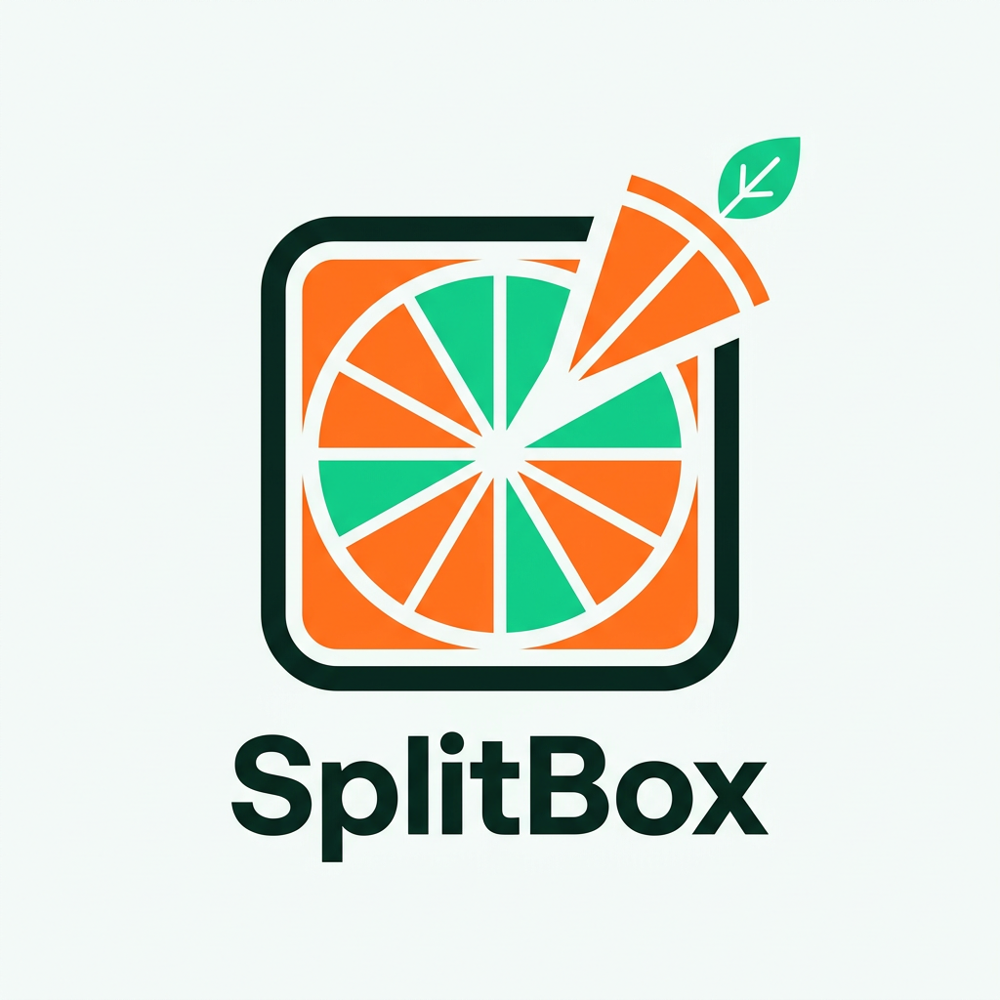

# SplitBox — Brand Identity

> **Web Styling Guide:** The complete website design system, CSS tokens, typography rules, and HTML/SVG UI component blueprints have been extracted into [page-syles.md](file:///home/hacksday/Documents/project/page-syles.md) for AI agents and frontend developers.

---

## 1. Business Name & Brand Strategy

### Business Name: **SplitBox**
**SplitBox** is a direct, punchy, two-syllable compound name that captures the exact utility of the platform: taking a wholesale bulk **Box** (case/crate) and **Splitting** it into individual student-sized shares—automatically pooled across strangers on campus with zero flake risk.

### Taglines & Positioning
- **Primary Tagline:** *Wholesale groceries, split by the slice.*
- **Utility Tagline:** *Bulk prices. Dorm-sized portions. Zero group-chat hassle.*
- **Short Descriptor (Badges / Receipts):** `CAMPUS BULK GROCERY POOLING`

### Brand Personality & Archetype
- **Smart & Thrifty Utility (Aldi × Splitwise):** Transparent unit math, no-nonsense savings, and frictionless escrow pooling. Every screen answers two questions immediately: *"How much do I save per unit?"* and *"How many slices are left to fill this box?"*
- **Market-Crate Freshness:** Avoids sterile corporate SaaS blue or generic delivery-app templates by pairing crisp botanical greens, vibrant citrus tangerine, and electric cobalt with tactile ink borders on an unbleached chalk-white canvas.

### Core Brand Vocabulary (UI Microcopy)
Using consistent, metaphor-driven terminology across the product makes SplitBox instantly recognizable:

| Generic Term | SplitBox Term | Usage in UI |
| :--- | :--- | :--- |
| Bulk Case / Wholesale Lot | **Box** | *"16-Carton Barista Oat Milk Box"* |
| Individual Portion / Unit | **Slice** | *"Claim 1 Slice ($6.90)"* |
| Active Group Pool | **Box Pool** | *"6 of 8 Slices Claimed"* |
| Upfront Escrow Hold | **Slice Lock** | *"Your slice is locked in escrow — charged only when the box fills"* |
| Scheduled Campus Pickup | **Box Drop** | *"North Quad Drop — Thu 4:00–6:00 PM"* |

---

## 2. Business Logo System: "The Citrus Crate"

### Visual Metaphor
Oranges are naturally pre-portioned into slices. The **SplitBox** logo fuses a sturdy rounded-square wholesale crate (**the Box**) with the cross-section of a fresh citrus fruit divided into radial wedges (**the Split**):
1. **The Outer Crate Frame:** A bold rounded square in **Deep Forest Ink (`#0B241C`)** enclosing a warm **Zesty Tangerine (`#FF6B1A`)** crate bed—representing wholesale bulk packaging and escrow security.
2. **The Segmented Citrus Core:** Inside the crate sits a crisp white pith ring divided into radial citrus wedges alternating between **Zesty Tangerine (`#FF6B1A`)** and **Botanical Spearmint (`#10D48E`)**—representing fresh groceries and collective progress as strangers fill the pool.
3. **The Popped Top-Right Wedge ("Your Split"):** One tangerine citrus wedge breaks cleanly out of the top-right corner of the box, crowned with a **Botanical Spearmint (`#10D48E`)** leaf—symbolizing a student claiming their individual portion without buying the whole case.

### Logo Asset Files
- **Primary Raster Logo (PNG):** [assets/splitbox-logo.png](file:///home/hacksday/Documents/project/assets/splitbox-logo.png)
- **Primary Horizontal Lockup (SVG):** [assets/splitbox-logo.svg](file:///home/hacksday/Documents/project/assets/splitbox-logo.svg)
- **Standalone App Icon / Favicon (SVG):** [assets/splitbox-icon.svg](file:///home/hacksday/Documents/project/assets/splitbox-icon.svg)



### Logo Anatomy (ASCII Diagram)
```text
                         🌿  <-- Botanical Spearmint Leaf (#10D48E)
                       ╱   ╲
       ╭──────────────╱     ╲    <-- Popped Top-Right Wedge (#FF6B1A)
       │  ╭───────── /   / ╲ ╲       ("Claiming 1 Slice from the Box")
       │  │   ╲  mint│ /    ╲╱
       │  │ tan ╲    │/     ╱
       │  │──────( CORE )──╱─╮
       │  │ mint╱    │╲   mint│  <-- Radial Citrus Slices inside
       │  │   ╱  tan │  ╲     │      Tangerine Crate Bed
       │  ╰──────────────────╯
       ╰──────────────────────╯  <-- Deep Forest Ink Crate Frame (#0B241C)

            S p l i t B o x      <-- Space Grotesk 700 ("Split" #0B241C / "Box" #1849D6)
       [• CAMPUS BULK GROCERY POOLING ] <-- JetBrains Mono Utility Sub-badge
```

### Inline Production SVG (Horizontal Lockup)
```xml
<svg xmlns="http://www.w3.org/2000/svg" viewBox="0 0 580 200" width="100%" height="100%" role="img" aria-label="SplitBox Logo">
  <defs>
    <style>
      .wordmark {
        font-family: 'Space Grotesk', 'Plus Jakarta Sans', -apple-system, BlinkMacSystemFont, 'Segoe UI', sans-serif;
        font-weight: 700;
        font-size: 66px;
        letter-spacing: -0.035em;
        fill: #0B241C;
      }
      .wordmark-accent { fill: #1849D6; }
      .tagline {
        font-family: 'JetBrains Mono', 'Fira Code', monospace;
        font-weight: 600;
        font-size: 12.5px;
        letter-spacing: 0.08em;
        fill: #0B241C;
      }
    </style>
    <clipPath id="citrus-circle-clip">
      <circle cx="96" cy="108" r="52" />
    </clipPath>
  </defs>

  <rect width="580" height="200" rx="16" fill="#F7FAF8" />

  <g transform="translate(8, 0)">
    <rect x="28" y="40" width="136" height="136" rx="28" fill="#FFFFFF" stroke="#0B241C" stroke-width="8" />
    <rect x="38" y="50" width="116" height="116" rx="18" fill="#FF6B1A" />
    <circle cx="96" cy="108" r="56" fill="#FFFFFF" />

    <g clip-path="url(#citrus-circle-clip)">
      <path d="M 96 108 L 66 52 L 96 52 Z" fill="#10D48E" />
      <path d="M 96 108 L 40 78 L 66 52 Z" fill="#FF6B1A" />
      <path d="M 96 108 L 40 108 L 40 78 Z" fill="#FF6B1A" />
      <path d="M 96 108 L 40 138 L 40 108 Z" fill="#10D48E" />
      <path d="M 96 108 L 66 164 L 40 138 Z" fill="#FF6B1A" />
      <path d="M 96 108 L 96 164 L 66 164 Z" fill="#FF6B1A" />
      <path d="M 96 108 L 126 164 L 96 164 Z" fill="#10D48E" />
      <path d="M 96 108 L 152 138 L 126 164 Z" fill="#FF6B1A" />
      <path d="M 96 108 L 152 108 L 152 138 Z" fill="#FF6B1A" />
      <path d="M 96 108 L 152 78 L 152 108 Z" fill="#10D48E" />
      <path d="M 96 108 L 96 52 L 152 78 Z" fill="#FFFFFF" />

      <line x1="96" y1="50" x2="96" y2="166" stroke="#FFFFFF" stroke-width="4.5" />
      <line x1="38" y1="108" x2="154" y2="108" stroke="#FFFFFF" stroke-width="4.5" />
      <line x1="46" y1="79" x2="146" y2="137" stroke="#FFFFFF" stroke-width="4.5" />
      <line x1="67" y1="58" x2="125" y2="158" stroke="#FFFFFF" stroke-width="4.5" />
      <line x1="146" y1="79" x2="46" y2="137" stroke="#FFFFFF" stroke-width="4.5" />
      <line x1="125" y1="58" x2="67" y2="158" stroke="#FFFFFF" stroke-width="4.5" />
    </g>

    <path d="M 96 108 L 116 30 L 182 68 Z" fill="#F7FAF8" />

    <g transform="translate(12, -14)">
      <path d="M 92 98 L 114 28 A 74 74 0 0 1 168 68 Z" fill="#FF6B1A" />
      <path d="M 111 36 A 65 65 0 0 1 160 72" fill="none" stroke="#FFFFFF" stroke-width="4.5" stroke-linecap="round" />
      <line x1="92" y1="98" x2="141" y2="49" stroke="#FFFFFF" stroke-width="4" stroke-linecap="round" />
    </g>

    <g transform="translate(152, 8)">
      <path d="M 0 32 C -2 12, 14 0, 32 0 C 32 18, 20 34, 0 32 Z" fill="#10D48E" />
      <line x1="2" y1="30" x2="22" y2="10" stroke="#FFFFFF" stroke-width="3" stroke-linecap="round" />
      <line x1="11" y1="21" x2="10" y2="11" stroke="#FFFFFF" stroke-width="2.5" stroke-linecap="round" />
      <line x1="11" y1="21" x2="21" y2="22" stroke="#FFFFFF" stroke-width="2.5" stroke-linecap="round" />
    </g>
  </g>

  <text x="214" y="108" class="wordmark">Split<tspan class="wordmark-accent">Box</tspan></text>
  <rect x="216" y="126" width="288" height="28" rx="6" fill="#EDF7F2" stroke="#0B241C" stroke-width="1.75" />
  <circle cx="232" cy="140" r="5" fill="#10D48E" />
  <text x="246" y="145" class="tagline">CAMPUS BULK GROCERY POOLING</text>
</svg>
```

### Logo Usage Guidelines
- **Clear Space:** Maintain a minimum clear-space buffer around the logo equal to **25% of the crate width (`0.25W`)** on all sides, measured from the tip of the popped top-right leaf.
- **Minimum Sizes:**
  - **Full Horizontal Lockup:** Minimum `140px` wide on web headers.
  - **Standalone Crate Icon:** Minimum `28px × 28px` for navigation bars; for `16px × 16px` favicons, simplify inner wedges to 4 quadrants while preserving the popped top-right tangerine slice.
- **Approved Variations:**
  1. **Primary Full-Color:** On Crisp Off-White (`#F7FAF8`), Pure White (`#FFFFFF`), or Pale Mint (`#EDF7F2`).
  2. **Dark/Inverted Badge (Stickers & Campus Pickup Signs):** Deep Forest Ink (`#0B241C`) background with a `2px` white outer crate border and high-luminance Mint/Tangerine wedges.
  3. **Monochrome Stamp (Receipts & Shipping Labels):** 1-color Deep Forest Ink (`#0B241C`) or Electric Cobalt (`#1849D6`) stencil.
- **Do Nots:**
  - Do not rotate the crate or move the popped wedge to another corner (top-right always signals upward progress and completion).
  - Do not add soft drop shadows or 3D bevels to the logo mark.
  - Do not place the full-color logo on saturated orange or green backgrounds that clash with the wedges.
