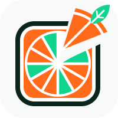

# SplitBox — AI Agent Web Styling & Component Guide

> **Purpose for AI Agents:** This specification defines the complete visual design system, CSS tokens, layout architecture, and copy-pasteable HTML/SVG/CSS component patterns for **SplitBox** (a campus bulk grocery pooling platform). Follow these rules strictly when generating any SplitBox web page or UI component.

---

## 1. Core Aesthetic Directives (Read First)

- **Theme Polarity:** **High-Craft Light Mode** on a cool unbleached chalk canvas (`#F7FAF8`). Never default to generic dark-mode SaaS templates or sterile corporate blue/gray palettes.
- **Visual Persona:** **Smart & Thrifty Utility meets Market-Crate Freshness** (Aldi × Splitwise). Every component emphasizes transparent unit math, collective pool fill states, and tactile packaging.
- **Tactile Crate Framing (No Blurry Shadows):**
  - Use crisp `1.5px` or `2px` solid **Deep Forest Ink (`#0B241C`)** borders on all cards, buttons, inputs, and badges.
  - Use hard zero-blur offset shadows (`3px 3px 0px #0B241C`) instead of diffuse drop shadows (`0 10px 25px rgba(0,0,0,0.1)` is forbidden).
- **Signature Visual Motifs:**
  1. **Segmented "Slice" Progress Indicators:** Never use generic horizontal progress bars for pool thresholds. Always use radial citrus-box slice meters where wedges fill up in **Botanical Spearmint (`#10D48E`)** and the user's active share pops outward at the top-right in **Zesty Tangerine (`#FF6B1A`)**.
  2. **Perforated Wholesale Receipts:** Product cards include a dashed monospace price comparison block contrasting **Campus Corner Store Retail** vs. **Your SplitBox Slice**.
  3. **Domain Microcopy:** Refer to bulk cases as **Boxes**, individual student shares as **Slices**, escrow holds as **Slice Locks**, and scheduled campus pickup windows as **Box Drops**.

---

## 2. Color System & Semantic Tokens

| Swatch Role | CSS Variable | Hex | RGB | HSL | Agent Usage Rule |
| :--- | :--- | :--- | :--- | :--- | :--- |
| **Canvas Base** | `--sb-bg-canvas` | `#F7FAF8` | `247, 250, 248` | `140°, 23%, 97%` | `<body>` background across all pages |
| **Card Surface** | `--sb-bg-surface` | `#FFFFFF` | `255, 255, 255` | `0°, 0%, 100%` | Product cards, navbar, modals, drawers |
| **Mint Surface** | `--sb-bg-mint-tint` | `#EDF7F2` | `237, 247, 242` | `150°, 38%, 95%` | Receipt blocks, open slice slots, savings strips |
| **Cobalt Surface** | `--sb-bg-cobalt-tint`| `#EEF2FF` | `238, 242, 255` | `226°, 100%, 97%`| Escrow guarantee callouts, campus drop zone pills |
| **Primary Ink** | `--sb-ink-primary` | `#0B241C` | `11, 36, 28` | `161°, 53%, 9%` | Primary text, headings, and all `1.5px–2px` borders |
| **Secondary Ink** | `--sb-ink-secondary` | `#4A665C` | `74, 102, 92` | `159°, 16%, 35%` | Supporting descriptions, unit breakdowns, timestamps |
| **Subtle Rule** | `--sb-border-subtle` | `#CBE0D6` | `203, 224, 214` | `151°, 26%, 84%` | Internal receipt dashed dividers |
| **Botanical Mint** | `--sb-mint-500` | `#10D48E` | `16, 212, 142` | `159°, 86%, 45%` | Funded/committed slices, "SAVE X%" badges, filled boxes |
| **Mint Deep Text** | `--sb-mint-700` | `#087F53` | `8, 127, 83` | `158°, 88%, 26%` | Accessible green text on light mint backgrounds |
| **Zesty Tangerine** | `--sb-tangerine-500` | `#FF6B1A` | `255, 107, 26` | `21°, 100%, 55%` | Primary "Claim 1 Slice" CTAs, user's active popped slice |
| **Tangerine Hover** | `--sb-tangerine-600` | `#E05206` | `224, 82, 6` | `21°, 95%, 45%` | Active/pressed tangerine button state |
| **Electric Cobalt** | `--sb-cobalt-600` | `#1849D6` | `24, 73, 214` | `225°, 80%, 47%` | Wordmark accent, escrow lock badges, active filter tabs |
| **Harvest Amber** | `--sb-warning-500` | `#F59E0B` | `245, 158, 11` | `38°, 92%, 50%` | "1–2 Slices Left" closing-soon indicators |
| **Radish Red** | `--sb-danger-600` | `#E11D48` | `225, 29, 72` | `347°, 77%, 50%` | Payment errors, missed pickup warnings |

### Contrast Guardrails (Strict)
1. **On Botanical Mint (`#10D48E`):** Always use **Deep Forest Ink (`#0B241C`)** text (`9.8:1` contrast). Never use white text on `#10D48E`.
2. **On Zesty Tangerine (`#FF6B1A`):** Always use **Deep Forest Ink (`#0B241C`)** bold text (`6.4:1` contrast) for crisp price-tag legibility.
3. **On Electric Cobalt (`#1849D6`) & Deep Forest Ink (`#0B241C`):** Always use **Pure White (`#FFFFFF`)** text.

---

## 3. Typography & Required Head Tags

Include this exact Google Fonts snippet inside `<head>` on every page:

```html
<link rel="preconnect" href="https://fonts.googleapis.com">
<link rel="preconnect" href="https://fonts.gstatic.com" crossorigin>
<link href="https://fonts.googleapis.com/css2?family=JetBrains+Mono:wght@500;600;700&family=Plus+Jakarta+Sans:wght@500;600;700&family=Space+Grotesk:wght@600;700&display=swap" rel="stylesheet">
```

### Font Role Matrix
| Role | CSS Token | Family | Weights | Where to Apply |
| :--- | :--- | :--- | :--- | :--- |
| **Display & Headings** | `--sb-font-display` | `Space Grotesk` | `600`, `700` | Page titles (`h1`–`h3`), button labels, brand wordmark |
| **Body & UI Controls** | `--sb-font-sans` | `Plus Jakarta Sans` | `500`, `600`, `700` | Product descriptions, pickup instructions, form inputs |
| **Receipts & Counters**| `--sb-font-mono` | `JetBrains Mono` | `500`, `600`, `700` | **All prices (`$6.90`), slice ratios (`6/8`), savings (`SAVE 42%`), countdowns, pickup codes (`BOX-409`)** |

> **Numeric Discipline:** Any element displaying prices, percentages, countdown timers, or slice counts MUST set `font-family: var(--sb-font-mono)` and `font-variant-numeric: tabular-nums`.

---

## 4. Base CSS Stylesheet (`styles.css`)

Include these tokens and core layout/component classes as the foundation of any SplitBox web page:

```css
:root {
  /* Surfaces */
  --sb-bg-canvas: #F7FAF8;
  --sb-bg-surface: #FFFFFF;
  --sb-bg-mint-tint: #EDF7F2;
  --sb-bg-cobalt-tint: #EEF2FF;

  /* Ink & Borders */
  --sb-ink-primary: #0B241C;
  --sb-ink-secondary: #4A665C;
  --sb-border-subtle: #CBE0D6;

  /* Brand Accents */
  --sb-mint-500: #10D48E;
  --sb-mint-700: #087F53;
  --sb-tangerine-500: #FF6B1A;
  --sb-tangerine-600: #E05206;
  --sb-cobalt-600: #1849D6;
  --sb-warning-500: #F59E0B;
  --sb-danger-600: #E11D48;

  /* Typography */
  --sb-font-display: 'Space Grotesk', -apple-system, BlinkMacSystemFont, sans-serif;
  --sb-font-sans: 'Plus Jakarta Sans', -apple-system, BlinkMacSystemFont, sans-serif;
  --sb-font-mono: 'JetBrains Mono', monospace;

  /* Radii & Tactile Framing */
  --sb-radius-box: 16px;
  --sb-radius-control: 10px;
  --sb-radius-pill: 6px;
  --sb-border-strong: 2px solid var(--sb-ink-primary);
  --sb-border-regular: 1.5px solid var(--sb-ink-primary);
  --sb-shadow-crate: 3px 3px 0px var(--sb-ink-primary);
  --sb-shadow-crate-hover: 5px 5px 0px var(--sb-ink-primary);
  --sb-shadow-crate-active: 1px 1px 0px var(--sb-ink-primary);

  /* Layout */
  --sb-max-width: 1280px;
}

*, *::before, *::after {
  box-sizing: border-box;
}

body {
  margin: 0;
  background-color: var(--sb-bg-canvas);
  color: var(--sb-ink-primary);
  font-family: var(--sb-font-sans);
  font-size: 16px;
  line-height: 1.5;
  -webkit-font-smoothing: antialiased;
}

/* Exposed Crate-Grid Texture (Use on Hero & Section Headers) */
.sb-crate-grid-bg {
  background-color: var(--sb-bg-canvas);
  background-image:
    linear-gradient(to right, rgba(11, 36, 28, 0.05) 1px, transparent 1px),
    linear-gradient(to bottom, rgba(11, 36, 28, 0.05) 1px, transparent 1px);
  background-size: 32px 32px;
}

/* Page Container & Responsive Catalog Grid */
.sb-container {
  max-width: var(--sb-max-width);
  margin: 0 auto;
  padding: 0 24px;
}

.sb-catalog-grid {
  display: grid;
  grid-template-columns: repeat(auto-fill, minmax(320px, 1fr));
  gap: 20px;
}

@media (max-width: 640px) {
  .sb-container { padding: 0 16px; }
  .sb-catalog-grid { grid-template-columns: 1fr; }
}

/* Typography Helpers */
.sb-h1 {
  font-family: var(--sb-font-display);
  font-size: clamp(2.25rem, 4vw, 3.5rem);
  font-weight: 700;
  line-height: 1.08;
  letter-spacing: -0.03em;
  margin: 0;
}

.sb-h2 {
  font-family: var(--sb-font-display);
  font-size: clamp(1.5rem, 2.5vw, 2.125rem);
  font-weight: 700;
  line-height: 1.15;
  letter-spacing: -0.025em;
  margin: 0;
}

.sb-mono {
  font-family: var(--sb-font-mono);
  font-variant-numeric: tabular-nums;
}

/* Price-Gun Badges & Status Pills */
.sb-badge {
  display: inline-flex;
  align-items: center;
  gap: 6px;
  font-family: var(--sb-font-mono);
  font-size: 0.72rem;
  font-weight: 700;
  letter-spacing: 0.06em;
  text-transform: uppercase;
  padding: 4px 8px;
  border-radius: var(--sb-radius-pill);
  border: var(--sb-border-regular);
  white-space: nowrap;
}

.sb-badge--mint {
  background-color: var(--sb-mint-500);
  color: var(--sb-ink-primary);
}

.sb-badge--cobalt {
  background-color: var(--sb-bg-cobalt-tint);
  color: var(--sb-cobalt-600);
}

.sb-badge--cobalt-solid {
  background-color: var(--sb-cobalt-600);
  color: #FFFFFF;
}

.sb-badge--tangerine {
  background-color: var(--sb-tangerine-500);
  color: var(--sb-ink-primary);
}

/* Tactile Buttons */
.sb-btn {
  display: inline-flex;
  justify-content: space-between;
  align-items: center;
  gap: 10px;
  padding: 12px 18px;
  font-family: var(--sb-font-display);
  font-size: 1rem;
  font-weight: 700;
  border-radius: var(--sb-radius-control);
  border: var(--sb-border-strong);
  box-shadow: 2px 2px 0px var(--sb-ink-primary);
  cursor: pointer;
  text-decoration: none;
  transition: transform 100ms ease, box-shadow 100ms ease, background-color 120ms ease;
}

.sb-btn--full { width: 100%; }

.sb-btn--primary {
  background-color: var(--sb-tangerine-500);
  color: var(--sb-ink-primary);
}

.sb-btn--primary:hover {
  background-color: #FF7E38;
  transform: translate(-1px, -1px);
  box-shadow: 4px 4px 0px var(--sb-ink-primary);
}

.sb-btn--primary:active {
  transform: translate(1px, 1px);
  box-shadow: var(--sb-shadow-crate-active);
}

.sb-btn--secondary {
  background-color: var(--sb-bg-surface);
  color: var(--sb-ink-primary);
}

.sb-btn--secondary:hover {
  background-color: var(--sb-bg-mint-tint);
  transform: translate(-1px, -1px);
  box-shadow: 4px 4px 0px var(--sb-ink-primary);
}

.sb-btn--cobalt {
  background-color: var(--sb-cobalt-600);
  color: #FFFFFF;
}

.sb-btn__mono {
  font-family: var(--sb-font-mono);
  font-weight: 700;
  font-size: 0.875rem;
  background: rgba(255, 255, 255, 0.4);
  color: var(--sb-ink-primary);
  padding: 2px 8px;
  border-radius: 4px;
  border: 1px solid var(--sb-ink-primary);
}

/* Split Card Component */
.sb-card {
  background: var(--sb-bg-surface);
  border: var(--sb-border-strong);
  border-radius: var(--sb-radius-box);
  box-shadow: var(--sb-shadow-crate);
  padding: 20px;
  display: flex;
  flex-direction: column;
  gap: 16px;
  transition: transform 140ms ease, box-shadow 140ms ease;
}

.sb-card:hover {
  transform: translate(-2px, -2px);
  box-shadow: var(--sb-shadow-crate-hover);
}

.sb-card__header {
  display: flex;
  justify-content: space-between;
  align-items: center;
  gap: 8px;
  flex-wrap: wrap;
}

.sb-card__body {
  display: flex;
  justify-content: space-between;
  align-items: center;
  gap: 16px;
}

.sb-card__title {
  font-family: var(--sb-font-display);
  font-size: 1.25rem;
  font-weight: 700;
  letter-spacing: -0.015em;
  margin: 0 0 4px 0;
}

.sb-card__subtitle {
  font-size: 0.875rem;
  color: var(--sb-ink-secondary);
  margin: 0;
}

/* Perforated Wholesale Receipt Block */
.sb-card__receipt {
  background: var(--sb-bg-mint-tint);
  border: 1.5px dashed var(--sb-ink-primary);
  border-radius: var(--sb-radius-control);
  padding: 12px 14px;
  font-family: var(--sb-font-mono);
  font-variant-numeric: tabular-nums;
  display: flex;
  flex-direction: column;
  gap: 6px;
}

.sb-receipt-row {
  display: flex;
  justify-content: space-between;
  align-items: baseline;
  font-size: 0.78rem;
  color: var(--sb-ink-secondary);
}

.sb-receipt-row--highlight {
  color: var(--sb-ink-primary);
  font-weight: 700;
  padding: 4px 0;
  border-top: 1px dashed var(--sb-border-subtle);
  border-bottom: 1px dashed var(--sb-border-subtle);
}

.sb-receipt-value--strike {
  text-decoration: line-through;
}

.sb-receipt-price {
  font-size: 1.35rem;
  font-weight: 700;
  color: var(--sb-ink-primary);
}

.sb-card__escrow-note {
  margin: 8px 0 0 0;
  font-size: 0.75rem;
  color: var(--sb-ink-secondary);
  line-height: 1.35;
}
```

---

## 5. Signature UI Component Blueprints

### 5.1 Top Campus Utility Navbar
Features the SplitBox logo mark, active campus pickup zone selector, next drop countdown in monospace, and active escrow slice counter:

```html
<header style="background: var(--sb-bg-surface); border-bottom: var(--sb-border-strong); position: sticky; top: 0; z-index: 50;">
  <div class="sb-container" style="height: 72px; display: flex; align-items: center; justify-content: space-between; gap: 16px;">
    <!-- Brand Lockup -->
    <a href="/" style="display: inline-flex; align-items: center; gap: 12px; text-decoration: none; color: inherit;">
      
      <span style="font-family: var(--sb-font-display); font-weight: 700; font-size: 1.5rem; letter-spacing: -0.03em;">
        Split<span style="color: var(--sb-cobalt-600);">Box</span>
      </span>
    </a>

    <!-- Campus Drop Zone & Countdown Bar -->
    <div style="display: flex; align-items: center; gap: 10px; flex-wrap: wrap;">
      <span class="sb-badge sb-badge--cobalt">📍 NORTH QUAD DROP ZONE</span>
      <span class="sb-badge sb-badge--mint">⏱ CLOSES IN 14H 22M</span>
      <button type="button" class="sb-btn sb-btn--secondary" style="padding: 8px 14px; font-size: 0.875rem;">
        <span>My Locked Slices</span>
        <span class="sb-btn__mono" style="background: var(--sb-mint-500);">3</span>
      </button>
    </div>
  </div>
</header>
```

### 5.2 Segmented "Slice" Progress Indicator (8-Slice Pool Meter)
Replaces standard progress bars. Each wedge represents one share in a bulk case:
- **Botanical Spearmint (`#10D48E`):** Shares already funded in escrow by other students on campus.
- **Zesty Tangerine (`#FF6B1A`):** The slice you are claiming (or have locked), popped slightly outward (`translate(3, -3)`) at the top-right.
- **Mint Tint (`#EDF7F2`):** Open slices remaining before the wholesale order triggers.

```html
<div class="sb-slice-meter" aria-label="6 of 8 slices claimed">
  <svg viewBox="0 0 88 88" width="68" height="68" class="sb-slice-meter__svg">
    <!-- Outer Rounded Crate Frame -->
    <rect x="6" y="6" width="76" height="76" rx="18" fill="#FFFFFF" stroke="#0B241C" stroke-width="3.5"/>
    <!-- Slices 1-5: Funded by Campus Strangers (Botanical Mint) -->
    <path d="M44 44 L44 12 A32 32 0 0 0 21.4 21.4 Z" fill="#10D48E" stroke="#FFFFFF" stroke-width="2.5"/>
    <path d="M44 44 L21.4 21.4 A32 32 0 0 0 12 44 Z" fill="#10D48E" stroke="#FFFFFF" stroke-width="2.5"/>
    <path d="M44 44 L12 44 A32 32 0 0 0 21.4 66.6 Z" fill="#10D48E" stroke="#FFFFFF" stroke-width="2.5"/>
    <path d="M44 44 L21.4 66.6 A32 32 0 0 0 44 76 Z" fill="#10D48E" stroke="#FFFFFF" stroke-width="2.5"/>
    <path d="M44 44 L44 76 A32 32 0 0 0 66.6 66.6 Z" fill="#10D48E" stroke="#FFFFFF" stroke-width="2.5"/>
    <!-- Slices 7-8: Open Slots (Mint Tint) -->
    <path d="M44 44 L66.6 66.6 A32 32 0 0 0 76 44 Z" fill="#EDF7F2" stroke="#FFFFFF" stroke-width="2.5"/>
    <path d="M44 44 L76 44 A32 32 0 0 0 66.6 21.4 Z" fill="#EDF7F2" stroke="#FFFFFF" stroke-width="2.5"/>
    <!-- Slice 6 (Top-Right): Active/Claimed Split (Popped Zesty Tangerine) -->
    <path class="sb-slice-meter__active-wedge"
          d="M44 44 L66.6 21.4 A32 32 0 0 0 44 12 Z"
          transform="translate(3, -3)"
          fill="#FF6B1A" stroke="#0B241C" stroke-width="2"/>
    <!-- Center Counter Hub -->
    <circle cx="44" cy="44" r="13" fill="#FFFFFF" stroke="#0B241C" stroke-width="2.5"/>
    <text x="44" y="48" text-anchor="middle" font-family="'JetBrains Mono', monospace" font-weight="700" font-size="10" fill="#0B241C">6/8</text>
  </svg>
</div>
```

> **Dynamic JS Helper for AI Agents:** When generating dynamic slice meters for arbitrary `totalSlices` ($N \in \{4, 6, 8, 10, 12\}$), compute each wedge path around center $(44, 44)$ with radius $R = 32$ using angles $\theta_i = -\frac{\pi}{2} + \frac{2\pi i}{N}$, coloring indices $0 \dots (\text{funded}-1)$ with `#10D48E`, the active user wedge with `#FF6B1A` (`transform="translate(3, -3)"`), and remaining wedges with `#EDF7F2`.

### 5.3 Wholesale "Split Card" (Catalog Pool Item)
```html
<article class="sb-card">
  <header class="sb-card__header">
    <span class="sb-badge sb-badge--cobalt">PANTRY STAPLE · 8-SLICE BOX</span>
    <span class="sb-badge sb-badge--mint">SAVE 42%</span>
  </header>

  <div class="sb-card__body">
    <div class="sb-card__info">
      <h3 class="sb-card__title">Califia Farms Barista Oat Milk</h3>
      <p class="sb-card__subtitle">1 Slice = Two 32oz Cartons (from 16-ct Wholesale Case)</p>
    </div>
    <div class="sb-card__meter">
      <!-- Insert 8-Slice SVG Meter -->
    </div>
  </div>

  <div class="sb-card__receipt">
    <div class="sb-receipt-row">
      <span class="sb-receipt-label">CAMPUS CORNER STORE</span>
      <span class="sb-receipt-value sb-receipt-value--strike">$11.98</span>
    </div>
    <div class="sb-receipt-row sb-receipt-row--highlight">
      <span class="sb-receipt-label">YOUR SPLITBOX SLICE</span>
      <span class="sb-receipt-price">$6.90 <small>/ slice</small></span>
    </div>
    <div class="sb-receipt-row">
      <span class="sb-receipt-label">POOL STATUS</span>
      <span class="sb-receipt-status">6/8 CLAIMED · 2 SLICES LEFT</span>
    </div>
  </div>

  <footer class="sb-card__footer">
    <button type="button" class="sb-btn sb-btn--primary sb-btn--full">
      <span>Claim 1 Slice</span>
      <span class="sb-btn__mono">$6.90 →</span>
    </button>
    <p class="sb-card__escrow-note">
      🔒 Escrow hold only charged when all 8 slices fill. Pickup Thu 4–6 PM @ North Quad.
    </p>
  </footer>
</article>
```

---

## 6. Pool & Escrow Lifecycle State Grammar

When building interactive filters, pool states, or order tracking views, map each state to these exact tokens:

| Lifecycle State | Slice Meter Visual | Status Badge Class & Copy | Primary Button Variant |
| :--- | :--- | :--- | :--- |
| **1. Open Pool** | Claimed wedges `#10D48E`, open slots `#EDF7F2` | `.sb-badge--cobalt` → `OPEN POOL · 5/8 SLICES` | `.sb-btn--primary` → `Claim 1 Slice ($X.XX →)` |
| **2. Closing Soon (1–2 Left)** | Remaining 1–2 slots outlined in dashed `#FF6B1A` | `.sb-badge--tangerine` → `🔥 1 SLICE TO FILL BOX` | `.sb-btn--primary` → `Claim Final Slice & Trigger Box` |
| **3. User Slice Locked** | User's wedge popped out in `#FF6B1A` | `.sb-badge--cobalt-solid` → `✓ SLICE LOCKED IN ESCROW` | `.sb-btn--secondary` → `Add Another Slice (+1)` |
| **4. Box Filled (Ordered)** | All wedges filled solid `#10D48E` | `.sb-badge--mint` → `★ BOX FILLED · ORDER PLACED` | `.sb-btn--secondary` → `Drop Thu 4–6 PM @ North Quad` |
| **5. Ready for Pickup** | Center hub displays pickup badge icon | `.sb-badge--mint` → `📦 READY AT NORTH QUAD` | `.sb-btn--cobalt` → `Show Pickup Pass (BOX-409)` |
