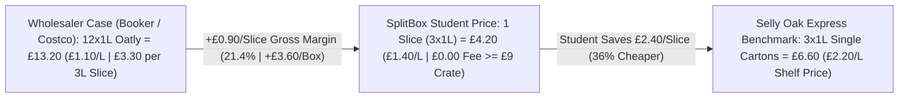

# Chapter 1 — Unit Economics, Pricing Physics & Financial Model

> [!IMPORTANT]
> **The 60-Second Founder Takeaway:** SplitBox makes money with **`£0.00` delivery fees** on standard crates by capturing the **wholesale-to-convenience price spread** (`20.0%–23.2%` gross margin) while students still save **`36%–41%`** versus Selly Oak convenience supermarkets. Because sequential First-Come, First-Served (FCFS) case allocation only purchases **`100%` locked wholesale boxes** *after* student cards are pre-authorised, SplitBox operates with **`£0.00` dead inventory**, **`£0.00` courier wages**, and **break-even at just 22 weekly student orders** at a single University of Birmingham (UoB) pickup hub.

---

## 1. How SplitBox Makes Money With £0 Delivery Fees

### 1.1 Why Getir, Gorillas & Gopuff Went Bankrupt — And Why SplitBox Flips the Equation

Rapid-delivery grocery startups raised billions of pounds promising 15-minute milk and toilet roll to student doors, then collapsed across the UK. Their fatal flaw was **structural unit-economics inversion** — every single order carried three permanent cost anchors that grocery margins (`20%–28%`) can never absorb on small student baskets:

1. **Dark-Store Property & Cold-Chain Overhead:** Leasing commercial high-street units, running walk-in chillers/freezers 24/7, and absorbing `3%–6%` fresh/chilled food spoilage every week.
2. **Point-to-Point Last-Mile Courier Wages:** Paying a rider UK National Living Wage + e-bike/insurance (`£13–£15/hour`) to complete `2.5–3.0` point-to-point drops per hour down Dawlish Road or up to The Vale — burning **`£4.20–£5.50` in pure last-mile labour per bag**.
3. **Speculative Inventory Working Capital:** Buying 2,000 SKUs upfront and hoping students order them before Best Before dates expire.

To hide a `£4.50+` delivery loss on a `£12.00` student basket, delivery apps pile on a `£2.99` delivery fee, a `£1.99` "small order fee", a `10%` "service fee", and `15%–20%` in-app menu markups — turning `£12.00` of groceries into **`£18.50+` at checkout**. Students immediately churn back to walking to Selly Oak Tesco Express or Sainsbury's Local.

**SplitBox eliminates all three cost centres structurally:**

| Structural Driver | Point-to-Point Delivery App (Getir / Deliveroo Hop) | Selly Oak Convenience Store (Tesco Express / Sainsbury's Local) | SplitBox Weekly Campus Drop (UoB Model) |
| :--- | :--- | :--- | :--- |
| **Inventory Model** | Speculative 2,000-SKU dark store (`3%–6%` waste) | High-rent Bristol Rd / Campus store (`£££` rent + shrinkage) | **Pre-committed demand only** (`100%` locked wholesale cases, `0%` spoilage) |
| **Cold Chain Needed?** | Yes — chilled vans & fridges | Yes — store refrigeration banks | **Zero** — `100%` sealed, UK FIR-labelled ambient sub-units |
| **Fulfilment Topology** | 1 courier → 1 student flat (`£4.20–£5.50`/order) | Student walks 20 mins uphill carrying 10kg bags | **1 van → 1 Saturday 2-hour Campus Hub → 40–60 orders handed over in `<25s` each** |
| **Last-Mile Fulfilment Cost / Order** | `£4.20–£5.50` | Built into `35%–45%` convenience shelf markup | **`£0.80–£1.25`/order** at 40–60 orders (`<£1.60` even at 30 orders!) |
| **Customer Fee at `≥ £9.00` Basket** | `£3.50–£6.00` combined delivery + service fees | `£0.00` fee, but punitive single-unit prices | **`£0.00` delivery & crate fee** (`£0.39` card-cover only on micro-crates `< £9.00`) |

### 1.2 The Wholesale-to-Convenience Arbitrage Spread (Worked Oatly Example)

Students living in **Shackleton, Chamberlain, Maple Bank, Tennis Courts, Mason**, or 6-bed Selly Oak houses on **Tiverton Road and Dawlish Road** get squeezed by the **"Single-Unit Convenience Tax"**:
- They have one shared fridge shelf and zero under-bed cupboard space for a 12-carton wholesale tray or a 48-roll sack of loo roll.
- They have no car to drive to **Costco Birmingham (Nechells, `B7 5PA`)** or **Booker Wholesale (Stirchley / Aston, `B6 5RQ`)**, nor a trade membership card.
- So they buy 1 carton of Oatly Barista at a time at convenience-store prices (`£2.20/L` = **`£6.60` for 3 cartons**).

SplitBox bridges that gap by unbundling a wholesale outer **Box** into `4` pre-sold **Slices** (`3 × 1L` cartons per Slice) across anonymous hallmates at the same pickup hub:



Look at why both sides win simultaneously:
- **The Student Wins Immediately:** Pays **`£4.20`** (`£1.40/L`) instead of **`£6.60`** (`£2.20/L`) — saving **`£2.40` (`36%`)** with `£0.00` delivery fees on any `≥ £9.00` crate, collected 2 minutes from their hall reception on Saturday morning.
- **SplitBox Captures Wholesale Spread Without Courier Burn:** Earns **`£0.90` gross profit per Slice (`£3.60` per locked 4-slice case, `21.4%` gross margin)**. Across **50 student crates** averaging `3.1` slices (`£12.50` basket) dropped together during one 2-hour Saturday popup at `Vale · Shackleton`, SplitBox generates **`£134.00` in product gross profit** using a single **3-hour Enterprise Car Club / Zipcar van booking (`~£38.00`)** — reducing physical transport cost to **`£0.76` per order** instead of Getir's `£4.80`!

---

## 2. Real SKU-by-SKU Unit Economics Table (`src/data/catalog.ts`)

Every currency calculation inside SplitBox (`src/data/catalog.ts` and `src/store/dropEngine.ts`) uses **integer GBP pence** (`toPence` / `fromPence`, e.g., `£4.20` = `420p`) so rounding drift never corrupts multi-slice allocations or partial Stripe captures.

### 2.1 Master Unit Economics Across All 14 UoB SplitBox Catalog SKUs

In `src/data/catalog.ts`, `wholesaleSliceCostGbp` represents **landed inc-VAT Cash & Carry cost** — the exact cash price an unregistered UK startup (`< £90,000` annual turnover) pays at the Booker or Costco till today. Table 2.1 breaks down all **14 real SplitBox SKUs** down to exact integer pence, alongside Cash & Carry equivalent brand swaps (*Cushelle/Andrex 48-roll*, *Ariel 3-in-1 Pods*, *Laila 2kg Basmati*) when running local Birmingham depot picks:

| SKU (`src/data/catalog.ts` ID & Trade Swap) | UK VAT Rate | Wholesale Case (ex-VAT) | Wholesale Case (inc-VAT) | Slices / Box | Landed Cost / Slice (`inc-VAT`) | SplitBox Price / Slice | Selly Oak Retail / Slice | Student Saving (`£` / `%`) | Pre-VAT Gross Margin (`£` / `%`) |
| :--- | :---: | :---: | :---: | :---: | :---: | :---: | :---: | :---: | :---: |
| **Oatly Barista Ambient** (`12×1L` → `3×1L`/slice) | `0%` | `£13.20` (`1320p`) | `£13.20` (`1320p`) | `4` | `£3.30` (`330p`) | **`£4.20`** (`420p`) | `£6.60` | `£2.40` (**`36%`**) | **`£0.90`** (**`21.4%`**) |
| **Mutti Polpa Chopped Tomatoes** (`24×400g` → `4-pack`/slice) | `0%` | `£15.60` (`1560p`) | `£15.60` (`1560p`) | `6` | `£2.60` (`260p`) | **`£3.30`** (`330p`) | `£5.40` | `£2.10` (**`39%`**) | **`£0.70`** (**`21.2%`**) |
| **Bamboo 3-Ply Loo Roll** (*or Cushelle/Andrex 48-roll* → `6-roll`/slice) | `20%` | `£25.00` (`2500p`) | `£30.00` (`3000p`) | `8`* | `£3.75` (`375p`) | **`£4.80`** (`480p`) | `£7.50` | `£2.70` (**`36%`**) | **`£1.05`** (**`21.9%`**) |
| **Tilda Pure Basmati Rice** (*or Laila* `4×2kg` → `1×2kg`/slice) | `0%` | `£14.20` (`1420p`) | `£14.20` (`1420p`) | `4` | `£3.55` (`355p`) | **`£4.50`** (`450p`) | `£7.25` | `£2.75` (**`38%`**) | **`£0.95`** (**`21.1%`**) |
| **TREK Cocoa Oat Flapjacks** (`24×50g` → `4-bar box`/slice) | `20%`† | `£11.00` (`1100p`) | `£13.20` (`1320p`) | `6`* | `£2.20` (`220p`) | **`£2.80`** (`280p`) | `£4.50` | `£1.70` (**`38%`**) | **`£0.60`** (**`21.4%`**) |
| **Fairy Non-Bio Laundry Pods** (*or Ariel* `4×28w` → `1 tub`/slice) | `20%` | `£15.17` (`1517p`) | `£18.20` (`1820p`) | `4` | `£4.55` (`455p`) | **`£5.90`** (`590p`) | `£9.50` | `£3.60` (**`38%`**) | **`£1.35`** (**`22.9%`**) |
| **Nongshim Shin Ramyun** (`20×120g` → `5-pack`/slice) | `0%` | `£11.80` (`1180p`) | `£11.80` (`1180p`) | `4` | `£2.95` (`295p`) | **`£3.75`** (`375p`) | `£6.25` | `£2.50` (**`40%`**) | **`£0.80`** (**`21.3%`**) |
| **Easy-Peeler Clementines** (`6×1kg` crate → `1kg net`/slice) | `0%` | `£8.88` (`888p`) | `£8.88` (`888p`) | `6`* | `£1.48` (`148p`) | **`£1.85`** (`185p`) | `£3.00` | `£1.15` (**`38%`**) | **`£0.37`** (**`20.0%`**) |
| **Jimmy's Iced Coffee Cans** (`24×250ml` → `4-can pack`/slice) | `0%`‡ | `£18.30` (`1830p`) | `£18.30` (`1830p`) | `6`* | `£3.05` (`305p`) | **`£3.90`** (`390p`) | `£6.40` | `£2.50` (**`39%`**) | **`£0.85`** (**`21.8%`**) |
| **Garofalo Bronze-Die Penne** (`16×500g` → `2×500g`/slice) | `0%` | `£16.64` (`1664p`) | `£16.64` (`1664p`) | `8`* | `£2.08` (`208p`) | **`£2.60`** (`260p`) | `£4.40` | `£1.80` (**`41%`**) | **`£0.52`** (**`20.0%`**) |
| **Pip & Nut Smooth PB 1kg** (`4×1kg` → `1×1kg tub`/slice) | `0%` | `£15.20` (`1520p`) | `£15.20` (`1520p`) | `4` | `£3.80` (`380p`) | **`£4.95`** (`495p`) | `£7.80` | `£2.85` (**`37%`**) | **`£1.15`** (**`23.2%`**) |
| **Finish Ultimate Dish Tabs** (`6×34-tab` → `1 pouch`/slice) | `20%` | `£20.00` (`2000p`) | `£24.00` (`2400p`) | `6`* | `£4.00` (`400p`) | **`£5.20`** (`520p`) | `£8.75` | `£3.55` (**`41%`**) | **`£1.20`** (**`23.1%`**) |
| **Minor Figures Masala Chai** (`12×1L` → `2×1L`/slice) | `0%`‡ | `£21.60` (`2160p`) | `£21.60` (`2160p`) | `6`* | `£3.60` (`360p`) | **`£4.60`** (`460p`) | `£7.40` | `£2.80` (**`38%`**) | **`£1.00`** (**`21.7%`**) |
| **PROPER Sea Salt Lentil Chips** (`24×85g` → `3×85g`/slice) | `20%`† | `£16.80` (`1680p`) | `£20.16` (`2016p`) | `8`* | `£2.52` (`252p`) | **`£3.15`** (`315p`) | `£5.25` | `£2.10` (**`40%`**) | **`£0.63`** (**`20.0%`**) |
| **14-SKU Equal-Weight Average** | — | `£15.96` | `£17.21` | `5.7` | `£3.10` (`310p`) | **`£3.96`** (`396p`) | `£6.43` | `£2.47` (**`38.5%`**) | **`£0.86`** (**`21.8%`**) |

> [!TIP]
> **Drop #1 Slice-Count Merchandising Rule (`2–4` Slices/Box vs. `6–8` Slices/Box):** Notice the `*` on `6`- and `8`-slice boxes above. While the full 14-SKU app catalog supports `4`, `6`, and `8` slices per box once a hub reaches `80+` weekly orders, **during Physical Drops #1–#3 (`25–40` orders at `Vale · Shackleton` alone), restrict your active weekly lineup to `2–4` slices per box!** You don't even have to change wholesale suppliers to do this: simply bundle a 48-roll toilet tissue carton into **`4` double-slices of `12 rolls` (`£9.60`/slice)** instead of `8` slices of `6 rolls`, and bundle a 24-tin Mutti tray into **`3` double-slices of `8 tins` (`£6.60`/slice)**. Fewer slices per box = **2x higher Box Lock Rate (`85%+`)** AND automatically higher Average Order Value!

*(VAT Footnotes: `†` Under HMRC VAT Notice 701/14, plain traditional oat flapjacks can qualify as `0%` cake, whereas chocolate-coated/protein cereal bars and bagged potato/savoury crisps carry `20%` standard-rated VAT. `‡` Milk-based drinks with `≥75%` milk content and dry/liquid tea preparations qualify for `0%`, whereas sweetened low-milk soft/energy drinks carry `20%`. Always inspect the `VAT: Z (0%)` vs `S (20%)` code printed on your Booker/Costco receipt before publishing any SKU price!)*

---

## 3. The UK VAT Trap Explained Simply (`0%` Zero-Rated vs. `20%` Standard-Rated)

More first-time UK grocery founders accidentally wipe out their profits through **Cash & Carry VAT blindness** than through any other mistake. Here is the complete first-principles mental model under HMRC rules.

### 3.1 How UK Grocery VAT Categories Split Your Catalog in Two

In the UK, **consumer retail prices must legally be displayed VAT-inclusive**, whereas **B2B wholesale Cash & Carry shelf tags at Booker, Costco, and Bestway prominently display ex-VAT prices in giant bold text**.

Under **HMRC VAT Notice 701/14 (Food Products)**, UK supermarket goods divide into two completely different tax worlds:
1. **`0%` Zero-Rated Staples (Your Margin Safe Haven):** Unprocessed and staple ambient foods for human consumption — plain/barista oat milk, dry pasta, basmati rice, dried noodles, tinned tomatoes, peanut butter, rolled oats, cooking oil, tea/coffee, and fresh whole fruit. Wholesale ex-VAT and inc-VAT prices are **identical (`£13.20 = £13.20`)**.
2. **`20%` Standard-Rated Goods (The Hidden Margin Killer):** All non-food household dorm items (**toilet roll, kitchen roll, Fairy laundry pods, Finish dishwasher tabs, bin liners, surface spray**) PLUS HMRC's "luxury/snack" food exceptions (**potato crisps, salted/roasted nuts, chocolate-coated biscuit/protein bars, confectionery, bottled water, and fizzy/energy drinks like Red Bull or Monster**). Wholesale checkout adds **`+20%`** on top of the shelf tag!

### 3.2 Stage 1: BEFORE the `£90,000` Rolling 12-Month VAT Threshold (Unregistered Startup)

In the UK, you are **not required** to register for VAT until your rolling 12-month VAT-taxable turnover exceeds **`£90,000`**. When you are **not VAT-registered**:
- **Output VAT Charged to Students = `£0.00`:** You do not charge VAT on your receipts, and you keep `100%` of the `£4.80` student slice price.
- **Input VAT Paid to Booker/Costco = UNRECLAIMABLE COST:** You still have to pay Booker the full `inc-VAT` price at the checkout till, and HMRC will **not** refund that `20%` VAT to you. Your true Cost of Goods Sold (COGS) is the **inc-VAT till total**.

> [!WARNING]
> **The Cash & Carry Shelf-Tag Trap (How Founders Lose Money on Every Loo Roll Case):** Imagine walking down Aisle 9 at Booker Stirchley. You spot a 48-roll case of Cushelle / Who Gives A Crap with a giant yellow shelf barker screaming **`£25.00`** (`£3.13` per 6-roll slice). You think: *"Brilliant! I'll price each slice at `£4.00` and make `£0.87` (`21.8%` margin)!"*
>
> **Wrong.** At the Booker checkout till, the scanner adds `20%` VAT (`+£5.00`), charging your bank card **`£30.00` (`£3.75`/slice)**. Because you aren't VAT-registered, your `£0.87` gross profit instantly collapses to **`£0.25`/slice (`6.3%`)**. Once Stripe takes `1.5% + £0.20` (`£0.26`), **you lose `-£0.01` cash on every single pack of toilet roll you carry up to campus!** Always divide the **small-print `inc-VAT` price** (`£30.00 / 8 = £3.75`) when unregistered.

### 3.3 Stage 2: AFTER `£90,000` Turnover — Or Strategic Voluntary VAT Registration!

Once your rolling 12-month sales approach `£90,000` (mandatory registration) — or if you choose **Voluntary VAT Registration** early — the tax math changes completely:
- **You RECLAIM `100%` of Input VAT** paid on stock (`20%` on loo roll/Fairy pods) AND on operating overheads (`20%` VAT on Enterprise Car Club vans, folding Euro crates, thermal labels, laptops, and Stripe's own VAT if applicable).
- **You REMIT Output VAT to HMRC** on every `20%` standard-rated SKU you sell. Because student prices are VAT-inclusive, **`20%` VAT equals `1/6th` (`16.67%`) of the gross student price** (`£4.80` student price = `£4.00` ex-VAT revenue kept by SplitBox + **`£0.80` Output VAT owed to HMRC**).
- **The Zero-Rated Food Superpower ("Repayment Trader" Hack):** Under UK VAT law, `0%` zero-rated food sales count as *taxable supplies* (just taxed at `0.0%`, unlike VAT-exempt insurance/rent). That means if **`75%–85%` of your SplitBox catalog is `0%`-rated food staples** (Oatly, Mutti, Tilda, Nongshim, Garofalo, Pip & Nut), registering for VAT voluntarily means:
  1. Your Output VAT on Oatly, rice, pasta, and noodles stays **`£0.00`** (`0%` price hike for students, `£0.00` margin compression!).
  2. You **reclaim `20%` Input VAT** on your van hire, Euro crates, gazebo, and packaging — meaning **HMRC pays SplitBox a quarterly cash VAT refund**!

*(Compare a `20%`-rated item like Bamboo Tissue at `£4.80`: Pre-registration cash gross profit is `£4.80 − £3.75 = £1.05/slice`. Post-VAT registration, net ex-VAT revenue is `£4.80 / 1.20 = £4.00` and ex-VAT cost is `£30.00 / 1.20 / 8 = £3.125`, so cash gross profit becomes **`£0.875/slice` (`£0.88`)** — HMRC takes `20%` of your value-added spread too! To keep the exact same `£1.05` cash profit post-registration on `20%` household SKUs, either negotiate trade discounts down by `17p/slice` or nudge the retail slice price from `£4.80` to `£5.00`, which still saves students `33%` vs. `£7.50` retail!)*

### 3.4 Exact Integer-Pence Pricing Formulas (Both VAT Stages)

Copy these exact formulas into your pricing spreadsheet or backend catalog validator (`targetMargin` e.g. `0.22` for `22%`):

```text
STAGE 1 — NOT VAT-REGISTERED (Turnover < £90,000/yr, No Voluntary Reg):
  landedCaseCostPence   = caseCostExVatPence + ROUND(caseCostExVatPence * supplierVatRate)
  costPerSlicePence     = ROUND(landedCaseCostPence / slicesPerBox)
  minSlicePricePence    = CEIL(costPerSlicePence / (1 - targetMargin))
  grossProfitPence      = slicePricePence - costPerSlicePence
  grossMarginPct        = (grossProfitPence / slicePricePence) * 100

STAGE 2 — VAT-REGISTERED (Mandatory >= £90,000/yr OR Voluntary Repayment Trader):
  costPerSliceExVatPence = ROUND(caseCostExVatPence / slicesPerBox)
  outputVatPence         = IF(skuVatRate == 0.20, ROUND(slicePricePence / 6), 0)
  netRevenueExVatPence   = slicePricePence - outputVatPence
  minSlicePricePence     = CEIL((costPerSliceExVatPence / (1 - targetMargin)) * (1 + skuVatRate))
  grossProfitExVatPence  = netRevenueExVatPence - costPerSliceExVatPence
  grossMarginExVatPct    = (grossProfitExVatPence / netRevenueExVatPence) * 100
```

---

## 4. Stripe UK Card Fee Physics & Pre-Authorisation Hold (`capture_method: 'manual'`)

### 4.1 Real Stripe UK Pricing & The UoB International Student Card Factor

Stripe UK charges **`£0.00/month`** fixed fees and natively supports **Apple Pay and Google Pay** (essential because `85%+` of UoB students check out one-handed on smartphones). However, every **captured** charge incurs a two-part transaction fee:

| Card Origin at UoB Checkout | Stripe UK Processing Rate | Fee on `£3.50` Charge | Fee on `£12.50` Charge | Why It Matters at UoB |
| :--- | :---: | :---: | :---: | :--- |
| **Standard UK Consumer Card** (Monzo, Starling, Barclays, HSBC UK, Revolut UK) | **`1.5% + £0.20`** | `£0.25` (`7.1%`!) | `£0.39` (`3.1%`) | Baseline domestic student debit card / Apple Pay rate. |
| **International / Non-UK Card** (EEA & overseas Visa/Mastercard) | **`2.5% + £0.20`** *(up to `3.25% + £0.20` non-EEA)* | `£0.29` (`8.3%`!) | `£0.51` (`4.1%`) | **Huge at UoB:** Over `25%–30%` of Vale & Selly Oak buyers are international students initially paying on non-UK home cards before opening a UK Monzo/HSBC account! |
| **UoB Blended Reality (`70%` UK / `30%` International)** | **`1.80% + £0.20`** | **`£0.26`** (`7.5%`!) | **`£0.43`** (`3.4%`) | Always model **`1.80% + £0.20`** in your conservative UoB P&L! |

### 4.2 Worked Basket P&L: Why the Fixed `£0.20` Fee Crushes `£3.50` Micro-Baskets (And Why Live Mode Uses the `£9.00` / `£0.39` Crate Rule)

In **Demo Mode (`VITE_DEMO_MODE=true`)**, SplitBox displays a flat `£0.00` fee on every basket size so pitch judges experience frictionless pooling math in 30 seconds. In **Live Production Mode**, however, allowing unlimited `£3.50` single-slice orders with `£0.00` fee lets Stripe's fixed `£0.20` charge devour over a third of your gross profit — especially if the same student places **three separate 1-slice orders** on Monday, Tuesday, and Wednesday (`3 × £0.20 = £0.60` fixed fees!).

Live Mode solves both leaks with two paired rules:
1. **`£9.00+` Free Crate Threshold:** Crates **`≥ £9.00` (`900p`) pay `£0.00` fees**; micro-crates **`< £9.00` pay a transparent `£0.39` (`39p`) micro-crate card-cover fee**.
2. **1 Editable Weekly Order per Student:** Until Wednesday `23:59` cutoff, adding another slice updates the student's **single weekly `PaymentIntent`** rather than creating multiple `20p`-fee transactions.

Compare the exact penny P&L across a **`£3.50` 1-slice micro-basket** vs. a **`£12.50` 3-slice standard crate** (at `21.4%` catalog product gross margin):

| P&L Line Item | `£3.50` 1-Slice Basket (Naive `£0.00` Fee) | `£3.50` 1-Slice Basket (**Live `+£0.39` Micro-Fee**) | `£12.50` 3-Slice Crate (**Live `£0.00` Free Crate**) |
| :--- | :---: | :---: | :---: |
| **Product Slice Subtotal** | `£3.50` (`350p`) | `£3.50` (`350p`) | `£12.50` (`1250p`) |
| **Wholesale Landed COGS (`78.6%`)** | `-£2.75` (`-275p`) | `-£2.75` (`-275p`) | `-£9.82` (`-982p`) |
| **Product Gross Profit (`21.4%`)** | **`£0.75`** (`75p`) | **`£0.75`** (`75p`) | **`£2.68`** (`268p`) |
| **Crate Card-Cover Fee (`< £9.00` only)** | `£0.00` | `+£0.39` (`+39p`) | **`£0.00`** *(Unlocked Free Crate!)* |
| **Total Captured on Student Card** | `£3.50` | `£3.89` | `£12.50` |
| **Stripe Fee — UK Card (`1.5% + £0.20`)** | `-£0.25` (`7.1%` of basket) | `-£0.26` | `-£0.39` (`3.1%` of basket) |
| **Stripe Fee — Intl Student Card (`2.5% + £0.20`)** | `-£0.29` (`8.3%` of basket) | `-£0.30` | `-£0.51` (`4.1%` of basket) |
| **Net Contribution Profit (UK / Intl Card)** | `£0.50` / `£0.46` (`14.3%` / `13.1%`) | **`£0.88` / `£0.84`** (`25.1%` / `24.0%`) | **`£2.29` / `£2.17`** (**`18.3%` / `17.4%`**) |

Notice the behavioral genius of the `£9.00` / `£0.39` rule: **80%+ of students hate paying a `39p` fee on principle**, so when their basket sits at `£4.20` (1 Oatly slice) or `£7.50` (Oatly + Mutti), the Basket Drawer nudges *"Add `£1.50` more for a `£0.00` Free Crate!"* — lifting Average Order Value past `£12.00`, filling open campus boxes **3x faster**, and delivering **`£2.17–£2.29` in clean net contribution per student**!

*(Fairness Guardrail at Cutoff: If a student checked out with `≥ £9.00` to earn a `£0.00` Free Crate, and an unfulfilled overflow box drops their settled total below `£9.00` at cutoff, **never** retroactively add the `£0.39` fee during capture. Honouring their `£0.00` fee promise preserves 100% student trust.)*

### 4.3 CRITICAL FINTECH LESSON: Why Capturing Upfront & Refunding Bleeds Cash — And How `capture_method: 'manual'` Makes Unfilled Slices Cost `£0.00`

> [!CAUTION]
> **Stripe Does NOT Refund Processing Fees When You Refund a Captured Charge!** Under Stripe's UK terms, the moment you capture a student's card (`capture_method: 'automatic'`), Stripe permanently keeps the `1.5% + £0.20` (`2.5% + £0.20` international) fee **even if you refund `100%` of the order 48 hours later!**

Look at the catastrophe if you used standard e-commerce auto-capture during an early campus drop:
- Suppose 40 students each place a `£4.20` order into overflow boxes that finish Wednesday night stuck at `1/4` or `2/4` (`<100%` full).
- With **upfront capture + `stripe.refunds.create()`**: Every student gets `£4.20` back (`£0.00` revenue for you), yet Stripe still deducts **`£0.26–£0.31` per refund** — burning **`£10.40–£12.40` in dead bank fees** for selling nothing! Even on partial refunds inside larger baskets, you still lose the `1.5%–2.5%` variable fee on every refunded slice.

**How SplitBox Eliminates Refund-Fee Bleed completely (`£0.00` Cost):**
1. **Checkout Places an Uncaptured Card Pre-Authorisation Hold (`capture_method: 'manual'`):** When a student locks slices between **Sunday `18:00` and Wednesday `23:59`**, Stripe instructs their issuing bank to ring-fence the funds (`status: 'requires_capture'`). Zero money moves, **you never hold pooled customer funds in your bank account** (keeping you cleanly outside FCA e-money/escrow safeguarding scope — always call it a **"Card Pre-Authorisation Hold"**, never `"escrow"`, in Live UI!), and **Stripe charges `£0.00`** at authorisation time.
2. **Respecting Visa/Mastercard's 7-Day (`168-Hour`) Authorisation Window:** Online Visa, Mastercard, and Apple Pay manual holds stay valid for **7 calendar days**. SplitBox's weekly drop opens **Sunday `18:00`**, cuts off **Wednesday `23:59`**, and settles **Thursday `09:00`** — a maximum hold age of **87 hours (`3.6 days`)**, safely inside the 7-day card-network expiry with >3 days of buffer.
3. **Thursday `09:00` Exact-Pence Settlement (`capture` vs. `cancel`):**
   - **If `0` slices in a student's order locked:** Call `stripe.paymentIntents.cancel(id)`. The hold vanishes from the student's Monzo/Barclays app in seconds. **Total Stripe fee paid by SplitBox = `£0.00`!**
   - **If `2` of `3` slices locked (e.g., `£8.40` fulfilled out of a `£12.60` hold):** Call `stripe.paymentIntents.capture(id, { amount_to_capture: 840 })`. Stripe captures **only `£8.40`**, automatically releases the uncaptured `£4.20` overflow hold, and calculates `1.5% + £0.20` strictly on the captured `£8.40` (`£0.33` instead of `£0.39`) — **zero fee bleed on unfulfilled overflow slices!**

---

## 5. Negative Working Capital & Drop #1 → Drop #12 → Multi-Campus Financial Model

### 5.1 The Sunday-to-Saturday Cashflow Timeline (& Surviving Stripe's First-Payout Hold!)

Because SplitBox's sequential FCFS allocator separates `100%` locked full boxes (`Box #1 = 4/4`) from `<100%` partial overflow pools (`Box #2 = 1/4`) **before** you step foot inside Booker or Costco, **you never buy a single loose carton of Oatly that hasn't already been sold and card-backed**.

| Day & Time (UoB Weekly Cycle) | Operational Event | Inventory Risk Held | Cash & Stripe Settlement Position |
| :--- | :--- | :---: | :--- |
| **Sun `18:00` – Wed `23:59`** | Students claim slices at `Vale · Shackleton`; Stripe places `capture_method: 'manual'` holds | **`£0.00`** (0 stock owned) | `£0.00` Stripe fees accrued; `100%` of pledged slices backed by verified live bank holds. |
| **Wed `23:59` Cutoff** | Drop closes; engine resolves `lockedBoxes = FLOOR(totalSlices / slicesPerBox)` per SKU | **`£0.00`** | Master Procurement CSV outputs **exact integer full cases** (e.g., `7 × 12L` Oatly cases, `0` partial cases). |
| **Thu `06:30 – 08:30`** | Founder picks exact locked cases at **Booker Aston (`B6 5RQ`) / Costco Nechells (`B7 5PA`)** | `100%` pre-sold stock | Pay wholesaler on **0%-interest founder business credit card / trade float**; verify zero depot stockouts *before* capturing student cards! |
| **Thu `09:00` Settlement** | Run batch `paymentIntents.capture(fulfilledPence)` & `cancel()` on `0`-fill/stockout slices | `100%` matched to captures | Captures lock irreversibly; Stripe schedules UK bank payout (`T+3` UK business days once account is seasoned). |
| **Sat `11:00 – 14:00` Drop** | 2-hour popup handoff via offline QR + 4-digit PIN Hub Ops scanner; folding crates return flat | **`£0.00` leftover stock** | Drop complete with zero warehouse storage, zero spoilage, and zero cardboard left on campus. |
| **Tue (T+3 Bank Settlement)** | Stripe deposits Thursday's net captured revenue into SplitBox's Monzo/Starling Business account | **`£0.00`** | **Steady-State Negative Working Capital:** Cash lands in your bank ~3 weeks *before* your 30-day business credit card statement is due! |

> [!IMPORTANT]
> **The First-Time Stripe Payout Trap (`7–14 Day` Initial Reserve):** On brand-new UK Stripe accounts, **Stripe holds your VERY FIRST live payout for `7–14` calendar days** for anti-fraud underwriting before switching you to standard `T+3` UK rolling payouts! Do not get caught at Costco on Thursday morning of Drop #1 waiting for Wednesday night's Stripe payout to clear:
> 1. **Start the Clock 10 Days Early:** Activate your live UK Stripe account and run a real **`£1.00` live Apple Pay charge** to yourself 10–14 days *before* Drop #1 so the new-account waiting period finishes before your first student cutoff.
> 2. **Keep a `£250–£300` Week-1 Procurement Float** (personal savings, UoB B-Enterprising micro-grant, or a 30-day interest-free credit card) to bridge Thursday wholesale checkout until Tuesday's Stripe payout lands.

### 5.2 Three Concrete P&L Scenarios: Drop #1 Break-Even → 4-Hub UoB → Year 2 Multi-Campus

> [!NOTE]
> **The 30-Week UK Academic Calendar Reality Check:** Never pitch an angel investor a spreadsheet multiplying your best November week by `52`! UK universities run **three ~10-week active residential periods = `30` high-density trading weeks per year**, plus `22` vacation weeks (Christmas, Easter, June–September Summer). Below, every annual number uses a **strict, honest `30-week` baseline**. Crucially, because SplitBox has **no dark-store rent, no salaried vans, `£0/mo` cloud hosting, and `£0` perishable inventory**, your weekly cash burn during those `22` holiday weeks drops to **near `£0.00`** — while summer postgrad drops and pre-paid **September Freshers Move-In Starter Crates** provide pure upside on top of this model!

Every line item below is reconciled in exact GBP (`£`) using UoB's `70%` UK / `30%` international card mix (`1.80% + £0.20` blended Stripe fee) and Live Mode's `£9.00+` Free Crate / `£0.39` micro-crate rule:

| Financial Model Metric | Scenario A: **Drop #1 Launch** (`Vale · Shackleton` Only, Founder-Run) | Scenario B: **Drop #4 Campus Scale** (`All 4 UoB Hubs`, Marshal-Run) | Scenario C: **Year 1 Mature UoB** (`4 UoB Hubs` + Brand Sampling) | Scenario D: **Year 2 Multi-Campus** (`5 Russell Group Unis` — 20 Hubs)* |
| :--- | :---: | :---: | :---: | :---: |
| **Active Campus Hubs** | `1` (*Vale · Shackleton*) | `4` (*Vale, Selly Oak, Guild, Pritchatts*) | `4` (*UoB Full Penetration*) | `20` (*UoB, Notts, Manc, Leeds, Sheff*) |
| **Fulfilled Weekly Orders (Crates)** | **`30` orders/wk** | **`150` orders/wk** | **`180` orders/wk** | **`1,200` orders/wk** (`240`/uni) |
| **Average Order Value (AOV — Slices)** | `£12.00` (~`3.0` slices) | `£13.00` (~`3.3` slices) | `£13.50` (~`3.4` slices) | `£14.00` (~`3.5` slices) |
| **Weekly Product GMV** | **`£360.00`** | **`£1,950.00`** | **`£2,430.00`** | **`£16,800.00`** |
| **Micro-Crate Fees (`< £9.00` @ `£0.39`)** | `+£2.34` (`6` orders) | `+£8.58` (`22` orders) | `+£10.53` (`27` orders) | `+£56.16` (`144` orders) |
| **Total Captured Gross Revenue / Wk** | `£362.34` | `£1,958.58` | `£2,440.53` | `£16,856.16` |
| **Wholesale Landed / Ex-VAT COGS** | `-£282.24` (`78.4%`) | `-£1,521.00` (`78.0%`) | `-£1,871.10` (`77.0%`) | `-£12,516.00` (`74.5%` pallet terms) |
| **Product Gross Profit (`%` of GMV)** | **`£77.76`** (`21.6%`) | **`£429.00`** (`22.0%`) | **`£558.90`** (`23.0%`) | **`£4,284.00`** (`25.5%` ex-VAT) |
| **Stripe UK + Intl Card Fees (`~1.8% + 20p`)** | `-£12.52` | `-£65.25` | `-£79.93` | `-£540.04` |
| **Order Contribution Profit (`£`/Order)** | **`£67.58`** (**`£2.25`/order**) | **`£372.33`** (**`£2.48`/order**) | **`£489.50`** (**`£2.72`/order**) | **`£3,800.12`** (**`£3.17`/order**) |
| **FMCG Challenger-Brand Crate Sampling** | `£0.00` | `£0.00` | `+£75.00`/wk *(~`£0.42`/crate)* | `+£500.00`/wk *(~`£0.42`/crate)* |
| **Van Hire / Wholesaler Pallet Delivery** | `-£38.00` *(3h Enterprise van)* | `-£65.00` *(6h Transit / delivery)* | `-£70.00` *(pallet drop + van)* | `-£375.00` *(5× `£75` direct drops)* |
| **Student Hub Marshals (`£13.00/hr` × `2.5h`)** | `£0.00` *(Founder solo)* | `-£97.50` *(`3` marshals + Founder)* | `-£130.00` *(`4` paid marshals)* | `-£975.00` *(`5` Leads + `20` marshals)* |
| **Insurance, Thermal Labels & Shrinkage** | `-£10.00` | `-£22.50` | `-£30.00` | `-£300.00` |
| **Total Weekly Fixed Drop Ops Cost** | **`-£48.00`** | **`-£185.00`** | **`-£230.00`** | **`-£1,650.00`** |
| **Weekly Net Operating Profit (EBITDA)** | **`+£19.58` / wk** (`5.4%`) | **`+£187.33` / wk** (`9.6%`) | **`+£334.50` / wk** (`13.8%`) | **`+£2,650.12` / wk** (`15.8%`) |
| **Exact Weekly Break-Even Order Count** | **`22` orders** (`21.3`) | **`75` orders** (`74.5`) | **`85` orders** *(or `57` w/ sampling)* | **`521` orders** (`105`/campus) |
| **30-Week Term-Time Annual GMV** | `£10,800` | `£58,500` | **`£72,900`** *(under `£90k` VAT cap!)* | **`£504,000`** *(VAT-registered)* |
| **30-Week Term-Time Net Cash Profit** | **`+£587`** | **`+£5,620`** | **`+£10,035` / yr** | **`+£79,504` / yr** *(pre-HQ)* |

*(`*`Year 2 VAT Note: At `£504,000` annual turnover, SplitBox is mandatory VAT-registered; Scenario D models `80%` zero-rated food staples + direct regional distributor pallet pricing (`12%–15%` cheaper than Cash & Carry shelf walk-ins), expanding net ex-VAT product gross margin to `25.5%` while keeping `36%–40%` student savings intact.)*

### 5.3 Five Financial Guardrails Every SplitBox Founder Must Enforce Weekly

1. **Never Launch Hub #2 Until Hub #1 Clears `50` Fulfilled Crates/Week:** At `22` orders on one hub, you are already profitable (`£48.00` fixed ops ÷ `£2.25` contribution/order = `21.3` orders). Splitting `30` orders prematurely across `4` hubs drops your Box Lock Rate below `40%` and multiplies Saturday marshal costs by 4x.
2. **Audit Cash & Carry Receipts Every Thursday Morning:** If Booker raises Oatly's trade case price by `£0.60` (`+£0.15`/slice), update `wholesaleSliceCostGbp` and `slicePriceGbp` before Sunday `18:00` Drop open so your `21%+` floor never erodes silently.
3. **Keep `75%+` of Weekly Volume in `0%` Zero-Rated Ambient Staples:** Protects you against the `20%` VAT cliff when crossing `£90,000` annual GMV and unlocks HMRC input-VAT cash refunds on vans and equipment via voluntary VAT registration.
4. **Enforce `capture_method: 'manual'` + Post-Pick Settlement (`Thu 09:00`):** Picking at Booker at `06:30` *before* running `paymentIntents.capture()` at `09:00` means even if Booker Aston is unexpectedly out of stock on Mutti Tomatoes, you simply reduce `amount_to_capture` — paying **`£0.00` in Stripe refund fees** instead of losing `1.5% + 20p`!
5. **Monetize the Crate Before Raising Student Prices:** Once UoB passes `100` weekly crates, challenger FMCG brands (oat milk, iced coffee, ramen, eco-laundry, protein bars) will gladly supply `40%–50%` promo cases or pay **`£150–£300` per campus drop** to place 1 sealed sample + QR flyer directly into 150 verified UoB student kitchens — adding `£1.00–£2.00` of pure `100%`-margin profit per order while keeping student fees at `£0.00`.
