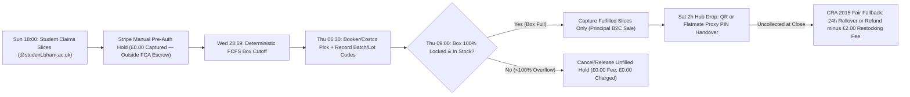

# Chapter 02 — UK Corporate, Food Safety, Labelling, Payments & Campus Compliance

> **Who this guide is for:** First-time University of Birmingham (UoB) student founders turning SplitBox from a local React prototype into a live, revenue-generating UK business. Every rule below is written strictly under **English & Welsh / Great Britain law** and anchored directly to SplitBox's 14 UoB SKUs, weekly Drop mechanics, and Birmingham supply chain.
>
> *Scope note:* This chapter is a practical operational compliance manual from first principles, not formal legal representation. Where your personal immigration status or co-founder deeds require bespoke advice, use the free UoB channels cited below (**UoB International Student Team**, **UoB Elevate / B-Enterprising**, and **Birmingham City Council Environmental Health**).

---

## 0. First Principles: Why SplitBox's Architecture Is Already a Legal Superpower

Most student grocery startups accidentally wander into the three sharpest regulatory buzzsaws in British commerce:
1. **Chilled Food Preparation & Cold-Chain Law** (refrigerated vans, continuous `< 8°C` probe logs, and Natasha's Law kitchen allergen liabilities).
2. **FCA Payment Institution / Escrow Regulation** (holding pooled customer cash in a bank account or app wallet without Financial Conduct Authority authorisation).
3. **University Hall Fire & Parcel-Room Bans** (dumping 60 cardboard boxes in Shackleton or Chamberlain reception corridors).

SplitBox's product architecture was deliberately designed so you **never trigger those three regimes in the first place**:
- **100% Factory-Sealed Ambient Sub-Units** = Zero cold-chain HACCP critical control points and zero open-food allergen cross-contamination.
- **Stripe `capture_method: 'manual'` ("Card Pre-Authorisation Hold") as Principal Seller** = Zero pooled customer money held in your bank account prior to box lock, keeping you **100% outside FCA escrow/e-money licensing**.
- **2-Hour Attended Pop-Up Collection in Reusable Euro Crates** = Zero unattended reception clutter and zero cardboard fire load.

To keep that protection intact in the real world, however, there are **seven non-negotiable UK legal gates** you must clear in the exact sequence below.

### Master Pre-Launch Legal Gate Chronology

| Timing Gate | Mandatory UK Compliance Action | Authority / Regulator | Statutory Cost | Consequence If Skipped |
| :--- | :--- | :--- | :--- | :--- |
| **Gate 0 (Day 1)** | **Check Founder UK Visa Right-to-Work / Self-Employment Status** | Home Office (UKVI) | `£0.00` | Student Visa curtailment & university expulsion if trading illegally on a Student Visa |
| **Gate 1 (T−28 Days)** | **Register as a Food Business Operator (FBO)** (`gov.uk/food-business-registration`) | Birmingham City Council Environmental Health | **`£0.00` (Free)** | Criminal offence under assimilated Reg (EC) 852/2004 & Food Safety Hygiene (England) Regs 2013 |
| **Gate 2 (T−21 Days)** | **Incorporate UK `Ltd` (with Virtual Registered Office)** + Open UK Business Bank Account | Companies House & HMRC | **`£50.00`** (+ `~£40/yr` virtual address) | Unlimited personal liability; residential student address exposed publicly on Google forever |
| **Gate 3 (T−14 Days)** | **60-Second Physical Sub-Unit Label Audit** at Booker Aston (`B6 5RQ`) / Costco (`B7 5PA`) | Trading Standards (UK FIR 2014 & GB CLP) | `£0.00` | Unlimited fines for selling unlabelled multipack inner units or decanted detergent pods |
| **Gate 4 (T−7 Days)** | **Timestamped Selly Oak Convenience Price Audit** + Live Pre-Auth & CRA 2015 Terms of Sale | ASA (CAP Code), CMA (DMCCA 2024) & Trading Standards | `£0.00` | ASA takedown for unsubstantiated savings claims; unenforceable unfair forfeiture clauses |
| **Gate 5 (T−5 Days)** | **Pay ICO Data Protection Fee (Tier 1)** before storing `@student.bham.ac.uk` emails | Information Commissioner's Office (ICO) | **`£40.00/yr`** (`£35.00` via Direct Debit) | Civil monetary penalty up to `£4,000` under Data Protection (Charges & Info) Regs 2018 |
| **Gate 6 (T−3 Days)** | **Activate `£5m` Public & Product Liability Insurance** + Verify Commercial Vehicle Cover | UoB Estates / Road Traffic Act 1988 | `~£8–£15/mo` + van hire or business car cover | Barred from campus venues; `6–8` driving licence points (`IN10`) & vehicle seizure on SD&P car insurance |



---

## 1. UK Company Formation, Tax & Founder Eligibility (Step-by-Step)

### 1.1 Critical International Student Visa Check (Read Before Touching Companies House!)

> [!CAUTION]
> **UK STUDENT VISA HOLDERS MUST STOP AND VERIFY IMMIGRATION RULES BEFORE INCORPORATING OR TAKING £1.** Under UK Visas and Immigration (**UKVI**) `Appendix Student` (paragraph `ST 26.5`), international students in the UK on a **Student Visa** (formerly Tier 4) are **strictly prohibited from being self-employed or engaging in "business activity"**.

Under Home Office UKVI caseworker guidance, prohibited **"business activity"** includes **all** of the following—**even if SplitBox makes `£0.00` profit and you pay yourself `£0.00` salary**:
- Registering with HMRC as a **Sole Trader** or business partner;
- Incorporating a UK Private Limited Company (`Ltd`) where you are appointed as a **Company Director**;
- Holding **more than `10%` of the shares** in a UK company (including shares held via a trust or nominee arrangement), unless purely passive investment in a publicly traded entity where you perform zero work; or
- Working for a company in which you hold a controlling interest or acting as a *shadow / de facto director* while a British flatmate puts their name on Companies House as a "front".

**How founder eligibility works across UoB student cohorts:**

| Founder Immigration Status | Can Register as Sole Trader or UK `Ltd` Director Now? | Safe Legal Action Path |
| :--- | :--- | :--- |
| **British or Irish Citizen** | **Yes — 100% unrestricted** | Incorporate `Ltd` online at Companies House (`£50`) and trade immediately. |
| **EU Settlement Scheme (Settled / Pre-Settled) or ILR** | **Yes — 100% unrestricted** | Incorporate `Ltd` online and trade immediately. |
| **UK Graduate Visa (2-Year Post-Study Visa)** | **Yes — permitted** | Self-employment and company directorship are permitted on the Graduate Visa once granted after completing your UoB degree. |
| **UK Innovator Founder Visa** | **Yes — for the endorsed venture** | Requires formal endorsement from a Home Office-approved Endorsing Body (speak to **UoB Elevate / B-Enterprising** 6 months before graduation). |
| **UK Student Visa (formerly Tier 4)** | **NO — Strictly Prohibited** | **Do NOT incorporate, become a director, hold `>10%` equity, or take live commercial money.** While studying, you may build non-commercial portfolio code, enter non-trading university enterprise pitch competitions (confirm terms with **UoB International Student Team [IST]**), and prepare for a Graduate or Innovator Founder Visa switch upon course completion. Never ask a UK friend to "front" a company you secretly run—that breaches both UKVI conditions and Companies House director declarations. |

---

### 1.2 Sole Trader vs. Private Limited Company (`Ltd`)

Assuming you have confirmed full UK right to be self-employed / a company director, you have two legal structures in Great Britain (UK private companies end strictly in **`Ltd`** or **`Limited`**—never copy non-UK corporate suffixes onto British pitch decks or terms!):

| Feature | Sole Trader | Private Limited Company (`Ltd` Limited by Shares) |
| :--- | :--- | :--- |
| **Legal Personality** | You and the business are legally the **same person**. | A separate legal entity (`SplitBox Campus Ltd`) distinct from you personally. |
| **Personal Liability** | **Unlimited.** If a crate injures someone or a debt arises outside insurance cover, your personal savings are exposed. | **Limited** to the unpaid nominal value of your shares (e.g., `£100`), absent fraud or wrongful trading. |
| **Formation Cost & Speed** | `£0.00` — Register for HMRC Self Assessment once gross trading turnover exceeds the **`£1,000` Trading Allowance** in a tax year. | **`£50.00`** online directly at Companies House (`24–48 hours` approval). *(Note: Companies House raised the digital incorporation fee from `£12` to `£50` in May 2024 under ECCTA 2023—ignore old blogs quoting `£12`!)* |
| **Co-Founder Equity & Vesting** | Messy partnership agreements; no shares to vest. | Clean Ordinary Share allocation (`1,000,000` shares at `£0.0001` nominal value) + 4-year reverse vesting. |
| **SEIS `50%` Angel Tax Relief** | **Ineligible.** UK angels will not invest into a Sole Trader. | **Eligible.** Unlocks UK **SEIS** (`50%` upfront Income Tax relief + `0%` CGT for angels investing up to `£250,000`). |
| **Campus & Wholesaler Credibility** | Accepted at Booker/Costco with HMRC proof + FBO receipt, but weaker with UoB Estates & FMCG brands. | Gold standard for UoB Estates RAMS approvals, challenger brand sponsorships, and Stripe UK onboarding. |

> [!TIP]
> **Practical Verdict for SplitBox:** If you are running a 1-off, 25-student closed hallmate test next Saturday (`Path 1 Concierge Validation` in [playbook/05-post-antigravity-24h-to-drop1-roadmap.md](./05-post-antigravity-24h-to-drop1-roadmap.md)) with total gross sales under `£1,000`, operating briefly as an insured, FBO-registered Sole Trader avoids delaying Week-1 learning. The moment you commit to recurring weekly Drops, bring on a co-founder, pitch UoB Estates, or apply for grants/SEIS, **incorporate a Private Limited Company (`Ltd`)**.

---

### 1.3 Step-by-Step Companies House Incorporation (`£50` Checklist)

Incorporate directly via **`https://www.gov.uk/limited-company-formation`** (avoid paying third-party websites `£150+` for add-ons you do not need, *except* when bundling a virtual registered office address below):

1. **Choose a Clean Company Name:**
   - Check availability on Companies House (e.g., `SPLITBOX TECHNOLOGIES LTD` or `SPLITBOX UK LTD`).
   - **Never include `"University of Birmingham"` or `"UoB"` inside your registered company name**—words implying university affiliation or royal/public patronage are restricted and infringe university trademarks. Keep `"UoB Edition"` as descriptive campus hub copy, not your corporate title.
2. **PRIVACY RULE — Never Use Your Selly Oak Student House as Your Registered Office!**
   - Everything filed at Companies House is **permanently public and scraped onto Google within hours**. Under the **Economic Crime and Corporate Transparency Act 2023 (ECCTA)**, your Registered Office must be an **"appropriate address"** (where official post comes to the attention of someone acting on behalf of the company and delivery can be recorded—**Royal Mail PO Boxes are now illegal** as Registered Offices).
   - Furthermore, 95% of Selly Oak student **Assured Shorthold Tenancy (AST)** agreements (`Dawlish Rd`, `Tiverton Rd`, `Bournbrook`) and UoB Hall Accommodation contracts explicitly **prohibit registering a company at the residential address**.
   - **The Solution (`~£35–£60/yr`):** Purchase a **Virtual Registered Office + Director's Service Address** package (e.g., via *1st Formations*, *Rapid Formations*, *Hoxton Mix*, or ask **UoB Elevate at The Exchange, 3 Centenary Square, Birmingham B1 2HS** whether incubated student ventures may use their hub address). Enter the virtual address for both **Registered Office** and **Director Correspondence Address**, and enter your student flat *only* in the private **Usual Residential Address** box (which Companies House hides from the public register).
3. **Provide a Registered Email Address & Complete Identity Verification:**
   - Under ECCTA 2023 rules, every UK `Ltd` must maintain an active **Registered Email Address** monitored by the founders (e.g., `founders@splitboxuob.co.uk`, not a personal email that expires when you graduate) and complete **Companies House Identity Verification** (`GOV.UK One Login` using passport/photocard driving licence) for every Director and Person with Significant Control (PSC).
4. **Select Exact SIC Codes (Standard Industrial Classification):**
   - Enter both of these codes so Stripe UK, business banks, and cash-and-carry trade desks classify SplitBox accurately without manual compliance holds:
     - **`47910`** — *Retail sale via mail order houses or via Internet* (primary e-commerce pre-order code)
     - **`47110`** — *Retail sale in non-specialised stores with food, beverages or tobacco predominating* (unlocks food-service wholesale trade accounts smoothly).
5. **Configure Founder-Friendly Share Capital (Avoid the "1 Share of £1" Mistake!):**
   - **Never incorporate with `1` Ordinary Share of `£1.00`.** If you later grant a co-founder `20%` or an early advisor `2%`, you cannot divide `1` share without filing formal share-subdivision resolutions (`SH02`).
   - Instead, issue **`1,000,000` Ordinary Shares** (single class, full voting, dividend, and capital distribution rights—required for SEIS qualification!) at a nominal value of **`£0.0001` per share** = **`£100.00` total share capital**.
6. **Declare the PSC Register (Persons with Significant Control):**
   - Any individual holding **more than `25%`** of shares or voting rights must be listed on the PSC register. Adopt standard **Model Articles** (or founder vesting articles if incorporating with a co-founder).

---

### 1.4 UK Corporate Tax, VAT Thresholds & Mandatory Annual Filings

Once incorporated, diarise these four statutory deadlines immediately—Companies House fines are **automated by computer even if your company had `£0.00` revenue**:

- **HMRC Corporation Tax Activation (Within 3 Months of Trading):** Companies House posts a `10-digit Unique Taxpayer Reference (UTR)` to your Registered Office within 14 days. Once you begin active trading (buying stock, taking live Drop pre-orders), sign in to your Business Tax Account and activate Corporation Tax within **3 months**.
  - **Rates:** UK Corporation Tax is **`19%` (Small Profits Rate)** on annual taxable profits up to `£50,000` (`25%` main rate above `£250,000`, with marginal relief between `£50k–£250k`). If SplitBox reinvests gross margin into crates, van hire, and flyers and records `£0` profit or a small Year-1 loss, you owe **`£0.00` Corporation Tax** (and trading losses carry forward against Year-2 profits)—**but you must still file your annual `CT600` return**.
- **Annual Statutory Accounts (Companies House):** First accounts are due **21 months** after your exact incorporation date (and **9 months** after your Accounting Reference Date every year thereafter). Filing 1 day late triggers an automatic **`£150` penalty**, escalating to `£1,500`.
- **Company Tax Return (`CT600` to HMRC):** Pay any Corporation Tax due **9 months and 1 day** after your accounting period ends; submit the `CT600` return within **12 months**.
- **Confirmation Statement (`CS01` to Companies House):** Due every 12 months (**`£34.00`** online fee) confirming your directors, shareholders, SIC codes, and registered email remain accurate.
- **UK VAT Registration (`£90,000` Rolling 12-Month Taxable Turnover):**
  - You must register for UK VAT if your **rolling 12-month VAT-taxable turnover** exceeds **`£90,000`** (checked at the end of every calendar month, not tax year!).
  - **Crucial Legal Catch:** Zero-rated (`0%` VAT) food items—such as `Oatly Barista`, `Mutti Chopped Tomatoes`, `Tilda Basmati Rice`, `Garofalo Penne`, and `Pip & Nut Peanut Butter`—**still count toward the `£90,000` taxable turnover threshold** (`0%` zero-rated is legally *taxable at zero percent*, unlike *VAT-exempt* financial/insurance services!).
  - Conversely, **voluntary VAT registration** *before* hitting `£90,000` is completely legal and gives a food-heavy business a cashflow advantage: you continue charging students **`0%` VAT** on zero-rated groceries while reclaiming **`20%` input VAT** from HMRC on Enterprise van hire, Euro crates, laptops, and Stripe/packaging invoices (full margin math is modelled in [playbook/01-unit-economics-and-financial-model.md](./01-unit-economics-and-financial-model.md)).

---

### 1.5 Co-Founder Equity Hygiene, UoB Student IP & Free Business Banking

1. **4-Year Reverse Vesting with a 1-Year Cliff (Never Split 50/50 Unvested!):**
   - Campus teams fracture during January exams and summer internships. If you hand a flatmate `50%` of the shares outright in Week 1 and they quit in Week 6 because hauling `12.6kg` Oatly cases in November rain is hard work, **they walk away owning half of SplitBox forever**—making your company uninvestable.
   - Put **every founder (including yourself)** on a **48-month reverse vesting schedule with a 12-month cliff**: if anyone leaves before Month 12, `100%` of their unvested shares convert to worthless deferred shares or are bought back at nominal value (`£0.0001`/share); at Month 12, `25%` vests; the remaining `75%` vests at `1/36th` per month over Months 13–48.
2. **Written IP Assignment Deed & University of Birmingham IP Policy:**
   - Under the **Copyright, Designs and Patents Act 1988**, only *employees* writing code in the course of employment automatically vest IP in the company. Co-founders, flatmates, or Computer Science friends helping before payroll **personally own the copyright** to any code or brand assets they create unless they sign a formal **Deed of Intellectual Property Assignment** transferring all rights in the SplitBox repository to the `Ltd`.
   - **UoB Student IP Check:** Under the **University of Birmingham Policy on Intellectual Property Rights**, undergraduate and taught postgraduate students generally **retain `100%` ownership of IP they create independently**, *provided* it was not funded by an external research sponsor, created jointly with salaried UoB academic staff, or submitted under specific group-project contracts assigning rights. Keep SplitBox strictly separate from assessed university coursework repositories (use personal hardware and your private GitHub repo) so angel investors see a clean IP chain of title.
3. **Open a Dedicated `£0/Month` UK Business Bank Account Immediately:**
   - Never run SplitBox Stripe payouts or Booker wholesale purchases through your personal student Santander/HSBC account (it breaches personal banking T&Cs and turns year-end accounting into chaos). Top UK `£0.00/mo` founder accounts:
     - **Mettle (by NatWest):** `£0.00/mo`, zero UK Faster Payments fees, **includes full FreeAgent accounting software (`£150+/yr` value) completely free**—which prepares HMRC VAT & `CT600` filings automatically!
     - **Starling Business Account:** `£0.00/mo`, full UK bank licence (`£85,000` FSCS protection), free domestic transfers, clean "Spaces" for ring-fencing Thursday wholesale spend.
     - **Monzo Business Lite:** `£0.00/mo`, instant push notifications, FSCS protected, effortless multi-founder debit cards.
     - **Tide:** Fast Companies House integration (`£0.00/mo` starter plan, though watch the `£0.20` per-transfer fee once transaction volume scales).

---

## 2. Food Business Operator (FBO) Registration & UK Food Hygiene Law

### 2.1 Mandatory Free Registration with Birmingham City Council (28-Day Rule)

> [!IMPORTANT]
> **"Everything we sell is factory-sealed tins and cartons—do we still have to register as a food business?" YES, BY LAW.** Under **assimilated Regulation (EC) No 852/2004 (Article 6)** and the **Food Safety and Hygiene (England) Regulations 2013**, *any* regular undertaking involved in the storage, transport, or retail distribution of food—**including online pre-order platforms handing out 100% pre-packed ambient groceries at a weekly pop-up**—must register with its local authority Environmental Health department.

- **Cost:** **`£0.00` (100% Free).** Never pay third-party copycat websites charging `£60–£150` to submit the form.
- **Official Portal:** **`https://www.gov.uk/food-business-registration`**
- **Which Council to Select:** Select **Birmingham City Council** (assuming your administrative/storage base between Thursday pick and Saturday drop is in Selly Oak `B29`, Edgbaston `B15`, or central Birmingham).
- **The 28-Day Rule:** Submit your registration **at least 28 calendar days before Drop #1**. Registration **cannot be refused**—you do *not* have to wait for an Environmental Health Officer (EHO) to visit your flat before trading once submitted in time. Because pre-packed ambient e-commerce poses minimal microbiological hazard, Birmingham EHO typically logs low-risk ambient distributors via a short remote questionnaire rather than an urgent kitchen inspection.

#### Copy-Paste Answers for Your `gov.uk/food-business-registration` Filing
- **Type of food business:** `Retailer` → `Online / distance selling` + `Mobile / temporary collection point`
- **Scope of food activities (free-text summary):**
  > *"Online pre-ordered student grocery pooling platform supplying strictly 100% factory-sealed, shelf-stable ambient pre-packed groceries and sealed household essentials via a scheduled 2-hour weekly collection point in reusable food-grade crates. Zero open food handling, zero weighing/re-packing/decanting, zero hot food preparation, and zero chilled or frozen cold-chain storage."*

---

### 2.2 Food Safety Act 1990 & "One Step Back, One Step Forward" Traceability

Two foundational statutes govern every carton of Oatly and tin of Mutti you hand over:
1. **Food Safety Act 1990 (Sections 7, 8, 14 & 21):** Makes it an offence to sell food rendered injurious to health, unfit for human consumption, or not of the nature, substance, or quality demanded. **Section 21 (Statutory Due Diligence Defence)** is your shield: if a manufacturer makes a factory error (e.g., undeclared allergen inside a sealed TREK flapjack box), SplitBox is protected from strict-liability prosecution **only if you prove you took all reasonable precautions and exercised all due diligence** (buying from reputable UK trade wholesalers, inspecting pack integrity, and keeping batch records).
2. **Assimilated Regulation (EC) No 178/2002 (Article 18 — Traceability):** Requires every FBO to maintain **"One Step Back, One Step Forward"** traceability so you can execute an immediate targeted withdrawal if the **Food Standards Agency (FSA)** issues a Product Recall or Allergy Alert.

#### SplitBox's 3-Minute Zero-Cost Traceability SOP
1. **One Step Back (Wholesaler → SplitBox):** Buy 100% of Drop stock on named trade accounts (**Booker Wholesale Aston `B6 5RQ` / Stirchley**, **Costco Wholesale Birmingham `B7 5PA`**, **Bestway / Dhamecha**) so every purchase produces an itemised VAT invoice. Never top up stock anonymously with cash and throw away the receipt.
2. **Lot Code Capture (Thursday Morning Pick):** As you load locked cases into Euro crates (using the `lot_code_picked` column in SplitBox's Booker PO `.csv` export), snap **one clear smartphone photo** of the outer case's **Best Before date + Batch/Lot number (`L...`)** and save it in `traceability/drop-XX/`. Retain invoices and lot logs for at least **12 months past the product's Best Before date**.
3. **One Step Forward (SplitBox → Student):** Although Article 18 does not legally force bricks-and-mortar shops to record walk-up customers' names, SplitBox's digital `claimed_slices` ledger automatically maps `product_id + drop_id` to verified `@student.bham.ac.uk` emails. If the FSA recalls a batch of `Pip & Nut` on Monday morning (sign up free to **FSA Allergy & Recall Alerts** at `food.gov.uk/news-alerts`), you can query that Drop's buyers and send a safety recall email in **under 60 seconds**.

---

### 2.3 Clean, Dry Ambient Storage & Chemical Segregation Rules

Between Thursday's cash-and-carry pick and Saturday's `2-hour` hub window, follow four non-negotiable hygiene rules:
1. **Off-Floor Lidded Euro Crates:** Never stack food cases directly on damp student cellar floors, carpets, or outdoor paving. Store inside clean, wipeable, lidded **`600×400mm` food-grade polypropylene Euro crates** raised off the floor in a cool, dry, ventilated, pest-free room with zero domestic pet access.
2. **Mandatory Chemical-from-Food Segregation:** SplitBox's catalog (`src/data/catalog.ts`) includes both foods (`Oatly`, `Tilda Rice`, `Clementines`) and hazardous household detergents (`Fairy Non-Bio 3-in-1 Pods`, `Finish Ultimate Dishwasher Tabs`). **Never store, transport, or hand over detergent tubs inside the same crate or carrier bag as food or toilet tissue.** Chemical perfume vapour taints porous packaging (`Tilda Rice`, `Garofalo Pasta`, `Clementines mesh net`), and a crushed liquid capsule ruins an entire food crate. Keep a dedicated crate stencilled **`NON-FOOD / HOUSEHOLD ONLY`**.
3. **Zero Damaged/Blown Tins or Punctured Cartons:** Any dented seam on a `Mutti` tin, swollen `Oatly` UHT brick, or broken tamper band on `Pip & Nut` must be quarantined immediately (`"DO NOT SUPPLY — RETURN TO BOOKER"`).
4. **Why SplitBox Bans Chilled/Frozen Goods:** Selling chilled dairy, hummus, or meat triggers statutory temperature control (**Food Safety and Hygiene (England) Regulations 2013, Schedule 4**: chilled high-risk food must be held at **`≤ 8°C`** at all times, with `≤ 5°C` FSA best practice, calibrated probe thermometers, insulated cool-boxes/reefer vans, and mandatory disposal if a student arrives late). Keeping SplitBox **100% ambient shelf-stable** saves `£5,000+` in cold-chain capex and eliminates spoilage risk.

---

## 3. THE #1 WHOLESALE CASE-SPLITTING TRAP — UK FIR 2014, Natasha's Law & Non-Food CLP

> [!WARNING]
> **THIS IS THE SINGLE BIGGEST LEGAL LANDMINE IN SPLITBOX'S BUSINESS MODEL.** Splitting a wholesale outer carton of `12 × 1L Oatly` into four `3 × 1L` Slices is **100% legal**. Scooping a `20kg` catering sack of rice into zip-bags, tearing open a catering tray of unlabelled snack bars, or counting loose Fairy laundry pods into sandwich bags is a **criminal Trading Standards / Environmental Health offence carrying unlimited fines**. Learn the exact boundary below before buying a single case.

### 3.1 First Principles: What UK Food Information Regulations 2014 (FIR) Require on Every Slice

Under **assimilated Regulation (EU) No 1169/2011** enforced in England via the **Food Information Regulations 2014 (FIR)**, the moment you split an outer wholesale case and hand **1 Slice** to a UoB student, **that Slice is the retail pre-packed unit supplied to the final consumer**.

Therefore, **every individual sub-unit (or sealed retail multipack) handed to a student MUST carry all mandatory disclosures printed clearly and indelibly in English**:
1. **Legal / Customary Name of the Food** (e.g., *Oat drink enriched with vitamins and calcium*).
2. **Full Ingredients List** in descending order of weight (for any product with `>1` ingredient).
3. **All 14 UK Regulated Allergens Emphasised Inline** within the ingredients list (via **bold**, `CAPITALS`, or *underlining*—e.g., *Water, **Oats** (10%)*). The **14 Annex II UK Allergens** are:
   - *Cereals containing **gluten** (specifically naming wheat, rye, barley, oats)*, *crustaceans*, *eggs*, *fish*, ***peanuts***, ***soybeans***, ***milk***, *tree **nuts** (specifically naming almonds, hazelnuts, walnuts, cashews, pecans, brazil nuts, pistachios, macadamias)*, *celery*, *mustard*, *sesame seeds*, *sulphur dioxide / sulphites (`>10mg/kg` or `10mg/L`)*, *lupin*, and *molluscs*.
4. **Net Quantity** (`1L`, `400g`, `5 × 120g`).
5. **Date of Minimum Durability** (`Best Before` / `Best Before End`) + **Special Storage / Conditions of Use** (e.g., *"Keep refrigerated after opening and consume within 5 days"*). *(Note: Selling food past a **`Use By`** date is a strict criminal offence; SplitBox's ambient catalog uses `Best Before` lines only—still enforce strict FIFO and `>30 days` remaining shelf life!)*
6. **UK Food Business Operator (FBO) Name & Postal Address** in Great Britain (or Northern Ireland under Windsor Framework rules—mandatory in GB since 1 January 2024 so consumers and Trading Standards have a accountable UK entity).
7. **Batch / Lot Code (`L...`)** and **Mandatory Nutrition Declaration** (`Energy kJ/kcal, Fat, Saturates, Carbohydrate, Sugars, Protein, Salt per 100g/100ml`).

---

### 3.2 Four Deadly Wholesale Traps You Must Never Step Into

1. **Trap 1 — Decanting Catering Sacks ("Natasha's Law" / PPDS Kitchen Trap):**
   - Suppose Bestway sells a `20kg` catering sack of basmati rice for `£22`. You think: *"I'll scoop ten `2kg` bags in my Selly Oak kitchen!"* **STOP.**
   - Opening bulk packaging and re-bagging food turns your home into a **food packing & preparation establishment** (requiring washable commercial surfaces, dedicated handwash sinks, full SFBB HACCP allergen controls) AND triggers **Natasha's Law — Food Information (Amendment) (England) Regulations 2019 (PPDS — Prepacked for Direct Sale)**, requiring full ingredient + bolded 14-allergen labels on every pouch, with catastrophic liability if trace peanut/sesame/gluten from your student kitchen contaminates the rice.
   - **SplitBox Rule:** Only ever buy **factory-packed sub-units** like `Tilda Pure Basmati Rice 4 × 2kg Trade Outer` (`1 Slice = 1 × 2kg factory-sealed ziplock bag`).
2. **Trap 2 — The *"Not to Be Sold Separately"* Multipack Label Trap:**
   - Why do inner cans or snack wrappers inside some multipacks say *"Multipack — not to be sold separately"*? That phrase is **not** a magic trademark ban by itself; manufacturers print it when mandatory **UK FIR Article 9** disclosures (ingredients, bolded allergens, `Best Before`, nutrition) appear **only on the outer multipack wrapper/box** and are omitted from the inner foil wrappers!
   - **Rule:** Handing over a **complete, factory-sealed `4-bar` retail box of TREK Flapjacks** (from a wholesale case of `6 × 4-bar` retail boxes) is **100% legal** because the `4-bar` box carries full UK retail labelling. Tearing open a `16-bar` catering display box and handing out loose foil bars missing allergen print is **illegal**.
3. **Trap 3 — The Foreign-Import Cash & Carry Carton Trap (Crucial for Ramen & World Foods!):**
   - At Birmingham Asian/world wholesalers (**Bestway**, **Dhamecha Smethwick**, regional importers), export cartons of noodles (`Nongshim Shin Ramyun`), sauces, or drinks occasionally have a compliant English UK importer sticker applied **only to the outer brown cardboard carton of 20**, while the inner `5-pack` pillow wrap is printed solely in Korean/Mandarin—or carries a **North American `"Nutrition Facts — Contains: Wheat, Soy"`** export panel!
   - **Warning:** North American export labels are **non-compliant in Great Britain** because overseas rules list allergens in a separate `"Contains:"` footer rather than emphasising them inline inside the ingredients list, omit `kJ / per 100g` energy values, and lack a UK FBO address. Always verify the **inner `5-pack` pillow bag itself** carries a UK-compliant English panel!
4. **Trap 4 — Non-Food Detergents (`GB CLP`) & Citrus Produce Marketing Standards:**
   - **Laundry Capsules & Dishwasher Tabs (`GB CLP Regulation` — assimilated Reg (EC) 1272/2008 & Soluble Packaging Regs):** Liquid detergent capsules (`Fairy Non-Bio 3-in-1`) are regulated chemicals posing severe paediatric eye/ingestion hazards. By law, they must be supplied in **opaque, child-impeding click-lock tubs (`1 × 28-Wash`)** or **child-resistant pouches (`Finish 34-Tab`)** displaying red-diamond **GHS hazard pictograms** (`GHS05`/`GHS07`), signal words (`DANGER`/`WARNING`), precautionary statements, tactile warnings where applicable, and supplier emergency phone details. **NEVER split loose washing pods out of a bulk drum into bags.**
   - **Fresh Ambient Citrus (`UK Horticultural Marketing Standards`):** Citrus fruit (`Orchard Crate Clementines`) is subject to **Specific Marketing Standards (SMS)** in Great Britain. Each `1 × 1kg Sealed Mesh Net` must keep its factory "wine-glass" label attached showing **Country of Origin**, **Quality Class** (`Extra`, `Class I`, or `Class II`), **Variety**, **Packer/Dispatcher Name & Address**, and **Net Weight (`1kg`)**. Never tip loose fruit out of an open wooden market crate into unlabelled paper bags.

---

### 3.3 The Cash & Carry 60-Second Label Audit Checklist (Bookmark on Your Phone)

Before listing *any* SKU in `src/data/catalog.ts`, stand in the aisle at **Booker Aston (`B6 5RQ`)** or **Costco Birmingham (`B7 5PA`)**, pull **one Slice sub-unit** out of the wholesale outer case (ask the depot duty manager if shrink-wrapped), and run these **7 checks in 60 seconds**:

- [ ] **1. Factory Seal Intact?** Zero scooping, zero cutting inner shrink-wrap that holds unlabelled units together, tamper band unbroken.
- [ ] **2. English Language?** Legal product name and ingredients printed in clear English directly on the Slice unit (not just on the outer shipping tray).
- [ ] **3. UK 14 Allergens Emphasised Inline?** Every regulated allergen (**oats**, **wheat**, **soya**, **milk**, **peanuts**, etc.) is **bolded/capitalised inside the ingredients list** (reject US-only `"Contains:"` imports lacking UK stickers).
- [ ] **4. Best Before + Lot Code Present?** Legible `Best Before` date (`≥ 30 days` remaining; `≥ 5 days` for fresh netted citrus) and `L...` batch code on the Slice unit itself.
- [ ] **5. Net Quantity & Nutrition Table?** Metric weight/volume (`1L`, `2kg`, `4 × 400g`) plus `kJ/kcal` per `100g/100ml` nutrition panel (for foods).
- [ ] **6. UK FBO / Supplier Address?** Valid Great Britain (or qualifying NI) manufacturer/importer name and postal address printed on the Slice unit.
- [ ] **7. Chemical / Produce Special Check (if non-food or citrus)?** Child-safe `GB CLP` hazard tub/pouch intact for detergents; attached Country-of-Origin + Class tag intact on netted citrus.

### Real Audit of SplitBox's 14 UoB Catalog SKUs (`src/data/catalog.ts`)

| Catalog ID | SplitBox Slice Unit (`1 Slice`) | Governing UK Regime | Typical UK VAT | Depot Sub-Unit Inspection Note |
| :--- | :--- | :--- | :--- | :--- |
| `oatly-barista-ambient` | `3 × 1L` Sealed Tetra Cartons | UK FIR 2014 | `0%` (plant milk) | Pass — each `1L` retail carton carries full UK ingredients (**Oats** bolded), `Best Before`, Lot & UK FBO. |
| `mutti-chopped-tomatoes` | `1 ×` Sealed `4 × 400g` Tin Pack | UK FIR 2014 | `0%` (food staple) | Pass — retail `4-pack` wrap & individual tins carry full English label + `Best Before` on tin lid. |
| `who-gives-a-crap-bamboo` | `1 ×` Sealed `6-Roll` Paper Sub-Pack | GPSR 2005 (Non-Food) | **`20%`** (household) | Pass — verify `6-roll` inner wrap states roll count & brand; price off **inc-VAT** cost pre-VAT registration! |
| `tilda-basmati-rice` | `1 × 2kg` Factory Ziplock Bag | UK FIR 2014 | `0%` (food staple) | Pass — buy `4 × 2kg` retail trade case only (**never** decant a `10kg/20kg` catering sack!). |
| `trek-protein-flapjacks` | `1 ×` Sealed `4 × 50g` Retail Box | UK FIR 2014 | `0%` / **`20%` check*** | Hand over sealed `4-bar` retail box (**Oats**, **Soya** bolded). *Check supplier VAT invoice: traditional oat flapjacks are `0%` (`HMRC VFOOD6200`), whereas non-flapjack cereal/protein bars are **`20%` standard-rated**!* |
| `fairy-non-bio-pods` | `1 × 28-Wash` Child-Safe Click Tub | **GB CLP & Detergents Regs** | **`20%`** (household) | Pass — individual factory click-lock tub has GHS pictograms & child lock. **Never split loose pods** & segregate from food crates! |
| `nongshim-shin-ramyun` | `1 ×` Sealed `5 × 120g` Pillow Pack | UK FIR 2014 | `0%` (dry noodles) | **Inspect carefully at Bestway/Dhamecha:** ensure the `5-pack` outer pillow bag itself has UK English text (**Wheat**, **Soya** bolded + UK importer address), not Korean-only inner film! |
| `easy-peeler-clementines` | `1 × 1kg` Sealed Mesh Net | **UK SMS Citrus Regs** | `0%` (fresh fruit) | Pass — verify every `1kg` net retains its attached "wine-glass" Origin + Class I + Packer tag; flag shorter freshness window at checkout. |
| `jimmys-iced-coffee-cans` | `1 ×` Sealed `4 × 250ml` Can Pack | UK FIR 2014 | `0%` (milk drink)** | Verify **Milk** bolded on each can / `4-pack`. **Confirm `0%` milk-beverage status on Booker invoice (sweetened non-milk soft drinks are `20%`!). |
| `garofalo-penne-rigate` | `2 × 500g` Sealed Pasta Bags | UK FIR 2014 | `0%` (food staple) | Pass — verify retail bags have English (**Durum Wheat Semolina** bolded), avoiding Italian-only restaurant foodservice sacks. |
| `pip-nut-peanut-butter` | `1 × 1kg` Tamper-Sealed Tub | UK FIR 2014 | `0%` (food staple) | Pass — **Peanuts** bolded; inspect lid induction/tamper strip before Saturday handover. |
| `finish-ultimate-tabs` | `1 × 34-Tab` Child-Safe Foil Pouch | **GB CLP & Detergents Regs** | **`20%`** (household) | Pass — factory child-impeding ziplock pouch intact; store strictly inside **`NON-FOOD`** crate. |
| `minor-figures-chai` | `2 × 1L` Sealed Ambient Cartons | UK FIR 2014 + GB Organic | `0%` / **`20%` check** | Verify retail `1L` cartons carry full UK label & `GB-ORG` code; check Booker VAT code on concentrates/beverages! |
| `proper-lentil-chips` | `3 × 85g` Sealed Sharing Bags | UK FIR 2014 | **`20%`** (savoury snack) | Pass — `85g` sharing bags are full standalone UK retail packs. Note potato/lentil crisps/snacks check supplier VAT (`20%` on standard crisps/snacks under HMRC `VFOOD7500`). |

---

## 4. FCA Payment Rules (Why You Never Say "Escrow"), Consumer Rights & Uncollected Crates

### 4.1 The FCA Trap: Why Holding Pooled Money Triggers Licensing — And How Stripe Manual Pre-Auth Avoids It 100%

In `brief.md`, the offline `localStorage` prototype loosely describes checkout as *"Simulated Escrow"*. **In Live Production Mode, delete the word `"Escrow"` from your vocabulary, UI, and Terms of Sale.**

#### First Principles of UK Payments Regulation
Under the **Payment Services Regulations 2017 (PSRs 2017)** and the **Electronic Money Regulations 2011 (EMRs 2011)**, the **Financial Conduct Authority (FCA)** regulates businesses that:
- Receive and hold funds from payers in an intermediary account to transmit to third parties (*money remittance / operating a payment account / regulated escrow*); or
- Accept customer prepayments into a stored-value digital wallet (*issuing electronic money*).

Operating a regulated payment or e-money service without FCA authorisation (which costs `£1,500–£5,000+` in application fees, `9–12 months` of legal scrutiny, and mandatory safeguarded capital accounts) is a **criminal offence under Regulation 138 of the PSRs 2017**.

#### Why SplitBox's Live Architecture Needs ZERO FCA Authorisation
SplitBox stays **100% outside FCA licensing** by enforcing two strict structural rules:

1. **Act as Principal Retailer (Merchant of Record), Never as a P2P Money-Splitting Agent:**
   - Students are **not** transferring money to strangers, and SplitBox is **not** acting as a neutral stakeholder holding funds between Buyer A and Seller B.
   - Legally, each student enters a straightforward **B2C retail contract to purchase groceries directly from SplitBox**, subject to a transparent condition precedent (that the product's wholesale Box reaches `100%` capacity by Wednesday `23:59` cutoff).
2. **Use Stripe `capture_method: 'manual'` ("Card Pre-Authorisation Hold"):**
   - When a student checks out between Sunday `18:00` and Wednesday `23:59`, **zero pounds enter SplitBox's bank account or settled Stripe balance**.
   - Instead, **Stripe Payments UK Ltd** (an FCA-authorised Electronic Money Institution, **FCA Firm Reference Number `900461`**) instructs the student's card-issuing bank (Monzo, Starling, HSBC, Revolut) to place a temporary **Card Pre-Authorisation Hold** ring-fencing `£X.XX` on the student's own card—identical to how Sainsbury's Online Groceries or a hotel pre-authorises a card before final basket weighing.
   - On Thursday `09:00` (`~87 hours` after Sunday `18:00` opening—comfortably inside Visa/Mastercard's **7-day [`168-hour`] standard manual-capture window**), SplitBox calls `stripe.paymentIntents.capture()` **only** for the exact integer-pence value of `100%` locked slices being supplied, and calls `cancel()` (or partial-capture release) on unfilled overflow slices at **`£0.00` Stripe fee and `£0.00` charge to the student**.
   - **Never Build a Top-Up "SplitBox Cash Wallet":** Do not let students deposit `£50` of unallocated cash into a SplitBox balance (e-money risk!). If you ever issue a `£1.00` apology perk, issue it as a non-cash **promotional discount voucher code** against a future SplitBox grocery purchase.

---

### 4.2 Consumer Contracts Regulations 2013 (CCR 2013) & DMCCA 2024 Checkout Rules

Because students order online via their phone (`distance contract`), three statutory consumer protections apply automatically:

1. **Mandatory Pre-Checkout Disclosures (`CCR 2013 Schedule 2`):**
   - Before a student taps the payment button, your site/drawer must clearly state: your **legal business name** (`SplitBox ... Ltd` + company number), **geographic address** (your virtual Registered Office satisfies this—never publish a "email-only, no address" ghost site!), **contact email**, **itemised GBP inc-VAT prices**, **exact Saturday hub location & time window**, and **cancellation policy**.
2. **Ban on Drip Pricing & Pre-Ticked Fees (`CCR 2013 Regs 31/40` & `DMCCA 2024`):**
   - Under the **Digital Markets, Competition and Consumers Act 2024 (DMCCA)** enforced by the Competition and Markets Authority (**CMA**), hiding mandatory fees until the final payment screen ("drip pricing") is illegal.
   - Because Live Mode waives fees on crates `≥ £9.00` (`£0.00` fee) and charges a **`£0.39` micro-crate card-cover fee on baskets `< £9.00`**, display that rule openly in the storefront header and basket drawer from the very first tap—and **never** pre-tick optional tips or donations.
3. **The 14-Day Online Cancellation Right (`CCR 2013 Regs 28–34`):**
   - **Before Wednesday `23:59` Cutoff:** Allow 1-click free editing or cancellation of the student's weekly order in the app (releasing their card hold cleanly).
   - **After Collection (14-Day Statutory Cooling-Off Period):** For online purchases of **sealed, non-perishable ambient items** (`Tilda Rice`, `Who Gives A Crap`, `Mutti Tins`, `Fairy Pods`), UK consumers have a statutory **14-day right after collection** to cancel and return *unopened, resaleable* goods at their own return drop-off cost.
   - **Statutory Exemptions (`CCR 2013 Regulation 28`):** There is **no** 14-day cancellation right for:
     - **Rapidly perishable goods (`Reg 28(1)(c)`):** Short-life fresh produce (`Orchard Crate Clementines`).
     - **Unsealed hygiene / health-protection goods (`Reg 28(3)(a)`):** Any food carton, tamper-sealed peanut butter tub, pillow noodle multipack, or toilet-roll sub-pack whose **factory seal has been broken or opened after collection**.

---

### 4.3 Reality Check: Fixing the Prototype's Illegal "30-Minute 100% Forfeiture" Copy (`CRA 2015`)

> [!IMPORTANT]
> **DO NOT LAUNCH LIVE MODE WITH "UNCOLLECTED ORDERS FORFEITED AFTER 30 MINS WITH NO REFUND."** While `brief.md` uses a simplified *"forfeited after 30 minutes"* line for hackathon demo speed, enforcing `100%` cash forfeiture on non-perishable ambient goods in Live Mode breaches **Part 2 of the Consumer Rights Act 2015 (CRA 2015)**.

#### Why `100%` Forfeiture Fails Under CRA 2015
Under **CRA 2015 Section 62** and **Schedule 2 (The "Grey List" of Unfair Contract Terms, paragraphs 4, 5 & 6)**, a consumer contract term is **legally unfair and void** if it lets a trader retain `100%` of a consumer's prepayment—or deduct a disproportionate penalty—where the trader has **not** suffered an equivalent financial loss.

Apply first-principles logic: suppose a Shackleton student catches flu on Saturday morning, sleeps past the `14:00` hub close, and fails to collect **`£19.50` of ambient `Oatly`, `Tilda Rice`, and `Fairy Pods`**. Every single item has a **12–24 month shelf life** and remains 100% resalable in next Saturday's Drop! Keeping both their `£19.50` payment **and** `£19.50` of non-perishable stock (or giving away their paid property after 30 minutes without active opt-in) is an unenforceable penalty that also collides with their 14-day CCR 2013 cancellation right—and a single angry post on **Brumfess / Vale WhatsApp** (*"SplitBox kept my £20 because my bus was delayed!"*) will poison your campus reputation overnight.

#### SplitBox's Legally Bulletproof & Student-Friendly 3-Step Uncollected Crate Protocol

| Stage | Operational & Legal Rule | Why It Works Legally & Commercially |
| :--- | :--- | :--- |
| **1. Prevent (`T−30m` Ping + Flatmate Proxy PIN)** | Send an automated `30 mins remaining` reminder with 1-tap **"Delegate Pass to a Flatmate"** (`4-digit Proxy PIN`). Any hallmate walking past Shackleton can collect in `15 seconds`. | Cuts uncollected crates by `>80%` before the window even closes. |
| **2. Fair 24h Rescue or Restocking Refund (Ambient Sealed Goods)** | If uncollected after the `30-minute` hub pack-down buffer, hold the sealed crate cleanly and email two choices valid for **24 hours**: **(A)** Free rollover to next Saturday's Drop (or Sunday `15-min` Selly Oak fallback window), OR **(B)** Refund to card **minus a transparent `£2.00` Uncollected Handling & Restocking Fee**. | A `£2.00` deduction genuinely reflects your sunk Stripe capture fee (`~£0.40–£0.55`) + return van transport & re-sorting labour—proportionate and enforceable under **CRA 2015**! |
| **3. Short-Life Produce Carve-Out & Voluntary Charity Opt-In** | Clearly mark genuinely perishable items (`easy-peeler-clementines`) as excluded from next-week storage/refund if missed after fallback, AND offer an **unticked opt-in toggle** at checkout: *"If I miss pickup + 24h fallback, donate my crate to UoB Guild Community Pantry instead of refunding."* | Respects `CCR 2013 Reg 28(1)(c)` for fresh fruit while turning charity donations into voluntary student goodwill rather than forced confiscation. |

---

## 5. ASA Price Comparisons, UK GDPR / ICO & Campus Insurance

### 5.1 ASA CAP Code (`Rules 3.1, 3.17 & 3.33–3.39`) & DMCCA 2024 Savings Claims

Every SplitBox card displays a savings badge (`SAVE 36%–41%`). In the UK, retail price comparisons are policed by the **Advertising Standards Authority (ASA)** under the **CAP Code (Section 3: Misleading Advertising)** and **Trading Standards (CTSI Pricing Practices Guidance)**:

1. **Replace Generic `"SELLY OAK EXPRESS"` With Real, Dated Local Retailers in Live Mode:**
   - Offline Demo Mode uses `SELLY OAK EXPRESS` as a neutral placeholder. Before going live with real UoB marketing flyers or live checkout, benchmark against **real named Selly Oak convenience stores** where students actually walk for single units—specifically **Sainsbury's Local (`584 Bristol Rd, Selly Oak, B29 6BE`)** and **Tesco Express (`526 Bristol Rd, Selly Oak, B29 6BD`)**—and display the exact check date:
     > *"Save 36% vs. Sainsbury's Local Selly Oak (B29 6BE) single-unit shelf price £6.60 (3 × £2.20), verified 18/11/2026."*
2. **Strict Like-for-Like Equivalence (`CAP Code Rule 3.33`):**
   - Compare **identical brand, specification, and equivalent total volume/count** (`3 × 1L Oatly Barista Ambient` vs `3 × 1L Oatly Barista` single cartons; `1 × 28-Wash Fairy Non-Bio Tub` vs equivalent per-wash convenience pack).
   - Compare against **genuine standard non-promotional shelf prices** (if a store runs a permanent Nectar/Clubcard price that most shoppers pay, note *"vs standard non-loyalty convenience price"* rather than exaggerating). Never invent struck-through `"£3.99 Delivery Fee → £0.00"` claims if SplitBox has never offered home courier delivery!
3. **Keep Your Timestamped `compliance-audit/` Evidence Folder:**
   - Once every **14–28 days**, walk down Bristol Road, snap clear smartphone photos of the **shelf-edge ticket** (showing product name, weight, unit price, and date/time metadata), and store them in `compliance-audit/YYYY-MM-DD-selly-oak/`. That 10-minute habit gives you instant documentary proof if challenged by the ASA or UoB Guild vetting.

---

### 5.2 UK GDPR, PECR & Mandatory ICO Registration (`£40/yr` or `£35` Direct Debit)

1. **Pay the Statutory ICO Data Protection Fee Before Launching Auth (`10 Minutes`):**
   - Under the **Data Protection (Charges and Information) Regulations 2018**, any UK entity processing customer personal data electronically (`@student.bham.ac.uk` emails, order histories, QR check-in records) must register with the **Information Commissioner's Office (ICO)** at **Tier 1 (Micro-organisation)**: **`£40.00/year`**, reduced to **`£35.00/year` if paid by Direct Debit**.
   - Register **only** at **`https://ico.org.uk/for-organisations/data-protection-fee/`**. *(Founder Warning: Within 7 days of incorporating at Companies House, scam mailers styled like government forms will arrive at your Registered Office demanding `£95–£120` for "GDPR Compliance Registration". Shred them—the real ICO fee is strictly `£40` / `£35` on `ico.org.uk`!)*
2. **Data Minimisation & Live Hall Ticker Anonymisation (Codebase Guardrail!):**
   - Collect **only** what SplitBox needs to fulfil a Drop: `@student.bham.ac.uk` email, display first name/initials, selected campus hub, order slices, and Stripe token ID (card numbers stay 100% inside Stripe's PCI-DSS Level 1 vault—never touch raw PANs!).
   - **Critical Privacy Fix From Prototype to Live Mode:** In `src/data/catalog.ts`, offline demo seeds show playful strings like `"Flat 12 in Ashcroft"` or `"Kitchen C4 in Shackleton"`. **Never publish real student flat numbers, room numbers, or full names in a live activity feed!** Pairing a hall block with a flat number identifies specific individuals (breaching **UK GDPR Article 5(1)(c) data minimisation** and student physical safety). Keep Live tickers strictly hub-level (`"A student at Vale · Shackleton locked Slice 3/4 of Oatly Barista"`) and enforce **Supabase Row-Level Security (RLS)** in `eu-west-2` (London) so public clients read only aggregate pool integers.
3. **PECR Electronic Marketing Rules (Service Alerts vs. Weekly Drop Blasts):**
   - **Transactional Emails (`Article 6(1)(b) Contract Necessity`):** Magic-link logins, Pre-Auth confirmations, Thursday `09:00` settlement receipts, QR passes, and Saturday *"30 mins left to collect"* reminders require **no marketing opt-in**.
   - **Weekly "Drop #4 Is Open!" Announcements (`PECR Regulation 22 Soft Opt-In`):** You may legally email existing SplitBox buyers/registrants about upcoming SplitBox grocery Drops **if and only if** (a) you gave them a clear opt-out option when collecting their email at signup/checkout, AND (b) every promotional email includes a **1-click `Unsubscribe` link**.

---

### 5.3 Insurance Required Before Trading (Including the Student Car Insurance Trap!)

1. **Public Liability (`£5,000,000` Minimum) + Product Liability Insurance (`~£8–£15/month`):**
   - **Public Liability (`£5m` indemnity limit):** Covers injury to students/public or property damage at your Saturday hub (e.g., a trestle table collapsing or a gust of wind catching signage at Mermaid Square). **Crucial UoB Rule:** Both **UoB Estates / Hospitality & Accommodation Services** and **Birmingham City Council** require a minimum of **`£5,000,000` (`£5m`)** Public Liability—do not buy a `£1m` starter policy only to have your campus permit rejected!
   - **Product Liability (bundle onto the same policy):** Covers legal defence and injury claims arising from defective products supplied by SplitBox (while your insurer subrogates back to the manufacturer using your Booker/Costco VAT invoices). Specialist UK online/pop-up retail insurers: **PolicyBee**, **Simply Business**, **Hiscox UK**, and **Direct Line for Business** (`~£95–£165/yr` total).
2. **Employers' Liability Insurance (`£5m` Statutory / `£10m` Standard — Required Before Hiring Student Marshals!):**
   - Under the **Employers' Liability (Compulsory Insurance) Act 1969**, the moment you engage a student Hub Marshal—**even for a 2.5-hour Saturday shift at `£13/hr`, or a regular volunteer flatmate rewarded in kind with a free `£15` grocery crate**—you must hold Employers' Liability cover (`£2,500/day` statutory fine if uninsured; only a sole-director `Ltd` with zero other workers is exempt). Adding Employers' Liability costs `~£4–£6/month`—switch it on before recruiting your first Saturday helper.

> [!CAUTION]
> **THE CAREER-ENDING UK STUDENT CAR INSURANCE TRAP (`IN10` — 6 TO 8 LICENCE POINTS!).** Standard student motor insurance covers **Social, Domestic & Pleasure (SD&P)** and sometimes **Commuting** to one fixed campus. **It becomes VOID the instant you load 25 wholesale cases of commercial SplitBox stock into the boot to run a Drop.**

If West Midlands Police (`ANPR` checks on the `A38(M)` Aston Expressway or Bristol Road) stop you—or you have a minor car-park bump at Costco Nechells—while hauling commercial retail stock on an SD&P policy:
- Your insurer will **repudiate cover**, leaving you personally liable for all third-party vehicle/injury claims; and
- Driving outside your insured class of use constitutes **driving without valid motor insurance under Section 143 of the Road Traffic Act 1988** (`IN10` conviction: **`6 to 8 penalty points`**, `£300` fixed penalty or unlimited court fine, and **automatic licence revocation** under the **Road Traffic (New Drivers) Act 1995** if you passed your driving test within the last 2 years!).

**Two 100% Legal Ways to Transport SplitBox Stock:**
1. **Commercial Van Club Hire (Recommended if Car-Free or Under-25):** Book an **Enterprise Car Club**, **Zipcar Business**, or **Hertz 24/7 van** (stationed right at Costco Birmingham `B7 5PA`!) for `~£12–£16/hr` with commercial carriage cover included (verify minimum driver age `19+/21+/25+` per vehicle tier when booking).
2. **Upgrading Your Personal Car Policy:** Phone your insurer *before* Thursday's run and request **Business Use explicitly including "Carriage of Own Goods for Retail Trade"** (note: you do **not** need expensive `£2,500/yr` *Hire & Reward* courier insurance because you are transporting **SplitBox's own stock** to a collection hub, not delivering third-party parcels for a fee—confirm that distinction in writing on your Certificate of Motor Insurance, and never exceed your hatchback's `~350–400kg` payload limit!).

---

## 6. Copy-Paste Live Legal Templates (Ready for Drop #1)

### 6.1 Checkout Microcopy & Pre-Authorisation Disclosure Box
Paste this exact disclosure above the payment button in `BasketDrawer.tsx` / `StripePreAuthSheet.tsx` in Live Mode:

```text
CARD PRE-AUTHORISATION HOLD (£0.00 CAPTURED TODAY)
• How payment works: Placing your order authorises a temporary hold on your card via Stripe Payments UK Ltd for your selected slices (plus £0.00 crate fee on orders £9.00+, or £0.39 micro-crate card cover under £9.00). Zero funds are captured today.
• Wednesday 23:59 Cutoff & Automatic Release: You may edit or cancel freely until Wed 23:59. On Thursday by 10:00, we capture ONLY slices inside 100% locked wholesale boxes confirmed in stock, and automatically release/cancel any unfilled overflow slices (£0.00 charged).
• Saturday Collection & Flatmate Proxy PIN: Collect during your chosen hub window using your QR Pass or share your 4-digit Proxy PIN with a flatmate. Uncollected ambient crates receive a 24h rollover/refund option (minus a £2.00 handling & restocking fee; fresh fruit excluded—see Terms of Sale).
```

---

### 6.2 Live UK Terms of Sale & Privacy Summary Skeleton (`/terms`)
Replace `[BRACKETED FIELDS]` with your exact registered details before switching `VITE_DEMO_MODE=false`:

```markdown
# SplitBox — Terms of Sale & Student Drop Policy (Great Britain)
_Last updated: [DD Month YYYY]_

## 1. Who We Are (Merchant of Record)
SplitBox is operated by **[SPLITBOX UK LTD]** (Company No. **[XXXXXXXX]**, registered in England & Wales), Registered Office: **[Virtual Registered Office Address, Postcode]**. Support & recalls: **[support@splitboxuob.co.uk]**. Registered Food Business Operator with **Birmingham City Council**; ICO Registration No. **[ZBXXXXXX]**. SplitBox is an independent student-founded retail business and is not affiliated with or endorsed by the University of Birmingham.

## 2. Eligibility & Principal Retail Contract
1. Orders are open to individuals aged **18 or over** holding a verified `@student.bham.ac.uk` or `@bham.ac.uk` email address.
2. **Principal Seller Status:** SplitBox sells factory-sealed grocery and household sub-units ("Slices") directly to you as Principal Retailer. You are contracting solely with SplitBox—never transferring money to other students—subject to each item's wholesale case ("Box") reaching `100%` slice allocation at your selected pickup hub by the published cutoff.

## 3. Prices, VAT & Crate Fee
1. All prices are shown in **Pounds Sterling (`£`)** inclusive of applicable UK VAT (if VAT-registered; VAT No. `[GBXXXXXXXXX / Not currently VAT-registered]`).
2. **Crate Fee:** Orders with a subtotal of **`£9.00` or more** carry a **`£0.00`** crate fee. Orders below **`£9.00`** carry a **`£0.39`** micro-crate card-cover fee disclosed in your basket prior to checkout.
3. Convenience store comparisons refer to dated single-unit shelf prices checked at named Selly Oak (`B29`) convenience stores on the date stated on the product card.

## 4. Card Pre-Authorisation Hold & Cutoff Settlement
1. Checkout places a **Card Pre-Authorisation Hold** via **Stripe Payments UK Ltd** (FCA FRN `900461`). **`£0.00` is captured at checkout.**
2. Slices are allocated strictly **first-come, first-served** across sequential wholesale Boxes (`Box #1`, `Box #2`, ...) at your chosen hub. You may edit or cancel your weekly order free of charge at any time before **Wednesday `23:59` cutoff**.
3. On **Thursday morning** following wholesale stock pick:
   - Slices in **`100%` full Boxes** (confirmed in stock) are marked **Fulfilled** and captured from your pre-authorised hold.
   - Slices in **`<100%` partial overflow Boxes** (or affected by wholesale depot stockouts) are **cancelled/released automatically** with **`£0.00` charged** to you. If zero slices in your order lock, `100%` of your hold (including any `£0.39` fee) is cancelled at `£0.00` cost.

## 5. Saturday Hub Collection, Proxy PIN & Uncollected Crates
1. Fulfilled orders must be collected during your selected hub's scheduled **Saturday collection window** by presenting your **QR Pickup Pass** or **4-digit Proxy PIN** (which you may delegate to a trusted flatmate; handover against your valid QR/Proxy PIN discharges delivery).
2. **If You Miss Your Window:** After the scheduled window plus a `30-minute` pack-down buffer, we retain sealed ambient items safely and email you for **24 hours** to choose either:
   - **(a)** Free rollover collection at next Saturday's Drop (or designated fallback slot); or
   - **(b)** Refund to your original payment method **minus a `£2.00` Uncollected Handling & Restocking Fee** (reflecting card-capture and transport/restocking costs).
   - *Exception for Short-Life Fresh Produce:* Perishable ambient fruit (e.g., netted clementines) cannot be stored to the following week and is non-refundable if uncollected after the fallback notice. Where you actively ticked the optional **Community Pantry Donation** box at checkout, uncollected crates after 24 hours are donated on your instruction.

## 6. Statutory Cancellation Rights, Returns & Allergens
1. **Consumer Contracts Regulations 2013:** For non-perishable sealed goods, you have **14 calendar days** after collection to cancel and return *unopened, tamper-sealed* items in resaleable condition at your own return drop-off arrangement for a refund. Under **Regulation 28**, cancellation rights do **not** apply to rapidly perishable fresh produce or sealed health/hygiene/food items once unsealed after collection.
2. **Faulty Goods:** Nothing in these Terms affects your statutory rights under the **Consumer Rights Act 2015** (refund/replacement for damaged or defective goods).
3. **Allergens & Product Labels:** Every Slice is supplied in manufacturer-sealed packaging carrying mandatory UK allergen and safety labelling. Manufacturer recipes occasionally change—**always read the physical product label on your Slice before consumption or use**, and keep household detergent capsules locked out of reach of children.

## 7. Data Protection Summary & Governing Law
We process your university email, name, hub selection, and order records solely to fulfil Drops, issue safety/recall notices, and (unless you opt out) email weekly SplitBox Drop openings with 1-click unsubscribe, hosted in UK/London cloud infrastructure (`Supabase eu-west-2`, `Stripe`, `Resend`). These Terms are governed by the laws of **England and Wales**.
```

---

### 6.3 Final Founder Pre-Drop #1 Legal Sign-Off Checklist
Tick every box below before accepting your first live student card hold:

- [ ] **Visa Eligibility Verified:** All active directors/sole traders hold unrestricted UK right to be self-employed (British/Irish/Settled/Graduate Visa—zero Student Visa breaches).
- [ ] **Birmingham City Council FBO Submitted (`T−28d`):** Registered free at `gov.uk/food-business-registration` under Birmingham City Council.
- [ ] **Entity & Banking Live:** UK `Ltd` incorporated (`£50`, SIC `47910` & `47110`, virtual Registered Office hiding residential address) + dedicated UK business bank account (`Mettle` / `Starling` / `Monzo Business`).
- [ ] **14-SKU Physical Label & Chemical Audit Passed:** Every Slice sub-unit verified in-depot for English UK FIR bolded 14-allergen print, `Best Before` + Lot code, intact `GB CLP` child-lock tubs, and separate **`NON-FOOD`** transport crate.
- [ ] **Stripe Manual Pre-Auth & CRA 2015 Copy Live:** Zero `"escrow"` references; `capture_method: 'manual'` active; `£2.00` fair restocking / 24h rollover replacing `100%` forfeiture.
- [ ] **Dated Selly Oak Price Evidence Saved:** Timestamped shelf photos from Sainsbury's Local (`B29 6BE`) / Tesco Express (`B29 6BD`) saved in `compliance-audit/`.
- [ ] **ICO Registered (`£40` / `£35` DD) & Tickers Anonymised:** Registered on `ico.org.uk`; zero flat/room numbers exposed on public activity feeds.
- [ ] **Insurance Certificates Saved in PDF Folder:** `£5m` Public & Product Liability policy (+ Employers' Liability before adding marshals) + commercial van hire or written Business "Carriage of Own Goods" car insurance confirmation.
