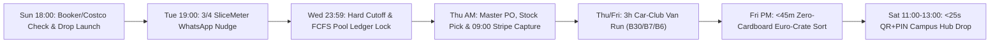

# Chapter 03 — Wholesale Supply Chain, Catalog Engineering & Saturday Campus Drop Operations

**For the University of Birmingham (UoB) SplitBox Founder**  
*Companion Codebase Modules:* `src/data/catalog.ts` · `src/components/ops/HubOpsView.tsx` · `src/components/ops/WholesaleManifestSection.tsx` · `src/components/ops/HubMarshallScannerCard.tsx`

---

## Executive Operational Thesis: Why Physical Discipline Is Your Real Moat

Software tracks who claimed Slice `3/4` of Oatly Barista, **but physical logistics decides whether you make `£350` net profit on a Saturday morning or lose your shirt in a Selly Oak traffic jam.**

Rapid grocery apps (Getir, Gorillas, Zapp) burned billions in the UK because they leased expensive dark stores, held perishable stock that rotted, and paid couriers `£4.50–£6.00` to ride a single bottle of milk and a pack of crisps to one flat door at a time. SplitBox flips every link of that chain:

1. **Zero Inventory Risk (Demand-First Cross-Docking):** You never buy a single wholesale case until `100%` of its slices are locked by student **Card Pre-Authorisation Holds** at the Wednesday `23:59` cutoff.
2. **100% Factory-Sealed Ambient Sub-Units:** Zero fridges, zero ice packs, zero loose scooping, zero expiry panic, and zero hall reception parcel clutter.
3. **Batch Fulfilment (`1 Van -> 1 Hub -> 60+ Students in 120 Minutes`):** One consolidated Friday wholesale run replaces `60–140` individual courier deliveries, turning a `21%–24%` wholesale gross spread into positive Day-1 unit contribution with **`£0.00` delivery fees** (at `≥ £9.00` basket value in Live Mode; `£0.00` flat in Demo Mode).

This chapter gives you the exact Birmingham postcodes, trade membership rules, `2–4` slice catalog engineering math, Sunday-to-Saturday solo-founder runbook, and `<25-second` Saturday hub choreography to run Drop #1 like a seasoned operator.

---

## 1. Where & How to Buy Wholesale in Birmingham (Day 1 to Scale)

Birmingham is one of the best cities in the UK to launch a student wholesale-pooling company. Within a **5-to-25-minute drive of Edgbaston (`B15`) and Selly Oak (`B29`)**, you have four heavyweight Cash & Carry ecosystems covering mainstream UK groceries, household bulk, and high-velocity international student staples.

> [!IMPORTANT]
> **Always Read the Inc-VAT Tag Until You Cross £90,000 Turnover:** UK Cash & Carry shelf labels print the **Ex-VAT price in huge bold font** and the **Inc-VAT price in tiny font underneath**. Before your company is VAT-registered (`£90,000` rolling 12-month taxable turnover threshold — see [Chapter 01](01-unit-economics-and-financial-model.md)), any `20%` VAT paid on toilet roll, laundry capsules, dishwasher tabs, crisps, or sweetened canned drinks is a **hard, non-recoverable cost**. Always verify your `wholesaleSliceCostGbp` against the **Inc-VAT** shelf figure.

### 1.1 Stage 1 (Drops #1–#7): Birmingham Cash & Carry Playbook

| Wholesaler & Exact Birmingham Depot | Distance from UoB (`B15`/`B29`) | Membership Fee & Trade Onboarding | Core SplitBox SKUs (`src/data/catalog.ts`) | Operational Superpower |
| :--- | :--- | :--- | :--- | :--- |
| **Booker Wholesale — Stirchley**<br>Pershore Rd, Stirchley, **B30 2YT** | **1.5 miles (`5–7 mins`)** from Selly Oak & The Vale | **`£0.00` (Free Trade Card)**<br>Apply at `booker.co.uk` | Mutti Polpa (`24×400g`), Oatly Barista (`12×1L`), Garofalo/Napolina Pasta, Fairy Tubs, TREK Bars, Clementines | Closest depot to campus; **live online branch stock counts** + Thursday **Click & Collect** cage picking. |
| **Booker Wholesale — Aston (Depot #402)**<br>85–87 Rocky Lane, Aston Cross, **B6 5RQ** | **5.5 miles (`18 mins`)** via A38 Aston Expressway | **`£0.00` (Same Booker Card)** | Deeper catering & retail multipack range, Jimmy's Iced Coffee (`24×250ml`), Minor Figures Chai, Finish Tabs | Flagship stock depth; sits directly on the return route from Costco Nechells (`B7 5PA`). |
| **Costco Wholesale Birmingham**<br>100 Watson Rd, Star City / Nechells, **B7 5PA** | **6.5 miles (`20–25 mins`)** via A38(M) | **`£22.00 + VAT/yr` (`£26.40` inc-VAT)** Trade Membership | Bamboo/Kirkland/Cushelle Loo Roll (`40–48` rolls in inner sub-packs), Fairy/Finish Mega Packs, Oatly/Alpro Trays, Pip & Nut, PROPER Snacks | Unbeatable unit economics on paper goods, detergent tubs, and branded snack cartons; early **Trade Hours (`Mon–Fri 10:00–12:00`)**. |
| **Bestway Birmingham** (Saltley, **B8 1JT**) & **Dhamecha Smethwick** (173 Rolfe St, **B66 2AU**) *(+ **Wing Yip**, 375 Nechells Park Rd, **B7 5NT**)* | **4.5–6.5 miles (`15–22 mins`)** | **`£0.00` (Free Trade Account)**<br>Photo ID + 2 business proofs | Nongshim Shin Ramyun (`20×120g` = `4×5-packs`), Tilda/Laila Basmati Rice (`4×2kg`), Indomie, world sauces, canned drinks | Secret weapon for UoB's huge international student population; Wing Yip is literally **2 minutes around the corner from Costco `B7 5PA`**. |

#### Exact Trade Onboarding Walkthrough (Do This in Week 1 Before Drop #1)

Do **not** show up at a Cash & Carry customer desk on Friday morning with just a student ID card—they will turn you away. Bring a neat plastic wallet containing these exact documents to unlock all four accounts in a single afternoon:

1. **Costco Wholesale Birmingham (`100 Watson Rd, Nechells, B7 5PA`):**
   - **Why Trade (`£26.40/yr` inc-VAT) Beats Individual (`£33.60/yr`):** Trade Membership saves `£7.20/yr`, includes one free spouse/domestic card (plus optional add-on partner cards at `£14.00 + VAT`), gives you valid VAT invoices made out to your business name for HMRC/FBO traceability, and grants entry during **quiet weekday Trade Hours (`10:00–12:00`)** when pallet aisles are empty.
   - **What to Bring to the Membership Desk:**
     1. **Valid Photo ID** (Passport or UK Driving Licence).
     2. **Proof of Trading Entity (Pick 1):** Companies House Certificate of Incorporation (`£50` online filing) **OR** Birmingham City Council Food Business Operator (FBO) Registration confirmation email **OR** HMRC Sole Trader UTR letter (check visa eligibility first — see [Chapter 02](02-uk-legal-regulatory-and-compliance.md)).
     3. **Secondary Business Proof (Pick 1):** UK Business Bank Statement PDF printed out (Monzo Business, Starling Business, Tide, or Mettle — all `£0/mo` and openable in 48 hours), commercial insurance certificate (`£5m` Public Liability), or business letterhead/invoice.
2. **Booker Wholesale (`Stirchley B30 2YT` & `Aston B6 5RQ`):**
   - Pre-register online at `booker.co.uk` (`Join -> New Customer -> Retailer / Campus Grocery`). Write down your temporary reference number, walk into **Booker Stirchley** (5 minutes down Pershore Road from Selly Oak) with your Photo ID + Companies House/FBO proof + business bank statement, and they will print your plastic barcode card on the spot for **`£0.00`**.
   - Immediately link your card number to your `booker.co.uk` login so you can view **live Stirchley vs. Aston branch inventory counts** and place **Click & Collect** orders on Thursday morning.
3. **Dhamecha (`Smethwick B66 2AU`), Bestway (`Saltley B8 1JT`) & Wing Yip (`Nechells B7 5NT`):**
   - Same exact document folder (`£0.00` registration). At **Dhamecha Smethwick** and **Wing Yip Trade Desk**, ask specifically for **export/retail multipack cartons** (e.g., `20-pack` Nongshim Shin Ramyun split internally into `4 × 5-pack` retail pillow packs with full English allergen bolding—never non-English grey-market imports that fail UK Food Information Regulations 2014!).

---

### 1.2 Stage 2 Sourcing (Drops #8+): Delivered Pallets & Paid Challenger Brand Deals

Walking Cash & Carry aisles with a flatbed trolley works brilliantly from **Drop #1 to Drop #7 (`25–100` weekly orders)**. Once you cross **`£1,200–£1,800/week` in wholesale spend (`~120+` student crates)**, stop hauling cases off retail shelves and move up one rung of the UK FMCG supply chain:

#### A. Regional Delivered Wholesalers (Van Hire Drops Toward `£0`)
- **CLF Distribution, Suma Wholefoods & Essential Trading:** The primary UK wholesale distributors behind **Oatly, Minor Figures, Pip & Nut, TREK, PROPER, and eco household lines**. Minimum order values (MOQs) for **free kerbside pallet delivery** to Birmingham typically sit at **`£250–£400` ex-VAT**, unlocking an extra **`6%–12%` gross margin** over Cash & Carry shelf prices.
- **Empire Bespoke Foods & Petty Wood:** Direct UK importers/distributors for premium world noodles, sauces, pasta, and tinned Mediterranean staples.
- **Booker / Bestway Delivered Wholesale:** Once weekly depot spend regularly clears **`£500–£750`**, talk to the **Booker Aston Territory Account Manager** to switch high-weight core lines (`Oatly`, `Mutti`, `Rice`, `Pasta`) onto scheduled Friday morning tail-lift delivery straight to your ground-floor staging lockup.

#### B. The Challenger Brand "Freshers & Saturday Crate Sponsorship" Goldmine

Here is an insider FMCG secret that turns SplitBox's margin structure upside down: **UK challenger food, drink, and eco-household brands spend `£2,500–£8,000 per day` hiring student marketing agencies to hand out lukewarm cans on windy campus walkways—with zero tracking of who took them or whether they ever bought a pack afterward.**

With SplitBox, you control a **verified `@student.bham.ac.uk` distribution pipe** going directly onto shared kitchen counters across The Vale (`Shackleton, Chamberlain, Maple Bank, Tennis Courts, Mason`) and Selly Oak (`Dawlish Rd, Tiverton Rd, Bournbrook`). Every single crate goes home to a flat of `5–8` students who cook and shop together.

Target these exact UK challenger brands once you have **`50–100` weekly crates** (with photos of your Saturday hub queues):
- **Drinks & Coffee:** *Oatly, Minor Figures, Jimmy's Iced Coffee, Liquid Death, Hip Pop, TRIP, Dash Water, Red Bull / Monster Campus Teams*
- **Study Fuel & Pantry:** *Huel (RTD bottles & bars), Tony's Chocolonely, TREK, PROPER, Graze, Pip & Nut, Deliciously Ella*
- **Dorm & Personal Care:** *Smol (laundry/dishwasher trial packs), Wild (refill deodorants), Who Gives A Crap, Suri*

Pitch **two structured commercial options** in one email:
1. **Option A — Paid "Saturday Crate Drop Insert" (`£200–£500` flat fee + free stock):** You place **1 chilled/ambient sample unit + a QR discount card** inside `100–250` verified UoB student pickup crates (`£1.50–£2.50` per guaranteed kitchen placement), capture a 1-click post-drop taste rating from buyers, and list their full-size multipack in the following Sunday's SplitBox Drop to convert trial into immediate case sales!
2. **Option B — Campus Launch Trade Subsidy (`40%–60%` off RRP on wholesale cases):** If their sampling cash budget is locked for the quarter, ask for **promotional stock ("investment cases")** at `40%–60%` trade discount so you can feature their multipack as the `"Hero £2.50 Student Drop"` of the week. You still price 40% below Selly Oak retail, while your gross margin jumps from `21%` to **`45%+`**.

> [!TIP]
> **Who to Email on LinkedIn:** Do not email generic `info@` addresses. Search LinkedIn for `[Brand Name] + ("Field Marketing Manager" OR "Sampling Manager" OR "Student Marketing" OR "Impulse Account Executive" OR "Out of Home")` based in London/UK. They are measured quarterly on *cost-per-sample-in-hand* and *student trial conversion*.

#### Copy-Paste Template: Challenger Brand Sponsorship & Trade Discount Email

```text
Subject: Putting [Brand Name] into 150 shared UoB student kitchens next Saturday (SplitBox Campus Drops)

Hi [First Name],

Quick note from the University of Birmingham — I run SplitBox, our weekly wholesale grocery "Box Drop" where UoB students across The Vale Village and Selly Oak pool wholesale cases of kitchen essentials and collect them every Saturday.

Instead of handing flyers to passersby in the rain who forget the brand 30 seconds later, every SplitBox crate goes directly back into a verified @student.bham.ac.uk 5-to-8-person shared student kitchen alongside their weekly Oatly, rice, and pantry staples.

We are locking our sponsored slots for next month's Saturday Drops ([Number, e.g., 150] verified student crates / ~900 flatmates reached per weekend) and [Brand Name] is at the top of our student request poll.

Two ways brands like [e.g., Jimmy's / Minor Figures / TREK] plug into a Saturday Drop:

1. Sponsored Crate Drop (£250 flat fee + 150 sample units):
   - 1 [Product] placed directly inside every pre-paid Saturday student grocery crate.
   - Co-branded card + 1-click feedback poll sent to all 150 verified UoB buyers on Sunday.
   - Automatic "Featured Pool" listing for full [Brand Name] cases in the following week's Drop so students who loved the sample immediately pool full packs.

2. "Featured Student Pool" Trade Allocation (zero cash fee):
   - Supply 15–25 promotional wholesale cases at a campus trial trade rate (50–55% off RRP) for a hero 2-week UoB Drop, with photo/video recap of boxes locking across The Vale & Selly Oak.

Happy to send over a 60-second clip of last Saturday's Shackleton Hub handover + our SKU sheet. Free for a quick 10-minute call on Tuesday at 11:00 or Thursday at 14:30?

Best,
[Your Name]
Founder, SplitBox (University of Birmingham)
[Your Phone Number] | [Live Storefront Link]
```

---

## 2. Catalog Engineering & Box-Divisibility Math

New founders assume *"more SKUs and smaller slices = more sales."* In pooled wholesale commerce, the exact opposite is true: **bloated catalogs and high slice-counts (`12` slices/box) are mathematical suicide at early hub density.**

### 2.1 Why `2`, `3`, or `4` Slices/Box Lock Reliably While `12`-Slice Boxes Trigger Refunds

Every SplitBox pool settles via **strict sequential First-Come, First-Served (FCFS) integer-box math** (`src/store/dropEngine.ts`):

```text
lockedBoxes          = Math.floor(totalClaimedSlices / totalSlicesPerBox)
autoReleasedOverflow = totalClaimedSlices % totalSlicesPerBox
```

Watch what happens at a realistic **Drop #1–#2 Launch Hub** (`Vale · Shackleton` with **`30` student orders**, averaging `3.2` slices per student = **`96` total slice claims** distributed across **`12` SKUs**, or an average of **`8` claims per SKU**, with real-world demand ranging from `5` to `13` claims per item):

| Slices Per Box (`totalSlicesPerBox`) | Example Wholesale Case Split | Outcome at `5` Claims (Slower SKU) | Outcome at `9` Claims (Popular SKU) | Operational & Financial Verdict |
| :--- | :--- | :--- | :--- | :--- |
| **`2` Slices / Box** | `6 × 1L` Oatly Tray -> `2` slices of `3 × 1L` (`£4.20`) | **`2` Boxes Lock (`4` fulfilled)** · `1` released (**`80%` lock rate**) | **`4` Boxes Lock (`8` fulfilled)** · `1` released (**`89%` lock rate**) | **Bulletproof for Drop #1.** Maximum `1` disappointed student per SKU; fastest Friday pre-sort. |
| **`3` Slices / Box** | `6 × 34-Tab` Finish Case -> `3` slices of `2` pouches (`£9.90`) or `12L` Chai -> `3 × 4L` | **`1` Box Locks (`3` fulfilled)** · `2` released (**`60%` lock rate**) | **`3` Boxes Lock (`9` fulfilled)** · `0` released (**`100%` lock rate**) | **High lock rate + bigger slice ticket**, pushing baskets effortlessly past the `£9.00` free-crate threshold. |
| **`4` Slices / Box** | `12 × 1L` Oatly (`4 × 3L`), `4 × 2kg` Tilda Rice, `20-pk` Shin Ramyun (`4 × 5-pk`) | **`1` Box Locks (`4` fulfilled)** · `1` released (**`80%` lock rate**) | **`2` Boxes Lock (`8` fulfilled)** · `1` released (**`89%` lock rate**) | **The SplitBox Sweet Spot.** One student sharing a `3/4` WhatsApp link locks the box instantly! |
| **`6`–`8` Slices / Box** | `48-Roll` Bamboo (`8 × 6-rolls`), `16 × 500g` Garofalo (`8 × 2-bags`) | **`0` Boxes Lock (`0` fulfilled!)** · `5` released (**`0%` lock rate on `6` or `8`!**) | **`1` Box Locks (`6` or `8` fulfilled)** · `3` or `1` released (**`67%–89%`**) | **Stage 2 (`80+` orders/hub) Only.** Safe once a hub clears `15+` claims/SKU; risky on Week 1! |
| **`12` Slices / Box** *(Rookie Trap!)* | Splitting `12 × 1L` Oatly into `12` single `1L` cartons (`£1.40`/slice) | **`0` Boxes Lock (`0` fulfilled!)** · `5` released (**`0%` lock rate**) | **`0` Boxes Lock (`0` fulfilled!)** · `9` angry students (**`0%` lock rate!**) | **NEVER DO THIS.** High refund rate, `£1.40` micro-tickets crushed by Stripe's `20p` fixed fee, and `3×` slower picking. |

> [!WARNING]
> **Tuning `src/data/catalog.ts` for Your Real Physical Drop #1:** In the codebase (`src/data/catalog.ts`), the 14 UoB showcase SKUs use `4`, `6`, and `8` slices per box (seeded for multi-hall volume). **For your first 3 live campus drops (`25–45` orders at 1 hub), restrict every active SKU to `2`, `3`, or `4` slices per box!** You don't even have to drop `6`- or `8`-slice products—simply **double the sub-unit bundle** (e.g., offer *Who Gives A Crap 48-Roll Carton* as **`4` slices of `2 × 6-roll sub-packs` (`12` rolls for `£9.50`)** instead of `8` slices of `6` rolls, and *Garofalo `16 × 500g` Pasta* as **`4` slices of `4 × 500g` bags (`2kg` for `£5.20`)**). Every sub-unit remains 100% factory-sealed and UK FIR-compliant, your lock rate jumps above `85%`, and your Average Order Value (AOV) surges!

### 2.2 Balancing the 12–15 Weekly SKUs: Hooks, Heavy Painkillers & Impulse Margin

Never pick SKUs at random. Every item in your `12–14` SKU weekly Drop must earn its slot in one of **three psychological roles** mapped directly to `src/data/catalog.ts`:

#### Role 1: Anchor Price Hooks (`3–4 SKUs` · High-Velocity, Known Benchmark Price)
Students may not know the exact price of bronze-die pasta, **but every coffee-drinking student in The Vale knows a single `1L` carton of Oatly Barista costs `£2.20` at Selly Oak convenience stores (`£6.60` for 3).**
- **Codebase Anchors:**
  - `oatly-barista-ambient` — **Oatly Barista `3 × 1L` Slice** at **`£4.20`** (`£1.40/L` eq. vs `£6.60` Selly Oak Express — **Save `36%`**, `4` slices/box).
  - `who-gives-a-crap-bamboo` — **Bamboo 3-Ply Toilet Tissue (`6-Roll` Sealed Sub-Pack)** at **`£4.80`** (vs `£7.50` retail — **Save `36%`**; or Cushelle/Kirkland inner wrapped sub-packs).
  - `garofalo-penne-rigate` — **Garofalo Durum Penne (`2 × 500g` Bags)** at **`£2.60`** (vs `£4.40` retail — **Save `41%`**).
- **Job:** Generate instant *"Wait, how is it that cheap?!"* credibility on hall WhatsApp flyers and drive weekly repeat habit.

#### Role 2: Heavy Carry Painkillers (`5–6 SKUs` · The "Selly Oak Uphill Walk" Moat)
Walk from Bristol Road (`B29`) up Edgbaston Park Road to **The Vale Village (`B15 3SZ`)** in November rain carrying `8kg` of tins, rice, and laundry detergent in plastic bags that slice into your fingers. **Once you understand that 20-minute uphill walk, you understand why carless UoB students love SplitBox.**
- **Codebase Heavyweights (`caseWeightKg` in `src/data/catalog.ts`):**
  - `mutti-chopped-tomatoes` — `11.2kg` case (`4 × 400g` sealed tin multipack = `1.8kg`/slice for **`£3.30`** vs `£5.40`).
  - `tilda-basmati-rice` — `8.3kg` case (`1 × 2kg` resealable pouch for **`£4.50`** vs `£7.25` — huge across Vale & Pritchatts Park international flats).
  - `minor-figures-chai` (`12.5kg` case · `2 × 1L` for **`£4.60`**) & `jimmys-iced-coffee-cans` (`6.6kg` case · `4 × 250ml` pack for **`£3.90`**).
  - `fairy-non-bio-pods` (`3.2kg` case · `28-wash` child-safe click-lock tub for **`£5.90`** vs `£9.50`) & `finish-ultimate-tabs` (`3.6kg` case · `34-tab` foil ziplock pouch for **`£5.20`** vs `£8.75`).
- **Job:** Deliver massive physical convenience value just `1–3 minutes` from student bedrooms (`Shackleton Forecourt` or `618 Bristol Rd`) and lift basket totals cleanly above `£9.00`.

#### Role 3: Lightweight High-Margin Impulse Add-Ons (`4–5 SKUs` · Basket Top-Ups)
Suppose a student adds `1` Oatly slice (`£4.20`) + `1` Tilda Rice slice (`£4.50`) = **`£8.70`**. In Live Mode, baskets under `£9.00` pay a `£0.39` micro-crate card-cover fee, while `≥ £9.00` unlocks **`£0.00` Free Crate Collection**. What do they add for `£1.85–£3.75`?
- **Codebase Basket-Builders (`<3kg` to `6.4kg` per full case — tiny van footprint!):**
  - `nongshim-shin-ramyun` — **Sealed `5 × 120g` Spicy Noodle Multipack** at **`£3.75`** vs `£6.25` (**Save `40%`**, `4` slices/box, `£0.80` margin/slice, only `2.8kg`/case!).
  - `trek-protein-flapjacks` — **Sealed `4 × 50g` Box** at **`£2.80`** vs `£4.50` (`1.5kg`/case — fits in van dead-space!).
  - `proper-lentil-chips` — **`3 × 85g` Sharing Bags** at **`£3.15`** vs `£5.25` (`2.4kg`/case).
  - `pip-nut-peanut-butter` — **`1kg` Tamper-Sealed Gym/Toast Tub** at **`£4.95`** vs `£7.80` (**`23.2%` gross margin — `£1.15`/slice!**).
  - `easy-peeler-clementines` — **`1kg` Pre-Netted Ambient Citrus** at **`£1.85`** vs `£3.00` (zero fridge needed; buy Friday morning for Saturday morning handover).

> [!IMPORTANT]
> **60-Second Sub-Unit Compliance Check Before Listing Any New SKU:** Every single slice in `src/data/catalog.ts` is either an individually retail-labelled container (`Oatly 1L`, `Tilda 2kg`, `Pip & Nut 1kg`, `Fairy click-lock tub`) or a factory-sealed retail multipack (`Nongshim 5-pack`, `Mutti 4-pack`, `TREK 4-box`) carrying full English ingredients, **bolded allergens**, Best Before date, net weight, and UK FBO address on the sub-unit itself (plus intact CLP child-resistant closures on detergents). Never split unlabelled inner catering pouches—see the full legal audit in [Chapter 02](02-uk-legal-regulatory-and-compliance.md).

---

## 3. The Sunday-to-Saturday Operating SOP (Minute-by-Minute Solo Founder Runbook)

You are a full-time UoB student with lectures, coursework, and society commitments. SplitBox is engineered so **one organised founder can run a `40–60` order weekly Drop in ~6.5 total hours of operational work per week** without skipping a single seminar.



### 3.1 Sunday `17:00–18:00` — Pre-Drop Stock/Price Audit & Launch (`45 mins`)
1. **`17:00` — Live Wholesale Stock & Price Check:** Log into `booker.co.uk` (set branch to **Stirchley `B30 2YT`**, backup **Aston `B6 5RQ`**) and check Costco's current UK Coupon Book. Confirm all `12–14` active SKUs show healthy branch stock (`10+` cases) and verify **Inc-VAT** cost hasn't ticked up above `wholesaleSliceCostGbp`. If an item is out of stock city-wide, swap it *before* opening the Drop—never after students pool!
2. **`17:25` — ASA Price Benchmark Snapshot:** Once a fortnight when walking down Bristol Road in Selly Oak, snap dated smartphone photos of shelf tags at local convenience stores (`SELLY OAK EXPRESS` benchmark) for your active SKUs and drop them into a Google Drive folder (`ASA-Price-Proofs-YYYY-MM`).
3. **`18:00` — Open the Weekly Drop:** Flip the hub pool status to `OPEN` and drop the Sunday `18:15` launch message into your hall/house WhatsApp broadcast (Sunday evening between `18:00` and `21:00` is peak student grocery planning time).

### 3.2 Tuesday `19:00`, Wednesday `23:59` & Thursday `09:00` — Pool Lock, Master PO & Post-Pick Capture (`30 mins`)
1. **Tuesday `19:00` & Wednesday `19:00` ("1 Slice Left" Velocity Push):** Filter your storefront by **`Almost Full (1–2 Left)`**. Screenshot `2–3` radial `<SliceMeter />` cards sitting at `3/4` (`Oatly`, `Shin Ramyun`, `Tilda Rice`) and post them to hall groups—students love clicking **Claim Final Slice & Fill Box** to rescue a pool before midnight.
2. **Wednesday `23:59:00` — Hard Cutoff & Sequential FCFS Pool Ledger Lock:**
   - Storefront locks automatically (`dropStatus = 'closed'`).
   - Every product's chronological slice ledger resolves into **100% Full Boxes (`lockedBoxes`)** vs. **Partial Overflow (`<100%` -> Release/Cancel uncaptured Card Pre-Authorisation Hold at `£0.00` fee)**.
3. **Thursday `06:00–09:00` — Integer-Case Master PO, Stock Confirmation & Post-Pick Stripe Capture:**
   - Export your **Integer-Case Master Procurement Sheet** (`06:00` PO Lock matching `WholesaleManifestSection.tsx` — golden rule: **you NEVER buy half a case**).
   - Confirm physical case availability via **Booker Click & Collect** (`Stirchley B30 2YT` / `Aston B6 5RQ`) + morning depot stock check *before* running `stripe.paymentIntents.capture({ amount_to_capture })` at **`~09:00`**. Why wait until post-pick confirmation to capture? Because your Visa/Mastercard 7-day Pre-Authorisation Hold is still open—so if any depot has a surprise stock-out, you simply deduct that slice from `amount_to_capture` at **`£0.00` Stripe fee bleed** instead of losing Stripe's non-refundable `1.5% + £0.20` processing fee on a post-capture refund!
   - Once captured, every student with `≥1` fulfilled slice receives their finalised GBP Settlement Receipt and Saturday Pickup Pass (`UOB-BOX-XXXX` QR + 4-digit PIN).

#### Worked Example: Thursday Master Procurement Sheet (`Vale · Shackleton` — `42` Orders, `27` Locked Cases)

| Depot Stop & Aisle | SKU (`src/data/catalog.ts`) | Claimed Slices | `Slices/Box` | **Buy (`lockedBoxes`)** | Released Overflow | Case Cost (Inc-VAT) | Line Spend (`£`) | Line Weight (`kg`) | Lot / Batch Code *(Log at Checkout!)* |
| :--- | :--- | :---: | :---: | :---: | :---: | :---: | :---: | :---: | :--- |
| **1. Booker Stirchley (`B30 2YT`)** | Oatly Barista (`12×1L`) | 22 | 4 | **`5` Cases** | 2 (`2/4`) | `£13.20` | `£66.00` | `63.0 kg` | `________` |
| **1. Booker Stirchley (`B30 2YT`)** | Mutti Polpa (`24×400g`) | 19 | 6 | **`3` Cases** | 1 (`1/6`) | `£15.60` | `£46.80` | `33.6 kg` | `________` |
| **1. Booker Stirchley (`B30 2YT`)** | Garofalo Penne (`16×500g`) | 17 | 8 | **`2` Cases** | 1 (`1/8`) | `£16.64` | `£33.28` | `16.8 kg` | `________` |
| **1. Booker Stirchley (`B30 2YT`)** | Jimmy's Iced Coffee (`24×250ml`) | 12 | 6 | **`2` Cases** | 0 (`0/6`) | `£18.30` | `£36.60` | `13.2 kg` | `________` |
| **1. Booker Stirchley (`B30 2YT`)** | Orchard Clementines (`6×1kg`) | 13 | 6 | **`2` Cases** | 1 (`1/6`) | `£8.88` | `£17.76` | `12.8 kg` | `________` |
| **2. Costco Nechells (`B7 5PA`)** | Bamboo / Bulk Loo Roll (`48-Roll`) | 25 | 8 | **`3` Cases** | 1 (`1/8`) | `£30.00` | `£90.00` | `22.2 kg` | `________` |
| **2. Costco Nechells (`B7 5PA`)** | Fairy Non-Bio (`4×28` Tubs) | 9 | 4 | **`2` Cases** | 1 (`1/4`) | `£18.20` | `£36.40` | `6.4 kg` | `________` |
| **2. Costco Nechells (`B7 5PA`)** | Pip & Nut Smooth PB (`4×1kg`) | 8 | 4 | **`2` Cases** | 0 (`0/4`) | `£15.20` | `£30.40` | `8.8 kg` | `________` |
| **3. Wing Yip (`B7 5NT`) / Dhamecha** | Nongshim Shin Ramyun (`20×120g`) | 18 | 4 | **`4` Cases** | 2 (`2/4`) | `£11.80` | `£47.20` | `11.2 kg` | `________` |
| **3. Wing Yip (`B7 5NT`) / Dhamecha** | Tilda Pure Basmati (`4×2kg`) | 9 | 4 | **`2` Cases** | 1 (`1/4`) | `£14.20` | `£28.40` | `16.6 kg` | `________` |
| **TOTAL PROCUREMENT** | **10 Fulfilled SKUs** | **152** | — | **`27` Cases** | **10 Released** | — | **`£432.84`** | **`204.6 kg`** | *Keep VAT Receipts 6 Yrs* |

*(Student Gross Captured Revenue on those `27` locked cases = **`£552.00`** · Gross Wholesale Spread = **`£119.16` (`21.6%`)** · Dead Unsold Stock = **`£0.00`**!)*

---

### 3.3 Thursday–Friday — Transport Without Owning a Car, Payload Math & Safe Lifting

You do **not** need to own a car, pay `£1,800/yr` in student motor insurance, or rent a warehouse to run SplitBox in Birmingham.

#### A. Four Carless Birmingham Transport Options (Ranked by Drop Size)

1. **Enterprise Car Club Vans (Selly Oak / Edgbaston / City Centre On-Street Bays) — `~£12.50–£16.00/hr`:**
   - Commercial vans (`Citroën Berlingo`, `VW Caddy`, `Ford Transit Custom`) parked in dedicated Birmingham bays (including Selly Oak/Bournbrook, Edgbaston, and Birmingham Moor Street/Digbeth), unlocked 24/7 via phone app.
   - **Fuel + commercial van insurance + breakdown cover are included** (`~£0.23–£0.29/mile` mileage rate). A crisp **3-hour Friday morning procurement loop** (`Selly Oak -> Booker Stirchley -> Costco Nechells -> Wing Yip -> Staging Base`, `~17 miles` total) costs **`~£42–£53` all-in** (or **`~£28–£35`** for a 2-hour `Booker Stirchley`-only run!).
   - *Driver Licence Check:* A standard **UK Category B car licence** legally covers vans up to **`3,500kg` (`3.5t`) Gross Vehicle Weight (GVW)**. Check the car club's under-25 age tier (`19+` or `21+` depending on vehicle size) during Week 1 registration—if you are 18–20 or lack a UK licence, recruit a 21+ PhD/Postgrad co-founder or paid Friday driver (`£14/hr` for 3 hours) who already holds a clean UK licence!
2. **Hertz 24/7 Hourly Vans at Costco Nechells (`B7 5PA`) & B&Q Selly Oak:**
   - Hourly Transit vans (`~£14–£18/hr`) stationed right inside retail car parks—ideal when buying bulky `48-roll` paper cartons at Costco `B7 5PA`.
3. **Friend's / Co-Founder's Estate Car or SUV (Drops #1–#2 Only, `<200kg`):**
   - `27` cases (`204.6kg`, shown above) fit comfortably with rear seats folded flat in a standard estate/hatchback—**PROVIDED** the driver upgrades their personal policy to **Class 1 Business Use** (`~£25–£50/yr` add-on on Admiral/Direct Line). **Never haul commercial wholesale stock on a standard "Social, Domestic & Pleasure" student car policy—insurers void cover completely in a collision.**
4. **Wholesaler Free Delivery (`£500–£750+` Depot Spend — Drops #6+):**
   - Once your weekly PO clears `50–65` cases, Booker/Bestway/CLF deliver pallets straight to your ground-floor lockup or partner venue on Friday morning, cutting Friday transport hours and van cost to **`£0.00`**.

#### B. Vehicle Payload Limits & Van-Loading Physics (Respect Liquid Density!)

Students underestimate how heavy liquids and tinned tomatoes are: **`1` Litre of Oatly or Chai = `~1.05kg` (`12.6kg` per case).** `10` cases of Oatly + `6` cases of Mutti + `6` cases of Chai + `5` cases of Rice = **`299.4kg` before a single roll of toilet paper enters the van!**

- **Small Hatchback / Estate (Rear Seats Flat):** Safe working cargo limit **`250–350kg`** (`~25–32` mixed cases). Exceeding this bottoms out rear suspension over Selly Oak speed cushions and lengthens braking distance in wet weather.
- **Small Panel Van (`Berlingo` / `Caddy`):** Safe payload **`650–800kg`** (`~65–85` mixed cases).
- **Medium SWB Van (`Ford Transit Custom`, `<3.5t`):** Safe payload **`1,000–1,200kg`** (`~110–145` mixed cases / 2 Euro pallets).

**3 Golden Loading & Manual Handling Rules (UK HSE Standards):**
1. **Buy a `£38` Folding Sack Truck / Platform Trolley on Day 1:** Never carry `12.6kg` Oatly trays across car parks by hand. Wheel stacks of `3–4` cases (`40–50kg`) effortlessly from van doors to hub tables on rubber/pneumatic wheels that glide smoothly over Shackleton paving slabs.
2. **Heavy Forward & Flat, Crushables High:** Load `Oatly (12.6kg)`, `Chai (12.5kg)`, `Mutti (11.2kg)`, `Pasta (8.4kg)`, and `Rice (8.3kg)` flat on the van deck pushed tight against the front bulkhead (over/between the axles), secured with two `£10` ratchet straps so nothing slides under emergency braking on the A38. Stack `Bamboo Tissue`, `TREK`, `PROPER Lentil Chips`, and `Clementines` on top—never underneath tins!
3. **Protect Your Spine:** Keep solo lifts **`≤ 15kg`** (hugging the case against your core, bending knees, zero twisting while holding weight). Never stack loaded Euro crates above chest height without a two-person lift.

---

### 3.4 Friday Evening / Saturday Morning Pre-Sort: `25+` Cases to Rapid Handoffs in `<45 Minutes`

Rookie founders make one of two fatal mistakes before Saturday morning:
- **Mistake A (Pre-Bagging 50 Individual Named Carrier Bags):** Takes `2.5 hours`, eats `£15` in paper bags that rip in British drizzle, and turns into a nightmare at the hub table when you hunt through 50 identical brown bags looking for `"Order #37"`.
- **Mistake B (Bringing Sealed Outer Cardboard Cases to Campus):** Forces you to slash tape with a box-cutter in front of a waiting queue, leaves a mountain of soggy cardboard at Shackleton Forecourt, and violates SplitBox's **Zero Cardboard / Zero Reception Footprint** guarantee to UoB Estates (`EstatesComplianceStrip.tsx`).

#### The SplitBox `<45-Minute` Euro-Crate Cross-Dock System

Invest **`£65–£85` once** in **`8` folding `600 × 400 × 320mm` food-grade perforated polypropylene Euro crates** (Nisbets / Solent Plastics; `25kg` load rating per crate, interlocking rims so stacks cannot slide in the van, and **fold flat to `65mm` thick** under a student bed between Saturdays!).

1. **Minutes `00–12` — De-Case & Cardboard Strip (At Home / Staging Base):**
   - Open all `25–30` wholesale outer cartons/shrink-wraps at your base on Friday evening.
   - Inspect every sub-unit for transit dents/leaks (quarantine any dented tin immediately) and flatten 100% of outer cardboard + plastic shrink-wrap into domestic/commercial recycling **before** loading the van. **Zero supplier cardboard ever travels to campus.**
2. **Minutes `12–30` — Pre-Band Multi-Unit Slices + Apply 4-Colour Category Stickers:**
   - **Single-pack slices require `0` prep (`0 seconds`):** `Tilda 2kg`, `Fairy 28-wash tub`, `Finish 34-tab pouch`, `Pip & Nut 1kg`, `Nongshim 5-pack`, `Mutti 4-tin shrink-pack`, `Bamboo 6-roll wrapped sub-pack`, `Jimmy's 4-can pack`, `TREK 4-bar box`, and `1kg Clementine net` are *already* single factory-sealed units!
   - **Loose multi-carton slices get pre-banded into `"1-Grab Units"`:** Strap each `3 × 1L Oatly` slice, `2 × 1L Minor Figures Chai` slice, `2 × 500g Garofalo Pasta` slice, and `3 × 85g PROPER Chips` slice together with wide biodegradable kraft belly-bands or heavy-duty rubber bands.
   - Slap a bright **colour-coded dot sticker** on every bundle so marshals spot SKUs in `0.5 seconds` without reading fine print:
     - **Mint Sticker (`#10D48E`):** Drinks & Oat Milk (`Oatly 3-pack`, `Chai 2-pack`, `Jimmy's 4-pack`)
     - **Cobalt Sticker (`#1849D6`):** Pantry (`Mutti`, `Tilda`, `Shin Ramyun`, `Garofalo`, `Pip & Nut`)
     - **Tangerine Sticker (`#FF6B1A`):** Snacks & Fruit (`TREK`, `PROPER`, `Clementines`)
     - **Yellow Sticker:** Household (`Bamboo Loo Roll`, `Fairy`, `Finish` — **always packed in separate crates from food/fruit** for chemical/fragrance taint prevention!).
3. **Minutes `30–45` — Stage Crates in Velocity Order + Pack the "Spare Buffer Crate":**
   - Pack high-velocity SKUs (`Oatly`, `Shin Ramyun`, `Mutti`, `Loo Roll`, `Rice`) into Crates `#1–#5` (front row at table height).
   - Pack a dedicated **Quarantine & Buffer Crate** holding `2` spare Oatly cartons, `1` spare noodle multipack, microfibre cloths, wet wipes, and a roll of heavy-duty carrier bags (`£0.15` emergency loan bags for forgetful freshers).

---

## 4. Running the 2-Hour Saturday Hub Drop Like Clockwork

Whether you are operating at **The Vale — Shackleton Forecourt (`B15 3SZ`, `11:00–13:00` concentrated 2h window)**, **Selly Oak — `618 Bristol Rd` (`B29 6BQ`)**, **Guild Mermaid Square (`B15 2TU`)**, or **Pritchatts Park (`B15 2SA`)**, your pop-up bay is your brand theatre. Students walking past a crisp, fast, zero-rubbish crate bay tell ten flatmates; students stuck behind a damp table with a dead iPad never order again.

### 4.1 Physical Pop-Up Bay Kit & British-Rainproof Layout (`12-Minute` Setup)

Arrive at `T - 25 minutes` (`10:35` for an `11:00` open). Unload via sack truck, move the van immediately off any hall forecourt/fire lane into legal visitor parking, and snap together this exact setup:

- **`1 × 6ft` (`183cm`) Heavy-Duty Folding Trestle Table (`~£38`, Screwfix/Costco)** + stretch/clipped wipe-clean branded dark-forest/mint tablecloth (tablecloth clips prevent flapping in Edgbaston wind tunnels!).
- **`3m × 3m` Commercial Waterproof Pop-Up Gazebo + `4 × 15kg` Leg Weights (`~£110`):** Essential for outdoor British rain (`Shackleton Forecourt` / `Bristol Rd`; skip gazebo if under `Mermaid Square` covered concourse). **CRITICAL CAMPUS SAFETY RULE:** Never hammer tent pegs into campus tarmac/paving, and **never** erect an unweighted gazebo—`60kg` of water/sand leg weights prevents gusts turning a canopy into a hazard.
- **Crate Ergonomics (Zero Floor Bending, Zero Ground Contact):** Food hygiene law (`EC 852/2004` retained in UK law) prohibits placing food bags directly on wet outdoor paving. Stack empty folded Euro crates underneath as **`32cm` risers** so active pick crates sit cleanly off the wet ground at waist height behind the table!
- **Tech & Power Redundancy:**
  1. Primary phone/tablet running SplitBox **Hub Ops View (`HubMarshallScannerCard.tsx`)** at `100%` screen brightness + **`20,000mAh` USB-C power bank** velcroed under the table lip.
  2. **Offline Manifest Cache + 1 Waterproof Paper Backup Sheet:** Concrete halls around Shackleton and crowded campus squares drop 4G/eduroam signals. Load the Hub Ops manifest on home Wi-Fi before leaving, **and** clip a single printed A4 sheet (sorted numerically by **4-Digit Check-In PIN** with `UOB-BOX-XXXX` code and SKU shorthand) onto a covered clipboard. Even if a phone shatters at `11:45`, your hub never stops!
  3. **A4 Tent Sign at Front Edge of Table:** Large QR code pointing to next week's Drop + bold text: *"PRE-ORDERED PICKUP BAY — HAVE YOUR QR / 4-DIGIT PIN & BAG READY · WALK-UPS: SCAN FOR £0 FEE NEXT DROP!"*

```text
   [ STUDENT WALKWAY / QUEUE (Along Wall — Never Blocking Hall Doors!) ]
          │
          ▼  (1) "QR + 4-Digit PIN & Backpack Open Ready!"
   ┌──────────────────────────────┬────────────────────────────────────┐
   │  CHECK-IN ZONE (Left 2ft)    │  HANDOVER ZONE (Right 4ft)         │
   │  • HubMarshallScannerCard    │  • Marshal lays out colour-coded   │
   │  • Waterproof PIN Clipboard  │    pre-banded Slices for 2s count  │
   │  • Walk-Up QR Sign + Samples │  • Student packs own Bag-for-Life  │
   └──────────────────────────────┴────────────────────────────────────┘
                 ▲                                   ▲
      [ Marshal 1: Scanner ]              [ Marshal 2: Picker ]
                 │                                   │
   ┌─────────────┴───────────────────┐ ┌─────────────┴─────────────────┐
   │ FAST-PICK EURO CRATES (On Risers)│ │ HOUSEHOLD CRATES (Separated)  │
   │ Mint: Oatly / Chai / Jimmy's    │ │ Yellow: Loo Roll / Fairy /    │
   │ Cobalt: Mutti / Rice / Noodles  │ │ Finish + Quarantine Buffer    │
   └─────────────────────────────────┘ └───────────────────────────────┘
```

---

### 4.2 The `< 25-Second` Student Check-In Choreography & Peak Queue Smoothing

At **`25 seconds` per student**, a 2-person bay processes **`144` students per hour** (`~3` students/minute peak burst)—meaning even a `75-order` Drop clears with zero queue anxiety.

| Second Mark | Marshal Action | Student Experience |
| :---: | :--- | :--- |
| **`00s – 04s`** | Eye contact with next student in queue while current student zips bag: *"Morning! QR or 4-digit PIN ready?"* | Student already has `My Orders / Pass` screen open (`PickupPassCard.tsx`). |
| **`04s – 09s`** | Scan `<QRCodeSVG />` (`UOB-BOX-VALE-XXXX`) **OR** type the **4-digit Check-In PIN** into `HubMarshallScannerCard` (instant fallback if student screen is cracked/dim). | Screen flashes **Verified** showing exact **Fulfilled Slices** (auto-released `<100%` slices already stripped out!). |
| **`09s – 19s`** | Scanner calls crisp colour-coded pick list: *"1 Mint Oatly 3-pack, 1 Cobalt Tilda 2kg, 1 Cobalt Shin Ramyun!"* Picker places all 3 pre-banded units cleanly on the table. | Student visually sees all 3 factory-sealed bundles match their receipt in `<2` seconds. |
| **`19s – 25s`** | Tap **`Mark Collected`** (stamps `collectedAt` audit log so pass cannot be re-scanned twice) as student slides bundles into their tote/rucsack: *"See you Wednesday!"* | Zero paper bag fumble, zero cardboard, student walks back to kitchen in 2 minutes. |

#### Preventing the `12:00` Saturday Sleep-In Rush
Left unmanaged, 65% of undergraduates wake up at `11:30` on Saturday and arrive simultaneously between `11:55` and `12:20`. Smooth the curve effortlessly on Friday evening:
- **Two Soft Hall Waves in Your Friday `18:00` Pickup Reminder:** Assign surnames `A–L` (or `Chamberlain & Maple Bank`) to **`11:00–12:00` ("Early Bird Wave")** and `M–Z` (`Shackleton, Tennis Courts & Mason`) to **`12:00–13:00`**.
- **Zero-Cost Early-Bird Incentive:** Drop `15` free challenger sample cans/bars (from Section 1.2!) into the crate of the **first 15 students who check in before `11:25`**. Word spreads fast—30% of your Drop will eagerly show up at `11:05`!

---

### 4.3 Field Exception SOPs: Damaged Cartons, Supplier Stock-Outs & Walk-Up Passersby

Great operations teams don't hope nothing goes wrong—they pre-script every edge case so a student marshal never freezes at the table:

1. **Transit-Damaged / Dented Tin or Weeping Carton Spotted at Pickup:**
   - **Rule:** Never hand a student a heavily dented tin (compromised hermetic seal risk) or sticky carton.
   - **Action (`15 seconds`):** Pull an identical clean replacement from the **Buffer Crate**. If no spare remains, apologise warmly, mark that single slice **`Damaged — Instant Refund`**, issue an exact pence partial refund (`e.g., £4.20`) plus a **`£1.00` Next-Drop Goodwill Credit** that afternoon, snap a photo of the damaged unit + batch code, and claim a no-quibble credit note at Booker/Costco Customer Service next week.
2. **Wholesale Depot Stock-Out (*"Booker Stirchley & Aston both ran out of Garofalo Penne!"*):**
   - **Rule:** Never substitute a different product or allergen profile without explicit consent, **never capture Stripe holds before confirming depot stock** (preserving `£0.00` fee bleed!), and never let a student walk out in the rain on Saturday only to hear half their order is missing.
   - **Action (Execute Pre-Capture on Thursday Morning — Zero Fee Bleed):** Check backup depots (`Booker Stirchley B30 2YT -> Booker Aston B6 5RQ -> Costco Nechells B7 5PA`). If genuinely out of stock across Birmingham during your Thursday morning Click-&-Collect / pick confirmation, **exclude that SKU (`£2.60`/slice) from `amount_to_capture`** before running your Thursday `09:00` Stripe capture (releasing the uncaptured hold portion at **`£0.00` Stripe processing fee**; reserve post-capture partial refunds strictly for rare post-settlement transit damage as in #1 above!). Add a **`£1.00` Next-Drop Apology Credit** and send a transparent WhatsApp/email note right away: *"Heads up: Garofalo Pasta sold out across Birmingham wholesalers this morning—we released £2.60 from your card pre-authorisation hold so you weren't charged a penny for it, plus added £1.00 off next week's crate. Your Oatly & Rice are locked and ready for Saturday 11:00!"* Transparency turns an operational hiccup into deep trust.
3. **Late / Uncollected Crates at Closing Time (`12:30` Warning -> `13:00` Close + `30m` Grace):**
   - **At `T - 30m` (`12:30`):** Check `HubMarshallScannerCard` for uncollected passes (`5–8` stragglers) and fire a direct WhatsApp/SMS ping: *"30 mins left at Shackleton Forecourt! Stuck in bed or away? Forward your QR + 4-digit PIN screenshot to a flatmate and they can grab your slices in 20 seconds!"* **Flatmate PIN Proxy Pickup rescues 80% of potential no-shows!**
   - **At `Window Close + 30m Grace` (`13:30`):** Note the distinction between **Demo Mode** (`HubOpsView.tsx` models automatic 30-minute Guild Food Bank donation) and **Live Production UK Consumer Law** (see [Chapter 02](02-uk-legal-regulatory-and-compliance.md) on Consumer Rights Act 2015 fairness for sealed ambient goods): either collect an explicit checkout tick-box opt-in (*"If I miss collection + 30m grace, donate my sealed food slices to UoB Guild Community Pantry"*), **or** hold uncollected crates with your campus marshal for a single 15-minute Sunday `18:00` hall lobby handoff / refund minus a transparent **`£2.00` restocking & van handling fee**.
4. **Walk-Up Passersby Who Point at the Crates and Ask: *"Wait—£4.20 for 3 Oatlys?! Can I buy one right now?"***
   - **Why You MUST Refuse Spot Sales:** Taking ad-hoc Apple Pay/cash payments from walk-ups on campus converts a **pre-ordered click-and-collect distribution point** into **unlicensed street trading/hawking** (an instant UoB Estates red line!), breaks exact pre-allocated student slice counts, and slows down your `<25s` check-in queue.
   - **The 15-Second Walk-Up -> Next-Drop Conversion Script (Memorise Word-for-Word):**
     > *"Everything in these crates was pre-locked by flatmates here before Wednesday midnight—that's the secret to getting it 38% cheaper than Selly Oak with £0 delivery fees! I can't sell off the table today, **but scan this QR sign right now (takes 10 seconds)** to unlock tomorrow's 6pm Drop for this hub—and take a free cold [Sponsored Sample Can/Bar] on us while you walk!"*

---

### 4.4 The Student Hub Marshal Playbook (Scaling Without Cloning Yourself)

As soon as Hub #1 (`Vale · Shackleton`) clears **`50+` weekly crates**—or the week you unlock Hub #2 (`Selly Oak · Bristol Rd` or `Pritchatts Park`)—you stop standing behind every trestle table yourself and promote reliable UoB students into **Campus Hub Marshals**.

#### Compensation Math That Attracts the Best Students on Campus
While the baseline dashboard model (`HubOpsView.tsx`) benchmarks UK Living Wage at `£12.60/hr`, **paying `£13.00/hr` + a free `£15.00` retail-value grocery crate (`~£9.50` wholesale cost to SplitBox) per `2.5-hour` Saturday shift** (`30m` setup/packdown + `2h` live window) makes SplitBox the most coveted weekend micro-job at UoB:

| Shift Cost Component (`2.5-Hour` Saturday Hub Shift) | Cash / Wholesale Cost to SplitBox | Perceived Value to Student Marshal |
| :--- | :---: | :---: |
| **`2.5 hrs × £13.00/hr`** (Comfortably above UK National Living Wage) | `£32.50` | `£32.50` |
| **Free `£15.00` Retail-Equivalent SplitBox Grocery Crate** (Oatly + Rice + Snacks) | `~£9.50` *(at wholesale cost)* | `£15.00` *(saved at Selly Oak)* |
| **Total Per-Marshal Shift Cost / Value** | **`£42.00` true cost** | **`£47.50` value (`£19.00/hr` eq.!)** |

*Unit Economics Check:* At an average gross profit of `~£2.80–£3.20` per student order, **just `14` student orders cover an entire Marshal's Saturday shift**—leaving orders `15` through `80+` at that hub as pure contribution margin!

#### Recruiting, Vetting & Managing Marshals in 4 Rules
1. **Recruit Organised Early-Risers (Not Party Promoters):** Skip flaky club-night reps. Recruit **UoB Boat Club (Rowing), Athletics/Triathlon, MedSoc, Engineering, or Residence Life community assistants** via **UoB Guild JobZone** and sports club treasurers—students already accustomed to waking up at `07:00` in cold British weather and showing up on time.
2. **Mandatory UK Right-to-Work & Student Visa Check Before Shift #1:** Check every marshal's UK passport or `gov.uk` Right-to-Work Share Code before paying a penny. If hiring an international UoB student on a Student Visa (as a PAYE worker, never "self-employed" contractor!), strictly cap shifts well inside their **20-hour/week term-time legal work limit** (a `2.5h` Saturday shift is ideal, provided they track any Guild/bar hours alongside it).
3. **The 15-Minute Friday Shadowing & Saturday SLA:** Every new marshal shadows `1` live Saturday shift alongside you before running a table solo. Measure every hub on three crisp SLAs:
   - **Setup Ready Photo** posted in the `#saturday-ops` WhatsApp group at **`T - 10 mins`** (`10:50` sharp).
   - **Zero Cardboard / Zero Litter Exit Photo** of the spotless empty forecourt posted at **`T + 35 mins`** (`13:35` sharp — gold-dust proof when pitching UoB Estates for new hubs!).
   - **`≥ 98%` Scan Accuracy** (`collectedAt` logged in `HubMarshallScannerCard` + zero unrecorded missing slices).
4. **Multi-Hub Staggered Van Circuit (Drops #4+):** Notice how `src/data/catalog.ts` staggers Saturday hub windows (`Pritchatts Park 10:30–13:00` -> `Vale · Shackleton 11:00–14:00` -> `Guild · Mermaid Sq 12:00–15:00` -> `Selly Oak · Bristol Rd 13:00–16:00`). One single hired Transit van drops pre-sorted Euro crates + gazebo to Marshal Pair A at `10:05`, Marshal Pair B at `10:35`, and Marshal Pair C at `12:30`, then loops back in the afternoon to collect folded empty `65mm` Euro crates—**scaling 1 van across all 4 UoB hubs in a single Saturday!**

---

*Next Chapter -> [Chapter 04: UoB Campus Go-To-Market, Estates Politics & Fundraising](04-uob-campus-gtm-estates-and-pitching.md)*
