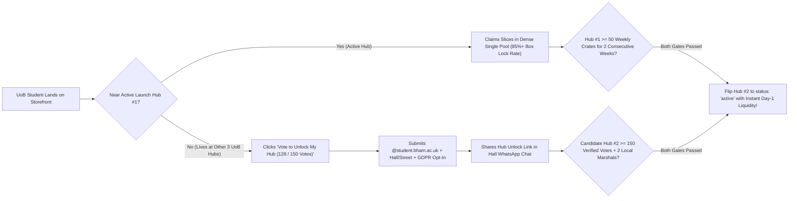

# Chapter 4 — University of Birmingham Go-To-Market, Campus Estates Politics, Viral Growth & Pre-Seed Fundraising

**For the University of Birmingham (UoB) SplitBox / PalletCut Founder**  
_Companion Volumes:_ [Master Playbook](../FOUNDER_BUSINESS_PLAYBOOK.md) · [01 Unit Economics](01-unit-economics-and-financial-model.md) · [02 UK Legal & Compliance](02-uk-legal-regulatory-and-compliance.md) · [03 Wholesale & Drop Ops](03-wholesale-supply-chain-and-drop-ops.md) · [05 24h-to-Drop #1 Roadmap](05-post-antigravity-24h-to-drop1-roadmap.md)

> [!IMPORTANT]
> **The 60-Second Founder GTM Takeaway:** You do not need £10,000 in paid Instagram ads or an 8-week university committee sign-off to win your first 50 paying UoB students. **SplitBox** *(unified storefront brand **PalletCut**)* scales with **`£0.00` ad spend** by obeying three rules: (1) concentrate 100% of early orders into **one active pickup hub** across **10 curated SKUs** to hit an **`85%+` Box Lock Rate**, (2) launch **permissionlessly on private property in Selly Oak within 7 days (Track A)** while **official Vale Village Estates RAMS approval (Track B)** runs in parallel, and (3) weaponise the **`3/4 Slices Claimed — 1 Left to Lock!`** radial `<SliceMeter />` inside UoB flat, hall, cultural society, and UBSport WhatsApp groups.

---

## 1. The Marketplace Density Law (Why Launching Across All 4 UoB Hubs on Week 1 Will Kill You)

### 1.1 Liquidity Physics of Sequential Case-Boundary Pooling

In `src/data/catalog.ts`, `UOB_CAMPUS_HUBS` defines four University of Birmingham collection points, enforcing **1 active launch hub (`status: 'active'`)** alongside **3 waitlist hubs (`status: 'coming_soon'` with `waitlistVotes`)**:

1. **`vale-shackleton`** — *The Vale Village — Shackleton Hub* (`Edgbaston Park Rd, B15 3SZ`, `Sat 11:00–14:00`)
2. **`guild-mermaid`** — *Guild of Students — Mermaid Square* (`Edgbaston Main Campus, B15 2TU`, `Sat 12:00–15:00`)
3. **`selly-oak-bristol`** — *Selly Oak — Bristol Road Hub* (`618 Bristol Rd, B29 6BQ`, `Sat 13:00–16:00`)
4. **`pritchatts-park`** — *Pritchatts Park — Social Space Hub* (`Pritchatts Rd, B15 2SA`, `Sat 10:30–13:00`)

Every hub maintains an **independent `HubDropLedger`**. Because a physical `12 × 1L` wholesale tray of *Oatly Barista* is divided into `4` physical `3 × 1L` slices handed out from one Euro crate at one Saturday bay, **1 slice claimed at Pritchatts Park cannot combine with 3 slices claimed at Shackleton**.

Under sequential First-Come, First-Served (`FCFS`) case allocation, a box only drops on Saturday if it reaches **`100%` (`4/4` or `6/6`)** by the Wednesday `23:59` cutoff. Any partial overflow box (`1/4`, `2/4`, `3/6`) never ships, and its Stripe **Card Pre-Authorisation Hold** (`capture_method: 'manual'`) is left uncaptured.

That creates an iron law of batch pooling: **Splitting early demand across multiple hubs and too many SKUs destroys your Box Lock Rate.**

---

### 1.2 Worked Mathematical Proof: 20 Orders Fragmented vs. 20 Orders Concentrated

Assume in Week 1 you hustle across campus and win **20 paying UoB student orders**, averaging **3.0 slices per crate** (`~£12.20` average crate subtotal, qualifying cleanly for **`£0.00` crate fee** above `FREE_CRATE_THRESHOLD_PENCE = 900` [`£9.00`]; micro-crates under `£9.00` pay `MICRO_CRATE_FEE_PENCE = 39` [`£0.39`]). That gives you **60 total slices claimed** in Drop #1.

Compare what happens at Wednesday `23:59` cutoff under two launch configurations:

| Launch Configuration | Active Hubs | Active SKUs | Independent Pools (`Hubs × SKUs`) | Mean Slices Claimed per Pool | Full Boxes Locked at Cutoff | Slices Fulfilled vs. Unfilled | Box Lock Rate & Student Trust Outcome |
| :--- | :---: | :---: | :---: | :---: | :---: | :---: | :--- |
| **Fatal Mistake: All 4 Hubs + All 14 SKUs Live** | `4` | `14` | **`56` pools** | `60 ÷ 56 =` **`1.07 slices`** | `3` boxes (`4/4` clusters) | **`12` fulfilled (`20%`)** / **`48` cancelled (`80%`)** | **20% Fill Rate — Startup Suicide.** ~80% of slices sit stuck at `1/4` or `2/6` and auto-release. 16 of 20 early adopters walk away telling their flatmates *"SplitBox never actually drops."* |
| **Winning Play: 1 Active Hub + 10 Tight SKUs** | `1` | `10` | **`10` pools** | `60 ÷ 10 =` **`6.00 slices`** | `12` of `14` opened boxes | **`54` fulfilled (`90%`)** / **`6` cancelled (`10%`)** | **85.7% Box Lock Rate (`90.0%` Slice Fill).** Nearly every student gets their full Saturday crate, saves `£7–£10`, and recruits their kitchen for Drop #2. |

#### Exact Pool-by-Pool Ledger of the Winning Single-Hub Drop #1 (`60 Slices` Across 10 Core `src/data/catalog.ts` SKUs)

By temporarily hiding `8`-slice slow-fill items (`Garofalo 8-slice`, `PROPER Lentil Chips 8-slice`, `Bamboo 8-slice`—or re-bundling toilet roll as a `4`-slice `12-roll` double-pack for Drop #1) and channelling all **60 slices** into **1 active hub** across **10 high-velocity `4`-slice and `6`-slice staples**, sequential FCFS math locks almost everything:

| Drop #1 Curated SKU (`src/data/catalog.ts`) | Slices / Box | Slices Claimed | Sequential FCFS Resolution at Wed `23:59` Cutoff | Locked Slices (`£` Captured Thu AM) | Unfilled Overflow (`£0.00` Fee Release) |
| :--- | :---: | :---: | :--- | :---: | :---: |
| **Oatly Barista Ambient (`3 × 1L` Slice @ `£4.20`)** | `4` | `13` | `Box #1 (4/4 ★)` · `Box #2 (4/4 ★)` · `Box #3 (4/4 ★)` · `Box #4 (1/4 ✕)` | `12` (`£50.40`) | `1` (`£4.20` uncaptured) |
| **Nongshim Shin Ramyun (`5 × 120g` Slice @ `£3.75`)** | `4` | `9` | `Box #1 (4/4 ★)` · `Box #2 (4/4 ★)` · `Box #3 (1/4 ✕)` | `8` (`£30.00`) | `1` (`£3.75` uncaptured) |
| **Tilda Pure Basmati Rice (`1 × 2kg` Slice @ `£4.50`)** | `4` | `8` | `Box #1 (4/4 ★)` · `Box #2 (4/4 ★)` | `8` (`£36.00`) | `0` (`£0.00`) |
| **Mutti Polpa Tomatoes (`4 × 400g` Slice @ `£3.30`)** | `6` | `7` | `Box #1 (6/6 ★)` · `Box #2 (1/6 ✕)` | `6` (`£19.80`) | `1` (`£3.30` uncaptured) |
| **Jimmy's Iced Coffee Cans (`4 × 250ml` Slice @ `£3.90`)** | `6` | `6` | `Box #1 (6/6 ★)` | `6` (`£23.40`) | `0` (`£0.00`) |
| **TREK Protein Flapjacks (`4 × 50g` Slice @ `£2.80`)** | `6` | `6` | `Box #1 (6/6 ★)` | `6` (`£16.80`) | `0` (`£0.00`) |
| **Fairy Non-Bio Capsules (`28-Wash Tub` @ `£5.90`)** | `4` | `5` | `Box #1 (4/4 ★)` · `Box #2 (1/4 ✕)` | `4` (`£23.60`) | `1` (`£5.90` uncaptured) |
| **Pip & Nut Smooth PB (`1kg Tub` @ `£4.95`)** | `4` | `4` | `Box #1 (4/4 ★)` | `4` (`£19.80`) | `0` (`£0.00`) |
| **Orchard Crate Clementines (`1kg Net` @ `£1.85`)** | `6` | `1` | `Box #1 (1/6 ✕)` | `0` (`£0.00`) | `1` (`£1.85` uncaptured) |
| **Finish Dishwasher Tabs (`34-Tab Pouch` @ `£5.20`)** | `6` | `1` | `Box #1 (1/6 ✕)` | `0` (`£0.00`) | `1` (`£5.20` uncaptured) |
| **TOTAL (20 Orders Concentrated at 1 Hub)** | — | **`60` slices** | **`12` of `14` Opened Boxes Locked (`85.7%` Box Lock Rate)** | **`54` (`£219.80`)** | **`6` (`£24.20` released)** |

---

### 1.3 Using the Other 3 Hubs as `"Vote to Unlock Next"` Demand Magnets

Never delete the inactive UoB hubs from the top hub selector. Keep **1 active hub (`status: 'active'`)** accepting baskets and render the other 3 hubs as **`COMING SOON — VOTE TO UNLOCK` (`status: 'coming_soon'`)**:



**Your Non-Negotiable Hub-Expansion Gate:**
1. **Hub #1 Liquidity Floor:** Do **not** open a second pickup hub until Hub #1 fulfils **`>= 50` weekly student crates** at **`>= 85%` Box Lock Rate** for **2 consecutive Saturdays**.
2. **Hub #2 Pre-Committed Demand:** Require **`>= 100–150` verified `@student.bham.ac.uk` waitlist votes** (collected with explicit UK GDPR opt-in checkbox and your `£40/yr` [`£35` Direct Debit] ICO registration active) **plus 2 recruited Student Marshals** living within a 3-minute walk of Hub #2.
3. **Synchronised Sunday Launch Blast:** Flip Hub #2 to `status: 'active'` on Sunday `18:00` and simultaneously email/WhatsApp all 150 voters so the first 10 boxes lock within 4 hours.

---

## 2. Navigating UoB Estates, Accommodation & Guild Politics (Plus the Week-1 Permissionless Launch Hack!)

### 2.1 Reality Check: Why Campus Committees Crush Unprepared Founders

Walk into **Shackleton Reception on The Vale (`B15 3SZ`)** or pitch a gazebo on **Mermaid Square outside the Guild of Students (`B15 2TU`)** tomorrow morning without permission and **UoB Security Services** or **Hospitality & Accommodation Services (HAS)** will shut you down in 12 minutes:
- **UoB HAS & Residence Life** guard against fire-corridor blockages, parcel-room overflow (receptions already drown in courier boxes), slip/trip liability, uninsured trading on university land, and allergen incidents.
- **The Guild of Students Commercial & Events Team** protects commercial stall fee income (`£150–£500/day` for external companies on Mermaid Square) and shields Guild retail/catering outlets unless you apply as a **B-Enterprising registered UoB student startup** or co-host with an affiliated student society.
- **The Momentum Trap:** Waiting 8 weeks for an Estates committee meeting before running Drop #1 wastes half a university term.

**The Two-Track Parallel Solution:**
- **Track A (Immediate Permissionless Drop #1 in 7 Days — Selly Oak Private Host):** Flip `selly-oak-bristol` live first on private commercial or off-street property in Selly Oak where University Estates has **zero jurisdiction**.
- **Track B (Official On-Campus Approval — `Vale · Shackleton` & `Guild · Mermaid Sq`):** Submit your institutional RAMS & Sustainability pack in Week 1, then walk into your Week-3 Estates walkthrough showing real photos of 40 UoB students checking in at Selly Oak in `<25 seconds` with zero cardboard waste.

---

### 2.2 Track A: The Week-1 Permissionless Launch Hack in Selly Oak (`B29`)

Over **15,000 second-, third-, and final-year UoB students** live in privately rented shared houses (HMOs) across a walkable `600m × 600m` grid in **Selly Oak** (**Bristol Road [A38]**, **Dawlish Road**, **Tiverton Road**, **Heeley Road**, **Hubert Road**, **Teignmouth Road**, **Raddlebarn Road**, and **Bournbrook**)—3 to 8 minutes from UoB South Gate and **5 minutes up Pershore Road from Booker Wholesale Stirchley (`B30 2YT`)**.

#### 4 Permissionless Private Host Deals in Selly Oak (Zero University Red Tape)

| Private Host Venue (`B29`) | Exact Deal Structure for `Sat 13:00–15:30` (`2.5 hrs`) | Cost per Drop | Why the Host Says "Yes" on the Spot |
| :--- | :--- | :---: | :--- |
| **1. Indie Coffee Shop or Bubble Tea Café** *(Bristol Rd / Raddlebarn Rd)* | Request a tidy `2m × 2m` rear corner or covered courtyard table. Offer **£25 flat Saturday host rent** OR a **"£1 Off Coffee When Scanning Your Crate Pass"** co-promo (`50p` funded by you, `50p` by café). | **£20–£25/Sat** | Guarantees **40–60 thirsty local students** walking physically up to their espresso counter during a quiet Saturday afternoon window. |
| **2. Indie Barber, Launderette, or Refill Shop** *(Bristol Rd / Dawlish Rd corner)* | Rent `2m × 2m` inside their front threshold or private covered yard for pre-paid QR click-and-collect handover (`zero` loose stock, `zero` waste left behind). | **£25/Sat** | Zero product overlap (`£100/month` pure found profit for unused corner space) + massive student awareness. |
| **3. Private Student House Paved Driveway** *(Dawlish Rd / Tiverton Rd / Heeley Rd)* | Partner with a reliable 6-bed student house that owns a **paved off-street front driveway behind their property boundary wall**. Pay the house **£25 retail value in free SplitBox groceries** (`~£12.50` wholesale cost to you) per Saturday. | **~£12.50/Sat** *(wholesale stock)* | Zero cash outlay; sits right on the highest-footfall student street in Birmingham; host housemates become evangelists. |
| **4. Selly Oak / Bournbrook Community or Church Hall Foyer** | Hire a covered ground-floor foyer for 2.5 hours (`£12/hr × 2.5 = £30`) as a student cost-of-living grocery co-op collection point. | **£25–£30/Sat** | Weatherproof indoor bay during wet November–February Saturdays. |

> [!WARNING]
> **Never Set Crates on the Public Pavement (UK Street Trading Law):** Even on Track A, **never** place crates, queues, or A-boards on the public Bristol Road or Dawlish Road council footway. Trading on a public highway without a **Birmingham City Council Street Trading Consent** breaches the *Local Government (Miscellaneous Provisions) Act 1982*. Keep every crate **100% inside private property boundaries**, allow **strictly pre-ordered online QR click-and-collect** (never hawk cash items to passers-by), hold a signed 1-page **Host Permission Note**, file your free **Birmingham City Council FBO registration** (`28 days` prior — see [Chapter 02](02-uk-legal-regulatory-and-compliance.md)), and carry active **£5m Public & Products Liability Insurance** plus **Class 1 Business Car Insurance ("Carriage of Own Goods")** (driving wholesale stock on standard Social, Domestic & Pleasure cover voids your policy and risks an `IN10` uninsured-driving conviction!).

#### Copy-Paste 30-Second Walk-In Pitch to a Selly Oak Indie Café Manager

> *"Hi! Are you the owner or manager? Quick 30-second pitch—I'm [Name], a UoB student running a student grocery click-and-collect club helping Selly Oak houses save 38% on sealed bulk staples like pasta, Basmati rice, and bamboo loo roll. Everyone pre-orders online by Wednesday night; we just need a tidy `2m × 2m` indoor/courtyard corner on Saturdays from `13:00 to 15:30` where 40 local students scan a phone QR code in 20 seconds and collect sealed packs from sanitised stackable crates. We carry £5m Public Liability insurance, leave zero cardboard, and we'll pay you **£25 cash/transfer every Saturday** PLUS hand every student a voucher to grab a coffee at your till while they're here. Could we test one Saturday trial next week?"*

---

### 2.3 Track B: Official On-Campus Approval at The Vale (`Vale · Shackleton`) & Guild (`Mermaid Square`)

To unlock the **3,500+ captive first-years living at The Vale** (`Shackleton`, `Chamberlain`, `Maple Bank`, `Tennis Courts`, `Mason`), never email Estates cold asking *"Can we sell groceries in reception?"* Follow this exact institutional sequence:

1. **Step 1 — Register with `B-Enterprising` (UoB Careers Network Student Enterprise Team):**
   - Book a free 1-to-1 advisor session with your `@student.bham.ac.uk` email. Being logged as an active **B-Enterprising UoB Student Startup** transforms your internal status from *"unvetted outside trader"* to *"UoB student cost-of-living & sustainability venture."* Ask your advisor to warm-introduce you to Sustainability and Residence Life.
2. **Step 2 — Win the UoB Sustainability Manager First (Scope-3 Van & Cardboard Angle):**
   - UoB's Estates Sustainability Office is measured on **Net Zero Carbon**, reducing **Scope 3 delivery vehicle trips** onto campus/Vale roads, and cutting **hall bin-store cardboard waste**.
   - **Your Data Hook:** Consolidating 50 Vale student orders into one Saturday Euro-crate drop replaces **~20 individual supermarket/Amazon courier van trips** onto Edgbaston Park Road (`B15 3SZ`) and keeps **100% of secondary wholesale cardboard** out of Vale Village waste stores.
3. **Step 3 — Operational Sign-Off from Residence Life & Vale Hub Manager (Hospitality & Accommodation Services [HAS]):**
   - Propose a **4-week controlled Saturday pilot (`11:00–13:30`)** on the **covered exterior Shackleton Forecourt**—pledging in writing: **zero items ever handed to Shackleton reception staff, zero parcel-room footprint, zero overnight storage, and zero fire-exit obstruction.**
4. **Step 4 — Guild of Students (`Mermaid Square`, `B15 2TU`):**
   - Apply through a Guild sustainability/enterprise society partnership (*Enactus Birmingham*, *People & Planet*) or B-Enterprising student trader showcase so external commercial pitch fees (`£150–£500`) are waived for your covered Mermaid Square bay (`Sat 12:00–15:00`).

#### Copy-Paste Email to UoB Sustainability Manager & Vale Residence Life / Hub Manager

```text
Subject: UoB Student Cost-of-Living & Scope-3 Van Reduction — 4-Week Saturday Forecourt Pilot Proposal (B-Enterprising Student Venture)

Dear [Name — UoB Sustainability Manager / Vale Village Operations Manager],

I am a [Year & Degree] student at the University of Birmingham (Student ID: [XXXXXXX]) and founder of SplitBox (PalletCut), a UoB student enterprise supported via B-Enterprising that helps halls residents cut essential grocery and household bills by 36%–41% while cutting delivery van congestion and cardboard waste at The Vale.

WHY THIS HELPS THE VALE & UoB NET ZERO TARGETS:
Car-free students in Shackleton, Maple Bank, Chamberlain, Tennis Courts, and Mason currently pay steep single-unit convenience markups or generate dozens of fragmented courier and supermarket van trips onto Edgbaston Park Road each week, overloading hall receptions and cardboard bin stores.

OUR ZERO-RECEPTION-BURDEN 4-WEEK PILOT PROPOSAL:
Students pool pre-orders online by Wednesday 23:59 for 100% ambient, factory-sealed, UK FIR-labelled retail sub-packs (e.g. UHT Oatly, pasta, Basmati rice, tinned tomatoes, bamboo toilet tissue — strictly zero chilled/frozen food, hot food, loose open allergens, or alcohol).
- Proposed Site & Window: Shackleton Exterior Covered Forecourt (2m x 3m demarcated bay, >=3m clear of all doors and fire exits), Saturdays 11:00–13:30 for a 4-week reviewable trial.
- Zero Staff or Reception Involvement: Students scan an offline QR + 4-digit PIN pass in <25 seconds directly from our lidded, food-grade Euro crates. Zero parcels are ever left at Shackleton reception or stored overnight.
- Zero Cardboard Waste: All outer wholesale cartons are recycled off-site before arrival; 50 consolidated student crates replace ~20 separate delivery van journeys onto The Vale.

ATTACHED INSTITUTIONAL COMPLIANCE PACK (1 MERGED PDF):
1. Site-Specific 1-Page Risk Assessment & Method Statement (RAMS) for Shackleton Forecourt
2. £5,000,000 Public & Products Liability Insurance Certificate (+ Class 1 Business Vehicle Cover)
3. Birmingham City Council Food Business Operator (FBO) Registration Confirmation & Approved Ambient SKU List

Having already proven smooth, zero-waste Saturday collections off-campus with UoB students in Selly Oak, could we meet briefly for 15 minutes next week—or do a 10-minute walkthrough on the Shackleton forecourt—to agree parameters for a 4-week trial?

Kind regards,

[Your Full Name]
Founder, SplitBox Ltd | University of Birmingham ([Degree, Year])
[xxx@student.bham.ac.uk] | [07XXX XXXXXX]
CC: [B-Enterprising Advisor Name, UoB Careers Network]
```

---

### 2.4 Copy-Paste 1-Page Risk Assessment & Method Statement (RAMS) Template

Attach this exact 1-page UK HSE-format RAMS to your Estates, Guild, or private host application—it immediately puts you in the top 1% of serious operators:

```markdown
# RISK ASSESSMENT & METHOD STATEMENT (RAMS) — SATURDAY CLICK-AND-COLLECT CRATE HUB
**Operator:** SplitBox Ltd (Companies House No: [XXXXXXXX] | Birmingham City Council FBO Ref: [XXXXXXXX])
**Site Location:** The Vale Village — Shackleton Covered Exterior Forecourt, Edgbaston Park Rd, B15 3SZ (2m × 3m bay, >=3m clear of all automatic doors, access ramps & fire exits)
**Schedule:** Saturdays Only — Unload/Setup 10:40–11:00 | Pre-Paid QR Collection 11:00–13:30 | Demobilise & Sweep 13:30–13:50
**Personnel:** Minimum 2 trained marshals in branded high-vis lanyards (Founder + Vale Student Marshal)
**Insurance:** £5,000,000 Public & Products Liability (Policy: [XXXX]) + Class 1 Business Motor ("Carriage of Own Goods")

## 1. SAFE METHOD OF OPERATION
1. **Supervised Unload (10:40–10:55):** Vehicle uses designated Shackleton loading bay at <=5 mph with hazard lights; Marshal #2 acts as pedestrian banksman during 15-min wheeled dolly transfer, then parks vehicle in standard bay prior to 11:00 opening.
2. **Zero-Cardboard Euro-Crate Setup:** All outer cardboard is stripped off-site. Sealed ambient sub-units arrive pre-sorted inside sanitised, lidded `600×400mm` food-grade polypropylene Euro crates (food crates segregated strictly above/separate from sealed GB CLP household detergent crates; max stack height `1.1m`; max single crate weight `<=13kg`). Zero mains cables, generators, or heating equipment used (if outdoor gazebo authorised in open square, minimum `15kg` leg weights × 4 = `60kg` ballast fitted).
3. **Contactless `<25s` QR + 4-Digit PIN Handover (11:00–13:30):** Pre-paid `@student.bham.ac.uk` students scan mobile QR/PIN pass on battery scanner device (`HubMarshallScannerCard`) and place sealed sub-packs directly into personal tote bags. Zero walk-up cash sales.
4. **Zero-Trace Clear-Out (13:30–13:50):** Any uncollected crates remain sealed in lidded Euro crates and leave in the operator vehicle (zero items handed to UoB reception). Forecourt inspected and photographed clear at 13:45.

## 2. UK HSE 5×5 HAZARD & CONTROL MATRIX (LIKELIHOOD 1–5 × SEVERITY 1–5)

| Identified Hazard | Persons at Risk | Initial Risk (L×S) | Control Measures Applied | Residual Risk (L×S) |
| :--- | :--- | :---: | :--- | :---: |
| **1. Vehicle-pedestrian conflict on arrival/departure** | Residents, pedestrians, marshals | `2 × 4 = 8` (Med) | Arrival strictly pre-peak (`10:40`); 5 mph limit; Marshal #2 guides reversing/unloading as banksman; vehicle parked away from forecourt before `11:00`. | `1 × 4 = 4` (Low) |
| **2. Manual handling injuries lifting bulk cases** | Hub marshals | `3 × 3 = 9` (Med) | Individual crate loads capped `<=13kg` (`12×1L` Oatly = `12.6kg`); Rubbermaid/folding sack dolly used for all transfers; kinetic lifting training; heavy crates kept at waist height on empty nested base crates. | `1 × 3 = 3` (Low) |
| **3. Slips, trips, wet weather & carton spillage** | Students, public, marshals | `3 × 2 = 6` (Med) | 100% battery-operated phones (zero trailing cables); crates stacked strictly inside demarcated `2m × 3m` dry canopy zone; zero loose shrink-wrap or cardboard; absorbent spill kit & sanitiser wipes in Marshal Crate #0. | `1 × 2 = 2` (Low) |
| **4. Queue build-up or fire-exit obstruction** | Shackleton occupants, staff | `2 × 4 = 8` (Med) | Bay positioned `>=3m` clear of fire exits and reception doors; `<25s` QR+PIN scan throughput (`140+` students/hr capacity); Marshal #2 keeps any queue >4 students in tidy single file along outer perimeter wall. | `1 × 4 = 4` (Low) |
| **5. Food safety, chemical cross-contact & allergens** | Student buyers | `2 × 4 = 8` (Med) | 100% ambient factory-sealed retail sub-units audited against UK FIR 2014 (standalone English ingredients & bold allergens on every slice); zero chilled/hot food; laundry/dishwasher tubs (`GB CLP` child-lock intact) transported in dedicated segregated non-food crate. | `1 × 4 = 4` (Low) |

**Approved By:** _________________________ ([Founder Name], Director) | **Date:** [DD/MM/2026] | **Site Mobile:** [07XXX XXXXXX]
```

---

## 3. Zero-Budget Hyper-Local Student Acquisition & Viral Loop Engineering

### 3.1 Why the `3/4` Radial `<SliceMeter />` Beats Paid Ads Every Time

Paid TikTok or Meta ads cost `£8–£20` per converted buyer because ad algorithms cannot target *"only students in Maple Bank Block C whose Oatly ran out tonight."* SplitBox embeds an **organic financialised viral loop** straight into `<SliceMeter />` and `SharePoolModal.tsx`:

1. **The `3/4` Cliffhanger:** A student claims Slice #3 of *Oatly Barista (`£4.20` vs `£6.60` Selly Oak Express — saving `£2.40`)* or Slice #7 of *Who Gives A Crap Bamboo Tissue (`£4.80` vs `£7.50` — saving `£2.70`)*.
2. **Aligned Self-Interest:** Their radial `<SliceMeter />` displays **`3/4 Slices Claimed — 1 Left to Lock!`**. Under SplitBox's rule, **if nobody claims the final slice before Wednesday `23:59`, that open box will not drop on Saturday.**
3. **Zero-Friction Peer Pull:** Clicking **"Share Pool on WhatsApp"** drops a pre-formatted deep link into their 6-person kitchen chat or 150-person hall group. Forwarding feels like **tipping off friends on 38%-off Oatly**, never spammy affiliate begging—converting flatmates at **`£0.00` CAC**.

---

### 3.2 Mapping UoB's 4 Highest-Velocity Organic Channels

| Hyper-Local UoB Channel | Specific Halls, Streets & Societies | Highest-Converting Catalog Anchors (`src/data/catalog.ts`) | Exact Zero-Ad-Spend Growth Play |
| :--- | :--- | :--- | :--- |
| **1. Vale Village Hall & Block WhatsApps** *(`~3,500` students)* | **Shackleton** *(Meal Plan + self-catered — massive iced coffee, Oatly & snack buyers)*, **Maple Bank**, **Tennis Courts**, **Chamberlain**, **Mason** *(5–10 bed self-catered flats)* | `Oatly Barista (£4.20 vs £6.60)`, `Jimmy's Iced Coffee (£3.90 vs £6.40)`, `Mutti Polpa (£3.30 vs £5.40)`, `Clementines (£1.85 vs £3.00)` | Recruit **1 resident Hall Marshal per hall** (NOT US-style "RAs"—approach social flat connectors or Residence Life student reps informally off-duty). Reward with **1 free `£4.20` Oatly slice per 10 fulfilled hall crates** (`£3.30` wholesale cost = `£0.33` CAC!). |
| **2. Selly Oak Shared HMO House Chats** *(`5–8` bed houses)* | **Dawlish Rd**, **Tiverton Rd**, **Heeley Rd**, **Hubert Rd**, **Raddlebarn Rd**, **Bournbrook** | `Fairy Non-Bio 28-Wash Tub (£5.90 vs £9.50)`, `Finish 34 Tabs (£5.20 vs £8.75)`, `Bamboo Tissue (£4.80 vs £7.50)`, `Garofalo Pasta (£2.60 vs £4.40)` | **"1 House = 1 Instant Locked Box":** Show 4-to-6 bed houses that ordering together locks an entire `4`-slice box of Oatly or Fairy Pods in a single checkout (`100%` guaranteed Saturday delivery). |
| **3. UoB Cultural & International Societies** *(`200–1,500` members each)* | **UoB CSSA**, **Malaysian Soc**, **Singapore Soc**, **Korean Soc**, **Indian Soc**, **PakSoc**, **ISOC**, **ACS & Nigerian Soc** | `Nongshim Shin Ramyun 5-Pack (£3.75 vs £6.25 — Save 40%)`, `Tilda Basmati Rice 2kg (£4.50 vs £7.25 — Save 38%)`, `Minor Figures Masala Chai (£4.60 vs £7.40)` | Give the Society Treasurer a tracked `?soc=malaysian` link paying **£0.50 sponsorship into the society bank account per fulfilled crate** (or 2 free cases of Shin Ramyun / Chai for their next Guild social). |
| **4. UBSport Clubs & Munrow Gym Lifters** | **UBBC (Boat Club/Rowing)**, **Rugby**, **Athletics**, **Powerlifting / Barbell Club**, **Hockey & Netball** | `Pip & Nut 1kg Peanut Butter (£4.95 vs £7.80)`, `TREK Protein Flapjacks (£2.80 vs £4.50)`, `Oatly Barista (£4.20)`, `Tilda Basmati (£4.50)` | Recruit 1 Club Nutrition/Social Sec as **Crate Captain**—members collect their bulk protein/carb crates right after Saturday morning training! |

---

### 3.3 Physical Guerrilla Tactics That Actually Convert at UoB

#### 1. Tuesday Night `19:30–21:00` "Oatly Iced-Latte & TREK Kitchen Demo" (`£4.40` Sample Cost → `15–20` Live Crates)
- **Why Tuesday Night:** It is **28 hours before Wednesday `23:59` cutoff**, fridges are empty, walking to Bristol Road in the rain is grim, and open pools sit visibly at `2/4` and `3/4`.
- **Stay 100% Within UoB Accommodation Rules:** Never tailgate fobbed security doors uninvited. Have a friend or Hall Marshal living inside **Mason**, **Maple Bank**, **Ashcroft (Pritchatts)**, or a **Dawlish Road HMO** invite you as their signed-in guest and knock on the neighbouring two kitchens for a 15-minute free tasting.
- **Sample Kit (`£4.40` total):** 1 chilled carton of Oatly Barista + instant espresso (`£1.60`), 1 box of `4 × 50g` TREK Cocoa Oat Flapjacks sliced into 16 tasting squares (`£2.20`), and paper shot cups (`£0.60`).
- **The Live Lock Moment:** Open the `375px` mobile storefront showing `Oatly Barista` at `3/4`. One student taps Apple Pay (`£0.00` captured upfront via Card Pre-Authorisation Hold) and the whole kitchen watches `Box #2` snap to **`✓ LOCKED`** in 10 seconds.

#### 2. The ASA-Compliant "Selly Oak Convenience Tax" A5 Kitchen Flyer (`£18` for 500 Copies)
Never stick tape or Blu-Tack onto painted university corridors (Estates fines societies for paint damage). Leave A5 heavy-card flyers on kitchen tables after invited tastings, prop tent-cards by the till at your partner Selly Oak café, and use official Guild/society noticeboards.

> [!NOTE]
> **Mandatory UK ASA CAP Code Evidence Rule:** Every price comparison against `SELLY OAK EXPRESS` (Bristol Road convenience stores) on flyers or social posts **must** compare identical brand and equivalent weight/volume, print the in-store verification date, and be backed by timestamped shelf-edge photos + receipts stored in your **Selly Oak (`B29`) Price-Proof Vault** (see [Chapter 02](02-uk-legal-regulatory-and-compliance.md)).

```text
+------------------------------------------------------------------------+
|  SPLITBOX (PALLETCUT) · UoB WEEKLY WHOLESALE DROP    [ £0 CRATE FEE* ] |
|  STOP PAYING THE 38% "BRISTOL ROAD CONVENIENCE TAX"                    |
+------------------------------------------------------------------------+
|  Pool sealed wholesale cases anonymously with UoB students at your hub.|
|  No Costco card. No car needed. 100% factory-sealed UK retail packs.   |
|                                                                        |
|  EXACT FACTORY-SEALED SLICE          SELLY OAK**  SPLITBOX   YOU SAVE  |
|  --------------------------------------------------------------------  |
|  Oatly Barista (3 x 1L Cartons)        £6.60       £4.20    -36% £2.40 |
|  Shin Ramyun Spicy Noodles (5-Pack)    £6.25       £3.75    -40% £2.50 |
|  Tilda Pure Basmati Rice (2kg Pouch)   £7.25       £4.50    -38% £2.75 |
|  Fairy Non-Bio Capsules (28-Wash Tub)  £9.50       £5.90    -38% £3.60 |
|  Pip & Nut Peanut Butter (1kg Tub)     £7.80       £4.95    -37% £2.85 |
|  Mutti Chopped Tomatoes (4 x 400g)     £5.40       £3.30    -39% £2.10 |
+------------------------------------------------------------------------+
|  3 STEPS TO LOCK YOUR SATURDAY CRATE:               +---------------+  |
|  1. Claim slices before WED 23:59 cutoff.           | [ LOCAL SVG   |  |
|  2. Card Pre-Authorisation Hold only — £0.00        |   QR CODE     |  |
|     charged on any open box that doesn't hit 100%!  | SCAN LIVE 3/4 |  |
|  3. Collect SAT @ [Vale Shackleton / 618 Bristol Rd]|   CAMPUS      |  |
|     in <25 secs with your QR + 4-Digit PIN Pass.    |   POOLS ]     |  |
+------------------------------------------------------------------------+
| *£0.00 crate fee on orders £9.00+ (£0.39 micro-crate card-cover <£9).  |
| **Equivalent convenience prices verified on Bristol Rd, Selly Oak B29  |
| on [DD/MM/2026]; shelf photo proof archived at palletcut.co.uk/proof.  |
+------------------------------------------------------------------------+
```

---

### 3.4 Exact Copy-Paste WhatsApp Forward Scripts

#### 1. Flat / Corridor WhatsApp `3/4` Lock Nudge (Peer-to-Peer Organic Forward)
```text
Anyone in [Maple Bank / Dawlish Rd] want to split a case of Oatly or Shin Ramyun for Saturday? 👀
I just claimed a slice on SplitBox — 3x 1L Oatly Barista is £4.20 (vs £6.60 on Bristol Rd) and 5-pack Shin Ramyun is £3.75 (vs £6.25).
Open box is sitting at 3/4 right now and needs 1 last slice before Weds 23:59 to lock for Saturday pickup (£0 fee over £9, and it's only a card pre-auth hold so £0 is taken if a box doesn't fill):
[link]
```

#### 2. Cultural Society Committee Broadcast (`CSSA` / `Malaysian Soc` / `Indian Soc` / `Nigerian Soc`)
```text
🍚 [SOCIETY NAME] × SPLITBOX SATURDAY WHOLESALE DROP (SAVE 38%–40% VS BRISTOL RD)
Skip carrying heavy rice and noodle multipacks up from Selly Oak! Pool wholesale cases anonymously for Saturday [Hub] pickup:
• Nongshim Shin Ramyun (Sealed 5-Pack): £3.75 (vs £6.25 retail — Save 40%)
• Tilda Pure Basmati Rice (Sealed 2kg Ziplock): £4.50 (vs £7.25 — Save 38%)
• Minor Figures Organic Masala Chai (2×1L): £4.60 (vs £7.40 — Save 38%)
• Mutti Polpa Chopped Tomatoes (Sealed 4-Pack): £3.30 (vs £5.40 — Save 39%)

Closes Wednesday 23:59 | £0.00 crate fee on £9+ orders | Every fulfilled crate donates £0.50 straight to [Society Name] events! Claim your slices: [link?soc=code]
```

#### 3. Wednesday `20:30` "Final 3.5 Hours — Orphan Slice Rescue" Broadcast
*(Send at `20:30` every Wednesday to opted-in buyers—clears `3/4` and `5/6` partial pools before `23:59`, lifting your Box Lock Rate above `90%`!)*
```text
⏳ FINAL 3.5 HOURS: Drop #4 closes at 23:59 tonight for Saturday [Hub] pickup!
14 full wholesale boxes are already 100% LOCKED ✅ — just 3 open boxes need 1 final slice to guarantee Saturday delivery:
🟠 Oatly Barista (3×1L @ £4.20) — 3/4 claimed (1 slice left!)
🟠 Tilda Basmati 2kg (£4.50) — 3/4 claimed (1 slice left!)
🟠 TREK Protein Flapjacks 4-Box (£2.80) — 5/6 claimed (1 slice left!)

Already ordered this week? Tap "Edit My Weekly Crate" to add a rescue slice in 10 seconds with £0 extra fee: [link]
```

---

## 4. Retention, The 30-Week Academic Calendar Problem & Multi-City Expansion Playbook

### 4.1 Turning the 22-Week Student Holiday Gap from a Threat into a Cash Engine

Undergraduate teaching and exams at UoB run **30 to 32 weeks per year**, interrupted by **Christmas (4 weeks)**, **Easter (4 weeks)**, and **Summer (14 weeks)**. High-overhead campus startups (leased shops, salaried riders, fresh-food warehouses) collapse every July.

**Why SplitBox Never Bleeds in the Holidays:** You own `£0` perishable inventory, `£0` commercial lease, and `£0` salaried fleet—pausing an undergrad halls hub for 3 weeks over Christmas costs `<£10` in insurance/domain overhead. Better yet, you monetise every calendar transition:

| Academic Calendar Phase | Campus Reality at UoB | Exact Revenue & Retention Play | Margin & Cashflow Impact |
| :--- | :--- | :--- | :--- |
| **1. Term-Time Weekly Loop (`30–32` wks)** | Habitual weekly restock of oat milk, noodles, rice, pasta, coffee & tissue | **Saturday `14:30` "1-Tap Re-Slice" Message:** 30 mins after QR pickup check-in, send cumulative savings receipt (*"Saved £22.80 vs Selly Oak this term"*) + 1-tap **"Lock Same Slices into Next Week's Drop"**; keep **1 editable weekly order** open until Wed `23:59`. | Sustains **`45%–60%` week-over-week repeat rate** at `£0` ad spend. |
| **2. End-of-Term Move-Out (`Weeks 10–11`, Late May / June)** | Selly Oak HMO tenants scramble to deep-clean houses before `30 June` tenancy end to protect `£500` deposits | Launch **"Deposit-Saver Shared-House Cleaning Box"** (`4` houses split trade cases of limescale spray, heavy-duty black sacks, degreasing wipes, sponges & Finish dishwasher pouches — `100%` sealed GB CLP-compliant packs). | **28%–32% gross margin** right when food pantry orders taper down for summer move-out. |
| **3. Summer Dissertation Term (`July–Sept`, `14` wks)** | Undergrads leave The Vale, **12,000+ UoB Postgrads & International MSc students** remain all summer writing dissertations | Consolidate to **1 Summer Hub** (`Selly Oak · Bristol Rd` or `Guild · Mermaid Sq`) serving `Mason/Jarratt`, `Pritchatts`, and `Bournbrook` postgrads with heavy `Basmati Rice`, `Shin Ramyun`, `Oatly`, `Iced Coffee`, and `Bamboo Tissue` pools. | Generates **`40–75` profitable crates/week** right through July and August. |
| **4. August Pre-Sold "September Freshers Move-In Starter Crate"** | **8,000+ incoming UoB freshers (and parents!)** want essentials waiting on Vale/Pritchatts Arrivals Weekend without paying £65+ to rip-off uni pack vendors | Market the **£34.00 "UoB Week-1 Kitchen & Bathroom Survival Crate"** (`6-Roll Bamboo Tissue + 28-Wash Fairy Tub + 3L Oatly + 1kg Pasta + 4×Mutti + 5×Shin Ramyun + 4×TREK`) from **A-Level Results Day in mid-August** to incoming freshers & parents WhatsApp/Facebook groups. | **200 Pre-Sold Crates = `£6,800` August cash injection (`~£1,900` net profit)** + onboard 200 Day-1 habitual freshers before Term 1 Week 1 even starts! |

> [!IMPORTANT]
> **Payment Capture Rule on August Freshers Pre-Orders:** Because Visa/Mastercard `capture_method: 'manual'` Card Pre-Authorisation Holds expire strictly after **7 days**, do **not** use a manual hold in mid-August for a mid-September Freshers Move-In Crate. Sell the Freshers Starter Crate as a **fixed-price guaranteed bundle (`capture_method: 'automatic'`)** where you procure exact pre-sold wholesale cases in September, providing clear UK *Consumer Contracts Regulations 2013* 14-day pre-dispatch cancellation rights.

---

### 4.2 Playbook to Clone UoB Across the UK's Densest Student Corridors

Every major UK university city replicates UoB's exact three-part geography: **(1) dense HMO student streets for a permissionless Week-1 launch, (2) a captive 3,000–5,000 bed first-year Halls Village, and (3) Booker + Costco depots within 15 minutes.**

| Rollout Order & Target City | Track A Week-1 HMO Hub *(Permissionless Indie Café / Driveway)* | Track B Official Halls Village Hub *(Estates RAMS + Sustainability Pitch)* | Local Wholesale Cash & Carry Depots (`<15 min` Van Loop) |
| :--- | :--- | :--- | :--- |
| **1. Birmingham (HQ — UoB)** | **Selly Oak** (`Bristol Rd / Dawlish Rd / Tiverton Rd, B29`) | **The Vale Village** (`Shackleton, B15 3SZ`) & **Pritchatts Park** (`B15 2SA`) | Booker Stirchley (`B30 2YT`, 6m) · Booker Aston (`B6 5RQ`) · Costco Nechells (`B7 5PA`) · Wing Yip (`B7 5NT`) |
| **2. Nottingham (UoN + NTU)** | **Lenton** (`Derby Rd / Kimbolton Ave / Rolleston Dr, NG7`) | **University Park Halls** (`Cripps / Rutland / Sherwood / Derby Hall`) | Booker Nottingham (`NG2`) · Costco Nottingham (`NG2`, 10m) |
| **3. Manchester (UoM + MMU)** | **Fallowfield & Withington** (`Wilmslow Rd Student Corridor, M14`) | **Fallowfield Campus Villages** (`Owens Park / Oak House / Unsworth Park` — `4,000+` beds) | Booker Ardwick (`M12`, 11m) · Costco Manchester Trafford (`M41`) |
| **4. Leeds (UoL + Leeds Beckett)** | **Hyde Park & Headingley** (`Brudenell Rd / Cardigan Rd / Victoria Rd, LS6`) | **Charles Morris / Devonshire Hall / Lupton / Central Village** | Booker Leeds (`LS12`, 9m) · Costco Leeds Hunslet (`LS10`, 12m) |
| **5. Sheffield (UoS + Hallam)** | **Crookesmoor, Broomhill & Ecclesall Rd** (`S10 / S11`) | **Endcliffe & Ranmoor Student Villages** *(`4,500+` first-years in one enclosed village—carbon copy of UoB's Vale!)* | Booker Sheffield (`S9`) · Costco Sheffield Parkway (`S9`, 14m) |

#### Launching Each New City in 14 Days for `<£400` ("Campus GM-in-a-Box")
1. **Recruit 1 Local Student City Launcher** (e.g., Enactus VP or Rowing/Rugby Treasurer in Lenton or Fallowfield) paid **`£1.00` per fulfilled crate + `£150` activation bonus** after 2 consecutive Saturdays of `50+` crates at `>=85%` Box Lock Rate.
2. **Pre-Warm `150` `.ac.uk` Waitlist Votes** via the live `"Vote to Unlock Lenton / Fallowfield"` selector before spending £1 on vans.
3. **Courier a `£140` Physical Hub Kit** (`12` collapsible `600×400mm` food-grade Euro crates, `1` folding platform dolly, `2` high-vis marshal lanyards, laminated ASA-verified local price-comparison board) + register the new pickup site's local council FBO notification `28 days` ahead.
4. **Zero-Leakage Procurement:** Issue the City Launcher a merchant-locked virtual corporate card (`Moss / Soldo / Revolut Business`) pre-loaded every Thursday morning with the **exact `£` wholesale PO amount** generated by `WholesaleManifestSection.tsx` for that city's `100%` locked boxes, paired with a 4-hour Saturday **Enterprise Car Club / Hertz 24/7** van booking (`~£35`).

---

## 5. Non-Dilutive Grants, UK SEIS Pre-Seed & Investor Defense

### 5.1 Mandatory UK Student Visa Check Before Applying for Grants or Incorporating

> [!CAUTION]
> **UKVI Student Visa Self-Employment & Directorship Ban (`Appendix Student ST 26.5`):** If you are an international UoB student on a **UK Student Visa (formerly Tier 4)**, UK immigration law strictly prohibits **self-employment** and **"engaging in business activity"**—including registering as a director of a trading UK `Ltd` company at Companies House, holding controlling shares while working in the business, or taking commercial revenue as a sole trader. **Never risk your visa!** Book a free appointment with **UoB B-Enterprising** and the **UoB International Student Team (IST)** first: while studying you can build the software, conduct non-trading customer discovery, enter ideation prizes, and line up transition onto the **UK Graduate Visa** (`2 full years` of unrestricted UK company incorporation and founder rights upon graduation) or a **UoB-endorsed Innovator Founder Visa** (see [Chapter 02](02-uk-legal-regulatory-and-compliance.md) for full corporate structure rules).

---

### 5.2 Non-Dilutive UK Grants (`£500`–`£25,000` at `0%` Equity Dilution)

Always exhaust free non-dilutive university and UK grant capital *before* selling equity:

| Grant / Competition | Non-Dilutive Award (`£`) | Who Runs It & Exact Winning Pitch Angle for UoB Judges |
| :--- | :---: | :--- |
| **1. UoB `B-Enterprising` Ideas Fund & Startup Grants** | **`£500` – `£5,000`** *(+ free **UoB Elevate** incubator space at The Exchange, Centenary Square, Birmingham)* | **UoB Careers Network.** Pitch SplitBox as an **immediate UoB Student Cost-of-Living + Scope-3 Sustainability solution** saving students `36%–41%` vs Selly Oak convenience stores, backed by a working offline-first web app and verified Drop #1 receipts. Pays for your `£50` incorporation, `£5m` insurance, Euro crates, and `£300` Stripe payout float! |
| **2. Santander X UK Awards** *(University / Launch Category)* | **`£5,000` – `£25,000`** *(+ mentoring & national press)* | **Santander Universities UK (entered via UoB B-Enterprising).** Judges reward real post-launch unit economics over slideware—apply with photos and P&L numbers from your first 3–4 Saturday drops (`100+` crates). |
| **3. Innovate UK Young Innovators / Unlocking Potential** | **`£5,000` – `£15,000`** *(+ tailored coaching)* | **UKRI / Innovate UK (ages 18–30).** Frame around **zero-waste sequential batch consolidation** eliminating urban grocery courier emissions and speculative food waste. |
| **4. UnLtd Starting Up Award & Enactus UK Partner Challenges** | **`£500` – `£8,000`** | **UnLtd (Social Entrepreneurs).** Emphasise eliminating the "car-free poverty premium" (~38% convenience-store surcharge) for low-income and halls-based university students. |

---

### 5.3 UK SEIS Explained Simply (Why UK Angels Get 50% Back from HMRC Upfront)

Once UoB reaches **`150–250` crates/week** and you want **`£75,000–£150,000`** to roll out Nottingham, Manchester, Leeds, and Sheffield plus FMCG brand sponsorships, **SEIS (Seed Enterprise Investment Scheme)** is your unfair UK fundraising superpower.

#### Qualifying Rules for `SplitBox Ltd`
- UK Private Company Limited by Shares (`Ltd`, incorporated online at Companies House for **`£50`**), trading `< 3 years`, `< 25` FTE staff, `< £350,000` gross assets, raising up to **`£250,000` lifetime SEIS** (followed later by **EIS** at `30%` tax relief).
- Investors must subscribe in cash for **new, full-risk ordinary shares** with **zero preferential liquidation or guaranteed redemption rights** (giving angels a `1x` liquidation preference disqualifies their entire SEIS tax relief!).

#### Worked GBP Tax Math: Investing `£10,000` into `SplitBox Ltd` Under SEIS

Put this exact slide in front of UK alumni angels, FMCG executives, and student-accommodation (PBSA) founders:

| UK Angel Tax Lever *(45% Additional-Rate UK Income Taxpayer Investing `£10,000`)* | Exact HMRC Relief Calculation | Investor's Net Cash Position |
| :--- | :--- | :--- |
| **Initial Subscription Wired to `SplitBox Ltd`** | `£10,000.00` for ordinary shares | `£10,000` gross cheque |
| **1. 50% Upfront Income Tax Relief (`SEIS3` Certificate)** | `50% × £10,000 = -£5,000.00` deducted directly off current or prior tax year's UK Income Tax bill | **Day-1 Net Cash at Risk = `£5,000`** |
| **2. Optional 50% CGT Reinvestment Relief** *(if rolling over another capital gain)* | Exempts `50%` of a reinvested gain (`£5,000 × 24% CGT = -£1,200.00` tax permanently wiped, not merely deferred!) | Effective net cost drops to **`£3,800`** |
| **3. 10x Exit Upside (Held `>= 3 Years`, Stake Grows to `£100,000`)** | **`0%` Capital Gains Tax** on the entire `£90,000` gain (saves `£21,600` in CGT!) | **`£100,000` tax-free (`20x` return on `£5,000` net cost)** |
| **4. Total Wipeout Downside (`SplitBox Ltd` Fails at `£0.00`)** | Share Loss Relief against Income Tax on remaining `£5,000` at `45%` = `-£2,250.00` | **Max Worst-Case Net Loss = `£2,750` (`27.5p` per `£1`!)** |

#### How to Secure HMRC SEIS Advance Assurance for `£0` (Step-by-Step)
1. **Incorporate `SplitBox Ltd` (`£50` at Companies House)** using clean ordinary shares (SIC `47910` Retail sale via Internet / `47110`).
2. **Secure 1 Named Prospective Investor Letter/Email First:** HMRC automatically rejects speculative Advance Assurance applications without **at least one real named prospective angel** stating their name, address, and indicative subscription (e.g., *"£15,000 subject to HMRC SEIS Advance Assurance"*).
3. **Submit Online via GOV.UK (`£0` HMRC fee — no `£2,000` lawyer needed):** Upload (a) 3-year financial forecast proving the **Risk-to-Capital condition** (capital is spent scaling campus hubs, engineering, and B2B brand ops—never parked in risk-free assets), (b) Investor Pitch Deck, (c) Certificate of Incorporation, Articles of Association, Share Register, and latest bank statement.
4. **Close & Issue `SEIS3`:** HMRC typically grants Advance Assurance in **2–6 weeks**. Once funds land, shares are allotted (`SH01`), and you have either **traded for 4 months OR spent `70%` of the SEIS cash**, file form **`SEIS1`** so HMRC authorises **`SEIS3`** tax-relief certificates for your angels.

---

### 5.4 Upgraded Investor Q&A: Cold-Eyed Numerical Answers to the 8 Hardest VC & Angel Objections

Memorise these eight numerical answers verbatim for B-Enterprising grant panels, SEIS angel coffees, and pre-seed VC partner meetings:

#### Objection 1: *"Didn't Getir, Gorillas, Gopuff, and Weezy all die burning billions in UK rapid grocery?"*
> **"Rapid grocery died because delivering a £15 student basket in 15 minutes carries £4.20–£5.50 in solo courier wages plus high-street dark-store rent and 3%–6% chilled spoilage—creating an unfixable £5+ structural loss on every bag. SplitBox flips every variable: £0 dark store, £0 cold chain, £0 courier fleet, and £0 unsold inventory because sequential FCFS allocation only purchases 100% pre-locked wholesale cases. Dropping 50 pre-paid orders in one 2-hour Saturday campus hub window brings fulfilment cost down to `£0.80–£1.25/order`, reaching unit break-even at just 22 weekly orders at a single UoB hub."**

#### Objection 2: *"Why won't Tesco Express, Sainsbury's Local, or Aldi in Selly Oak simply match your prices?"*
> **"Channel economics and student physics prevent both. Tesco Express and Sainsbury's Local on Bristol Road carry prime high-street rent, business rates, 24/7 refrigeration, and single-unit shrinkage—UK *Which?* price audits repeatedly show convenience formats rely on a structural markup (`35%–45%` above wholesale case unit rates on staples) and cannot price-match wholesale cases inside a 3,000 sq ft Express store without destroying their highest-margin UK retail format. Meanwhile, 85% of halls students have no car or trade card to haul 12.6kg Oatly trays back from Booker Stirchley or Costco Nechells."**

#### Objection 3: *"What happens to your CAC and LTV when one-third of your users graduate every June?"*
> **"In normal consumer apps, churn is fatal because replacing a churned user on Meta Ads costs £30+ CAC. Universities reverse that math: every September, UoB delivers 8,000 brand-new car-free freshers into the exact same five Vale buildings on the exact same weekend. Because our `3/4` `<SliceMeter />` WhatsApp loop, Tuesday kitchen demos (`£4.40` sample cost), and `£0.33`-CAC Hall Marshals acquire active buyers at `<£1.80` blended CAC, a student placing 14 orders across a 30-week academic year (`~£13.50` AOV × `~15%` net contribution after Stripe & hub ops = `~£28.35` Year-1 net contribution; `£56+` across Years 1–2) pays back CAC on their very first Saturday crate and generates `>15x` Year-1 LTV:CAC."**

#### Objection 4: *"When open boxes fail to hit 100%, won't refunds destroy student trust AND eat your margin in non-refundable Stripe fees?"*
> **"We engineered out both failure modes. First, on payment rails: Stripe never refunds its `1.5% + £0.20` (`2.5% + £0.20` international) fee on a captured charge—so in Live Production we place a 7-day Stripe `capture_method: 'manual'` Card Pre-Authorisation Hold, lock the FCFS pool ledger at Wednesday `23:59` cutoff, and execute `stripe.paymentIntents.capture({ amount_to_capture })` on Thursday morning *after* wholesale Click-&-Collect/depot pick confirmation. Unfilled overflow slices and any depot stock-out reduce `amount_to_capture` at `£0.00` Stripe fee bleed. Second, on trust: single-hub concentration across 10 tight `4–6` slice SKUs plus our Wednesday `20:30` 'Orphan Slice Rescue' WhatsApp alert sustains an `85%–92%` Box Lock Rate while sequential FCFS keeps `Box #1` and `Box #2` 100% intact."**

#### Objection 5: *"How defensible is this? Couldn't two CS students vibe-code a copycat app over a weekend?"*
> **"Software isn't the moat—local pool liquidity and campus Estates clearance are. Under the Marketplace Density Law, if SplitBox runs 60 weekly orders at `Vale · Shackleton` (`90%` lock rate) and a copycat gets 8 orders (`15%` lock rate), 85% of the copycat's slices fail to lock on Wednesday night and auto-cancel, pushing frustrated students straight into our deep pool so their Oatly actually arrives on Saturday. Combine winner-take-all hub liquidity with signed UoB Estates / PBSA (Unite, iQ, Chapter) RAMS permits and direct wholesale/brand rebates, and every unlocked hub becomes locally defensible."**

#### Objection 6: *"Aren't you running unlicensed FCA escrow, or breaking Natasha's Law / food safety rules by splitting wholesale cases?"*
> **"Zero regulatory shortcuts on either side. Under FCA *Payment Services Regulations 2017*, SplitBox acts as Principal Seller using Stripe UK's FCA-authorised `capture_method: 'manual'` Card Pre-Authorisation Holds—we never hold pooled third-party escrow funds. On food law, we register free with Birmingham City Council as a Food Business Operator `28 days` prior and enforce a strict 60-second *UK Food Information Regulations 2014* & *GB CLP* audit: every single slice in `src/data/catalog.ts` is a 100% ambient, factory-sealed retail sub-pack with complete standalone English ingredients, bold allergens, net weight, BBE, and UK FBO address—zero cold chain, zero open decanting, and segregated Euro crates separating food from child-locked laundry tubs."**

#### Objection 7: *"Won't hungover students miss the Saturday 2-hour window, leaving you with dead stock and bank chargebacks?"*
> **"Pre-committed Thursday card capture (`~£13.50`) plus a 2-minute walk outside their hall and Saturday morning QR reminders drive `95%+` on-time collection, supported by our **Flatmate Proxy PIN** (any flatmate can collect in 15 seconds using the buyer's 4-digit PIN). For the `<5%` who miss Saturday pickup + grace window, our Live Production terms comply strictly with *Consumer Rights Act 2015 s.62* (avoiding unenforceable `100%` penalty forfeitures): students get a 24-hour marshal rollover option or an automatic refund minus a fair, cost-reflective `£2.00` restocking fee, while the sealed long-life ambient pack rolls straight into next week's manifest with `£0.00` spoilage and `0` chargebacks."**

#### Objection 8: *"Is student wholesale-splitting truly venture-scale, or just a neat £3k/month campus lifestyle business?"*
> **"2.9 million UK university students spend `~£38–£45/week` on groceries and household consumables—a `£3.8bn+` addressable UK market packed into 35 carbon-copy campus corridors (Selly Oak, Lenton, Fallowfield, Hyde Park, Endcliffe, Clifton, Cathays). Reaching 15% penetration across the top 25 UK university cities via our `<£400` 'Campus GM-in-a-Box' playbook (`~110,000` weekly term-time crates + August pre-sold Freshers Survival Crates) exceeds `£55m+` annual GMV with negative working capital. Above that sits our 80%-gross-margin B2B engine: challenger FMCG brands (oat milk, iced coffee, ramen, protein snacks, eco-cleaning) already pay `£200–£500` per campus Saturday drop (`£0.50–£1.50`/crate) for guaranteed trial inside 18-year-old kitchens the exact week lifelong grocery brand habits form."**
