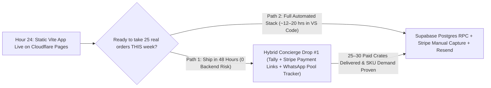

# Chapter 5: The 24-Hour Post-Antigravity Transition, £0/mo Student Stack & 30-Day Launch Roadmap

**Audience:** University of Birmingham (UoB) Student Founder (`@student.bham.ac.uk`)  
**Mission:** Lock down 100% of your codebase before your 24-hour Antigravity window closes, transition seamlessly to a **£0.00/month** student developer & cloud stack, bridge honestly from a single-browser `localStorage` prototype to real student card orders without stalling in "tech purgatory", survive Stripe UK's 7–14 day first-payout delay on a **< £200** budget, and execute Days 1–30 to deliver your first profitable campus Drop.

---

## 1. Emergency Checklist Before Your 24-Hour Antigravity Window Closes

When your Antigravity multi-agent session ends tomorrow, you must walk away with **three irreversible wins**: (1) a verified, zero-error repository backed up to your own private GitHub and offline storage, (2) a battle-tested **Airplane-Mode Pitch Laptop** ready for UoB B-Enterprising, Guild, or angel demos with zero Wi-Fi, and (3) a **£0.00/month** AI coding + cloud hosting stack linked to your `@student.bham.ac.uk` email.

### 1.1 Final-Hours Verification & Backup Runbook (Run Tonight)

Open a terminal inside your project root (`/home/hacksday/Documents/project`) and execute these exact verification and backup steps in order before closing Antigravity:

```bash
# 1. Confirm clean dependency lockfile and TypeScript project references
npm install
npm run typecheck

# 2. Run the automated unit test suite + offline asset-CDN & GBP currency QA gate
#    (Executes node scripts/run-tests.mjs AND .agents/skills/splitbox-qa-gate/scripts/verify_offline_and_build.sh)
npm run verify

# 3. Build the production static bundle into dist/ and test the compiled output locally
npm run build
npm run preview
```

**What `npm run verify` proves before you lock the repo:**
- `tsc -b && vite build` compiles cleanly with **0 TypeScript or bundler errors**.
- **Zero forbidden external asset CDNs:** All fonts (`@fontsource/space-grotesk`, `@fontsource/plus-jakarta-sans`, `@fontsource/jetbrains-mono`), vector icons (`lucide-react`), brand marks (`public/assets/splitbox-*.svg`), and QR passes (`qrcode.react` `<QRCodeSVG />`) are 100% locally bundled.
- **100% GBP (`£`) integer-pence integrity:** Every SKU in `src/data/catalog.ts` and settlement path in `src/store/dropEngine.ts` computes in integer pence (`toPence` / `fromPence`) with zero stray non-GBP currency symbols.

Next, inspect your working tree, verify no secret `.local` files are staged (`.gitignore` already excludes `node_modules`, `dist`, and `*.local`), push everything to a **private GitHub repository** owned by your personal founder account, and save an offline archive:

```bash
# 4. Inspect git status — make sure .agents/, .github/, docs/, playbook/, and src/ are tracked
git status

# 5. Stage and commit the complete codebase, AI agent guardrails, specs, and founder playbooks
git add -A
git commit -m "chore(release): lock post-antigravity SplitBox UoB MVP, specs, and founder playbook"

# 6. Push to a PRIVATE GitHub repository under your founder GitHub account
git branch -M main
git remote add origin https://github.com/<YOUR-GITHUB-USERNAME>/splitbox-uob.git
git push -u origin main

# 7. Create a timestamped offline tarball (excluding node_modules & dist) and copy to USB / OneDrive / iCloud
tar --exclude='node_modules' --exclude='dist' -czf ../splitbox-uob-complete-backup.tar.gz .
```

> [!IMPORTANT]
> **Do NOT git-ignore `.agents/`, `.github/copilot-instructions.md`, `AGENTS.md`, `CLAUDE.md`, `docs/`, or `playbook/`.** Those files encode your entire engineering architecture, integer-pence math invariants, tactile citrus-crate design tokens (`--sb-*`), and UK legal guardrails so smaller single-agent AI tools tomorrow inherit your full system context automatically.

### 1.2 The 5-Minute "Zero-Wi-Fi" Demo Rehearsal (Test Before Tomorrow Morning)

University lecture theatres, Guild basement rooms, and The Exchange often have captive-portal Wi-Fi (`eduroam` login walls) that break cloud demos mid-pitch. Because SplitBox bundles every font, SVG, and QR generator locally and persists state in `localStorage` (`splitbox_uob_drop_v1`), your laptop works with **Wi-Fi completely switched off**.

Turn **Wi-Fi OFF** on your laptop right now, run `npm run dev` (or `npm run preview`), open `http://localhost:5173`, and rehearse this 6-step sequence until it takes under 3 minutes:

1. **Clean Reset:** Open the top **Demo Controls** toolbar (`DemoControlsBar.tsx`) and click **Reset** to restore clean Wednesday seed pools across all 4 UoB hubs (`Vale · Shackleton`, `Guild · Mermaid Sq`, `Selly Oak · Bristol Rd`, `Pritchatts Park`).
2. **Select Launch Hub & Anchor SKU:** Confirm **The Vale Village — Shackleton Hub** is active. Point to **Oatly Barista Edition Oat Milk (Ambient)** (`£4.20` SplitBox slice for `3 × 1L` cartons vs `£6.60` Selly Oak Express benchmark — **Save 36%**, `£0.00` delivery fee) sitting at **`3/4` slices claimed** on the radial `<SliceMeter />`.
3. **Prove Cross-Box FCFS Allocation (`3/4 + 2`):** Add **`2` slices** of Oatly Barista and open the **SplitBox Crate** slide-over (`BasketDrawer.tsx`). Show the reviewer how **Slice 1 locks `Box #1` at `4/4` (`100%` Guaranteed)** while **Slice 2 opens `Box #2` at `1/4` (`Pooling`)**, then submit the basket hold.
4. **Simulate Campus Liquidity:** Click **Simulate Strangers** in Demo Controls to watch anonymous hallmates add `1–2` slices across open hub pools while radial SVG wedges update live.
5. **Trigger Wednesday Cutoff & Partial Auto-Release:** Click **Trigger Cutoff**. In `OrdersPickupView.tsx`, walk through the perforated **GBP Settlement Receipt** (`SettlementReceipt.tsx`) proving `Box #1` (`4/4`) was captured for Saturday pickup while `Box #2` (`<100%`) was **automatically released/refunded in full (`£`)** without cancelling the fulfilled items—followed by the offline SVG QR code, `UOB-BOX-XXX` code, **4-Digit Check-In PIN**, and **Proxy Flatmate PIN** (`PickupPassCard.tsx`).
6. **Ops, Investor & `375px` Mobile Proof:** Click into **Hub Ops** (`HubOpsView.tsx` — integer-case wholesaler manifest, QR/PIN check-in scanner, and Estates zero-cardboard compliance strip), **Investor View** (`InvestorPitchView.tsx` — unit-economics X-Ray and multi-campus scale simulator), and toggle Chrome DevTools to **`375px × 812px`** to show zero horizontal overflow and the sticky bottom `MobileBasketBar`.

### 1.3 Coding & Hosting for `£0.00/Month` Tomorrow Using `@student.bham.ac.uk`

Losing Antigravity does **not** mean paying `£100+/month` for developer tools or cloud servers. Your `@student.bham.ac.uk` email unlocks an enterprise-grade production stack for **`£0.00/month`**:

| Layer | Tool / Provider | Standard Cost | UoB Student Cost | Exact Setup & How SplitBox Uses It |
| :--- | :--- | :--- | :--- | :--- |
| **Daily AI Pair-Programmer** | **GitHub Copilot Pro** (via GitHub Student Developer Pack) | ~£8–£16/mo | **£0.00/mo** | Apply at `education.github.com/pack` with `@student.bham.ac.uk` + UoB ID photo. Install the GitHub Copilot extension in VS Code—it **automatically reads `.github/copilot-instructions.md`** on every prompt! |
| **Backup AI Editors / Web LLMs** | **Cursor (Free Tier) + Claude / ChatGPT Free Web** | £16–£20/mo | **£0.00/mo** | Cursor auto-loads `AGENTS.md`; Claude auto-loads `CLAUDE.md`. On free web chats, attach **only 1 spec from `docs/` + 1 target `.ts`/`.tsx` file** to stay inside free context limits. |
| **Custom Domain & CI/CD** | **Namecheap `.me` / Name.com + GitHub Actions** (Student Pack) | ~£12/yr | **£0.00/yr** (Yr 1) | Claim 1 free custom domain (e.g. `splitboxuob.me`) inside the Student Pack and run `npm run verify` automatically on every push via GitHub Actions. |
| **Frontend Static Hosting** | **Cloudflare Pages** (or Vercel Hobby) | £0.00/mo | **£0.00/mo** | Connect your private GitHub repo (`Build command: npm run build`, `Output: dist`). Unlimited static bandwidth; host live storefront at `splitboxuob.me` and pitch simulator at `demo.splitboxuob.me` (`VITE_DEMO_MODE=true`). |
| **Database, `.ac.uk` Auth & Edge Functions** | **Supabase Free Tier** (`eu-west-2` London) | £0.00/mo | **£0.00/mo** | UK GDPR London region, `500 MB` Postgres DB, `50,000` monthly active users (`@student.bham.ac.uk` Magic Links), `500,000` Edge Function calls/mo, and live Realtime WebSockets. |
| **UK Card, Apple Pay & Google Pay** | **Stripe UK** (Standard Pay-As-You-Go) | £0.00/mo fixed | **£0.00/mo fixed** | Zero monthly fee. Charges `1.5% + £0.20` (UK consumer cards) or `2.5% + £0.20` (international student cards) **only on captured orders**; cancelled uncaptured manual holds cost **`£0.00`**. |
| **Transactional & Auth Emails** | **Resend Free Tier** | £0.00/mo | **£0.00/mo** | `3,000` free emails/mo (`100/day`). Plug Resend SMTP into Supabase Auth (removes Supabase's built-in 2-emails/hour dev limit!) and send Thursday QR Pickup Pass receipts. |

> [!TIP]
> **Your Post-Antigravity Golden Rule in VS Code:** Whenever GitHub Copilot Pro edits a file tomorrow, run `npm run verify` before committing. That single 10-second command blocks accidental floating-point pound drift, stray non-GBP currency symbols, TypeScript regressions, and external font/image CDN leaks automatically.

---

## 2. Honest Technical Gap Analysis: Prototype (`localStorage`) vs. Real Student Orders

Before writing a single line of backend code on your own tomorrow, be ruthlessly clear as a founder about what your current codebase **already solves** versus what a browser-only `localStorage` app **physically cannot do** across 30 separate smartphones in The Vale.

### 2.1 Non-Jargon Audit: What Works Today vs. What Breaks Across Two Phones

| Business Capability | What the Current Codebase Already Does (`localStorage`) | What `localStorage` CANNOT Do Across Separate Student Phones |
| :--- | :--- | :--- |
| **Catalog, Integer-Pence Math & Brand UI** | **100% Complete.** 14 real ambient UoB SKUs in `src/data/catalog.ts` (`Oatly Barista £4.20`, `Mutti Polpa £3.30`, `Who Gives A Crap £4.80`, `Tilda Basmati £4.50`, `Shin Ramyun £3.75`, `Fairy Pods £5.90`), radial `<SliceMeter />`, `375px` mobile UI, Hub Ops manifest, and Investor simulator. | Nothing missing visually—ready to deploy to Cloudflare Pages tonight as a public interactive catalog and investor demo. |
| **Shared Campus Pool Counts (`3/4 -> 4/4`)** | `src/store/dropEngine.ts` allocates slices sequentially (`Box #1`, `Box #2`, …) and saves state inside **your own browser's** `localStorage` (`splitbox_uob_drop_v1`). | **Phone A cannot see Phone B.** If Priya in Chamberlain claims Slice `4/4` on her iPhone, Tom in Shackleton opening `splitboxuob.me` on his Android still sees `3/4` because `localStorage` never leaves Priya's phone. |
| **Real Visa / Apple Pay Charges & Pre-Auth Holds** | `src/services/productionGateway.ts` models exact integer-pence `StripeManualHoldIntentRequest` payloads (`capture_method: 'manual'`) in `local_ledger` mode. | **No real money moves.** Clicking checkout in Demo Mode does not authorise a real Monzo/Barclays debit card or Apple Pay wallet. *(Also, live UK checkout copy must say **"Card Pre-Authorisation Hold (£0.00 captured until box locks)"**, never unregulated **"escrow"**—see [Chapter 2](02-uk-legal-regulatory-and-compliance.md).)* |
| **Wednesday `23:59` Cutoff Settlement** | Clicking **Trigger Cutoff** deterministically separates `100%` locked boxes from `<100%` overflow slices in browser memory. | **No automated Thursday card capture/void.** Needs either founder-triggered Stripe Dashboard/script capture or a Supabase Edge Function calling `paymentIntents.capture()` / `cancel()`. |
| **Saturday QR + PIN Hub Check-In** | `PickupPassCard.tsx` renders an offline `<QRCodeSVG />` + 4-digit PIN + Proxy PIN, and `HubMarshallScannerCard.tsx` simulates check-in locally. | **Cross-device pass lookup.** A student's phone generates a pass on their device, so your marshal phone at the Saturday table needs a shared master order list (printed/iPad sheet for 25 orders, or synced HMAC database manifest at 50+ orders) to verify it hasn't been collected twice. |

### 2.2 Two Valid Paths to Physical Drop #1 Within 14 Days (Never Let Coding Delay Revenue!)

First-time technical founders routinely lose 6 weeks debugging edge-case database migrations before discovering which 8 products students actually buy. **Do not fall into tech purgatory.** You have two valid engineering paths—choose **Path 1** to validate real student cash in 48 hours, then graduate to **Path 2** once weekly volume passes `30+` orders:



#### Path 1 — The 48-Hour "Concierge / Hybrid" Drop #1 (Zero Backend Risk · Recommended for Drop #1)

Y Combinator and top consumer logistics founders validate their first physical drop using a **Concierge MVP**: the student sees a crisp branded storefront, pays via real Apple Pay on Stripe, and receives sealed wholesale slices on Saturday—while **you** act as the human database behind the curtain for the first 25–30 orders.

**Exact 6-Step Workflow (Set Up in One Evening, `£0.00` Tech Cost):**
1. **Deploy the Visual Catalog Tonight:** Push your repo to **Cloudflare Pages** (`splitboxuob.me`) so students can browse the real SplitBox tactile cards, unit breakdowns (`1 Slice = 3 × 1L Oatly`), and `£` savings vs Selly Oak convenience stores on their phones.
2. **Narrow to 1 Hub & 8 Fast-Locking SKUs (`2–4` Slices/Box Only):** Pick **1 single collection point** (e.g., a private student house front forecourt off Bristol Rd / Dawlish Rd in Selly Oak for zero university red tape, or an approved `Vale · Shackleton` table—see §4.1 on FBO timing!) and list **only `4`-slice or `2`-slice boxes** (`Oatly Barista 4-slice £4.20`, `Tilda Basmati 4-slice £4.50`, `Shin Ramyun 4-slice £3.75`, `Pip & Nut 1kg 4-slice £4.95`, `Fairy Non-Bio 4-slice £5.90`). Temporarily hold back `8`-slice boxes until hub volume exceeds 40 orders.
3. **Collect Real Apple Pay Orders Without Custom Backend Code:** Create a clean **Tally.so** order form (free) connected to **Stripe Checkout / Stripe Payment Links** with **Apple Pay and Google Pay enabled**, enforcing a **`£9.00` minimum crate (or `£0.39` micro-crate card-cover fee below `£9.00`)** so Stripe's fixed `£0.20` fee never erodes your ~`21%` gross margin.
   - *How to avoid Stripe refund fees in Concierge Mode:* Either configure Stripe Checkout for manual capture (capturing locked orders in the Stripe Dashboard on Thursday morning—up to 25 clicks takes 4 minutes!), **or** on a closed 25-hallmate beta with standard capture, personally underwrite topping up the final 1–2 slices on your top 5 staple SKUs (keeping 1 extra `£3.30` wholesale slice of Oatly or pasta for your own flat kitchen costs pennies and avoids every refund!).
4. **Run the Pool Ledger in a Live Google Sheet + WhatsApp Broadcast:** Every evening at `19:00` (Mon–Wed), tally your Tally/Stripe rows in a simple Google Sheet (`total_slices / 4 = locked_boxes`, `total_slices % 4 = open_box_progress`) and post a 1-line screenshot in your hall/Selly Oak WhatsApp group: *"Vale/Selly Oak Drop #1: Box #2 of Oatly is at 3/4 — 1 slice left (`£4.20`) before Wednesday 23:59 cutoff!"* That manually triggers the exact viral loop your app automates.
5. **Thursday Wholesaler Buy:** Buy **only** the integer locked cases from Booker Stirchley/Aston or Costco Nechells using your Google Sheet totals.
6. **Saturday 2-Hour Pickup (`12:00–14:00`):** Assign each student a `UOB-01`..`UOB-30` crate number + 4-digit PIN (last 4 digits of their mobile number), pre-sort their sealed sub-units into numbered paper bags inside folding Euro crates on Friday evening, and tick them off on your iPad/phone in `< 20 seconds` per student.

#### Path 2 — Going Full Live Production (`Supabase + Stripe Manual Capture + Resend` · For `30+` Orders/Week)

Once Drop #1 proves students turn up on Saturday and re-order on Sunday, wire the `stripe_supabase_live` mode already scaffolded in `src/services/productionGateway.ts` and detailed in `docs/ACTION_PLAN_24H.md` + `docs/architecture/fullstack-blueprint.md`. Here are the **4 plain-English building blocks** you will switch on with GitHub Copilot Pro:

1. **Campus-Only Passwordless Login (`Supabase Auth` + `Resend SMTP`):** Students enter their `@student.bham.ac.uk` (or `@bham.ac.uk`) email and tap a 6-digit Magic Link/OTP code. Connecting Resend's free SMTP inside Supabase Project Settings removes Supabase's 2-emails/hour sandbox cap so 150 students can log in simultaneously at Sunday `18:00` Drop launch.
2. **Anti-Double-Booking Database Lock (`PostgreSQL SELECT ... FOR UPDATE`):** If two students in Maple Bank tap *Claim Last Slice (`4/4`)* at `23:58:59` on Wednesday, naive frontend math would tell both they got Slice `4/4`. A single Postgres RPC function (`claim_sequential_slices`) locks that hub-product pool row for `< 5 milliseconds`, awards Slot `#4` (`Box #1` Locked) to the first request, awards Slot `#5` (`Box #2`, `1/4` Pooling) to the second request, enforces **1 editable weekly order per student**, and sweeps abandoned 10-minute checkouts cleanly.
3. **Stripe UK `capture_method: 'manual'` + Apple Pay & Google Pay:**
   - **Apple Pay & Google Pay are mandatory for UK student conversion:** Roughly **85–90% of UK undergraduates** pay on iPhone/Android via Apple Pay or Google Pay; forcing students to get out of bed to find a physical plastic debit card cuts mobile checkout conversion in half. Verify `splitboxuob.me` under **Stripe Dashboard → Settings → Payment Method Domains** in 2 minutes.
   - **7-Day Card Pre-Authorisation Hold (`£0.00` Unfilled Fee Bleed):** Your Edge Function creates a GBP `PaymentIntent` with `capture_method: 'manual'` (`£0.00` crate fee at `>= £9.00`; `£0.39` micro-crate card-cover fee `< £9.00`). Because your Drop opens **Sunday `18:00`** and settles **Thursday `09:00`** (**`87 hours` / `3.6 days`**), every hold sits safely inside Visa/Mastercard's **7-day (`168-hour`)** manual-capture expiry window.
4. **Thursday `09:00` Post-Wholesaler Settlement Script + Cryptographic QR Passes:**
   - Run your settlement function at **Thursday `09:00`** *right after* picking locked cases at Booker/Costco (so if the depot only had 4 cases of Mutti instead of 5, you pass a stock override *before* capturing cards!).
   - For **100% locked orders**, call `stripe.paymentIntents.capture()`. For **mixed cross-box orders** (e.g., `Box #1` locked, `Box #2` stuck at `1/4`), call `stripe.paymentIntents.capture(id, { amount_to_capture })`—Stripe charges only the fulfilled slices and releases the uncaptured remainder automatically with **`£0.00` refund processing fee** (see [Chapter 1](01-unit-economics-and-financial-model.md)). For **0-fulfilled orders**, call `stripe.paymentIntents.cancel()` (**`£0.00` Stripe fee**).
   - Finally, Resend emails each student their itemised GBP receipt and an **HMAC-SHA256 signed QR Pickup Pass** (`sb1.<uuid>.<nonce>.<sig>`) + 4-digit PIN that your `/ops/scan` Marshal PWA verifies offline via WebCrypto `SHA-256` even when mobile signal drops outside Shackleton.

---

## 3. Lean Startup Budget (`< £200` Total Cash) & The First-Time Stripe Payout Trap

You do **not** need angel investment, a leased warehouse, or a refrigerated van to launch SplitBox at UoB. Because sequential FCFS box locking guarantees you never buy unsold inventory, your non-recoverable startup outlay is **under `£60` for an ultra-lean validation drop** or **under `£200` for a fully incorporated, insured UK Limited Company launch**.

### 3.1 Line-by-Line GBP Launch Budget: Ultra-Lean Validation vs. Full Incorporated Launch

| Expense Line Item | UK Provider / Statutory Body | Ultra-Lean Validation *(Home Student Sole Trader\*, Off-Campus Selly Oak Hub)* | Full Incorporated Launch *(UK `Ltd` Company, UoB Estates Ready)* | Founder Notes & Money-Saving Rules |
| :--- | :--- | :---: | :---: | :--- |
| **Food Business Operator (FBO) Registration** | Birmingham City Council (`gov.uk/food-business-registration`) | **£0.00** | **£0.00** | **100% Free** statutory registration; submit **at least 28 days** before handing over food (see §4.1 Day-2 workaround!). |
| **Company Incorporation (`Ltd`)** | Companies House (`gov.uk` direct digital filing) | **£0.00** *(Sole Trader\*)* | **£50.00** | File directly at `gov.uk/limited-company-formation` (`£50` statutory fee since May 2024). Never pay formation websites `£100+`. |
| **ICO Data Protection Registration** | Information Commissioner's Office (`ico.org.uk`) | **£0.00 – £35.00** | **£35.00** *(£40 card / £35 DD)* | Tier 1 micro-organisation fee (`£35/yr` via Direct Debit). Mandatory under UK GDPR before storing digital student email/order records. |
| **Wholesaler Trade Membership** | Booker Stirchley/Aston (`£0`) & Costco Nechells (`£22 + VAT`) | **£0.00** *(Booker only)* | **£26.40** *(Booker + Costco Trade)* | Booker Wholesale trade card is **free**; Costco Trade Membership (`£22.00 + 20% VAT = £26.40/yr`) unlocks Kirkland & Oatly pallet pricing. |
| **Reusable Folding Crates & Bag Labels** | `5×` Ventilated `600×400mm` Food-Grade Euro Crates + A4 Sticker Sheets | **£10.00** *(Clean heavy-duty reusable totes + stickers)* | **£30.00** | Buy collapsible Euro crates online (`~£5.50` each) so 5 crates stack flat under a hall bed between Saturdays. |
| **Drop #1 Wholesaler Transport (3 Hours)** | Enterprise Car Club / Zipcar Birmingham or Hertz 24/7 (at Costco) | **£20.00** *(2-hr car share from Booker Stirchley, 1.5 mi)* | **£35.00** *(3-hr SWB Transit van + fuel)* | Check driver age rules (Enterprise Car Club U19/21+ plans or co-founder/friend driver with Class 1 business cover if using a personal car—see [Chapter 2](02-uk-legal-regulatory-and-compliance.md)). |
| **Hyper-Local Print & Hub Signage** | UoB Guild Print / local Selly Oak print shop (`100× A5` QR cards + `2× A3` laminated table signs) | **£15.00** | **£15.00** | Put your live `3/4` Oatly QR code on kitchen flyers and a bold laminated **"SPLITBOX SATURDAY PICKUP — SCAN QR PASS"** sign on the table. |
| **Public & Product Liability Insurance (`£5m`)** | Monthly pay-as-you-go policy (Superscript / Simply Business) | **£0.00 – £12.00** *(£12 strongly advised)* | **£12.00** *(Month 1)* | Monthly rolling UK online retailer/market-stall policy (`~£10–£12/mo` for `£5m` PLI); required by UoB Estates before setting up on campus. |
| **Tech Stack, Hosting, Auth, DB & Domain** | GitHub Student Pack + Cloudflare + Supabase + Resend + Stripe | **£0.00** | **£0.00** | **`£0.00/month` fixed overhead** via `@student.bham.ac.uk`. |
| **Unsold / Dead Inventory Risk** | Sequential FCFS `100%` Locked Boxes Only | **£0.00** | **£0.00** | You never purchase `<100%` boxes at the Cash & Carry. |
| **TOTAL NON-RECOVERABLE LAUNCH COST** | — | **£45.00** *(up to £92 with ICO + PLI)* | **£168.40 – £203.40** *(£168.40 ops+Ltd; £203.40 inc. annual ICO)* | Covered entirely by 3–4 weeks of UoB B-Enterprising micro-grant support or personal savings. |
| **Revolving 7-Day Cashflow Bridge Float** *(Returned 100% + Profit Every Week!)* | Personal savings / 0% overdraft / credit card float (see **§3.2** below!) | **£150.00 – £200.00** *(Temporary 7-day bridge)* | **£250.00 – £300.00** *(Temporary 7-day bridge)* | **Not a cost!** Bridges Thursday wholesaler checkout until Stripe deposits Wednesday's captured student funds into your bank. |

*\*UK Student Visa Compliance Gate: If you are an international student at UoB on a UK Student Visa (formerly Tier 4), UKVI strictly prohibits self-employment / Sole Trader trading and restricts company directorships unless operating under an endorsed university enterprise route. Read [Chapter 2](02-uk-legal-regulatory-and-compliance.md) and speak to UoB B-Enterprising BEFORE registering with HMRC or Companies House.*

### 3.2 CRITICAL CASHFLOW WARNING: The First-Time Stripe UK Payout Trap (`7–14 Days`!)

> [!WARNING]
> **Stripe Holds Your VERY FIRST Live Payout for 7–14 Calendar Days on Brand-New UK Accounts!**  
> Every first-time marketplace/e-commerce founder gets blindsided by this once. Even when you capture `£320.00` of locked student slices at **Thursday `09:00`**, Stripe **will NOT deposit that `£320.00` into your UK bank account in time for your Thursday/Friday morning Costco or Booker checkout!**
> - **On a brand-new UK Stripe account:** Your initial live payout is held for **7 to 14 days** for standard fraud/risk underwriting.
> - **Even after your account matures:** Standard UK Stripe payouts settle on **`T+3` UK business days**—meaning a Thursday `09:00` capture lands in your Monzo/Starling business bank account on **Tuesday of next week**, *four days after* you bought the wholesale cases!

If you arrive at Booker Aston or Costco Nechells on Thursday/Friday morning expecting Wednesday night's student Stripe captures to pay at the till, **your card will decline and Drop #1 will fail before it starts.**

#### Your 3-Step Protocol to Survive the Stripe Payout Lag With Zero Stress

1. **Trigger the 7–14 Day Countdown on Day 2 (`10–12 Days` Before Drop #1):**  
   The moment your UK bank account and ID are verified in Stripe, switch momentarily to Live Mode, create a `£1.00` test payment link, and **pay yourself `£1.00` using your own debit card / Apple Pay** (costing you `£0.22` in Stripe fees). Stripe's 7–14 day mandatory waiting clock starts from your **first live charge**—not from the day you opened the account! Starting that clock on Day 2 means the initial freeze expires *before* Drop #1 or Drop #2 settles.
2. **Ring-Fence a Revolving `£200–£300` "96-Hour Transit Float" (Zero Inventory Risk):**  
   Keep `£200–£300` available on a dedicated business/personal card, 0% student overdraft, or UoB B-Enterprising grant account solely to pay Costco/Booker on Thursday/Friday morning (`~£240` wholesale cost covers ~`£310` of captured student orders across 25–30 crates). Remember: **this is NOT speculative inventory spend**—every single carton in your trolley has *already* been `capture()`-settled on Stripe at Thursday `09:00`! Every Tuesday when Stripe's Faster Payments payout hits your bank, your `£240` float returns automatically **plus ~`£50–£65` in gross margin**, ready to fund next Thursday's Drop.
3. **Prevent Mid-Term Stripe Reserve Freezes:**  
   Set a clear bank statement descriptor (`SPLITBOX UOB`), publish transparent UK Consumer Contracts Regulations / pre-auth terms + support email on `splitboxuob.me`, and always use `capture_method: 'manual'` (`cancel()` for unfilled boxes) so angry cardholder chargebacks stay at `0.0%`.

---

## 4. The Complete 30-Day Launch Roadmap & Weekly KPI Kill/Scale Gates

Execute this exact 30-day calendar starting the hour your Antigravity session ends. Notice how it solves the **28-day statutory Food Business Operator (FBO) notice rule** cleanly without forcing you to sit idle for a month!

### 4.1 Week 1 (Days 1–7): Post-Antigravity Lockdown, Legal Gates, Cash & Carry Recon & Hub #1

- **Day 1 (Today — Final Hours on Antigravity):**
  - Run `npm run verify` and `npm run build`, push everything to your private GitHub repo, save `splitbox-uob-complete-backup.tar.gz`, and rehearse the 5-minute Airplane-Mode Demo.
  - Apply for the **GitHub Student Developer Pack** (`@student.bham.ac.uk`), enable **GitHub Copilot Pro** in VS Code, and deploy `dist/` to **Cloudflare Pages** (`£0.00`).
- **Day 2 (Statutory Registrations — Free FBO Clock Starts Today):**
  - *(Home students / permitted founders; international students check Student Visa rules first—[Chapter 2](02-uk-legal-regulatory-and-compliance.md).)*
  - Submit your **free Birmingham City Council Food Business Operator (FBO) registration** at `gov.uk/food-business-registration`. Describe operations accurately: *"Online pre-ordered case-splitting of 100% ambient, factory-sealed, UK FIR-labelled groceries with weekly 2-hour pop-up collection; zero cold-chain or open-food handling."*
  - **How to Handle the 28-Day FBO Notice Rule Without Losing Momentum:** Assimilated Regulation (EC) 852/2004 states FBO registration should be submitted **at least 28 days before** commencing food operations. You have **two 100% legal options** for Week 2:
    1. **Email Birmingham City Council EHO** with your registration reference asking if they are happy for your zero-risk sealed ambient pop-up to commence earlier; **OR**
    2. **Run Week 2 & Week 3 as "Dorm & House Essentials Drops" using 100% NON-FOOD Household SKUs** (`Who Gives A Crap 48-Roll Bamboo Tissue`, `Fairy Non-Bio 4×28 Laundry Tubs`, `Finish Ultimate 6×34 Dishwasher Pouches`, `Kitchen Roll`, `Refuse Sacks`—**non-food household goods do not require FBO food registration!**). That lets you test real student Apple Pay checkouts, van runs, Euro crates, and Saturday QR check-ins with paying UoB students on **Day 14**, then unlock the full **Food + Drinks Grocery Catalog (`Oatly`, `Mutti`, `Tilda`, `Shin Ramyun`) on Day 30** the instant Day 28 clears!
- **Day 3 (Stripe `£1` Warmup & ICO Registration):**
  - Open your **Stripe UK** account, enable **Apple Pay** and **Google Pay**, and run your **`£1.00` live warmup charge** immediately so the 7–14 day first-payout hold starts ticking down today.
  - Register online with the **ICO** (`£35/yr` Direct Debit) before collecting real student emails/orders.
- **Day 4 (Birmingham Wholesaler Recon & 60-Second UK FIR Inner-Pack Audit):**
  - Visit **Booker Wholesale (Stirchley or Aston `B6 5RQ`, free trade card)** and/or **Costco Wholesale Birmingham (Heartlands Parkway, Nechells `B7 5PA`, `£26.40` inc-VAT Trade card)**—plus **Bestway / Dhamecha** for `Shin Ramyun` and `2kg` rice multipacks ([Chapter 3](03-wholesale-supply-chain-and-drop-ops.md)).
  - **Physically inspect the inner sub-units inside every outer case:** Confirm every single **Slice sub-unit** carries factory-printed English ingredients, **bolded 14 UK FIR allergens**, net weight, Best Before date, Lot code, and UK address (reject any catering inner pack marked *"Not for individual resale"* lacking standalone allergen info).
  - Photograph shelf price tags noting **ex-VAT vs inc-VAT (`0%` food vs `20%` household/drinks/confectionery)** so you never price a `20%`-VAT item off its ex-VAT tag ([Chapter 1](01-unit-economics-and-financial-model.md)).
- **Day 5 (Selly Oak ASA Price-Comparison Evidence Folder):**
  - Walk Bristol Road, Selly Oak (`B29`) into **Sainsbury's Local (`584 Bristol Rd`)** and **Tesco Express (`526 Bristol Rd`)**. Take dated photos of shelf-edge prices for exact matching weights/brands and store them in a local `compliance-audit/` folder to satisfy **ASA CAP Code Rule 3.33** before publishing *"Save 36–41% vs Selly Oak Express"* badges.
- **Day 6 (Lock Permissionless Hub #1 + File UoB Estates & B-Enterprising Packs):**
  - Secure a **zero-delay Week 2 Launch Hub** in Selly Oak (a trusted student house front forecourt off Dawlish Rd / Tiverton Rd / Bristol Rd or partner independent café patio—zero university committee wait!).
  - Simultaneously submit your **Estates RAMS & Compliance Proposal** for **`Vale · Shackleton`** and book a **UoB Elevate / B-Enterprising** startup advisor meeting (`£500–£2,500` equity-free enterprise grant application—[Chapter 4](04-uob-campus-gtm-estates-and-pitching.md)).
- **Day 7 (Curate Tight Launch Menu & Seed 30 Founding Students):**
  - Configure **1 active hub only** (keeping the other 3 UoB hubs on `"Vote Next Hub"` waitlist capture) and trim your active Drop #1 menu to **8 fast-filling SKUs capped at `2–4` slices per box**.
  - Invite 30 flatmates, society mates, and neighbours into your **"SplitBox UoB Founding Drop"** WhatsApp community ahead of Sunday `18:00` launch.

### 4.2 Week 2 (Days 8–14): Drop #1 Closed Beta (`25–30` Orders, `1` Hub, Real GBP Validation)

- **Days 8–9 (Sun `18:00` – Mon): Open the Pool.** Launch the weekly Drop at Sunday `18:00` (using Path 1 Concierge Checkout or Path 2 Live Supabase/Stripe). Seed the first 5 orders from your closest flatmates within 30 minutes so new visitors immediately see `1/4` and `2/4` active radial `<SliceMeter />` momentum.
- **Days 10–11 (Tue – Wed `23:59`): Drive the `3/4` Viral Loop & Close Cutoff.** On Wednesday at `18:00` (6 hours before cutoff), post live screenshots of every box sitting at `3/4` (*"1 slice left to lock Box #3 before 23:59!"*). Close orders strictly at Wednesday `23:59` and freeze sequential FCFS allocations.
- **Day 12 (Thu `06:30–10:00`): Wholesaler Pick & Card Settlement.** Export your integer `lockedBoxes` shopping list, buy **only** `100%` locked cases at Booker/Costco using your `£200–£300` transit float, log supplier receipt + FIR Lot codes, execute Thursday `09:00` Stripe capture / partial-capture / void settlement, and dispatch QR + 4-digit PIN Pickup Passes.
- **Day 13 (Fri Evening, `45 mins`): Zero-Cardboard Pre-Sort.** At home, unbox outer transit cardboard (recycle it off-campus!), pack each student's sealed slices into paper bags labelled `UOB-BOX-XXX` inside folding `600×400mm` Euro crates, charge your phone + power bank, and verify your offline manifest works in Airplane Mode.
- **Day 14 (Sat `12:00–14:00`): Execute the 2-Hour Hub Drop.** Set up 15 minutes early (`11:45`) with 1 flatmate helper (`£0` wage cost). Check in each student via QR or 4-digit PIN / Proxy PIN in **`< 25 seconds`**, pack down empty folding crates by `14:30` (after the strict 30-minute grace window), photograph the spotless forecourt for your UoB Estates deck, and post a Saturday `17:00` group thank-you + Sunday Drop #2 preview.

### 4.3 Week 3 (Days 15–21): SKU Margin Tuning, Payout Check & Live Stack Cutover

- **Days 15–16 (Monday Unit-Economics Post-Mortem):** Reconcile every penny from Week 2—wholesale inc-VAT receipts vs captured Stripe GBP revenue minus UK (`1.5% + £0.20`) and international student (`2.5% + £0.20`) card fees and transport cost. Replace any SKU that failed to hit `100%` lock or move it from `6` slices down to `4` slices. Confirm your Day-3 Stripe `£1` warmup unlocked standard `T+3` UK bank payouts!
- **Days 17–19 (Graduate From Path 1 to Path 2 Automated Stack):** If you ran Week 2 on Path 1 (Concierge), spend 3 focused evenings in VS Code with free **GitHub Copilot Pro** implementing the Supabase London (`eu-west-2`) `claim_sequential_slices` RPC, `@student.bham.ac.uk` Magic Links, and Stripe `capture_method: 'manual'` checkout from `docs/ACTION_PLAN_24H.md` now that real demand is proven.
- **Days 20–21 (Drop #2 Execution — Target `45–60` Orders at Hub #1):** Double volume at your **same single hub** (do *not* split liquidity across 2 hubs yet!) by prompting every Week-2 buyer who claimed a `3/4` box to share the pool link into their flat or society WhatsApp group.

### 4.4 Week 4 (Days 22–30): Full FBO Grocery Launch, First Hub Marshal & UoB Estates / Grant Pitch

- **Days 22–25 (Hire Marshal #1 & Lock Replenishment Staples):** Recruit 1 reliable UoB student Hub Marshal at **`£13.00/hr`** (above UK National Living Wage) + a free `£15` grocery crate for a 2.5-hour Saturday shift (`~£32.50` cash cost), freeing you to oversee quality, supplier deals, and walk-up student signups ([Chapter 3](03-wholesale-supply-chain-and-drop-ops.md)).
- **Days 26–28 (Pitch UoB Elevate / B-Enterprising & Accommodation Estates With Hard Proof):** Walk into your B-Enterprising grant review and UoB Estates meeting showing (a) your live offline-ready SplitBox app, (b) `£5m` Public Liability certificate + Day-2 BCC FBO registration, (c) photos of 2 spotless zero-cardboard Saturday drops, and (d) `100+` `@student.bham.ac.uk` `"Vote Next Hub"` signups requesting **`Vale · Shackleton`**.
- **Days 29–30 (28-Day FBO Window Complete -> Full Ambient Grocery + Household Drop #3/#4):** With your 28-day Birmingham City Council FBO notice period complete, unlock the full **12–14 SKU Ambient Grocery + Household catalog** (`Oatly Barista`, `Mutti Polpa`, `Tilda Basmati`, `Shin Ramyun`, `Pip & Nut`, `Jimmy's Iced Coffee`, `Bamboo Tissue`, `Fairy Pods`), target **`75–100` weekly orders**, send your first **Challenger Brand Sampling Sponsorship email** (`£200–£500` per Freshers/Exam crate drop—[Chapter 3](03-wholesale-supply-chain-and-drop-ops.md)), and prepare to flip Hub #2 (`Vale · Shackleton` or `Selly Oak · Bristol Rd`) from `coming_soon` to `active` **only** once every KPI gate below turns green!

---

## 5. Weekly North Star KPIs Scorecard & Automated Pivot Triggers

Track these **5 numbers every Sunday at `11:00`** before opening the next Drop at `18:00`. Never expand SKUs or open a second campus hub while any core metric sits in the Red zone:

| Weekly North Star KPI | Exact Calculation | Green (Scale Gate) | Amber (Tune This Week) | Red (Immediate Pivot Trigger & Exact Fix) |
| :--- | :--- | :---: | :---: | :--- |
| **1. Box Lock Rate** | `(Slices in 100% Full Boxes at Cutoff) ÷ (Total Pre-Auth Slices Claimed)` | **`>= 80%`** | `70% – 79%` | **`< 70%` — Liquidity is diluted!** Cut active catalog down to 8 hero staples, cap `totalSlicesPerBox` at `2–4` (pause `6` and `8`-slice boxes), and freeze all new hub launches until Hub #1 stays `>= 85%` for 2 straight weeks. |
| **2. Net Contribution Margin** | `(Captured GBP Revenue − Inc-VAT Wholesale Cost − Stripe Fees − Van/Marshal Cost) ÷ Captured GBP Revenue` | **`>= 12%`** *(on ~21–23% gross spread)* | `9% – 11.9%` | **`< 9%` — Margin leak!** Audit 3 culprits immediately: (a) pricing `20%`-VAT household/drink SKUs off ex-VAT Cash & Carry tags, (b) `< £9.00` micro-baskets or `2.5% + £0.20` international student cards without the `£0.39` micro-crate cover fee, or (c) `£35` van hire spread over `< 25` crates (use closer Booker Stirchley car share until `35+` orders). |
| **3. Saturday Hub Collection Rate** | `(Crates Collected Within 2h Window + 30m Grace) ÷ (Fulfilled Crates)` | **`>= 95%`** | `90% – 94.9%` | **`< 90%` — No-show friction!** Trigger automated Saturday `10:30` SMS/WhatsApp + email alerts (`90 mins` prior) prominently displaying the **4-Digit Flatmate Proxy PIN** (`"Stuck in bed or library? Text this 4-digit PIN to any flatmate walking past!"`), and enforce your transparent CCR-compliant uncollected restocking policy ([Chapter 2](02-uk-legal-regulatory-and-compliance.md)). |
| **4. Week-over-Week Repeat Buyer Rate** | `(% of Drop N Fulfilled Buyers Ordering Again in Drop N+1 or N+2)` | **`>= 45%`** | `30% – 44.9%` | **`< 30%` — Pantry over-stocking!** `6-roll` loo tissue and `2kg` rice take 3 weeks to finish, whereas `3L` Oatly, iced coffee, ramen, and snacks run out every 7 days. Weight 60% of hero top-row slots toward **weekly-depleting consumables** (`Oatly Barista`, `Jimmy's`, `Clementines`, `Shin Ramyun`, `TREK`) and send a Sunday `18:00` 1-tap re-order WhatsApp link. |
| **5. Saturday Check-In Speed** | `Median Seconds from Student Arrival to Bag Handover` | **`< 25 sec`** | `25 – 45 sec` | **`> 45 sec` — Table bottleneck!** Stop picking individual cartons out of wholesale trays during Saturday rush. Pre-pack complete student orders into `UOB-BOX-XXX` paper bags inside sequential Euro crates on Friday evening and keep offline 4-digit PIN lookup ready alongside camera QR scan. |

---

### Related Playbook Modules
- **Unit Economics, `0%` vs `20%` UK VAT & Stripe Fee Math:** [playbook/01-unit-economics-and-financial-model.md](01-unit-economics-and-financial-model.md)
- **Companies House, UK Student Visa Rules, FBO, UK FIR 2014, FCA Pre-Auth & Insurance:** [playbook/02-uk-legal-regulatory-and-compliance.md](02-uk-legal-regulatory-and-compliance.md)
- **Birmingham Wholesalers (Costco, Booker, Bestway), Brand Sponsorships & Saturday Hub SOP:** [playbook/03-wholesale-supply-chain-and-drop-ops.md](03-wholesale-supply-chain-and-drop-ops.md)
- **UoB Zero-CAC Growth, Selly Oak vs. Estates RAMS, Summer Survival & SEIS/Grant Funding:** [playbook/04-uob-campus-gtm-estates-and-pitching.md](04-uob-campus-gtm-estates-and-pitching.md)
